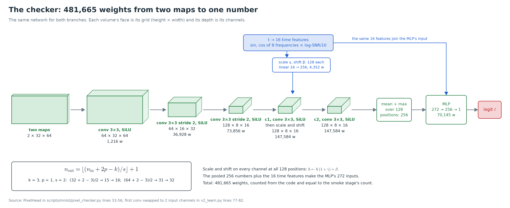
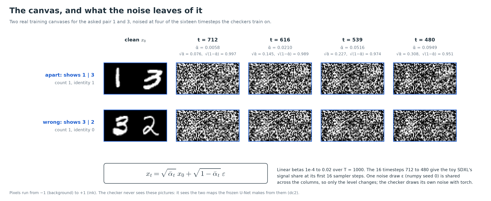
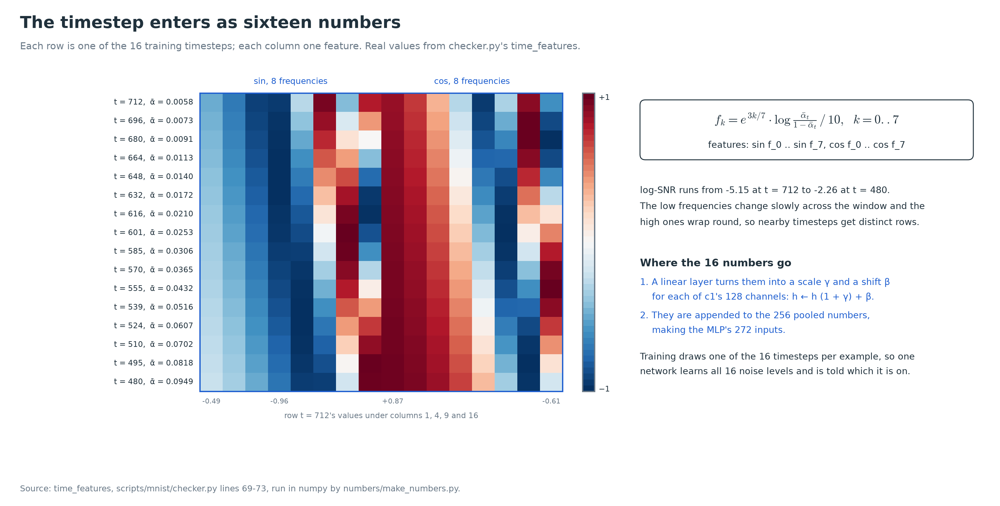
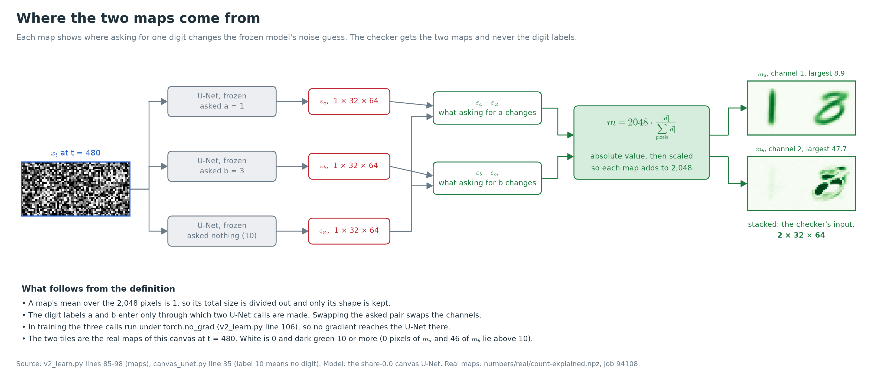
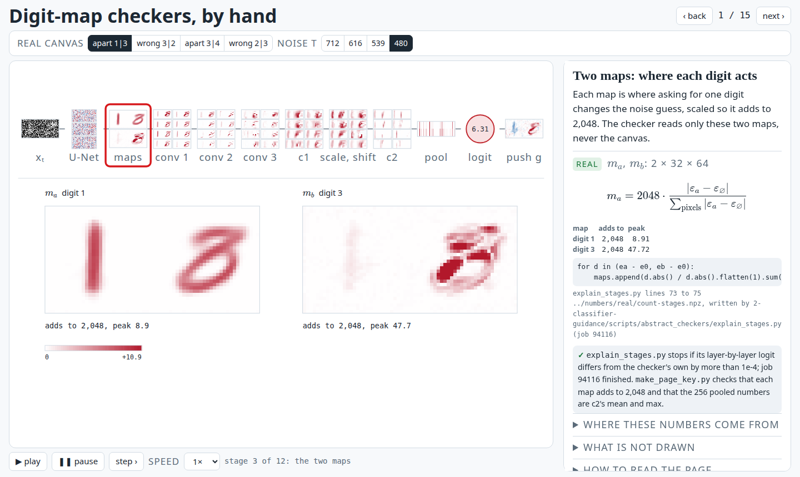
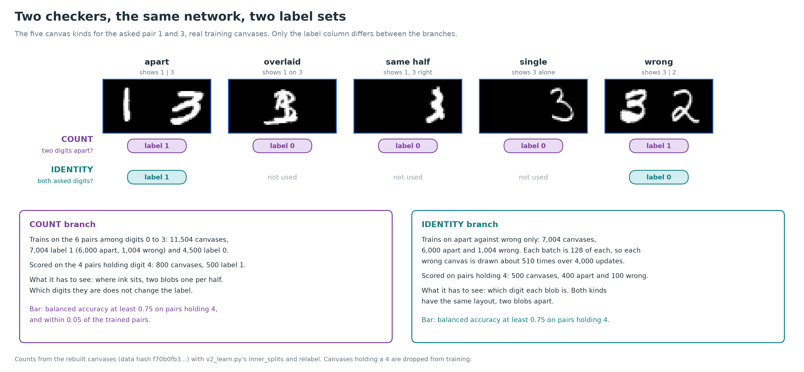
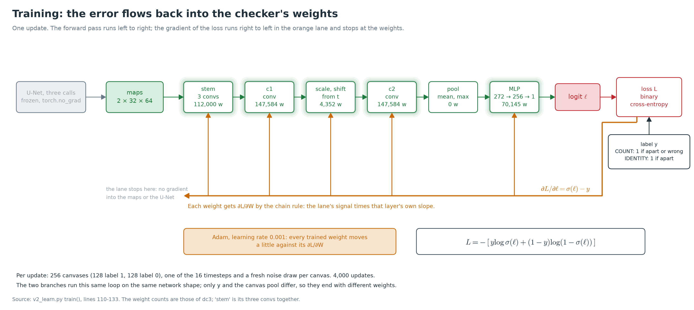
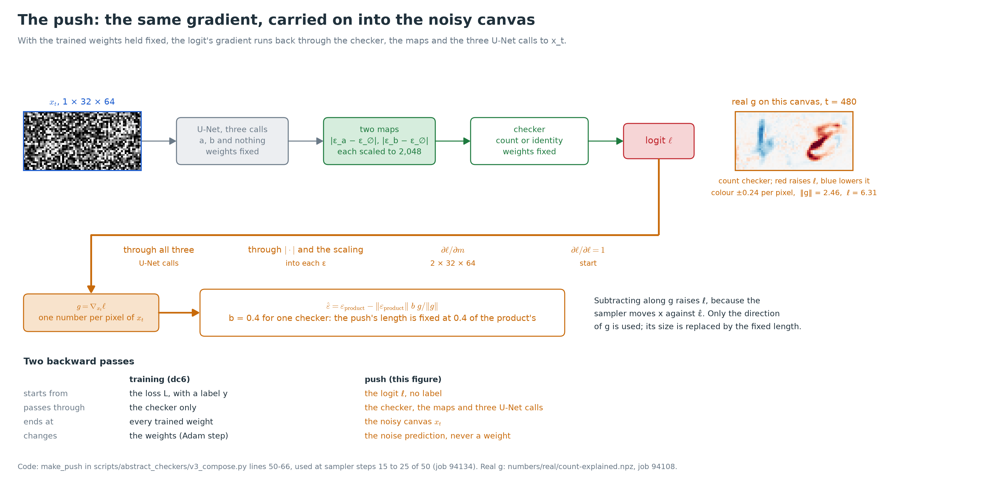

# 🌍 Context: the digit-map checkers, the network view

⬅️ Previous: [one sampler step](01-overview.md) | 📋 [The pages of this method](01-overview.md#the-pages-of-this-method) | Next: [the miniature](03-the-miniature.md) ➡️

This page opens the checker from the noisy canvas to its one logit, then follows the two backward passes that use it: training, which ends at the checker's weights, and the push, which runs on to the canvas. The canvas, the noise, the maps, the network and the timestep are the same for both checkers; they differ only in their labels and so in their trained weights. Every size and count comes from the ladder's numbers file, and the figures are [the ladder's network view](../../../2-classifier-guidance/artifacts/scenes/digit-map-checkers/0.5-network-view/README.md). What the product of experts is stays on [the product-of-experts overview](../01-the-product-of-experts/01-overview.md).

*The checker, left to right. Each volume's face is its grid (height × width) and its depth is its channels. Two maps of 2 × 32 × 64 go through a 3 × 3 convolution (64 × 32 × 64, 1,216 weights), two stride-2 convolutions (64 × 16 × 32, 36,928 weights; 128 × 8 × 16, 73,856 weights), c1 (147,584 weights) followed by a scale and shift made from the timestep, and c2 (147,584 weights). A mean and a max over the 128 positions give 256 numbers; with the 16 time features (blue, top) that is 272 inputs to an MLP of 70,145 weights ending in one logit ℓ (red). The box at the lower left works the output-size rule for the stride-2 layers: 32 → 16 and 64 → 32.* ✅ *Read on the figure at full size; every count matches the ladder's numbers file.*

## Table of contents

- [Words this page uses](#words-this-page-uses)
- [The canvas and its noise](#the-canvas-and-its-noise)
- [The two maps](#the-two-maps)
- [The network, layer by layer](#the-network-layer-by-layer)
- [Two checkers, two label sets](#two-checkers-two-label-sets)
- [The two backward passes](#the-two-backward-passes)
- [Where this came from](#where-this-came-from)
- [Read more](#read-more)

## Words this page uses

Navigation: 📋 [TOC](#table-of-contents) | [Next](#the-canvas-and-its-noise) ➡️

**Timestep t**: how noisy the canvas is, counted from 999 (all noise) down to 0 (clean). The checkers train at 16 of them, 712 down to 480.

**Signal share ᾱ_t**: the share of the clean canvas's variance left at t, from 0 (all noise) to 1 (clean): 0.0058 at t = 712 and 0.0949 at t = 480.

**Channel**: one layer of a volume, one number per grid cell. The two maps are 2 channels; c1's output is 128.

**Kernel**: the small grid of weights a convolution slides over its input, here 3 × 3.

**SiLU**: the bend after each convolution, SiLU(z) = z · σ(z), which keeps large positive values and pulls negative ones toward 0.

## The canvas and its noise

Navigation: ⬅️ [Words this page uses](#words-this-page-uses) | 📋 [TOC](#table-of-contents) | [Next](#the-two-maps) ➡️

**At the 16 timesteps the checkers train on, the digits cannot be seen by eye: the clean canvas is weighted 0.076 to 0.308 and the noise 0.997 to 0.951.** ✅

<table><tr>
<td> The canvas, clean and at four timesteps</td>
<td> The timestep as sixteen numbers</td>
</tr></table>

*Left: two real training canvases for the asked pair 1 and 3. Top row, `apart` (1 | 3): count label 1, identity label 1. Bottom row, `wrong` (3 | 2): count 1, identity 0. Columns: clean, then t = 712, 616, 539 and 480, with ᾱ 0.0058, 0.0210, 0.0516 and 0.0949 above each. One noise draw (numpy seed 0) is shared across the columns, so only the level changes; the checker draws its own noise in training.* ✅ *Right: the 16 time features at each training timestep, one row per t, sines in the left 8 columns and cosines in the right 8, blue −1 to red +1. The row for t = 712 reads −0.49, −0.96, +0.87 and −0.61 under columns 1, 4, 9 and 16.* ✅ *The noise draw is illustrative; the canvases, the levels and the features are real.* ✍️ *(the ladder's card)*

$$
\textcolor{#1f5fd0}{\underbrace{x_t}_{\text{the noisy canvas}}}
= \underbrace{\sqrt{\bar\alpha_t}}_{\text{weight on the picture}}\;\textcolor{#1f5fd0}{\underbrace{x_0}_{\text{the clean canvas}}}
+ \underbrace{\sqrt{1-\bar\alpha_t}}_{\text{weight on the noise}}\;\underbrace{\varepsilon}_{\text{standard normal noise}}
$$

On the miniature's first pixel (clean −1, noise draw 0.5) this gives 0.308 × (−1) + 0.951 × 0.5 = 0.168 at t = 480. Move to t = 712 and the picture's weight falls to 0.076, so the same pixel reads 0.076 × (−1) + 0.997 × 0.5 = 0.422: the background pixel now looks brighter than at t = 480, because the noise owns almost all of it. ✅ The weights are the ladder's numbers file; the pixel and its draw are the miniature's.

🔤 **The name:** time features
- **time**: here the timestep t, which says how noisy the canvas is.
- **features**: numbers a network reads as part of its input. On the right picture, one row of 16 coloured cells.
- **Formula, in those words:** take the log of signal over noise, log(ᾱ_t / (1 − ᾱ_t)), divide by 10, multiply by 8 frequencies from 1 to 20.09 (e^(3k/7) for k = 0 to 7), and take the sine and cosine of each: f_k = e^(3k/7) · log(ᾱ_t / (1 − ᾱ_t)) / 10, features sin f₀ … sin f₇, cos f₀ … cos f₇.
- **Consequence:** log signal over noise runs from −5.15 at t = 712 to −2.26 at t = 480. The slow first frequency moves sin f₀ only from −0.49 to −0.22 across the window, while the fast ones wrap round, so neighbouring timesteps still get rows that differ. ✅ The ladder's numbers file. One network learns all 16 noise levels and is told which it is on.

## The two maps

Navigation: ⬅️ [The canvas and its noise](#the-canvas-and-its-noise) | 📋 [TOC](#table-of-contents) | [Next](#the-network-layer-by-layer) ➡️

**The checker never sees the canvas: it sees two maps of where asking the frozen U-Net for each digit changes its noise guess, each scaled to add to 2,048.** ✅

<table><tr>
<td> Where the two maps come from</td>
<td> The real maps, from the saved count checker's run</td>
</tr></table>

*Left: the ladder's diagram. The noisy canvas at t = 480 goes through the frozen U-Net asked for a = 1, b = 3 and nothing (label 10), giving three noise guesses of 1 × 32 × 64; the two differences from the no-digit guess are what asking for each digit changes; the green box takes their absolute value and scales each to add to 2,048; stacked, they are the checker's 2 × 32 × 64 input. The map tiles were left as empty slots, marked "real map owed (GPU)".* ✅ *Right: those maps as later computed, on the [miniature page](https://claude.ai/artifact/MX2hKBUWBXSzPQSbaxysKC#real-system)'s first frame (apart 1 | 3, t = 480). The map for digit 1 lights up the 1 and also the 3, adds to 2,048 and peaks at 8.9; the map for digit 3 lights up the 3 only and peaks at 47.7. The row above runs through every stage to a logit of 6.31.* ✅ *Read on the still and checked in `count-stages.npz` (sums 2,048.0 and 2,048.0, peaks 8.906 and 47.719, logit 6.308), job 94116.*

$$
\textcolor{#1d7a3e}{\underbrace{m_a}_{\text{map for digit } a}}
= \underbrace{2048}_{\text{pixels}} \cdot
\frac{\lvert \textcolor{#c0262d}{\varepsilon_a} - \textcolor{#c0262d}{\varepsilon_\varnothing} \rvert}{\underbrace{\sum_{\text{pixels}} \lvert \textcolor{#c0262d}{\varepsilon_a} - \textcolor{#c0262d}{\varepsilon_\varnothing} \rvert}_{\text{the total, divided out}}}
$$

Worked on the miniature, which scales to 4 for its 4 pixels: asking for digit 1 on the apart canvas changes the guess by (−0.062, −0.259, −0.082, −0.033), total size 0.436, so m_a = 4 × (0.062, 0.259, 0.082, 0.033) / 0.436 = (0.57, 2.37, 0.75, 0.31). It is largest on pixel 2, where a "1" has ink. ✅ The miniature's answer key.

| Move | m_a after it | What it shows |
|---|---|---|
| none | (0.57, 2.37, 0.75, 0.31) | the map as the checker reads it |
| double every difference | (0.57, 2.37, 0.75, 0.31), unchanged | the total is divided out, so how strongly the model reacted is lost and only the shape is kept |
| double pixel 2's difference alone | (0.36, 2.98, 0.47, 0.19) | that pixel rises and every other falls, because the total grew |
| swap the asked pair (ask 3, then 1) | the two channels swap | the digit labels enter only through which calls are made |

✅ The two moved maps computed this session from the key's differences; the swap read in `maps` in `v2_learn.py`.

> [!NOTE]
> A map is where the model reacts to a digit, which is not always where that digit sits. On the real apart canvas the map for 1 keeps only 32% of its mass in the left half, where the 1 is, while the map for 3 keeps 93% in the right half. ✅ Computed from `count-stages.npz`.

## The network, layer by layer

Navigation: ⬅️ [The two maps](#the-two-maps) | 📋 [TOC](#table-of-contents) | [Next](#two-checkers-two-label-sets) ➡️

**Three convolutions shrink the 2 × 32 × 64 maps to 128 × 8 × 16, the timestep scales and shifts each channel after c1, and a mean and a max over positions feed a small MLP that gives one logit.** ✅

| Layer | Output shape | Weights |
|---|---|---|
| stem conv 1, 3 × 3, then SiLU | 64 × 32 × 64 | 1,216 |
| stem conv 2, 3 × 3 stride 2, then SiLU | 64 × 16 × 32 | 36,928 |
| stem conv 3, 3 × 3 stride 2, then SiLU | 128 × 8 × 16 | 73,856 |
| c1, 3 × 3, then SiLU | 128 × 8 × 16 | 147,584 |
| film: 16 time features → a scale γ and a shift β of 128 each | 256 | 4,352 |
| h ← h (1 + γ) + β | 128 × 8 × 16 | 0 |
| c2, 3 × 3, then SiLU | 128 × 8 × 16 | 147,584 |
| mean and max over the 128 positions, plus the 16 time features | 272 | 0 |
| MLP: 272 → 256, SiLU, 256 → 1 | 1 | 70,145 |
| total | | 481,665 |

✅ The ladder's numbers file, added up again this session. The map reader never gets the asked pair; the raw-canvas reader it is compared with in the findings keeps one input channel and is told the pair through a learned embedding. ✅ `make_head` in `v2_learn.py`.

🔤 **The name:** stride-2 convolution
- **convolution**: rolling one small pattern over a grid and writing down how well each spot matches it. On the picture, each arrow between two green volumes: a 3 × 3 kernel per output channel, slid over every cell.
- **stride**: the length of each step. Stride 2 jumps two cells at a time, so it writes half as many cells across and half as many down.
- **Formula, in those words:** n_out = ⌊(n_in + 2p − k) / s⌋ + 1, with kernel k = 3, padding p = 1 and stride s = 2: ⌊(32 + 2 − 3) / 2⌋ + 1 = 16 down the height, ⌊(64 + 2 − 3) / 2⌋ + 1 = 32 across.
- **Consequence:** at stride 1 the same layer would keep 32 × 64. Two stride-2 layers take the grid from 32 × 64 to 8 × 16, so each of c1's 128 positions summarises a patch of the canvas, and the checker can compare the two halves at that coarse scale. ✅ The figure's box at the lower left.

🔤 **The name:** scale and shift (FiLM)
- **scale**: multiply. **shift**: add. **FiLM** is the name the literature gives this, feature-wise linear modulation: each channel ("feature-wise") gets its own multiply and add ("linear modulation").
- **On the picture:** the blue box above c1, a linear layer from the 16 time features to 128 scales γ and 128 shifts β.
- **Formula, in those words:** h ← h (1 + γ) + β. With γ = 0 and β = 0 the layer passes h through unchanged.
- **Consequence:** in the miniature at t = 480 the first channel's value on the left half is 0.280 after its SiLU, and γ = 0.053, β = 0.098 make it 0.280 × 1.053 + 0.098 = 0.392. Switch the scale and shift off and it stays 0.280. ✅ The miniature's answer key. The same timestep therefore changes how much each channel counts, which is how one network handles 16 noise levels.

🔤 **The name:** mean and max pooling
- **pooling**: putting many things into one shared pool. Here, 128 positions per channel become 2 numbers.
- **mean**: the average over positions. **max**: the largest value.
- **Formula, in those words:** for each of 128 channels, the mean of its 8 × 16 grid and the max of it: 128 + 128 = 256 numbers, whatever the grid size.
- **Consequence:** in the miniature, channel 1 reads 0.392 on the left half and −0.137 on the right; its mean is 0.128 and its max 0.392. The mean says how much of the channel is on overall and the max says whether it is strongly on anywhere, which a blob in one half shows. ✅ The miniature's answer key.

## Two checkers, two label sets

Navigation: ⬅️ [The network, layer by layer](#the-network-layer-by-layer) | 📋 [TOC](#table-of-contents) | [Next](#the-two-backward-passes) ➡️

**The two checkers are the same network trained on different labels: count calls `apart` and `wrong` both yes, and identity sees only those two kinds and calls `wrong` no.** ✅

*Five real training canvases for the asked pair 1 and 3: `apart` (1 | 3), `overlaid` (1 on 3), `same_half` (1 and 3 in the right half), `single` (3 alone) and `wrong` (3 | 2). Purple row, count labels: 1, 0, 0, 0, 1. Teal row, identity labels: 1, not used, not used, not used, 0. The two boxes give each branch's counts.* ✅

| Branch | Trains on, pairs among digits 0 to 3 | Scored on, pairs holding digit 4 | What it has to see |
|---|---|---|---|
| count | 11,504 canvases: 7,004 label 1 (6,000 `apart`, 1,004 `wrong`) and 4,500 label 0 | 800 canvases, 500 label 1 | where ink sits: two blobs, one per half |
| identity | 7,004 canvases: 6,000 `apart` and 1,004 `wrong` | 500 canvases, 400 `apart` and 100 `wrong` | which digit each blob is, since both kinds have the same layout |

✅ The ladder's numbers file, counted with `v2_learn.py`'s `inner_splits` and `relabel`. Every batch is half label 1, so each identity `wrong` canvas is drawn about 510 times over 4,000 updates. The saved count checker the push used was later retrained on all 10 pairs among digits 0 to 4 and scored on digits 5 to 9. ✍️ [The learning finding, section 4](../../../2-classifier-guidance/report/abstract-checkers-on-digits/does-a-checker-learn-plurality-on-unseen-digits.md#4-the-count-checker-on-digits-5-to-9).

## The two backward passes

Navigation: ⬅️ [Two checkers, two label sets](#two-checkers-two-label-sets) | 📋 [TOC](#table-of-contents) | [Next](#where-this-came-from) ➡️

**Training sends the loss's slope back into the checker's weights and stops at the maps; the push sends the logit's slope back through the maps and all three U-Net calls to the noisy canvas, and changes no weight.** ✅

<table><tr>
<td> Training: into the weights</td>
<td> The push: on into the canvas</td>
</tr></table>

*Left: one training update. The orange lane starts at the loss with ∂L/∂ℓ = σ(ℓ) − y and sends a slope up into the stem (112,000 weights), c1, the scale and shift, c2 and the MLP; the pool has no weights; the lane stops before the maps, which were computed with gradients off. Adam at learning rate 0.001 moves each weight against its slope, on 256 canvases per update (128 label 1), 4,000 updates.* ✅ *Right: the push. With the weights fixed, the lane starts at the logit (∂ℓ/∂ℓ = 1), passes ∂ℓ/∂m (2 × 32 × 64), the absolute value and the scaling, and all three U-Net calls, and ends at g = ∇_{x_t}ℓ, one number per pixel. The figure's footer says no pushed run exists and real g is owed; both have since been produced (the [overview](01-overview.md#where-the-sources-disagree) lists this).* ✅

| | Training | Push |
|---|---|---|
| starts from | the loss L, with a label y | the logit ℓ, no label |
| passes through | the checker only | the checker, the maps and three U-Net calls |
| ends at | every trained weight | the noisy canvas x_t |
| changes | the weights, by an Adam step | the noise prediction, never a weight |

✅ Read on the right figure's table. How the slope through the map's scaling works, and why it carries a term for every pixel, is worked on [the miniature page](03-the-miniature.md#the-push-on-four-pixels).

## Where this came from

Navigation: ⬅️ [The two backward passes](#the-two-backward-passes) | 📋 [TOC](#table-of-contents) | [Next](#read-more) ➡️

| What | How it was established | When |
|---|---|---|
| Every shape, weight count, schedule value and branch count | Read in the ladder's `numbers/numbers.json`; the weights added up again | 2026-11-24 |
| The labels on each figure | Read on each figure at full size | 2026-11-24 |
| The real maps' sums, peaks and half shares, and the logit 6.308 | Computed from the ladder's `numbers/real/count-stages.npz` (job 94116) with numpy; matches the still | 2026-11-24 |
| The miniature's map, scale-and-shift and pooling values, and the two moved maps | Read in `miniature_answer_key.json`; the moved maps computed from its differences | 2026-11-24 |
| The map reader is never told the pair; the raw reader is | Read in `make_head` and `maps`, `v2_learn.py` lines 77 to 98 | 2026-11-24 |
| The display noise is illustrative | Stated by the ladder's card and `numbers.json`'s `examples_note` | 2026-11-24 |

## Read more

Navigation: ⬅️ [Where this came from](#where-this-came-from) | 📋 [TOC](#table-of-contents)

| What | Where |
|---|---|
| Convolution, stride, FiLM, pooling, cross-entropy and backpropagation, each linked to the textbook page that teaches it | [the ladder's rebuild companion](../../../2-classifier-guidance/artifacts/scenes/digit-map-checkers/rebuild-from-fundamentals.md#3-the-network) |
| Every stage of the real count checker on four canvases at four noise levels, to step through | [the miniature page](https://claude.ai/artifact/MX2hKBUWBXSzPQSbaxysKC#real-system), and its [local copy](../../../2-classifier-guidance/artifacts/scenes/digit-map-checkers/miniature-page/digit-map-checkers-miniature.html) |

⬅️ Previous: [one sampler step](01-overview.md) | 📋 [The pages of this method](01-overview.md#the-pages-of-this-method) | Next: [the miniature](03-the-miniature.md) ➡️

<!-- built-to: PAGE_LOOK_FORMAT v1 -->
