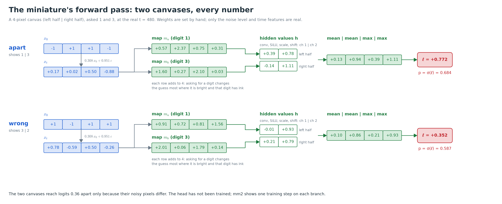
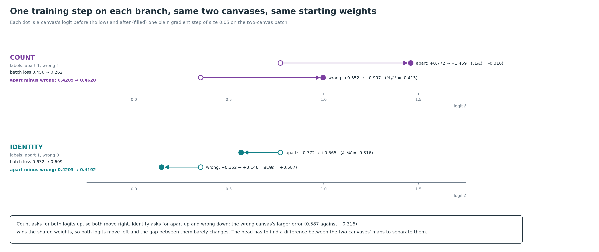
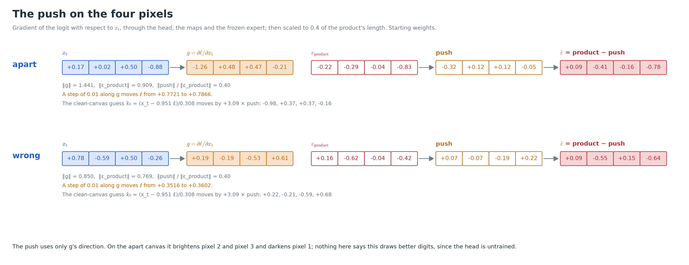
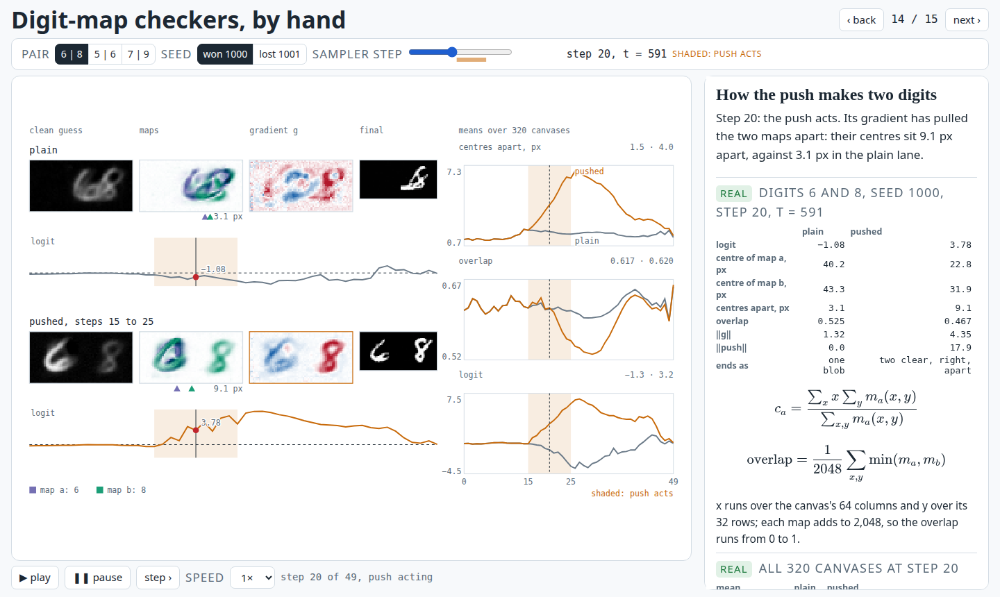

# 🌍 Context: the digit-map checkers, worked on a four-pixel canvas

⬅️ Previous: [the network view](02-the-network-view.md) | 📋 [The pages of this method](01-overview.md#the-pages-of-this-method) | Next: [the code](04-the-code.md) ➡️

This page shrinks the checker until every number fits on paper: a canvas of four pixels, a frozen "U-Net" that is one line of arithmetic, and a head with one convolution. It runs the forward pass on two canvases, one training step on each checker, and the push. Its weights and its frozen expert are set by hand, so its logits say nothing about how well a real checker reads; only its noise level (t = 480) and its two time features are real. The last section links the interactive page that plays the same steps, and the real push on real runs. Everything here comes from [the ladder's miniature](../../../2-classifier-guidance/artifacts/scenes/digit-map-checkers/2-miniature/README.md) and its answer key.

*The miniature's forward pass, left to right, at t = 480. Top row, the `apart` canvas (shows 1 | 3); bottom row, the `wrong` canvas (shows 3 | 2); both asked 1 and 3. Blue: the clean pixels x₀ and the noisy ones x_t = 0.308 x₀ + 0.951 ε. Green: the map for digit 1 (m_a) and for digit 3 (m_b), each adding to 4; the hidden values h, one row per half and one column per channel; then mean, mean, max, max. Red: the logit, 0.772 for apart (chance 0.684) and 0.352 for wrong (chance 0.587). The footer says the two logits are 0.4205 apart (apart minus wrong) only because the noisy pixels differ, since the head is untrained.* ✅ *Read on the figure at full size; 0.7721 − 0.3516 = 0.4205 in the answer key.*

## Table of contents

- [Words this page uses](#words-this-page-uses)
- [The toy](#the-toy)
- [The forward pass with every number](#the-forward-pass-with-every-number)
- [One training step on each checker](#one-training-step-on-each-checker)
- [The push on four pixels](#the-push-on-four-pixels)
- [The same steps on the real runs](#the-same-steps-on-the-real-runs)
- [Run it yourself](#run-it-yourself)
- [Where this came from](#where-this-came-from)

## Words this page uses

Navigation: 📋 [TOC](#table-of-contents) | [Next](#the-toy) ➡️

**Pixel p₁ to p₄**: the four numbers of the canvas. p₁ and p₂ are the left half, p₃ and p₄ the right.

**Stroke**: a digit drawn into one half. A "1" is (−1, +1), a "3" is (+1, −1) and a "2" is (+1, +1).

**Ink pattern T_y**: where the frozen expert thinks digit y's ink goes, on both halves: T₁ = (0.2, 1, 0.2, 1), T₃ = (1, 0.2, 1, 0.2).

**Logit ℓ and chance σ(ℓ)**: the head's one output, and 1 / (1 + e^(−ℓ)), its chance that the answer is yes.

## The toy

Navigation: ⬅️ [Words this page uses](#words-this-page-uses) | 📋 [TOC](#table-of-contents) | [Next](#the-forward-pass-with-every-number) ➡️

**Two canvases share one noise draw, and the asked pair is 1 and 3: `apart` shows 1 | 3 and `wrong` shows 3 | 2.** ✅

| Part | In the miniature | In the real checker |
|---|---|---|
| canvas | 4 pixels from −1 to +1 | 32 × 64 pixels from −1 to +1 |
| noise | one draw, ε = (0.5, −0.3, 0.2, −0.6), at t = 480 (√ᾱ = 0.308, √(1 − ᾱ) = 0.951) | a fresh draw per canvas at one of 16 timesteps |
| frozen expert | ε_∅ = 0.9 x, and asking for digit y subtracts 0.5 T_y σ(3x) | the share-0.0 canvas U-Net |
| maps | scaled to add to 4 | scaled to add to 2,048 |
| head | one convolution (2 maps in, 2 channels out, one window per half, 8 weights shared by both halves), SiLU, scale and shift from 2 time features, mean and max over the halves, one readout | three stem convolutions, c1, scale and shift from 16 time features, c2, pooling, a two-layer MLP |
| training | one plain step of size 0.05 on the two-canvas batch | Adam at 0.001 on 256 canvases, 4,000 updates |

✅ Read in `miniature.py`, lines 26 to 48 and 63 to 87, and the ladder's miniature card.

**The hand-set expert, by what moves.** One line of arithmetic stands in for each of the U-Net's three calls. Colours are the ladder's: blue the canvas, red a noise guess, grey a setting fixed by hand.

$$
\textcolor{#c0262d}{\underbrace{\varepsilon_\varnothing}_{\text{no digit asked}}} = \textcolor{#6b7a88}{0.9}\,\textcolor{#1f5fd0}{x_t},
\qquad
\textcolor{#c0262d}{\underbrace{\varepsilon_y - \varepsilon_\varnothing}_{\text{what asking for } y \text{ adds}}}
= -\,\textcolor{#6b7a88}{\underbrace{0.5}_{\text{strength}}}\;\textcolor{#6b7a88}{\underbrace{T_y}_{\text{where } y \text{ has ink}}}\;\underbrace{\sigma(\textcolor{#6b7a88}{3}\,\textcolor{#1f5fd0}{x_t})}_{\text{how bright the pixel is}}
$$

| Move, on pixel 2 of the apart canvas | What asking for digit 1 adds | What it shows |
|---|---|---|
| none: x_t = 0.023, T₁ = 1 | −0.259 | the largest change on the canvas, where a "1" has ink |
| T₁ set to 0.2, as if a "1" had no ink there | −0.052 | the ink pattern sets where the map is bright |
| the pixel brighter, x_t = 0.9 | −0.469 | a brighter pixel reacts more, through σ(3x) |
| the pixel dark, x_t = −0.9 | −0.032 | a dark pixel barely reacts |
| the sharpness 3 set to 0 | the map for 1 becomes (0.33, 1.67, 0.33, 1.67) | σ(0) = 0.5 on every pixel, so the map is T₁'s shape alone and ignores the canvas |

Adding both digits' changes to ε_∅ gives the product. On pixel 1 of the apart canvas:

$$
0.151 + (-0.062) + (-0.312) = -0.223
$$

That is the first entry of ε_product in [the push on four pixels](#the-push-on-four-pixels). ✅ Computed this session from the key's noisy pixels; the two changes match the key's `d_a` and `d_b`. The [miniature page's U-Net frame](https://claude.ai/artifact/MX2hKBUWBXSzPQSbaxysKC#unet) plays the three guesses on both canvases.

A **plain step** moves each weight against its slope by 0.05 times that slope, w ← w − 0.05 ∂L/∂w, with none of Adam's per-weight scaling. It is gradient descent, drawn on the [gradient descent card](../../../../../Obsidian/Artificial%20Intelligence/Machine%20Learning/Gradient%20Descent.md#where-to-learn-this). The readout's added constant c starts at −1 and feeds straight into both logits, so its slope is the mean of the two canvases' logit slopes:

| Branch | Slope of the batch loss in c | c after one plain step |
|---|---|---|
| count | −0.3645 | −1 − 0.05 × (−0.3645) = −0.982 |
| identity | +0.1355 | −1 − 0.05 × 0.1355 = −1.007 |

✅ The slopes are the key's `grad.c`; the steps computed this session.

🧸 **Toy:** the two canvases above, the hand-set head, t = 480. Expected before running: the map for digit 1 is largest where a "1" has ink and the pixel is bright, and the two canvases get different logits only because their noisy pixels differ, since the head is untrained.

## The forward pass with every number

Navigation: ⬅️ [The toy](#the-toy) | 📋 [TOC](#table-of-contents) | [Next](#one-training-step-on-each-checker) ➡️

**On the apart canvas the map for digit 1 peaks on pixel 2, where a "1" has ink, and the head gives 0.772; the wrong canvas gives 0.352.** ✅

| Stage | apart (1 \| 3) | wrong (3 \| 2) |
|---|---|---|
| clean x₀ | (−1, +1, +1, −1) | (+1, −1, +1, +1) |
| noisy x_t | (0.168, 0.023, 0.498, −0.879) | (0.784, −0.593, 0.498, −0.263) |
| map for digit 1, m_a | (0.57, 2.37, 0.75, 0.31) | (0.91, 0.72, 0.81, 1.56) |
| map for digit 3, m_b | (1.60, 0.27, 2.10, 0.03) | (2.01, 0.06, 1.79, 0.14) |
| hidden h, left half (channel 1, channel 2) | (0.392, 0.779) | (−0.011, 0.925) |
| hidden h, right half | (−0.137, 1.107) | (0.211, 0.787) |
| mean over halves | (0.128, 0.943) | (0.100, 0.856) |
| max over halves | (0.392, 1.107) | (0.211, 0.925) |
| logit ℓ | 0.772 | 0.352 |
| chance σ(ℓ) | 0.684 | 0.587 |

✅ The answer key.

**The last step, by hand.** The readout weights the four pooled numbers by (0.5, 0.5, 1, 1), the two time features (−0.224, 0.975) by (0.3, −0.2), and adds −1. On apart: 0.5 × 0.128 + 0.5 × 0.943 + 0.392 + 1.107 + 0.3 × (−0.224) − 0.2 × 0.975 − 1 = 0.772. ✅ Recomputed this session from the key's weights.

> [!NOTE]
> A logit of 0.772 does not mean the canvas is a good one. The head has not been trained, so the two logits differ only because the noise left different pixels. The next section shows what one step of training does to them.

## One training step on each checker

Navigation: ⬅️ [The forward pass with every number](#the-forward-pass-with-every-number) | 📋 [TOC](#table-of-contents) | [Next](#the-push-on-four-pixels) ➡️

**From the same starting weights, one count step raises both logits; one identity step lowers both, and the gap between apart and wrong barely moves.** ✅

*Across: the logit, from about −0.2 to 1.7. Hollow dots are each canvas's logit before the step, filled dots after one plain step of size 0.05 on the two-canvas batch. Purple, count (labels apart 1, wrong 1): apart 0.772 → 1.459, wrong 0.352 → 0.997, batch loss 0.456 → 0.262, gap 0.4205 → 0.4620. Teal, identity (labels apart 1, wrong 0): apart 0.772 → 0.565, wrong 0.352 → 0.146, batch loss 0.632 → 0.609, gap 0.4205 → 0.4192.* ✅

$$
\textcolor{#c0262d}{\underbrace{L}_{\text{the loss}}}
= -\Big[\,\underbrace{y}_{\text{the label}}\,\log\textcolor{#c0262d}{\underbrace{\sigma(\ell)}_{\text{chance of yes}}} + (1-y)\log\big(1-\sigma(\ell)\big)\Big],
\qquad
\textcolor{#c86a0a}{\underbrace{\frac{\partial L}{\partial \ell}}_{\text{the slope sent back}}} = \sigma(\ell) - y
$$

🔤 **The name:** binary cross-entropy
- **binary**: two possible answers, yes (1) or no (0). On the picture, the label beside each branch.
- **cross-entropy**: how surprised you are by the true answer when you were going by the model's chances. For one canvas it is minus the log of the chance the model gave the right answer.
- **Formula, in those words:** if the label is yes, L = −log σ(ℓ); if no, L = −log(1 − σ(ℓ)). The slope in the logit is the chance minus the label.
- **Consequence:** the wrong canvas has σ(ℓ) = 0.587. Under count (label 1) its loss is −log 0.587 = 0.533 and its slope −0.413, which pushes its logit up. Flip the label to 0, as identity does, and its loss becomes −log 0.413 = 0.884 and its slope +0.587, which pushes it down. ✅ The answer key, logs recomputed.

| Canvas | Label under count | Slope under count | Label under identity | Slope under identity |
|---|---|---|---|---|
| apart, σ(ℓ) = 0.684 | 1 | −0.316 | 1 | −0.316 |
| wrong, σ(ℓ) = 0.587 | 1 | −0.413 | 0 | +0.587 |

✅ The answer key.

**Why identity barely moves the gap.** Both canvases flow through the same eight shared kernel weights. Under identity, the wrong canvas's slope (+0.587) is larger than the apart canvas's (−0.316), so the shared weights move to lower every logit, and both fall by about 0.2. To separate apart from wrong the head has to find something in the maps that differs between them, and both canvases hold two blobs, one per half. ✅ The answer key; the reading is the ladder's. The real identity checker met this as a score little above chance ✍️ ([the learning finding, section 3](../../../2-classifier-guidance/report/abstract-checkers-on-digits/does-a-checker-learn-plurality-on-unseen-digits.md#3-split-in-two-the-count-checker-passes-and-the-identity-checker-misses)).

## The push on four pixels

Navigation: ⬅️ [One training step on each checker](#one-training-step-on-each-checker) | 📋 [TOC](#table-of-contents) | [Next](#the-same-steps-on-the-real-runs) ➡️

**With the starting weights fixed, the logit's gradient is carried back through the head, the maps and the frozen expert to the four pixels, and set to 0.4 of the product's length on both canvases.** ✅

*Each row, left to right: the noisy pixels x_t (blue), the gradient g = ∂ℓ/∂x_t (orange), the product's noise guess (red), the push (orange), and ε̂ = product − push (red). Apart: ‖g‖ = 1.441, ‖ε_product‖ = 0.909, push / product = 0.40; a step of 0.01 along g moves ℓ from 0.7721 to 0.7866. Wrong: ‖g‖ = 0.850, ‖ε_product‖ = 0.769, push / product = 0.40; ℓ from 0.3516 to 0.3602.* ✅

| | apart | wrong |
|---|---|---|
| g | (−1.258, 0.480, 0.470, −0.208) | (0.193, −0.190, −0.527, 0.610) |
| ε_product | (−0.223, −0.290, −0.042, −0.831) | (0.158, −0.621, −0.042, −0.424) |
| push | (−0.317, 0.121, 0.119, −0.052) | (0.070, −0.069, −0.191, 0.221) |
| ε̂ | (0.094, −0.411, −0.160, −0.779) | (0.088, −0.552, 0.149, −0.645) |
| clean-guess shift, 3.09 × push | (−0.98, +0.37, +0.37, −0.16) | (+0.22, −0.21, −0.59, +0.68) |

✅ The answer key. The push equation is taken apart term by term on [the overview](01-overview.md#the-push-by-what-moves).

🔤 **The name:** the slope through the map's scaling
- **slope**: how much one number changes per unit change in another.
- **scaling**: the map divides each pixel's |difference| by the total. On the picture, the step from the frozen expert's differences to the green maps.
- **Formula, in those words:** raising one pixel's |difference| raises that pixel's map value and lowers every other pixel's a little, because the total grew: ∂m_i / ∂|d_j| = 4 ([i = j] / S − |d_i| / S²), with S the total (2,048 in place of 4 on the real canvas).
- **Consequence:** on the apart canvas, raising pixel 2's |difference| by a small amount δ changes the map for digit 1 by (−1.31, +3.73, −1.72, −0.70) times δ. So the push's gradient reaches every pixel through every other pixel's map value, and a checker that wants more ink in one place also asks for less ink elsewhere. ✅ Computed this session from the key's differences; the formula is the ladder's [rebuild companion, rung 14](../../../2-classifier-guidance/artifacts/scenes/digit-map-checkers/rebuild-from-fundamentals.md#rung-14-the-slope-through-dsumd-has-a-quotient-rule-term), whose code check matches finite differences to 1.4e-09.

[i = j] is 1 when i and j are the same pixel and 0 otherwise. So only the pixel that was raised gets the 1 / S term.

**Finite differences** check a slope without the chain rule: nudge the input by a small step h, run the forward pass again, and divide the change in the output by h. The build nudges each input both ways by a step of one millionth and divides the difference by twice the step. That is `numeric` in `miniature.py`, lines 131 to 144. On the apart canvas, stepping along g's own direction:

| Step h along g / ‖g‖ | (ℓ after − ℓ before) / h |
|---|---|
| 0.01 | 1.451 |
| 0.001 | 1.442 |
| 10⁻⁶ | 1.441, which is ‖g‖ |

As h shrinks the estimate settles on the chain rule's answer, which is the match the build checks. ✅ Computed this session with the miniature's forward pass rebuilt from the key's weights; it reproduces the key's logit 0.7721 and g.

💥 **Broken run (without):** the maps detached, as training builds them under `torch.no_grad`.
- **Predict:** what is g on the apart canvas?
- **Wrong:** (0, 0, 0, 0): the logit has no path back to the pixels, so the push is empty.
- **Right**, with the maps built with gradients on: (−1.258, 0.480, 0.470, −0.208).

✍️ The miniature page's broken-run control ([its spec](../../../2-classifier-guidance/artifacts/scenes/digit-map-checkers/miniature-page/SPEC.md#what-each-control-does)).

> [!WARNING]
> The miniature's push says nothing about drawing better digits, because its head is untrained. It shows the mechanics: which way the gradient points and how the fixed length is set. Whether a trained checker's push helps is measured on the real runs below.

## The same steps on the real runs

Navigation: ⬅️ [The push on four pixels](#the-push-on-four-pixels) | 📋 [TOC](#table-of-contents) | [Next](#run-it-yourself) ➡️

**The miniature page plays every step above, opens on the real count checker running stage by stage on real canvases, and ends on the real push turning one fused glyph into two digits, step by step.** ✍️ [The miniature page](https://claude.ai/artifact/MX2hKBUWBXSzPQSbaxysKC), published privately, with a [local copy](../../../2-classifier-guidance/artifacts/scenes/digit-map-checkers/miniature-page/digit-map-checkers-miniature.html) and [its spec](../../../2-classifier-guidance/artifacts/scenes/digit-map-checkers/miniature-page/SPEC.md).

*The page's frame 14 at sampler step 20 (t = 591), digits 6 and 8, seed 1000, one seed sampled twice from the same noise. Plain lane, top: the clean guess is a 6 and an 8 drawn over each other, the two maps (purple for 6, green for 8) sit 3.1 pixels apart, the logit is −1.08, and the run ends as one blob. Pushed lane, bottom, pushed at steps 15 to 25: a 6 on the left and an 8 on the right, maps 9.1 pixels apart, logit 3.78, push length 17.9, ending as two clear, right digits apart. Right: means over all 320 canvases at each of the 50 steps, grey plain and orange pushed, with steps 15 to 25 shaded: the centres' separation in pixels, the overlap of the two maps, and the logit.* ✅ *Read on the still at full size.*

A **map's centre** is where its mass balances across the canvas: each column's position, weighted by how much of the map sits in that column.

The **overlap** is the map mass the two share: take the smaller of the two map values at each pixel, add them up, and divide by the 2,048 pixels. So 0 is no shared mass and 1 is two identical maps. ✅ Read in `trace_push.py`, lines 51 to 55. On this page's apart canvas the two four-pixel maps share 0.41 of their mass. ✅ Computed this session from the key's maps.

| Mean over 320 canvases, job 94161 | Step 15 | Step 20 | Step 25 | Step 49 |
|---|---|---|---|---|
| plain: map centres apart, pixels | 1.63 | 1.48 | 1.26 | 0.94 |
| pushed: map centres apart, pixels | 1.63 | 4.05 | 6.61 | 1.11 |
| plain: logit | −0.23 | −1.26 | −4.14 | |
| pushed: logit | −0.23 | 3.22 | 6.70 | |

✅ Recomputed this session from the ladder's `trace-stats.npz`; they agree with [the push finding's table](../../../2-classifier-guidance/report/abstract-checkers-on-digits/does-the-count-checkers-push-compose-unseen-digits.md#4-what-the-two-maps-do-while-the-push-acts) to its rounding. Inside the push window the maps move apart and the logit rises; after it, the centres drift back to about 1 pixel, so a late map's centre does not show where the digits ended. This rerun drew 41 clean pairs of 320 pushed and 0 plain; the recorded run drew 43, and its count is the verdict. ✍️ The push finding, section 5.

## Run it yourself

Navigation: ⬅️ [The same steps on the real runs](#the-same-steps-on-the-real-runs) | 📋 [TOC](#table-of-contents) | [Next](#where-this-came-from) ➡️

**One script makes every miniature number, checks every hand gradient against finite differences, and must report a largest mismatch under 1e-6.** ✍️ The ladder's miniature card gives 1.4e-09.

🔨 **Build:** from the ladder's `2-miniature/` folder, `PYTHONDONTWRITEBYTECODE=1 ~/.claude/venvs/figures/bin/python -I miniature.py`. It prints the largest mismatch, raises if any gradient is off, and prints each branch's logits before and after one step: count apart (0.7721, 1.4591), identity wrong (0.3516, 0.1456). Different numbers mean a weight, the noise draw or the step size changed.

> [!WARNING]
> The script rewrites `miniature_answer_key.json` inside the ladder folder (`miniature.py` line 224). Run it on a copy of the folder, or expect a changed file in `git status`. It was not re-run for these pages; the numbers were read from the key as it stands.

## Where this came from

Navigation: ⬅️ [Run it yourself](#run-it-yourself) | 📋 [TOC](#table-of-contents)

| What | How it was established | When |
|---|---|---|
| The canvases, strokes, ink patterns, noise draw, expert, weights and step size | Read in the ladder's `2-miniature/miniature.py`, lines 26 to 87 | 2026-11-24 |
| Every forward, training and push value | Read in `miniature_answer_key.json` | 2026-11-24 |
| The readout sum, the losses, and the quotient-rule column (−1.31, 3.73, −1.72, −0.70) | Recomputed this session from the key's values | 2026-11-24 |
| The figure labels | Read on mm1, mm2, mm3 and the frame 14 still at full size | 2026-11-24 |
| mm1's footer gap of 0.4205, which mm2 also prints | Read on mm1 and checked against the key's 0.7721 − 0.3516 | 2026-11-24 |
| The 320-canvas means | Recomputed from `numbers/real/trace/trace-stats.npz` (job 94161) | 2026-11-24 |
| The broken-run control and the interactive page's contents | Stated by the miniature page's spec | 2026-11-24 |

⬅️ Previous: [the network view](02-the-network-view.md) | 📋 [The pages of this method](01-overview.md#the-pages-of-this-method) | Next: [the code](04-the-code.md) ➡️

<!-- built-to: PAGE_LOOK_FORMAT v1 -->
