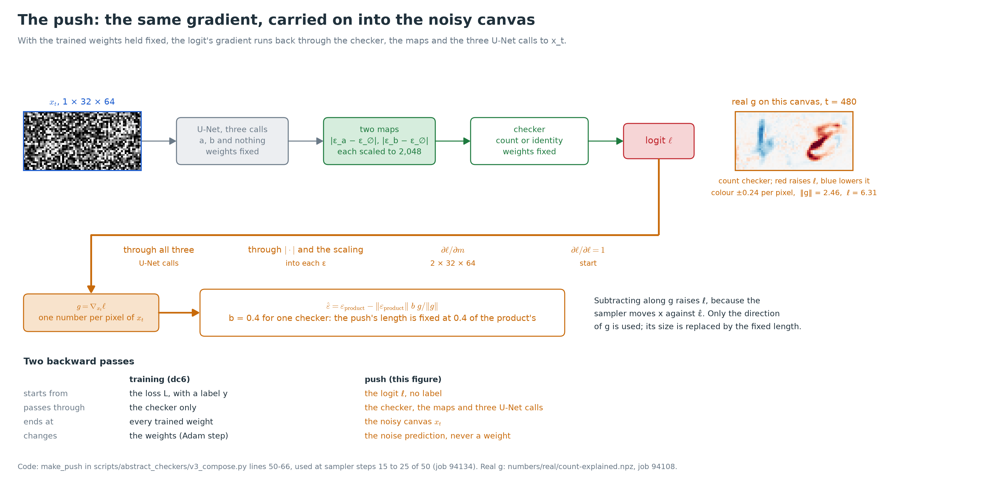

# 🌍 Context: the digit-map checkers, the code that runs them

⬅️ Previous: [the miniature](03-the-miniature.md) | 📋 [The pages of this method](01-overview.md#the-pages-of-this-method) | Next: [the methods index](../00-INDEX.md) ➡️

This page reads the checkers' own code block by block, where it lives, in the order one training update and one pushed sampler step run them, and ties each block to a figure and to its twin in the miniature's `miniature.py`. Five files carry it: the canvas U-Net script (the schedule, the product and the sampler), the checker script (the time features), the pixel checker script (the network), the V2 learning script (the maps, training, the label sets and saving the head) and the V3 compose script (the push). Line numbers are as the files stand at commit `e7787922`, with all five clean. The ladder's own [code walk](../../../2-classifier-guidance/artifacts/scenes/digit-map-checkers/3-code/walk-v2-learn.md) reads the same five files at commit `cbff8c0e`, where all five are unchanged, so its line numbers and these agree. It runs from the training update through saving the count checker, the push, and two recording scripts this page does not read: `explain_stages.py`, which keeps every layer's output, and `trace_push.py`, which records the plain and pushed samplers step by step.

<a href="../../../2-classifier-guidance/artifacts/scenes/digit-map-checkers/0.5-network-view/dc7-the-push-gradient-into-the-canvas.png"></a>

*The push, which is the one block the sampler adds. Top row, forward: [the noisy canvas](../../../2-classifier-guidance/artifacts/scenes/digit-map-checkers/rebuild-from-fundamentals.md#1-the-noisy-canvas) x_t (1 × 32 × 64), the U-Net called for a, b and nothing with its weights fixed, the two maps |ε_a − ε_∅| and |ε_b − ε_∅| each scaled to 2,048, the checker (count or identity) with its weights fixed, and the logit ℓ. Orange lane, backward, right to left: ∂ℓ/∂ℓ = 1, then ∂ℓ/∂m (2 × 32 × 64), then through the absolute value and the scaling into each ε, then through all three U-Net calls, ending at g = ∇_{x_t}ℓ. The orange box sets ε̂ = ε_product − ‖ε_product‖ b g / ‖g‖ with b = 0.4. The tile at the upper right is the real g of the saved count checker on the apart canvas (1 | 3) at t = 480, red where it raises ℓ and blue where it lowers it, with ‖g‖ = 2.46 and ℓ = 6.31. The table at the bottom compares this pass with training's. The footer names `make_push` in the V3 script, lines 50 to 66, used at sampler steps 15 to 25 of 50 (job 94134), and the file the real g comes from, `numbers/real/count-explained.npz` (job 94108), which the `explain` stage below writes.* ✅ *Read on the figure at full size; the tile is described in full on [the network view](02-the-network-view.md#the-two-backward-passes).*

## Table of contents

- [Words this page uses](#words-this-page-uses)
- [The blocks and where they live](#the-blocks-and-where-they-live)
- [The schedule and the sixteen timesteps](#the-schedule-and-the-sixteen-timesteps)
- [Noising a canvas and making the two maps](#noising-a-canvas-and-making-the-two-maps)
- [One training update](#one-training-update)
- [The two label sets](#the-two-label-sets)
- [The push in the sampler](#the-push-in-the-sampler)
- [Saving the head and its real gradients](#saving-the-head-and-its-real-gradients)
- [How it fails and how you know it worked](#how-it-fails-and-how-you-know-it-worked)
- [Where this came from](#where-this-came-from)

## Words this page uses

Navigation: 📋 [TOC](#table-of-contents) | [Next](#the-blocks-and-where-they-live) ➡️

**`torch.no_grad`**: a block inside which PyTorch records no history of the arithmetic, so no gradient can later flow back through it.

**`torch.autograd.grad(y, x)`**: asks PyTorch for the slope of y with respect to x, through every recorded step between them.

**Label 10**: the "no digit" label the canvas U-Net was trained with, so asking with 10 gives ε_∅.

**Window**: the set of timesteps at which the push acts; at every other step the push is zero.

**V2**: the step on Loop 8's lane of the progress board that trained the digit-map checkers on digits 0 to 4 and tested whether they tell how many digits a canvas holds on digits 5 to 9, which they never trained on. The V2 learning script is its code.

**V3**: the step on Loop 8's lane of the progress board that pushed the digit product with the count checker's gradient on unseen digit pairs, against the plain product and a random push of the same size. The V3 compose script is its code.

## The blocks and where they live

Navigation: ⬅️ [Words this page uses](#words-this-page-uses) | 📋 [TOC](#table-of-contents) | [Next](#the-schedule-and-the-sixteen-timesteps) ➡️

**Every block is this project's own code, read where it lives.** ✅

| Block | Where it lives | What it computes | Figure | The miniature's twin |
|---|---|---|---|---|
| the schedule | [the canvas U-Net script](../../../2-classifier-guidance/scripts/mnist/canvas_unet.py), lines 35 to 38 | ᾱ_t = ∏ (1 − β_s), β linear from 1e-4 to 0.02 over 1,000 steps | [the canvas and its noise](../../../2-classifier-guidance/artifacts/scenes/digit-map-checkers/0.5-network-view/dc1-the-canvas-and-its-noise.png) | `ABAR` = 0.094869, line 27 |
| the 16 training timesteps | [the V2 learning script](../../../2-classifier-guidance/scripts/abstract_checkers/v2_learn.py), lines 46 to 47 | 712 down to 480 | the same | t = 480 only |
| the time features | [the checker script](../../../2-classifier-guidance/scripts/mnist/checker.py), lines 69 to 73 | sin and cos of e^(3k/7) log(ᾱ/(1 − ᾱ)) / 10, k = 0 to 7 | [the timestep as sixteen numbers](../../../2-classifier-guidance/artifacts/scenes/digit-map-checkers/0.5-network-view/dc4-the-timestep-as-sixteen-numbers.png) | `PHI`, line 30, the first frequency only |
| noising and the maps | the V2 learning script, `maps` lines 85 to 98 and `inputs` lines 101 to 107 | x_t, then m = 2048 · \|ε_y − ε_∅\| / Σ \|ε_y − ε_∅\| | [where the two maps come from](../../../2-classifier-guidance/artifacts/scenes/digit-map-checkers/0.5-network-view/dc2-where-the-two-maps-come-from.png) | `expert` and `maps_of`, lines 63 to 72 |
| the network | [the pixel checker script](../../../2-classifier-guidance/scripts/mnist/pixel_checker.py), `PixelHead` lines 33 to 56, first layer swapped in `make_head`, V2 lines 77 to 82 | 2 maps to one logit, 481,665 weights | [the checker network](../../../2-classifier-guidance/artifacts/scenes/digit-map-checkers/0.5-network-view/dc3-the-checker-network.png) | `head`, lines 75 to 87 |
| one training update | the V2 learning script, `train` lines 110 to 133 | binary cross-entropy, one Adam step at 0.001 | [training into the weights](../../../2-classifier-guidance/artifacts/scenes/digit-map-checkers/0.5-network-view/dc6-training-backprop-into-the-weights.png) | `head_backward`, line 89, and one plain step of 0.05 |
| the two label sets | the V2 learning script, `relabel` lines 296 to 304 | count: two digits apart is 1; identity: `apart` 1 against `wrong` 0 | [two checkers, two label sets](../../../2-classifier-guidance/artifacts/scenes/digit-map-checkers/0.5-network-view/dc5-two-checkers-two-label-sets.png) | `LABELS`, line 37 |
| the push | [the V3 compose script](../../../2-classifier-guidance/scripts/abstract_checkers/v3_compose.py), `make_push` lines 50 to 66; added in `sample`, canvas U-Net script lines 214 to 220 | −‖ε‖ b g / ‖g‖ inside the window, 0 outside | the picture above | `maps_backward` and `logit_of_x`, lines 109 to 126 |
| saving the head and real gradients | the V2 learning script, `explain` lines 341 to 362 and `stage_final_count` lines 365 to 393 | the saved count head, and real maps, logits and g on four example canvases | the [real maps still](02-the-network-view.md#the-two-maps) | none |

The miniature's file is [the ladder's miniature script](../../../2-classifier-guidance/artifacts/scenes/digit-map-checkers/2-miniature/miniature.py). ✅

## The schedule and the sixteen timesteps

Navigation: ⬅️ [The blocks and where they live](#the-blocks-and-where-they-live) | 📋 [TOC](#table-of-contents) | [Next](#noising-a-canvas-and-making-the-two-maps) ➡️

**The checkers train at the 16 toy timesteps whose signal share matches SDXL's first 16 sampler steps, chosen by a switch.** ✅

```python
SDXL_MATCHED = torch.tensor([712, 696, 680, 664, 648, 632, 616, 601, 585, 570, 555, 539, 524, 510, 495, 480])
WINDOWS = {"early": STEPS16, "sdxl": SDXL_MATCHED}
```

The V2 learning script, lines 46 to 47. `STEPS16` starts as the toy sampler's own first 16 steps (999 down to 693, line 43), and `main` replaces it with `WINDOWS[args.window]` at line 436. The runs this folder describes pass `--window sdxl`, so ᾱ runs from 0.0058 at t = 712 to 0.0949 at t = 480. ✅ The saved count checker's scores file records `"window": "sdxl"`. Why the window moved from the toy's own early steps, and what that did to the scores, is in [the learning finding, section 2](../../../2-classifier-guidance/report/abstract-checkers-on-digits/does-a-checker-learn-plurality-on-unseen-digits.md#2-at-sdxls-noise-level-it-learns-where-the-digits-are-and-still-not-which). ✍️

🔤 **The name:** the schedule, and ᾱ_t ("alpha bar")
- **schedule**: a timetable. Here, how much noise each of the 1,000 steps adds, β_s at step s. It rises in a straight line from 0.0001 at the first step to 0.02 at the last.
- **alpha bar**: α_s = 1 − β_s is the share of the variance one step keeps, and the bar marks the running product of every α up to t.
- **On the picture:** the ᾱ printed above each column of [the canvas and its noise](../../../2-classifier-guidance/artifacts/scenes/digit-map-checkers/0.5-network-view/dc1-the-canvas-and-its-noise.png).
- **Formula, in those words:** the signal share left at t is what survives every step's small loss, one after another.

$$
\underbrace{\bar\alpha_t}_{\text{signal share left at } t} = \prod_{s=0}^{t}\big(1 - \textcolor{#6b7a88}{\underbrace{\beta_s}_{\text{noise added at step } s}}\big)
$$

- **Consequence:** halve the top of the line and about three times as much picture is left at t = 480, so the same timestep would mean a different noise level, and the 16 training timesteps would no longer match SDXL's. ✅ Computed this session from the schedule above.

| Schedule | ᾱ at t = 480 | ᾱ at t = 712 |
|---|---|---|
| β rising to 0.02, as here | 0.0949 | 0.0058 |
| β rising to 0.01 instead | 0.303 | 0.075 |

The [one-jump card](../../../../../Obsidian/Artificial%20Intelligence/Generative%20Modeling/Diffusion%20Models/From%20Many%20Steps%20To%20One%20Jump.md#many-steps-collapse-into-one-jump) works the running product step by step on a cosine schedule. The β here is the schedule's; the β of the scale and shift on [the network view](02-the-network-view.md#the-network-layer-by-layer) is a different number.

## Noising a canvas and making the two maps

Navigation: ⬅️ [The schedule and the sixteen timesteps](#the-schedule-and-the-sixteen-timesteps) | 📋 [TOC](#table-of-contents) | [Next](#one-training-update) ➡️

**One batched call runs the U-Net three times, for no digit, digit a and digit b, and each map is the absolute difference from the no-digit guess divided by its total and multiplied by the 2,048 pixels.** ✅

```python
def maps(model, xt, t, pair, variant):
    """The two maps of where each asked label changes the noise prediction, each adding to 1, then scaled by the pixel count."""
    n = xt.shape[0]
    y = torch.cat([torch.full((n,), NULL, device=xt.device), pair[:, 0], pair[:, 1]])
    e0, ea, eb = model(xt.repeat(3, 1, 1, 1), t.repeat(3), y).chunk(3)
    channels, totals = [], []
    for d in (ea - e0, eb - e0):
        total = d.abs().flatten(1).sum(1).clamp_min(1e-12)[:, None, None, None]
        channels.append((d if variant == "signed" else d.abs()) / total * PIXELS)
        totals.append(total.log())
    out = torch.cat(channels, 1)
    ...
    return out
```

The V2 learning script, lines 85 to 98; the dots stand for lines 96 and 97, which add the log totals only for the `totals` variant, which the runs here do not use. The labels a and b enter only through which calls are made, so the head that reads `out` never sees them. ✅

```python
def inputs(cfg, model, x0, t, pair, noise):
    a = ABAR.to(x0.device)[t][:, None, None, None]
    xt = a.sqrt() * x0 + (1 - a).sqrt() * noise
    if cfg["reader"] == "raw":
        return xt
    with torch.no_grad():
        return maps(model, xt, t, pair, cfg["input"])
```

Lines 101 to 107. In training the maps are made under `torch.no_grad`, so the loss's slope stops at the maps and the U-Net is never trained. ✅

🔤 **The name:** `torch.no_grad`
- **no**: none.
- **grad**: gradient, the slope of one number with respect to another.
- **On the picture:** in training (the [network view's training figure](02-the-network-view.md#the-two-backward-passes)), the place where the orange lane stops before the maps.
- **Formula, in those words:** inside the block, ∂(anything after) / ∂(anything inside) is not recorded, so the chain rule has no link to follow through it.
- **Consequence:** leave it on in training and nothing changes but speed and memory, since the U-Net is frozen anyway. Leave it on in the push and g = (0, 0, 0, 0) on the miniature, an empty push. That is why the push code builds the maps again inside `torch.enable_grad()`. ✍️ The miniature page's broken-run control.

## One training update

Navigation: ⬅️ [Noising a canvas and making the two maps](#noising-a-canvas-and-making-the-two-maps) | 📋 [TOC](#table-of-contents) | [Next](#the-two-label-sets) ➡️

**Each update draws 128 yes-canvases and 128 no-canvases, one of the 16 timesteps and a fresh noise per canvas, and takes one Adam step on binary cross-entropy.** ✅

```python
    for step in range(1, updates + 1):
        i = np.concatenate([rng.choice(pos, batch // 2), rng.choice(neg, batch - batch // 2)])
        x0 = to_x(split["x"][i], dev)
        pair = torch.from_numpy(split["asked"][i].astype(np.int64)).to(dev)
        y = torch.from_numpy(split["target"][i].astype(np.float32)).to(dev)
        t = STEPS16[torch.randint(0, len(STEPS16), (len(i),), generator=gen)].to(dev)
        noise = torch.randn(x0.shape, generator=gen).to(dev)
        loss = F.binary_cross_entropy_with_logits(head(inputs(cfg, model, x0, t, pair, noise), t, pair)[:, 0], y)
        opt.zero_grad(set_to_none=True)
        loss.backward()
        opt.step()
```

The V2 learning script, lines 119 to 129; the optimiser is `torch.optim.Adam(head.parameters(), 1e-3)` at line 116, and 4,000 updates is the base setting. `binary_cross_entropy_with_logits` is L = −[y log σ(ℓ) + (1 − y) log(1 − σ(ℓ))], taken apart on [the miniature page](03-the-miniature.md#one-training-step-on-each-checker). ✅ The pair is passed to the head, which for the map reader ignores it (`pair_aware=False` in `make_head`). ✅

Adam, short for adaptive moment estimation, gives each weight its own step size from running averages of that weight's recent slopes and of their squares. [The rebuild companion, rung 13](../../../2-classifier-guidance/artifacts/scenes/digit-map-checkers/rebuild-from-fundamentals.md#rung-13-adam-scales-each-weights-step-by-its-own-running-gradient-size), links the textbook page that teaches it.

## The two label sets

Navigation: ⬅️ [One training update](#one-training-update) | 📋 [TOC](#table-of-contents) | [Next](#the-push-in-the-sampler) ➡️

**The two checkers differ only here: count keeps every canvas and labels it by layout, identity keeps only `apart` and `wrong`.** ✅

```python
def relabel(split, task):
    """count: two digits apart, so apart and wrong are label 1. identity: apart (1) against wrong (0) only."""
    if task == "count":
        out = dict(split)
        out["target"] = split["apart"].copy()
        return out
    if task == "identity":
        return take(split, np.isin(split["kind"], [KINDS.index("apart"), KINDS.index("wrong")]))
    raise ValueError(task)
```

Lines 296 to 304. For identity the stored target is kept, which is 1 for `apart` and 0 for `wrong`. ✅ The counts each set produces are on [the network view](02-the-network-view.md#two-checkers-two-label-sets).

## The push in the sampler

Navigation: ⬅️ [The two label sets](#the-two-label-sets) | 📋 [TOC](#table-of-contents) | [Next](#saving-the-head-and-its-real-gradients) ➡️

**At each step inside the window the push rebuilds the maps with gradients on, takes the logit's gradient with respect to the noisy canvas, and returns it scaled to b times the product's length, with a minus sign; the sampler adds it to the product.** ✅

```python
WINDOW = {int(t) for t in ddim_timesteps(50) if 480 <= int(t) <= 712}
...
def make_push(kind, b, head, model, a, bb, seed):
    gen = torch.Generator().manual_seed(seed)

    def push(x, t, eps):
        if int(t[0]) not in WINDOW:
            return torch.zeros_like(eps)
        if kind == "random":
            d = torch.randn(x.shape, generator=gen).to(x.device)
        else:
            with torch.enable_grad():
                xx = x.detach().requires_grad_(True)
                pair = torch.tensor([[a, bb]], device=x.device).expand(x.shape[0], 2)
                logit = head(maps(model, xx, t, pair, "base"), t, pair)[:, 0]
                d, = torch.autograd.grad(logit.sum(), xx)
        size = eps.flatten(1).norm(dim=1)[:, None, None, None]
        return -size * b * d / d.flatten(1).norm(dim=1).clamp_min(1e-12)[:, None, None, None]
    return push
```

The V3 compose script, line 33 and lines 50 to 66. The window holds the 11 sampler timesteps between 480 and 712, which are steps 15 to 25 of 50 (t = 693 down to 489). ✅ The checked trace's `push_steps` lists the same 11. The random row uses the same length in a direction drawn from a fixed seed, so a push that fails for being too small is ruled out. ✅

```python
        def full_eps(xx):
            e = eps_fn(xx, tt) if eps_fn is not None else product_eps(model, xx, tt, labels, g)
            fr = None
            if push_fn is not None:
                push, fr = per_sample_cap(push_fn(xx, tt, e), e, cap)
                e = e + push
            return e, fr
```

The canvas U-Net script, lines 214 to 220. `product_eps` (lines 172 to 177) is ε_∅ + g · Σ (ε_label − ε_∅), which at g = 1 is ε_a + ε_b − ε_∅. The V3 runs call `sample` with `g=1.0` and `cap=1.0`, so the sampler's own cap would fire only on a push longer than the whole prediction, and a push of 0.4 never reaches it. ✅ The step itself is DDIM with eta 0, read on [the product-of-experts code page](../01-the-product-of-experts/04-the-code.md#the-sampler-step).

The g in `product_eps` is the code's guidance weight, one number, set to 1.0 here. It is a different thing from the checker's gradient g on the other pages, which has one value per pixel. ✅ Read in `product_eps`'s signature and the V3 runs' `sample` call.

🔤 **The name:** window
- **window**: an opening that lets some things through and keeps others out. Here, a set of 11 timesteps at which the push is let through.
- **On the picture:** the orange shading over steps 15 to 25 in the [miniature page's frame 14](03-the-miniature.md#the-same-steps-on-the-real-runs).
- **Formula, in those words:** push = −‖ε‖ b g / ‖g‖ if t is in the window, else 0.
- **Consequence:** the window is the 16 timesteps the checker trained at, cut to the ones the 50-step sampler visits. Outside it the checker would be reading noise levels it never saw. Inside it, over the 320 canvases of the traced run, the two maps' centres move from 1.6 to 6.6 pixels apart between steps 15 and 25, and after it they drift back to about 1. ✅ Recomputed from the ladder's `trace-stats.npz`.

## Saving the head and its real gradients

Navigation: ⬅️ [The push in the sampler](#the-push-in-the-sampler) | 📋 [TOC](#table-of-contents) | [Next](#how-it-fails-and-how-you-know-it-worked) ➡️

**The stage that retrains the count checker on digits 0 to 4 saves the head, and with the ladder's example canvases it also writes real maps, logits and gradients, built the same way the push builds them.** ✅

```python
            with torch.enable_grad():
                xt = (ab.sqrt() * x0 + (1 - ab).sqrt() * noise).requires_grad_(True)
                m = maps(model, xt, t, pair, "base")
                logit = head(m, t, pair)[:, 0]
                g, = torch.autograd.grad(logit.sum(), xt)
```

`explain`, the V2 learning script, lines 353 to 357, run on `apart_1_3`, `wrong_1_3`, `apart_3_4` and `wrong_3_4` at t = 712, 616, 539 and 480 with the ladder's display noise. `stage_final_count` saves the head with `torch.save` at line 375 and writes `count-explained.npz` when given the examples. ✅ That file's logits match the stage-by-stage file the miniature page reads: on `apart_1_3`, 0.543, 1.567, 3.806 and 6.308 from t = 712 to 480. ✅

## How it fails and how you know it worked

Navigation: ⬅️ [Saving the head and its real gradients](#saving-the-head-and-its-real-gradients) | 📋 [TOC](#table-of-contents) | [Next](#where-this-came-from) ➡️

**Three checks run in the code before any score is read: a zero push must change no pixel, the head must overfit 16 canvases, and the scores must clear bars written into the source.** ✍️

**[A zero push changes no pixel](../../../2-classifier-guidance/report/abstract-checkers-on-digits/is-the-small-environment-repeatable.md#2-a-zero-push-changes-no-pixel).** The V3 script renders a row with b = 0 and compares it with the plain product; the largest pixel difference was 0.0, against a bar of under 1e-5. ✍️ [The push finding, section 1](../../../2-classifier-guidance/report/abstract-checkers-on-digits/does-the-count-checkers-push-compose-unseen-digits.md#1-the-push-separates-the-fused-digit).

**The head can learn at all.** `overfit_one` (V2 lines 184 to 204) trains on 16 fixed canvases and must get at least 15 right; the saved count checker got 16 of 16. ✅ The ladder's `count-final.json`.

To overfit is to fit the training canvases so closely that the head memorises them. In a real run that is a failure; here it is a test, because a head that cannot even memorise 16 fixed canvases has a bug in its wiring.

**The bars sit in the code.** `MIN_BA = 0.75` and `MAX_GAP = 0.05` (V2 lines 33 and 34) are balanced accuracy on unseen digits and the largest gap to seen digits, so they cannot move after a score is seen without showing in a diff. ✅

> [!NOTE]
> Only the count head is ever saved for these runs. `stage_split` keeps no trained head, `stage_final_count` saves the count head at line 375, and no stage saves the identity head, so no real identity maps, logits or gradients exist. The ladder's code walk says the same in [its blocks 9 and 10](../../../2-classifier-guidance/artifacts/scenes/digit-map-checkers/3-code/walk-v2-learn.md#10-saving-the-count-checker-and-its-real-maps).

## Where this came from

Navigation: ⬅️ [How it fails and how you know it worked](#how-it-fails-and-how-you-know-it-worked) | 📋 [TOC](#table-of-contents)

| What | How it was established | When |
|---|---|---|
| Every excerpt and line number | Read in the five scripts at commit `e7787922`, working tree clean for all five | 2026-11-24 |
| The five scripts are the same at `e7787922`, at the code walk's commit `cbff8c0e`, and at HEAD | `git diff` between the three on each script, empty for all five | 2026-11-24 |
| No stage saves the identity head | `torch.save` appears in the V2 script only at line 375 (`stage_final_count`, the count head) and line 406 (`stage_final`, one head trained on the stored targets with no `relabel` call); `relabel(..., "identity")` runs only inside `stage_split` (line 315), which saves nothing | 2026-11-24 |
| The window is steps 15 to 25 | `WINDOW` in the V3 script against `ddim_timesteps(50)`, and the ladder's `numbers/real/trace/trace.json` | 2026-11-24 |
| `--window sdxl` for the saved count checker; overfit 16 of 16 | Read in the ladder's `numbers/real/count-final.json` | 2026-11-24 |
| The four logits on `apart_1_3` | Read in `count-explained.npz` and `count-stages.npz`, which agree | 2026-11-24 |
| The map centres 1.6 and 6.6 pixels | Recomputed from `trace-stats.npz` | 2026-11-24 |
| The zero-push result | Stated by the push finding | 2026-11-24 |
| The miniature twins | Read in the ladder's `2-miniature/miniature.py` | 2026-11-24 |

⬅️ Previous: [the miniature](03-the-miniature.md) | 📋 [The pages of this method](01-overview.md#the-pages-of-this-method) | Next: [the methods index](../00-INDEX.md) ➡️

<!-- built-to: PAGE_LOOK_FORMAT v1 -->
