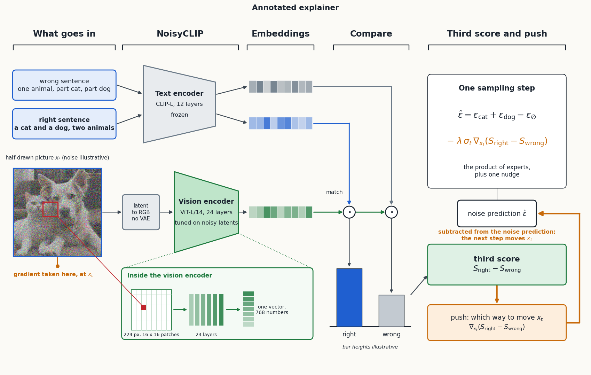
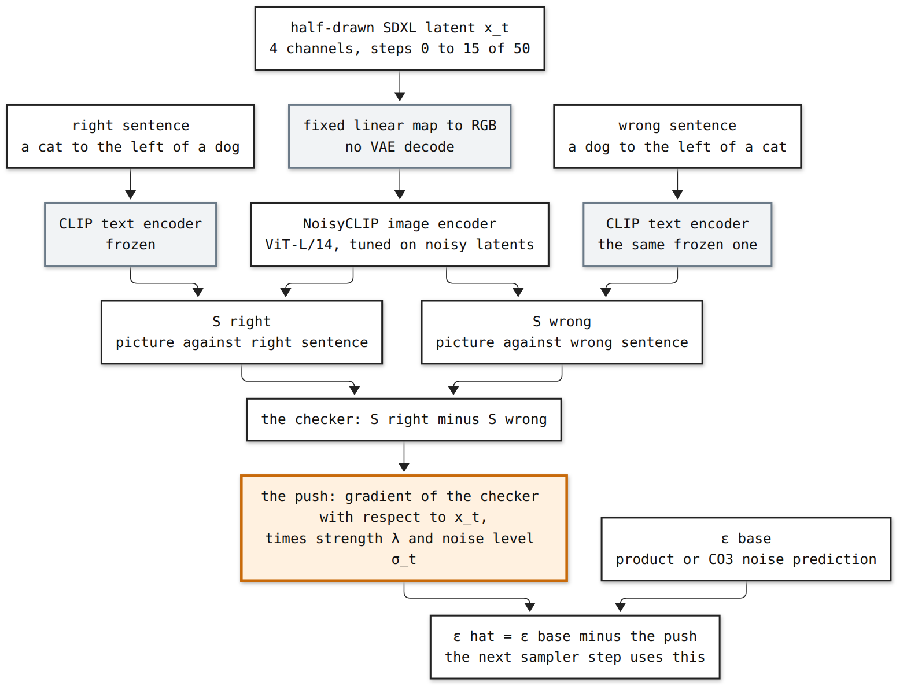
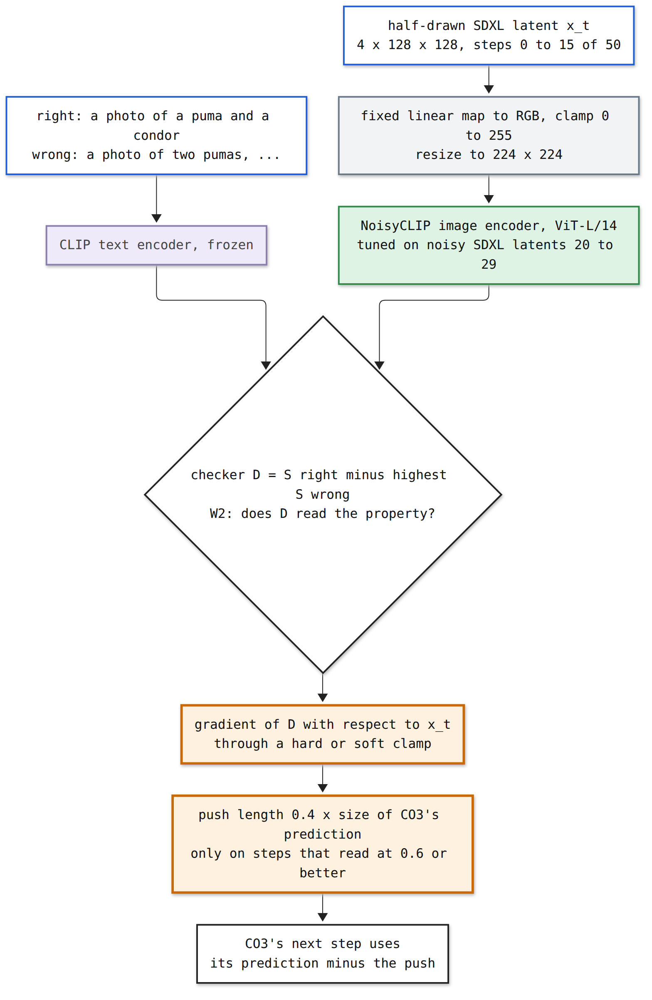

# 🌍 Context: the sentence-score push, one sampler step

⬅️ Previous: [the methods index](../00-INDEX.md) | 📋 [The pages of this method](#the-pages-of-this-method) | Next: [the network view](02-the-network-view.md) ➡️

The sentence-score push is Loop 9's first candidate checker. NoisyCLIP, a CLIP model whose image side was retrained on noisy SDXL latents, reads a half-drawn latent and scores it against a right sentence and a wrong one, and the gradient of the difference is taken off the sampler's noise prediction. The push was designed and never run: Loop 9's reading test found that no sentence score reads a cat and dog picture at steps 0 to 15, where the push would act, so the push step was stopped before any picture was rendered ([the push step's review](../../../artifacts/notes/progress/noise-text-critic/03-does-it-steer/review.md)). What product-of-experts composition is lives in [PoE composition](../../world/poe-composition.md#what-poe-composition-is), and the sampler this push is added to is worked on [the product-of-experts overview](../01-the-product-of-experts/01-overview.md). This folder adds the ladder's pictures, a miniature of 8 latent numbers you can follow by hand, the code, and the third route the loop tried: training a noise-aware encoder of our own on digits. Every picture here comes from [the sentence-score ladder](../../../2-classifier-guidance/artifacts/scenes/noisyclip-sentence-score/README.md) unless its caption names another source.

*One sampling step, read left to right in five columns. What goes in: the right sentence "a cat and a dog, two animals", the wrong sentence "one animal, part cat, part dog", and the half-drawn picture x_t. NoisyCLIP: the text encoder (CLIP-L, 12 layers, frozen, grey) turns each sentence into a strip of numbers; the picture passes a grey "latent to RGB, no VAE" box into the green vision encoder (ViT-L/14, 24 layers, tuned on noisy latents), whose inset shows a 224-pixel picture cut into 16 × 16 patches, 24 layers, and one vector of 768 numbers. Compare: the picture's vector meets each sentence's vector at a dot node, giving the blue "right" bar and the grey "wrong" bar. Third score and push: the green box holds S_right − S_wrong, the orange box holds the push ∇_{x_t}(S_right − S_wrong), and the orange arrow ends at the noise prediction ε̂ = ε_cat + ε_dog − ε_∅ − λ σ_t ∇_{x_t}(S_right − S_wrong). The orange dot under the picture marks where the gradient is taken.* ✅ *Read on the picture at full size.* *No run of Loop 9 produced a number on this picture: the noise on the picture and the two bar heights are illustrative, and every size comes from CLIP's public config.* ✍️ *(the ladder's README, line 7). The picture under the noise is the pilot render of the cat and dog pair at seed 42* ✍️ *(the overview card).*

## Table of contents

- [Words this page uses](#words-this-page-uses)
- [What one step does](#what-one-step-does)
- [The names, taken apart](#the-names-taken-apart)
- [The push, by what moves](#the-push-by-what-moves)
- [How it fails and how you know it worked](#how-it-fails-and-how-you-know-it-worked)
- [What is measured where](#what-is-measured-where)
- [Where the sources disagree](#where-the-sources-disagree)
- [The pages of this method](#the-pages-of-this-method)
- [Where this came from](#where-this-came-from)
- [Read more](#read-more)

## Words this page uses

Navigation: 📋 [TOC](#table-of-contents) | [Next](#what-one-step-does) ➡️

**Latent x_t**: SDXL draws in a small code of 4 channels by 128 by 128 numbers and decodes it to a 1024-pixel picture only at the end. x_t is that code at sampler step t, on the scale √ᾱ_t x_0 + σ_t ε: √ᾱ_t times the finished code plus σ_t times fresh noise.

**Step**: one of the sampler's 50 denoising steps, 0 the noisiest and 49 almost finished. "Half-drawn" on these pages means steps 0 to 15.

**σ_t, the noise level**: how much of x_t is noise, σ_t = √(1 − ᾱ_t). It is 0.9971 at step 0 and 0.9515 at step 15.

**CLIP**: two encoders trained together, one for sentences and one for pictures, so that a picture and its own caption land close. Each ends in a vector of 768 numbers of length 1.

**NoisyCLIP**: CLIP ViT-L/14 with its image encoder fine-tuned on noisy SDXL latents, from the paper arXiv 2512.08505. Its text encoder is base CLIP's, unchanged.

**Sentence score S**: the cosine between the picture's vector I and a sentence's vector T, from −1 to 1.

**Right sentence and wrong sentence**: a sentence that says what the picture should hold and one that names a mistake. The overview uses the counting pair above; the deep dives use "a cat to the left of a dog" against "a dog to the left of a cat", which share every word.

**ε_base**: the noise prediction before any push, either the product of experts ε_cat + ε_dog − ε_∅ or CO3's. CO3 is a published sampler correction for composing two prompts, which also uses the joint prompt's prediction at each step ([the CO3 push finding](../../../2-classifier-guidance/report/the-method-search/does-adding-the-kept-push-to-co3-beat-co3-alone.md)).

**Push**: the extra arrow taken off ε_base at a pushed step.

**W2, W3 and W4**: Loop 9's names for three of its steps. W2 is the reading test, which scored right-against-wrong sentences on cat and dog pictures at steps 0 to 15; W3 is the push of CO3's renders with that score, which never ran; W4 trains a noise-aware encoder of our own on digits, the subject of [the fifth page](05-training-our-own-encoder.md).

**The miniature**: the ladder's toy of 2 pixels with 4 channels each, worked in full on [the miniature page](03-the-miniature.md). Its colour map is the released one; every other weight is set by hand.

**Where these words are taught with worked examples**: the gradient on [the gradient card](../../../../../Obsidian/Mathematics/Calculus/Gradient.md#where-to-learn-this), CLIP on [the CLIP card](../../../../../Obsidian/Artificial%20Intelligence/Deep%20Learning/Contrastive%20Image-Text%20Training.md#where-to-learn-this), and the sentence score's cosine on [the cosine similarity card](../../../../../Obsidian/Mathematics/Linear%20Algebra/Cosine%20Similarity.md#where-to-learn-this).

## What one step does

Navigation: ⬅️ [Words this page uses](#words-this-page-uses) | 📋 [TOC](#table-of-contents) | [Next](#the-names-taken-apart) ➡️

**At each pushed step the latent goes through a fixed colour map and NoisyCLIP's image encoder, the two sentences go through the frozen text encoder, the two cosines are subtracted, and the gradient of that difference with respect to the latent, times a strength λ and the noise level σ_t, is taken off the noise prediction.** ✅ Read in [the ladder's notation](../../../2-classifier-guidance/artifacts/scenes/noisyclip-sentence-score/NOTATION.md) and in `co3_push.py` line 68, the push code a sentence score would plug into.

Each box of the picture has a twin in the miniature and at full scale:

| Box | In the miniature | At full scale on SDXL |
|---|---|---|
| the latent | 2 pixels of 4 channels: pixel A (1, 0.5, 0, 0.5), pixel B (1, −1, 0, −0.5) ✅ | 4 × 128 × 128 ✍️ |
| latent to RGB | the released 3 × 4 weights and biases 150, 140, 130 ✅ | the same map, read in the released `latent_to_image.py`, lines 9 to 17 ✅ |
| the clamp to 0 to 255 | pixel B's red comes to 305 and is held at 255 ✅ | on unit-variance noise it holds 26.8% of red, 11.4% of green and 7.0% of blue values ✅ recomputed from the weights |
| the image encoder | one hand-set 2 × 6 layer, then made length 1 ✅ | resize to 224, ViT-L/14 with 24 blocks, projection to 768 numbers; 303,179,776 numbers tuned ✍️ the ladder's numbers file, counted from the config |
| the two sentence vectors | T_right (0.8, 0.6), T_wrong (0.6, 0.8), set by hand ✅ | CLIP-L's frozen text encoder, 768 numbers each ✍️ |
| the score difference | 0.9687 − 0.9995 = −0.0308 ✅ | a number from −2 to 2; never computed on a push run |
| the push | λ σ_t g with λ = 2 and σ_t = 0.8 ✅ | λ never set: the push step's design fixes the push's length instead, see [where the sources disagree](#where-the-sources-disagree) |
| ε̂, what the sampler uses | ε_base minus the push ✅ | the push subtracted from both entries of CO3's two-entry prediction ✅ `co3_push.py`, lines 30 to 36 |

Loop 9's notes drew the same path twice before any run, once with the left-right pair and the λ σ_t form, once with a different pair and the fixed-length form:

<table><tr>
<td> The reading note's drawing</td>
<td> The loop's first way, as planned</td>
</tr></table>

*Left: the reading note's flow from top to bottom. The latent at steps 0 to 15 goes through "fixed linear map to RGB, no VAE decode" and "NoisyCLIP image encoder, ViT-L/14, tuned on noisy latents"; "a cat to the left of a dog" and "a dog to the left of a cat" go through "CLIP text encoder, frozen"; the boxes S right and S wrong feed "the checker: S right minus S wrong"; the orange box reads "the push: gradient of the checker with respect to x_t, times strength λ and noise level σ_t"; the last box reads "ε hat = ε base minus the push, the next sampler step uses this".* ✅ *Right: the same way as the loop planned to run it. The right sentence is "a photo of a puma and a condor" and the wrong ones start "a photo of two pumas"; the diamond reads "checker D = S right minus highest S wrong, W2: does D read the property?"; the orange boxes read "gradient of D with respect to x_t through a hard or soft clamp" and "push length 0.4 × size of CO3's prediction, only on steps that read at 0.6 or better".* ✅ *Both read at full size; both are plans, and neither carries a measured number.*

## The names, taken apart

Navigation: ⬅️ [What one step does](#what-one-step-does) | 📋 [TOC](#table-of-contents) | [Next](#the-push-by-what-moves) ➡️

**Each name points at one part of the opening picture, and each consequence is worked on the miniature's numbers.** ✅ The miniature's [answer key](../../../2-classifier-guidance/artifacts/scenes/noisyclip-sentence-score/2-miniature/miniature_answer_key.json), with the moves computed this session from its weights.

🔤 **The name:** sentence score
- **sentence**: a caption in words. On the picture, the two blue boxes at the far left.
- **score**: a number for how well something fits. Here the cosine of the picture's vector and the sentence's vector: on the picture, each dot node and the bar under it.
- **Formula, in those words:** S = I · T, the dot product of two vectors of length 1, which is the cosine of the angle between them: 1 when they point the same way, 0 when they are unrelated.
- **Consequence:** on the miniature I = (0.6259, 0.7799), so S_right = 0.6259 × 0.8 + 0.7799 × 0.6 = 0.9687. Turn T_right until it points along I and S_right rises to 1, its ceiling.

🔤 **The name:** score difference, right minus wrong
- **right** and **wrong**: the two sentences. **minus**: subtract the second score from the first.
- **On the picture:** the green "third score" box, fed by the two bars.
- **Formula, in those words:** D = S_right − S_wrong = I · (T_right − T_wrong). Both scores use the same I, so only the place where the two sentence vectors differ can change D.
- **Consequence:** on the miniature D = 0.9687 − 0.9995 = −0.0308, so the toy picture sits closer to the wrong sentence. Swap the two sentences and D becomes +0.0308; give both sentences the same vector and D is 0 and so is its gradient at every latent number.

🔤 **The name:** NoisyCLIP
- **noisy**: covered in random noise. Here, a latent part way through sampling.
- **CLIP**: Contrastive Language-Image Pre-training, the two encoders above. Taken apart on [the network view](02-the-network-view.md#training-on-noisy-latents).
- **On the picture:** the green vision encoder, labelled "tuned on noisy latents", beside the grey text encoder labelled "frozen".
- **Consequence:** on the paper's own captions, NoisyCLIP puts the right caption first among five on 0.506 of pictures at latents 21 to 30, against 0.145 for base CLIP, where 0.20 is chance ✍️ (the paper, p. 14, as recorded in [the NoisyCLIP reading note](../../../artifacts/notes/progress/noise-text-critic/01-reading/noisyclip.md)). On this project's cat and dog pictures at steps 0 to 15 it reads 0.479 to 0.538 mean balanced accuracy over the five properties, where 0.5 is chance ✍️ ([the reading finding](../../../2-classifier-guidance/report/the-sentence-score/can-a-sentence-score-read-the-five-properties.md#1-no-model-reads-any-property-at-steps-0-to-15)).

🔤 **The name:** push
- **push**: a shove in one direction. On the picture, the orange box and the orange arrow into the noise prediction.
- **∇_{x_t}**: "the slope with respect to every number of x_t". It gives one number per latent number, so g has x_t's shape.
- **Formula, in those words:** take the direction in which D rises fastest at the latent, g = ∇_{x_t} D, scale it by the strength λ and the noise level σ_t, and take it off the noise prediction.
- **Consequence:** on the miniature, with λ = 2 and σ_t = 0.8, the push on pixel A's channel z₁ is 1.6 × (−0.1149) = −0.1838. One sampler step later D is −0.0791 with the push and −0.0984 without it.

## The push, by what moves

Navigation: ⬅️ [The names, taken apart](#the-names-taken-apart) | 📋 [TOC](#table-of-contents) | [Next](#how-it-fails-and-how-you-know-it-worked) ➡️

**The sampler uses the base prediction minus λ σ_t times the gradient of the score difference.** ✅ The colours are the ladder's: red for what a network outputs, green for the image side, orange for the push.

$$
\textcolor{#c0262d}{\underbrace{\hat\epsilon_t}_{\text{what the sampler uses}}}
= \textcolor{#c0262d}{\underbrace{\epsilon_{\text{base}}}_{\text{product or CO3}}}
- \underbrace{\lambda}_{\text{strength}}\;
\underbrace{\sigma_t}_{\text{noise level}}\;
\textcolor{#c86a0a}{\underbrace{\nabla_{x_t}\big[S_{\text{right}} - S_{\text{wrong}}\big]}_{g}}
$$

The worked case is the miniature's one step: σ_t = 0.8 going to 0.6, signal 0.6 going to 0.8, λ = 2. Values for the 8 latent numbers are written pixel A then pixel B, channels z₀ to z₃. ✅ The answer key; the rows for other λ computed this session by redoing the key's arithmetic, which gives back the key's −0.0791 at λ = 2.

| Symbol | On the miniature | If it grew |
|---|---|---|
| ε_base | A (0.5, 0, 0, −0.5), B (−0.5, 0.5, 0, 0) | the push does not change, because this form of the push never reads ε_base's size |
| g | A (0.0200, −0.1149, 0.0490, −0.0708), B (−0.0407, 0.0034, −0.0102, 0.0339), length 0.1547 | a steeper score gives a longer push at the same λ |
| λ | 2 | D after the step: −0.0984 at λ = 0, −0.0886 at 1, −0.0791 at 2, −0.0613 at 4, −0.0305 at 8, with push lengths 0, 0.124, 0.248, 0.495 and 0.990 |
| σ_t | 0.8 | on SDXL it is 0.9971 at step 0 and 0.9515 at step 15, so across the push window it changes the push by under 5% |
| push = λ σ_t g | 1.6 × g: A (0.032, −0.1838, 0.0784, −0.1133), B (−0.0651, 0.0054, −0.0163, 0.0542) | |
| ε̂ = ε_base − push | A (0.468, 0.1838, −0.0784, −0.3867), B (−0.4349, 0.4946, 0.0163, −0.0542) | |

**What the push does to the next latent.** One DDIM step multiplies ε̂ by 0.6 − 0.8 × 0.8 / 0.6 = −0.4667, so taking the push off ε̂ adds 0.4667 times the push to the next latent: a step along g, the way D rises. ✅ The answer key's `coefficient_on_eps`.

DDIM, the name of this step, is taken apart word by word on [the miniature's sampler step](03-the-miniature.md#the-push-and-one-sampler-step), with what changes when the step draws fresh noise; [the DDIM card](../../../../../Obsidian/Artificial%20Intelligence/Generative%20Modeling/Diffusion%20Models/DDIM.md#where-to-learn-this) holds its textbook pages.

> [!NOTE]
> λ stands in for a factor a classifier would supply. Treat the two sentences as two classes with the score multiplier e^{t_s}, and the gradient of log p(right) is (1 − p) e^{t_s} g, so it points along g. On the miniature, at its multiplier of 10, p(right) = 0.4236 and the factor is 5.7643 ✅ (the key). The same cosines at NoisyCLIP's real multiplier of 98.86 give p(right) = 0.0454 and a factor of 94.37 ✅ (computed this session). The factor shrinks as the classifier grows sure; a fixed λ does not. The derivation is [the ladder's rebuild, section 6](../../../2-classifier-guidance/artifacts/scenes/noisyclip-sentence-score/rebuild-from-fundamentals.md#6-the-score-difference-is-a-two-sentence-classifier).

## How it fails and how you know it worked

Navigation: ⬅️ [The push, by what moves](#the-push-by-what-moves) | 📋 [TOC](#table-of-contents) | [Next](#what-is-measured-where) ➡️

**The push gets no signal when the text encoder gives the two sentences the same vector, when the released map's byte conversion is left in the path, or when every colour of a pixel is clamped.** ✅ The answer key's `breaks`; all four ways are worked on [the miniature page](03-the-miniature.md#break-it-four-ways).

💥 **Broken run (without):** both sentences given the same vector, as a text encoder that cannot tell two word orders apart would.
- **Predict:** on the miniature, what are D and the length of g?
- **Wrong:** D = 0 and every entry of g is 0, so the push adds nothing.
- **Right**, with the two hand-set sentence vectors: D = −0.0308 and g has length 0.1547.

**How you know it worked, on the toy.** D after one step rises from −0.0984 without the push to −0.0791 with it, so the push moves the latent the way the score difference says yes. ✅ The key. The toy's weights are set by hand, so this shows the mechanics and says nothing about a real picture.

> [!WARNING]
> No push of this kind ran on SDXL. The push step was allowed only on steps where the score reads the property at 0.6 balanced accuracy or better, and no step qualified, so no picture was rendered and none of its 4.5 budgeted GPU-hours was spent ✍️ ([the push step's review](../../../artifacts/notes/progress/noise-text-critic/03-does-it-steer/review.md), lines 3 to 7).

## What is measured where

Navigation: ⬅️ [How it fails and how you know it worked](#how-it-fails-and-how-you-know-it-worked) | 📋 [TOC](#table-of-contents) | [Next](#where-the-sources-disagree) ➡️

**Every miniature number is a toy value; every real-run number is quoted from the finding that measured it, and the verdicts belong to those findings.**

| Statement | Measured on | Mark and source |
|---|---|---|
| the miniature's colours, scores, gradient, push and step | the hand-set toy | ✅ the answer key |
| the clamp holds 26.8%, 11.4% and 7.0% of red, green and blue on unit-variance noise | the released weights, independent channels | ✅ recomputed this session; ✍️ the ladder's numbers file |
| NoisyCLIP puts the right caption first among five on 0.506 of pictures at latents 21 to 30, base CLIP 0.145 | the paper's own captions | ✍️ [the NoisyCLIP reading note](../../../artifacts/notes/progress/noise-text-critic/01-reading/noisyclip.md), p. 14 |
| no sentence score reads any of five properties at steps 0 to 15: NoisyCLIP, frozen CLIP and Latent CLIP stay between 0.46 and 0.56 against a bar of 0.75 | 220 cat and dog pictures noised back, W&B `70g3qw2f` | ✍️ [the reading finding](../../../2-classifier-guidance/report/the-sentence-score/can-a-sentence-score-read-the-five-properties.md) |
| NoisyCLIP reads prompt match at 0.78 to 0.86 at steps 30 to 49 | the same | ✍️ [the reading finding, section 2](../../../2-classifier-guidance/report/the-sentence-score/can-a-sentence-score-read-the-five-properties.md#2-the-models-do-read-once-the-picture-is-mostly-drawn) |
| with five wordings, NoisyCLIP's own training steps, real sampler states and species-free sentences, the best sentence row is 0.574; a readout checker on SDXL's own features reads 0.637, under its floor of 0.65, so the reading test is inconclusive by its bars | W&B `etbecql0` | ✍️ [the fairness finding](../../../2-classifier-guidance/report/the-sentence-score/is-the-sentence-score-test-fair.md) |
| CLIP-L's text encoder keeps 0.72 of a colour-binding swap and 0.28 of a left-right swap after averaging both word orders | text only, six noun pairs | ✍️ [the word check in the reading review](../../../artifacts/notes/progress/noise-text-critic/02-can-it-read/review.md#text-only-word-check); worked on [the network view](02-the-network-view.md#the-two-sentences-and-the-text-encoder) |
| the push changes CO3's renders | not run | ✍️ [the push step's review](../../../artifacts/notes/progress/noise-text-critic/03-does-it-steer/review.md) |
| our own encoder on digits reads seen digits at 0.758 and unseen ones at 0.590 | W&B `en52x031` | ✍️ [the own-encoder finding](../../../2-classifier-guidance/report/the-sentence-score/does-our-own-noise-aware-model-read-unseen-digit-pairs.md); ✅ read in its result file; see [training our own encoder](05-training-our-own-encoder.md) |

**Balanced accuracy**, the score every row above uses, is the mean of the share of yes-pictures called yes and the share of no-pictures called no, so a score that calls everything yes gets 0.5. It is taught on a small table in [the reading finding's concepts](../../../2-classifier-guidance/report/the-sentence-score/can-a-sentence-score-read-the-five-properties.md#concepts-this-uses).

## Where the sources disagree

Navigation: ⬅️ [What is measured where](#what-is-measured-where) | 📋 [TOC](#table-of-contents) | [Next](#the-pages-of-this-method) ➡️

**Four places where two records say different things about this method. These pages report both and resolve none.**

| What | One source | The other source |
|---|---|---|
| The push's size | the ladder: p = λ σ_t g ([the notation](../../../2-classifier-guidance/artifacts/scenes/noisyclip-sentence-score/NOTATION.md), line 16; the overview's equation; [the closing page](../../../2-classifier-guidance/artifacts/scenes/noisyclip-sentence-score/read-through-a-small-network.md), section 7), matching `raw = strength * sigma * grad` in `co3_push.py`, line 68 | [the push step's design](../../../artifacts/notes/progress/noise-text-critic/03-does-it-steer/design.md), lines 73 to 79: p_t = b ‖ε_g‖ ∇D / ‖∇D‖ with b = 0.4, "so the push has no strength to tune"; `w3_steer.py`, line 34 (`PUSH_LENGTH = 0.4`) and line 167; the planned drawing above: "push length 0.4 × size of CO3's prediction" |
| What the wrong side of D is | the ladder's notation, line 35: D = S_right − S_wrong, one wrong sentence | `SentenceScore` in `w3_steer.py`, line 133: the right cosine minus the highest of several wrong cosines; the planned drawing: "S right minus highest S wrong"; [the reading finding](../../../2-classifier-guidance/report/the-sentence-score/can-a-sentence-score-read-the-five-properties.md#words-this-page-uses), lines 43 to 44 |
| Whether any result exists | [the ladder's README](../../../2-classifier-guidance/artifacts/scenes/noisyclip-sentence-score/README.md), line 65, [its network-view card](../../../2-classifier-guidance/artifacts/scenes/noisyclip-sentence-score/0.5-network-view/README.md), line 7, and [the closing page](../../../2-classifier-guidance/artifacts/scenes/noisyclip-sentence-score/read-through-a-small-network.md), line 7: "No result on this project's pictures exists yet", W2 and W3 "will measure"; the figure nc10: "No sentence score has been run on our pictures" | [the reading finding](../../../2-classifier-guidance/report/the-sentence-score/can-a-sentence-score-read-the-five-properties.md): the scores were run on 220 pictures and are null or inconclusive; [the push step's review](../../../artifacts/notes/progress/noise-text-critic/03-does-it-steer/review.md), line 3: "not run, because no step was readable" |
| Which steps our own encoder trains on | [the ladder's README](../../../2-classifier-guidance/artifacts/scenes/noisyclip-sentence-score/README.md), line 59, the overview ov3 and the loop's third-way drawing: steps 0 to 15 | [the own-encoder design](../../../artifacts/notes/progress/noise-text-critic/04-train-our-own/design.md), line 88, and `STEPS` in `w4_train.py`, line 49: the digit sampler's steps 0 to 25; quoted in full on [training our own encoder](05-training-our-own-encoder.md#where-the-sources-disagree) |

The overview draws a counting pair while every deep dive uses the left-right pair. That is a choice of example: counting and left-right order are both among the five properties the reading test scored, though its counting sentences are worded "a photo of a cat and a dog, two separate animals" against "a photo of one animal" and "one animal that is part cat and part dog" ✍️ ([the reading finding](../../../2-classifier-guidance/report/the-sentence-score/can-a-sentence-score-read-the-five-properties.md#words-this-page-uses), lines 61 to 64).

## The pages of this method

Navigation: ⬅️ [Where the sources disagree](#where-the-sources-disagree) | 📋 [TOC](#table-of-contents) | [Next](#where-this-came-from) ➡️

**The pages go from this one step down to the code, then to the third route, in the order of the ladder's rungs.**

1. This page: one sampler step, the names, the push equation and where it was measured (the ladder's overview, section 1 of its README).
2. [The network view](02-the-network-view.md): each part of the overview opened with its real size, in the README's deep-dive order, with the ladder's six illustrations beside the figures they illustrate (levels 0.5 and 1).
3. [The miniature](03-the-miniature.md): 8 latent numbers forward, back, pushed, broken four ways and trained one step, then the toy behind the word check (level 2).
4. [The code](04-the-code.md): the released NoisyCLIP code and our push code, block by block (level 3).
5. [Training our own encoder](05-training-our-own-encoder.md): step W4, a small noise-aware encoder trained on digit canvases against CLIP's frozen text encoder (section 4 of the README).

The ladder draws its rung 1 illustrations as a set of their own, and its closing page pairs each with the deep-dive figure it illustrates; page 2 does the same, so the illustrations have no page apart. The ladder's sections 2 and 3, Latent CLIP's push and the linear probe on frozen vectors, are folder 05 of [the methods index](../00-INDEX.md).

## Where this came from

Navigation: ⬅️ [The pages of this method](#the-pages-of-this-method) | 📋 [TOC](#table-of-contents) | [Next](#read-more) ➡️

| What | How it was established | When |
|---|---|---|
| The step, the symbols and the push form | Read in the ladder's `NOTATION.md`, `README.md` and `0.5-network-view/README.md`, and in `co3_push.py` lines 30 to 36 and 62 to 76, working tree clean at commit `abf0f247` | 2026-11-24 |
| Every miniature value | Read in `2-miniature/miniature_answer_key.json` | 2026-11-24 |
| D after the step for λ = 0, 1, 4 and 8, the push lengths, the factor at 98.86 | Computed this session from the key's weights with numpy, in a scratch folder; the λ = 2 row gives back the key's −0.0791 | 2026-11-24 |
| σ_t at steps 0 and 15, the parameter counts | Read in the ladder's `numbers/numbers.json` | 2026-11-24 |
| The clamp shares | Recomputed from the weights as normal tail areas: red's spread √(60² + 60² + 25² + 70²) = 112.81 about 150 gives 9.2% + 17.6% | 2026-11-24 |
| The released map's lines | Read in the released checkout of `novasearch/noisyclip` at commit `016b913` named in the ladder's `ladder.json` | 2026-11-24 |
| What the four pictures show | Opened at full size; their paths and every visible label passed `is_showable` in `scripts/shared/disallowed_subjects.py`; none is on [the held pictures list](../../../artifacts/notes/progress/held-pictures.md) | 2026-11-24 |
| That the overview's noise and bars are illustrative | Stated by the ladder's README, line 7, and its overview card | 2026-11-24 |
| Every real-run number and verdict | Read in the four findings under `2-classifier-guidance/report/the-sentence-score/` and the push step's review | 2026-11-24 |

## Read more

Navigation: ⬅️ [Where this came from](#where-this-came-from) | 📋 [TOC](#table-of-contents)

| What | Where |
|---|---|
| The rung pages as one local file | [the ladder's single page](../../../2-classifier-guidance/artifacts/scenes/noisyclip-sentence-score/noisyclip-ladder.html) |
| The whole method one idea at a time, on the 8 numbers | [the ladder's closing page](../../../2-classifier-guidance/artifacts/scenes/noisyclip-sentence-score/read-through-a-small-network.md) |
| Each equation down to the rungs the learning tree teaches | [the ladder's rebuild companion](../../../2-classifier-guidance/artifacts/scenes/noisyclip-sentence-score/rebuild-from-fundamentals.md) |
| What the paper claims and what the released code does | [the NoisyCLIP reading note](../../../artifacts/notes/progress/noise-text-critic/01-reading/noisyclip.md) |
| The loop's verdict on sentence scores | [Loop 9's verdict](../../../artifacts/notes/progress/noise-text-critic/05-verdict.md) |
| The readout checker the loop recommends instead | [the readout checker overview](../02-the-readout-checker/01-overview.md) |

⬅️ Previous: [the methods index](../00-INDEX.md) | 📋 [The pages of this method](#the-pages-of-this-method) | Next: [the network view](02-the-network-view.md) ➡️

<!-- built-to: PAGE_LOOK_FORMAT v1 -->
