# 🌍 Context: the sentence-score push, the network view

⬅️ Previous: [one sampler step](01-overview.md) | 📋 [The pages of this method](01-overview.md#the-pages-of-this-method) | Next: [the miniature](03-the-miniature.md) ➡️

This page opens each part of [the overview](01-overview.md) with its real size, in the order the ladder's [network-view card](../../../2-classifier-guidance/artifacts/scenes/noisyclip-sentence-score/0.5-network-view/README.md) gives: the two sentences, the half-drawn picture, the colour map and its clamp, the vision encoder and how it was trained, the comparison, and the push. Each figure sits beside the ladder's illustration of the same idea, where one exists. Every size comes from CLIP ViT-L/14's public config, SDXL's scheduler config or the ladder's numbers file; the noise thumbnails are synthetic, and no figure here holds a result from a run of this push. CLIP's own insides are drawn on [the CLIP ladder](../../../../../goal-setting/learning/papers/deep-learning/diffusion-models/compositional-diffusion-models/scorers/clip-read-through-a-small-network.md), and this page draws only what NoisyCLIP and the push add.

<a href="../../../2-classifier-guidance/artifacts/scenes/noisyclip-sentence-score/0.5-network-view/nc1-one-model-three-uses.png">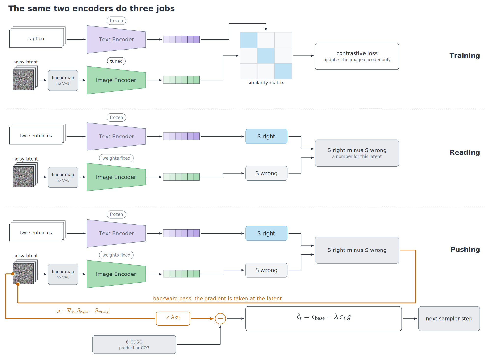</a>

*The same two encoders do three jobs, one lane each. Training (top): captions through the lilac text encoder (frozen) and noisy latents through a grey "linear map, no VAE" box and the green image encoder (tuned) meet in a similarity matrix with a pale blue diagonal, and the contrastive loss "updates the image encoder only". Reading (middle): two sentences and a noisy latent, with the image encoder's weights fixed, give S right and S wrong and the box "S right minus S wrong, a number for this latent". Pushing (bottom): the same difference sends an orange lane, "backward pass: the gradient is taken at the latent", to g = ∇_{x_t}[S_right − S_wrong], which is multiplied by λ σ_t and subtracted from "ε base, product or CO3" to give ε̂_t = ε_base − λ σ_t g for the next sampler step.* ✅ *Read on the figure at full size. The card says to open this one first when you lose track of which job a later figure belongs to* ✍️.

## Table of contents

- [Words this page uses](#words-this-page-uses)
- [The two sentences and the text encoder](#the-two-sentences-and-the-text-encoder)
- [The half-drawn picture and its noise levels](#the-half-drawn-picture-and-its-noise-levels)
- [Four latent channels become three colours](#four-latent-channels-become-three-colours)
- [The clamp stops the gradient](#the-clamp-stops-the-gradient)
- [What is tuned and what is frozen](#what-is-tuned-and-what-is-frozen)
- [Training on noisy latents](#training-on-noisy-latents)
- [Compare: right minus wrong](#compare-right-minus-wrong)
- [The gradient walks back to the latent](#the-gradient-walks-back-to-the-latent)
- [How the push joins CO3](#how-the-push-joins-co3)
- [All of it at once](#all-of-it-at-once)
- [Where this came from](#where-this-came-from)
- [Read more](#read-more)

## Words this page uses

Navigation: 📋 [TOC](#table-of-contents) | [Next](#the-two-sentences-and-the-text-encoder) ➡️

**Encoder**: a network that turns an input (a sentence, a picture) into a fixed-length list of numbers, its vector.

**ViT-L/14**: a vision transformer, large size, that cuts a 224-pixel picture into patches of 14 by 14 pixels (16 by 16 of them, 256 in all) and runs them through 24 blocks of attention and MLP.

**Vision transformer and attention, with worked examples**: [the vision transformer card](../../../../../Obsidian/Artificial%20Intelligence/Deep%20Learning/Vision%20Transformer.md#where-to-learn-this) and [the attention card](../../../../../Obsidian/Artificial%20Intelligence/Deep%20Learning/Attention.md#where-to-learn-this); CLIP's own blocks are drawn on the CLIP ladder linked at the top of this page.

**Summary token**: one extra slot added to the 256 patches; its 1024 numbers after the last block are what the encoder hands on.

**Projection**: a fixed matrix that maps the encoder's output into the shared 768-number space where pictures and sentences are compared.

**Frozen and tuned**: frozen weights never change during training; tuned weights are moved by it.

**VAE decoder**: SDXL's network from the 4-channel latent to the finished 1024-pixel picture. NoisyCLIP skips it.

**W2**: Loop 9's reading test, which scored right-against-wrong sentences with NoisyCLIP, frozen CLIP and Latent CLIP on cat and dog latents at steps 0 to 15, with no training, to see whether the score reads each of the five properties before anything is pushed.

**W3**: Loop 9's step planned to push CO3's renders with the sentence score, allowed only on steps where its reading test, W2, found the score readable.

## The two sentences and the text encoder

Navigation: ⬅️ [Words this page uses](#words-this-page-uses) | 📋 [TOC](#table-of-contents) | [Next](#the-half-drawn-picture-and-its-noise-levels) ➡️

**Before any picture is read, the text encoder has to give "a cat to the left of a dog" and "a dog to the left of a cat" different vectors, and it keeps only 0.28 of a left-right swap, against 0.72 of a colour-binding swap.** ✍️ [The word check in the reading review](../../../artifacts/notes/progress/noise-text-critic/02-can-it-read/review.md#text-only-word-check).

<table><tr>
<td><a href="../../../2-classifier-guidance/artifacts/scenes/noisyclip-sentence-score/0.5-network-view/nc11-the-text-only-word-check.png">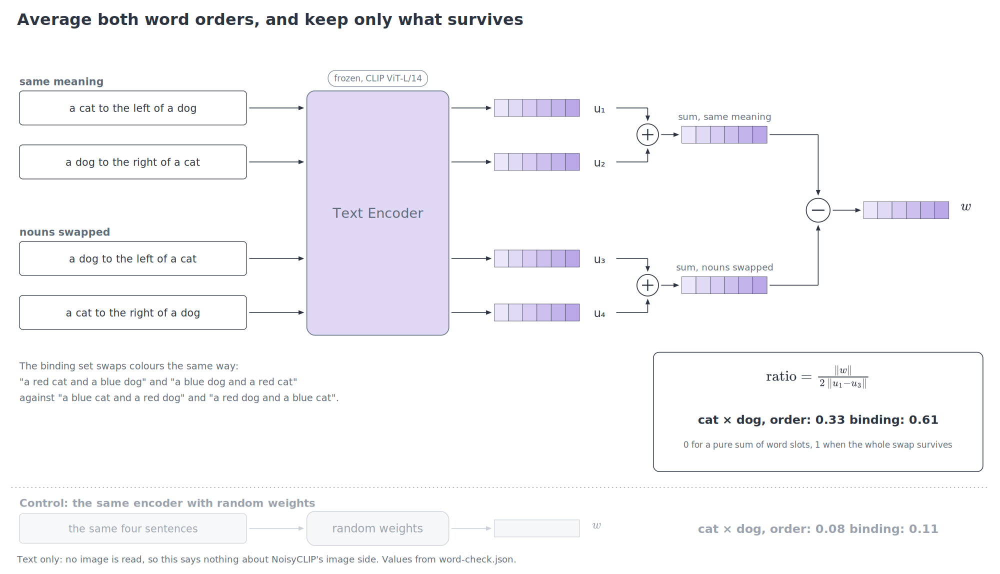</a> The word check, one swap set</td>
<td><a href="../../../2-classifier-guidance/artifacts/scenes/noisyclip-sentence-score/0.5-network-view/nc12-what-survives-for-six-noun-pairs.png">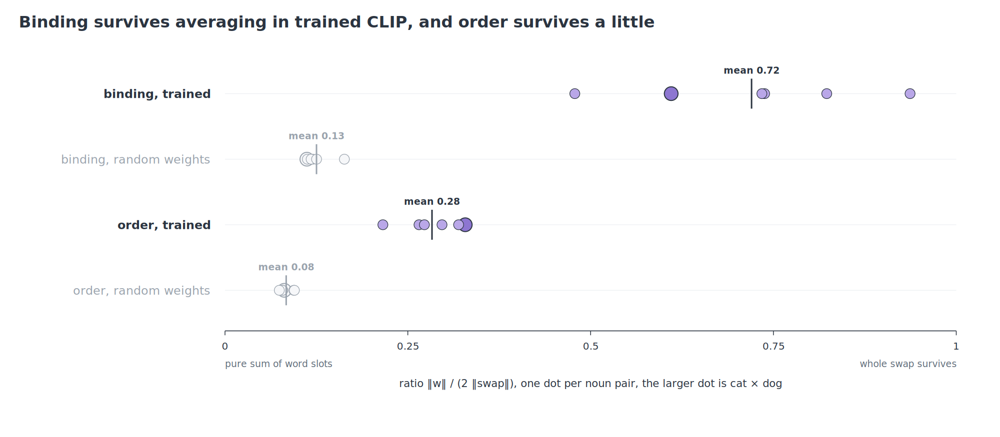</a> What survives for six noun pairs</td>
</tr></table>

*Left: the four sentences of one swap set go through CLIP-L's frozen text encoder to u₁ to u₄. "a cat to the left of a dog" and "a dog to the right of a cat" (same meaning) are summed; "a dog to the left of a cat" and "a cat to the right of a dog" (nouns swapped) are summed; w is the first sum minus the second. The box gives ratio = ‖w‖ / (2 ‖u₁ − u₃‖), 0 for a pure sum of word slots and 1 when the whole swap survives, and for cat and dog "order: 0.33, binding: 0.61". The faded row below runs the same four sentences through the same encoder with random weights: 0.08 and 0.11.* ✅ *Right: across, the same ratio from 0 to 1; one dot per noun pair, six pairs, four rows. Binding with trained weights averages 0.72, with random weights 0.13; order with trained weights 0.28, with random weights 0.08. The larger dot in each row is cat and dog.* ✅ *Both read at full size; the numbers come from [the word check's result file](../../../artifacts/notes/progress/noise-text-critic/02-can-it-read/word-check/word-check.json).* ✍️ *This check reads no image, so it bounds what any reader with this text encoder can do and says nothing about NoisyCLIP's image side* ✍️ *(the network-view card).*

🔤 **The name:** word slot
- **word**: one word of the sentence, such as "cat".
- **slot**: a fixed place it can sit in, first noun or second noun.
- **On the picture:** a sentence built as a sum of one vector per word in its slot; the "+" nodes on the left figure add two such sentences.
- **Formula, in those words:** if every sentence were cat-in-slot-one plus relation plus dog-in-slot-two, the same-meaning sum and the swapped sum would hold every word slot once each, so w = 0 and the ratio is 0.
- **Consequence:** on the ladder's word-check toy, adding one term c × side × (n_first − n_second), which knows which noun sits on which side, lifts the ratio from 0 at c = 0 to 0.24 at c = 0.25, 0.47 at c = 0.5 and 0.78 at c = 1 ✅ (c = 0 and 0.5 from [the word-check toy's key](../../../2-classifier-guidance/artifacts/scenes/noisyclip-sentence-score/2-miniature/word_check_toy_key.json); 0.25 and 1 computed this session from its vectors). Trained CLIP's 0.33 for cat and dog order sits between the toy's c = 0.25 and c = 0.5. The toy is worked on [the miniature page](03-the-miniature.md#the-word-check-on-a-toy).

## The half-drawn picture and its noise levels

Navigation: ⬅️ [The two sentences and the text encoder](#the-two-sentences-and-the-text-encoder) | 📋 [TOC](#table-of-contents) | [Next](#four-latent-channels-become-three-colours) ➡️

**NoisyCLIP trained on steps 20 to 29 of a 50-step run, and this loop would read and push at steps 0 to 15, where the picture's share of the latent is 0.076 to 0.31.** ✅ The ladder's numbers file, computed from SDXL's scheduler config; the training window is the paper's, p. 6 ✍️.

<table><tr>
<td><a href="../../../2-classifier-guidance/artifacts/scenes/noisyclip-sentence-score/0.5-network-view/nc7-trained-noise-levels-and-pushed-steps.png">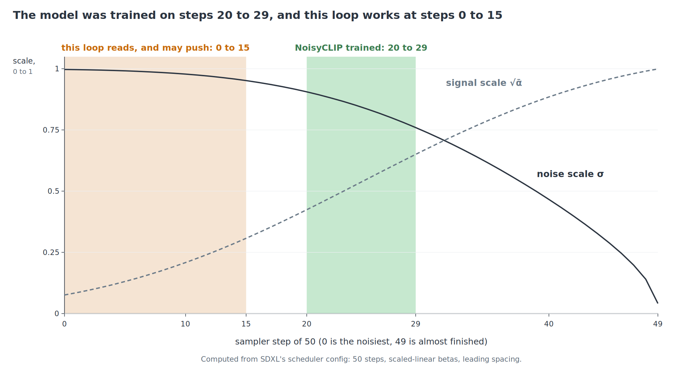</a> Trained later than this loop reads</td>
<td><a href="../../../2-classifier-guidance/artifacts/scenes/noisyclip-sentence-score/1-illustrations/ni6-trained-later-than-we-push.png">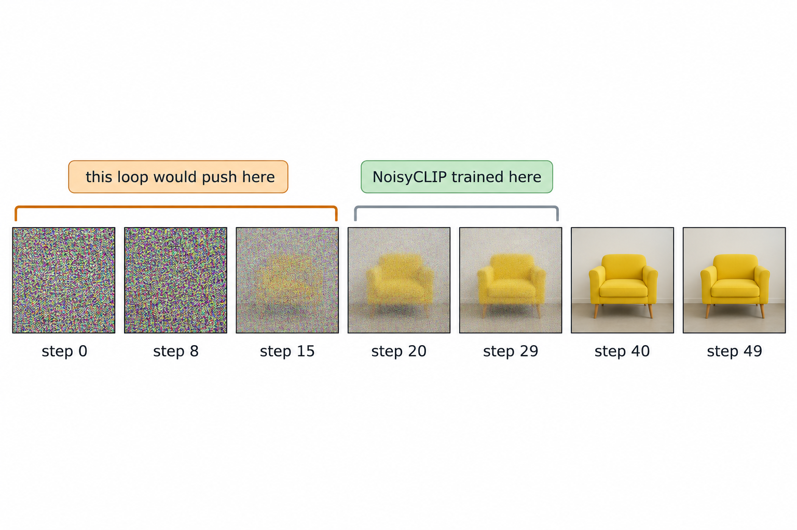</a> The same, illustrated</td>
</tr></table>

*Left: across, the sampler step of 50, 0 the noisiest; up, the scale from 0 to 1. The solid line is the noise scale σ, the dashed line the signal scale √ᾱ. Orange band: "this loop reads, and may push: 0 to 15". Green band: "NoisyCLIP trained: 20 to 29". Footer: computed from SDXL's scheduler config, 50 steps, scaled-linear betas, leading spacing.* ✅ *Right: the ladder's illustration, an armchair appearing out of noise at steps 0, 8, 15, 20, 29, 40 and 49, with the two windows bracketed. Its tiles are an image model's teaching drawing, no SDXL sample, and an armchair is in no benchmark pool* ✍️ *(the illustrations card).*

| Step of 50 | Timestep | Signal scale √ᾱ | Noise scale σ |
|---|---|---|---|
| 0 | 981 | 0.076 | 0.9971 |
| 10 | 781 | 0.2085 | 0.978 |
| 15 | 681 | 0.3076 | 0.9515 |
| 20 | 581 | 0.4241 | 0.9056 |
| 29 | 401 | 0.6503 | 0.7597 |

✅ The ladder's numbers file, `schedule`.

🔤 **The name:** timestep, from scaled-linear betas with leading spacing (the left figure's footer)
- **timestep**: one tick of the clock SDXL was trained on, numbered 0 (almost clean) to 999 (almost all noise). On the table, the second column: each of the 50 sampler steps sits on one tick.
- **betas**: β, the small amount of noise the training clock adds at each tick.
- **scaled-linear**: √β rises in a straight line from √0.00085 = 0.0292 at tick 0 to √0.012 = 0.1095 at tick 999, and β is that line squared.
- **leading spacing**: the 50 steps take every 20th tick counted up from the start, 1, 21, 41 and on to 981, so step k sits at tick 981 − 20k: step 15 at 681 and step 29 at 401, as in the table.
- **Formula, in those words:** ᾱ at a tick is the product of (1 − β) over every tick up to it, the signal scale is √ᾱ and the noise scale is √(1 − ᾱ).
- **Consequence:** step 0 sits at tick 981, with signal scale 0.076 and noise scale 0.9971. Start the 50 steps at the clock's very end instead, tick 999, and the signal scale at step 0 falls to 0.0683. ✅ Computed this session from the two beta ends, which give back the table's 0.076 at tick 981 and 0.3076 at tick 681.

🔤 **The name:** signal scale
- **signal**: the part of the latent that is the picture.
- **scale**: the number it is multiplied by.
- **On the picture:** the dashed line.
- **Formula, in those words:** x_t = √ᾱ_t × the finished latent + σ_t × fresh noise, with (√ᾱ_t)² + σ_t² = 1.
- **Consequence:** at step 0, 0.076² + 0.9971² = 0.0058 + 0.9942 = 1.000, so the picture holds 0.6% of the latent's variance. Move to step 15 and it holds 0.3076² = 9.5%; to step 20, where NoisyCLIP's training starts, 18.0%. ✅ Computed from the table.

## Four latent channels become three colours

Navigation: ⬅️ [The half-drawn picture and its noise levels](#the-half-drawn-picture-and-its-noise-levels) | 📋 [TOC](#table-of-contents) | [Next](#the-clamp-stops-the-gradient) ➡️

**CLIP reads colour pictures, so a fixed table turns SDXL's 4 latent channels into red, green and blue at each of the 128 by 128 positions, with no VAE decoder.** ✅ The released `latent_to_image.py`, lines 9 to 17.

<table><tr>
<td><a href="../../../2-classifier-guidance/artifacts/scenes/noisyclip-sentence-score/0.5-network-view/nc3-four-latent-channels-to-rgb.png">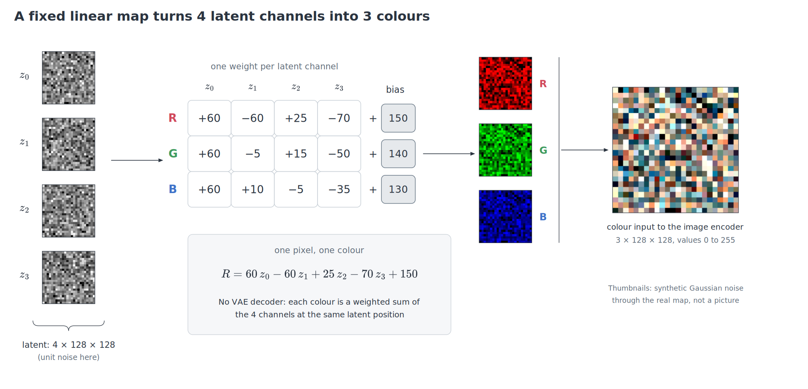</a> The fixed map</td>
<td><a href="../../../2-classifier-guidance/artifacts/scenes/noisyclip-sentence-score/1-illustrations/ni1-a-cheap-colour-view-of-the-latent.png">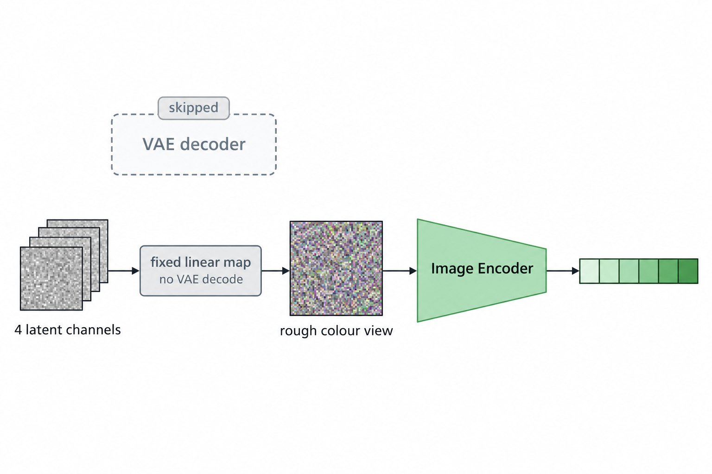</a> The same, illustrated</td>
</tr></table>

*Left: four latent tiles z₀ to z₃ ("latent: 4 × 128 × 128, unit noise here"), the weight table R (+60, −60, +25, −70) + 150, G (+60, −5, +15, −50) + 140, B (+60, +10, −5, −35) + 130, the three colour tiles, and the "colour input to the image encoder, 3 × 128 × 128, values 0 to 255". The box spells out R = 60 z₀ − 60 z₁ + 25 z₂ − 70 z₃ + 150. The tiles are synthetic Gaussian noise through the real map, not a picture.* ✅ *Right: the illustration, with the VAE decoder drawn dashed and tagged "skipped".* ✅ *Both read at full size.*

$$
\underbrace{R}_{\text{red, 0 to 255}} = \underbrace{60\,z_0 - 60\,z_1 + 25\,z_2 - 70\,z_3}_{\text{a fixed weighted sum of the 4 channels}} + \underbrace{150}_{\text{bias}}
$$

🔤 **The name:** linear map
- **linear**: each output is the inputs times fixed numbers, added up; doubling a change in the input doubles the change in the output.
- **map**: a rule that sends each input to an output.
- **On the picture:** the weight table, one row per colour, one column per latent channel.
- **Formula, in those words:** colour = W z + b, one weighted sum per row.
- **Consequence:** on the miniature's pixel A, (1, 0.5, 0, 0.5), red is 60 − 30 + 0 − 35 + 150 = 145. Set its z₃ from 0.5 to 0 and red rises by 70 × 0.5 to 180. ✅ The answer key, and the move computed this session.

## The clamp stops the gradient

Navigation: ⬅️ [Four latent channels become three colours](#four-latent-channels-become-three-colours) | 📋 [TOC](#table-of-contents) | [Next](#what-is-tuned-and-what-is-frozen) ➡️

**The released map holds each colour between 0 and 255 and then converts it to 8-bit integers; a held colour passes no gradient, and the conversion passes none at all.** ✅ The released `latent_to_image.py`, line 18.

<table><tr>
<td><a href="../../../2-classifier-guidance/artifacts/scenes/noisyclip-sentence-score/0.5-network-view/nc4-clamping-kills-the-gradient.png">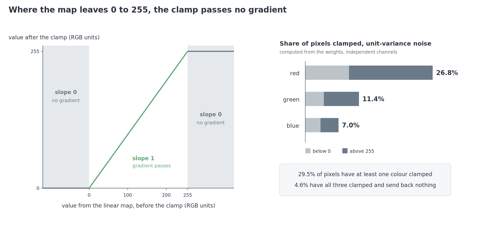</a> The clamp and the share it holds</td>
<td><a href="../../../2-classifier-guidance/artifacts/scenes/noisyclip-sentence-score/1-illustrations/ni5-two-places-the-signal-is-cut.png">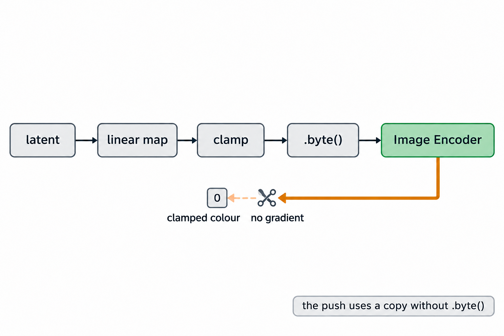</a> Two places the signal is cut</td>
</tr></table>

*Left plot: across, the value from the linear map before the clamp; up, the value after, both in RGB units. Grey bands below 0 and above 255 are "slope 0, no gradient"; the green line from 0 to 255 is "slope 1, gradient passes". Right: the share of pixels clamped on unit-variance noise, computed from the weights with independent channels, light grey below 0 and dark grey above 255: red 26.8%, green 11.4%, blue 7.0%. The box: 29.5% of pixels have at least one colour clamped, and 4.6% have all three clamped and send back nothing.* ✅ *Right: the illustration's return lane is cut at `.byte()` and ends at a clamped colour of 0; the tag reads "the push uses a copy without .byte()".* ✅ *Both read at full size.*

🔤 **The name:** clamp
- **clamp**: a tool that holds something in place. Here, clamp(c) = min(max(c, 0), 255): any colour below 0 is held at 0 and any above 255 at 255.
- **On the picture:** the two grey bands of the left plot.
- **Formula, in those words:** its slope is 1 inside 0 to 255 and 0 outside, so a held colour sends back 0 to every latent channel that fed it.
- **Consequence:** red's spread on unit noise is √(60² + 60² + 25² + 70²) = 112.81 about a mean of 150, so the share below 0 is the normal tail beyond −150 / 112.81 = −1.33, 9.2%, and the share above 255 the tail beyond 105 / 112.81 = 0.93, 17.6%: 26.8% in all. Halve every red weight and the spread halves to 56.4, the tails move to −2.66 and 1.86, and the share falls to about 3.5%. ✅ The first three numbers in [the rebuild companion, section 3](../../../2-classifier-guidance/artifacts/scenes/noisyclip-sentence-score/rebuild-from-fundamentals.md#3-the-clamp-and-how-many-pixels-it-holds) and recomputed this session; the halved case computed this session as 0.4% + 3.1%.

> [!NOTE]
> These shares assume independent unit-variance channels, which holds for pure noise. A half-drawn SDXL latent has structure, so its clamped share has to be measured ✍️ (the rebuild companion, section 3). The push step's design plans that measurement and a soft clamp to compare, and no finding holds a measured share ✍️ (its review).

## What is tuned and what is frozen

Navigation: ⬅️ [The clamp stops the gradient](#the-clamp-stops-the-gradient) | 📋 [TOC](#table-of-contents) | [Next](#training-on-noisy-latents) ➡️

**NoisyCLIP's published weights change only the image encoder, 303,179,776 of CLIP's 427,616,513 numbers; both projections and the first text block equal base CLIP exactly.** ✍️ The ladder's numbers file, counted from the config, and [the checkpoint comparison](../../../artifacts/notes/progress/noise-text-critic/01-reading/tools/checkpoint-compare.txt).

<a href="../../../2-classifier-guidance/artifacts/scenes/noisyclip-sentence-score/0.5-network-view/nc5-what-is-tuned-and-what-is-frozen.png">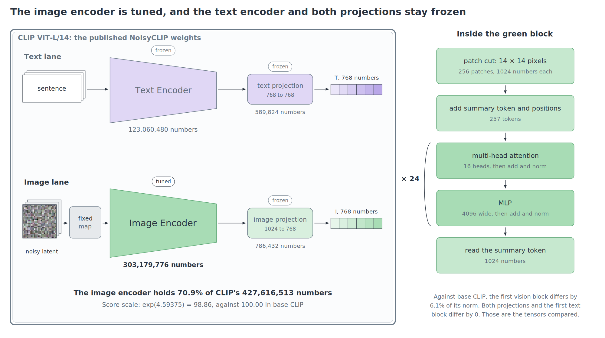</a>

*Inside the frame "CLIP ViT-L/14: the published NoisyCLIP weights". Text lane: sentence, text encoder (frozen, 123,060,480 numbers), text projection 768 to 768 (frozen, 589,824), T of 768 numbers. Image lane: noisy latent, fixed map, image encoder (tuned, 303,179,776), image projection 1024 to 768 (frozen, 786,432), I of 768 numbers. Footer: the image encoder holds 70.9% of CLIP's 427,616,513 numbers; score scale exp(4.59375) = 98.86 against 100.00 in base CLIP. Right column, "Inside the green block": patch cut of 14 × 14 pixels (256 patches, 1024 numbers each), add the summary token and positions (257 tokens), × 24 of multi-head attention (16 heads) and an MLP 4096 wide, each followed by add and norm, then read the summary token (1024 numbers). The note: the first vision block differs from base CLIP by 6.1% of its norm; both projections and the first text block differ by 0; those are the tensors compared.* ✅ *Read at full size.*

Only those tensors were compared, so the other text layers are frozen on the paper's word (p. 6) ✍️. The released training flag `--only_vision` freezes every parameter whose name contains "text", which would leave the image projection trainable, while the published weights show that projection unchanged; the command that produced the checkpoint is not released ✍️ ([the code walk, block 4](../../../2-classifier-guidance/artifacts/scenes/noisyclip-sentence-score/3-code/walk-noisyclip.md#4-which-parameters-train)). The code is quoted on [the code page](04-the-code.md#which-parameters-train).

## Training on noisy latents

Navigation: ⬅️ [What is tuned and what is frozen](#what-is-tuned-and-what-is-frozen) | 📋 [TOC](#table-of-contents) | [Next](#compare-right-minus-wrong) ➡️

**Training pulls each noisy latent's vector toward its own caption and away from every other caption in the batch, and only the image side moves.** ✍️ The paper, p. 6, as recorded in [the NoisyCLIP reading note](../../../artifacts/notes/progress/noise-text-critic/01-reading/noisyclip.md).

<table><tr>
<td><a href="../../../2-classifier-guidance/artifacts/scenes/noisyclip-sentence-score/0.5-network-view/nc6-training-on-noisy-latents.png">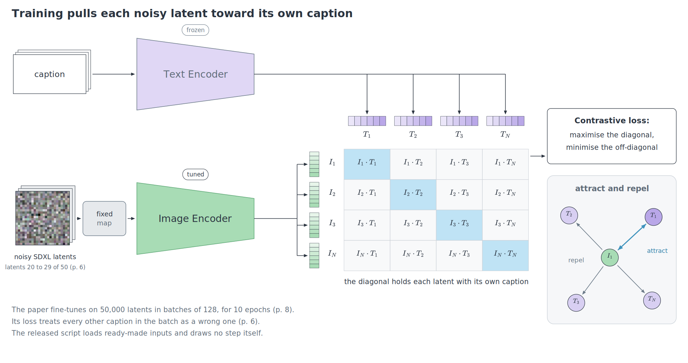</a> The training layout</td>
<td><a href="../../../2-classifier-guidance/artifacts/scenes/noisyclip-sentence-score/1-illustrations/ni3-training-on-half-drawn-pictures.png">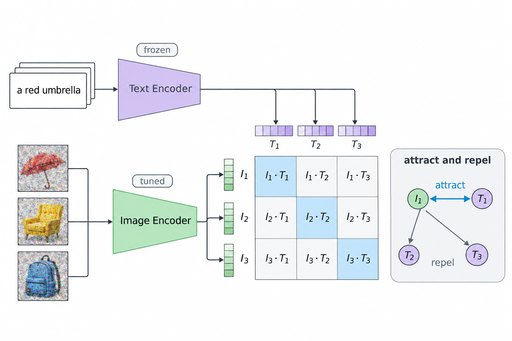</a> The same, illustrated</td>
</tr></table>

*Left: captions through the frozen text encoder to T₁ … T_N; noisy SDXL latents ("latents 20 to 29 of 50, p. 6") through the fixed map and the tuned image encoder to I₁ … I_N; the matrix cells are labelled by their product I_i · T_j and hold no values; the diagonal is pale blue; the box reads "Contrastive loss: maximise the diagonal, minimise the off-diagonal"; the panel shows I₁ attracted to T₁ and repelled from T₂, T₃, T_N. Footer: the paper fine-tunes on 50,000 latents in batches of 128 for 10 epochs (p. 8); its loss treats every other caption in the batch as a wrong one (p. 6); the released script loads ready-made inputs and draws no step itself.* ✅ *Right: the illustration on an umbrella, an armchair and a backpack, subjects in no benchmark pool* ✍️ *(ladder.json).* *The CLIP ladder draws the same loss with real scores in [four pictures against four captions](../../../../../goal-setting/learning/deep-learning/generative-models/02-stable-diffusion-and-clip/artifacts/figures/clip/network-view/cv7-four-pictures-against-four-captions.png).*

$$
\underbrace{\mathcal L}_{\text{the loss}} = \tfrac12\Big[\underbrace{\mathrm{CE}\big(e^{t_s} s,\ \text{rows}\big)}_{\text{each latent picks its caption}} + \underbrace{\mathrm{CE}\big(e^{t_s} s,\ \text{columns}\big)}_{\text{each caption picks its latent}}\Big]
$$

s is the matrix of cosines, e^{t_s} the score multiplier (98.86 in NoisyCLIP, 10 in the miniature), and CE the cross-entropy: minus the log of the share a softmax gives the right cell.

Both are worked with numbers on [the cross-entropy card](../../../../../Obsidian/Mathematics/Statistics/Information%20Theory/Cross-Entropy.md#where-to-learn-this) and [the softmax card](../../../../../Obsidian/Artificial%20Intelligence/Deep%20Learning/Softmax.md#where-to-learn-this).

🔤 **The name:** CLIP, contrastive language-image pre-training
- **contrastive**: judged by comparison. Each latent is scored against every caption in the batch, and only beating the others counts. On the picture, the diagonal against the rest of its row and column.
- **language-image**: the two lanes, sentences and pictures, each with its own encoder.
- **pre-training**: training once on broad data before the model is put to a particular use. NoisyCLIP fine-tunes a pre-trained CLIP on noisy latents.
- **Formula, in those words:** for each row, the share the softmax of e^{t_s} × cosines gives the diagonal cell; the loss is minus its log, averaged over rows and over columns.
- **Consequence:** on the miniature's two latents and two sentences at multiplier 10, row 1 holds 9.6865 and 9.9946, so the diagonal's share is 0.4236 and its cross-entropy 0.859; averaged over both rows and both columns the loss is 0.9264. One step of size 0.5 on the image layer takes it to 0.7929, and the sentence vectors stay at (0.8, 0.6) and (0.6, 0.8). ✅ The answer key's `training`; the row share recomputed this session. Worked on [the miniature page](03-the-miniature.md#one-training-step).

## Compare: right minus wrong

Navigation: ⬅️ [Training on noisy latents](#training-on-noisy-latents) | 📋 [TOC](#table-of-contents) | [Next](#the-gradient-walks-back-to-the-latent) ➡️

**The score difference is the picture's vector dotted with the difference of the two sentence vectors, so a text encoder that gave the two sentences the same vector would give the push nothing to follow.** ✅ Read on the figure and in the ladder's notation.

<table><tr>
<td><a href="../../../2-classifier-guidance/artifacts/scenes/noisyclip-sentence-score/0.5-network-view/nc8-right-minus-wrong.png">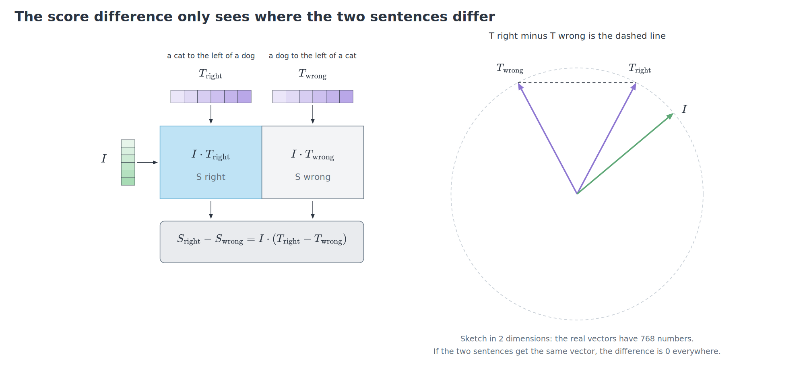</a> Right minus wrong</td>
<td><a href="../../../2-classifier-guidance/artifacts/scenes/noisyclip-sentence-score/1-illustrations/ni2-one-picture-against-two-sentences.png">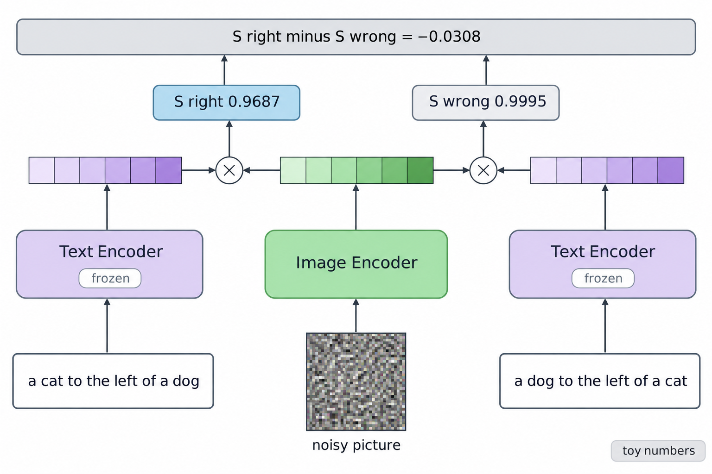</a> The same, on the miniature's numbers</td>
</tr></table>

*Left: I meets T_right ("a cat to the left of a dog") in the blue cell, S right, and T_wrong ("a dog to the left of a cat") in the grey cell, S wrong; the box reads S_right − S_wrong = I · (T_right − T_wrong). The circle is a two-dimensional sketch of 768-number vectors: T_right minus T_wrong is the dashed line between their tips, and "if the two sentences get the same vector, the difference is 0 everywhere".* ✅ *Right: the illustration carries the miniature's numbers, S right 0.9687, S wrong 0.9995, difference −0.0308, tagged "toy numbers".* ✅ *Both read at full size.*

$$
D = \underbrace{I \cdot T_{\text{right}}}_{S_{\text{right}}} - \underbrace{I \cdot T_{\text{wrong}}}_{S_{\text{wrong}}} = I \cdot \underbrace{(T_{\text{right}} - T_{\text{wrong}})}_{\Delta T,\ \text{where the sentences differ}}
$$

On the miniature ΔT = (0.8, 0.6) − (0.6, 0.8) = (0.2, −0.2), so D = 0.6259 × 0.2 − 0.7799 × 0.2 = −0.0308. Shrink the gap between the sentences to (0.05, −0.05) and D shrinks to a quarter, −0.0077, with the picture unchanged. ✅ The key, and the move computed this session. This is why the word check above bounds the push: on CLIP's text encoder a left-right swap moves a sentence 0.19 to 0.34, against 0.63 to 0.87 for changing one noun ✍️ (the network-view card).

## The gradient walks back to the latent

Navigation: ⬅️ [Compare: right minus wrong](#compare-right-minus-wrong) | 📋 [TOC](#table-of-contents) | [Next](#how-the-push-joins-co3) ➡️

**The chain rule carries the score difference back through ten stages, one factor per stage, to one number per latent number; the released map would cut it at the byte conversion and at any clamped colour.** ✅ Read on the figure.

<a href="../../../2-classifier-guidance/artifacts/scenes/noisyclip-sentence-score/0.5-network-view/nc9-the-gradient-back-to-the-latent.png">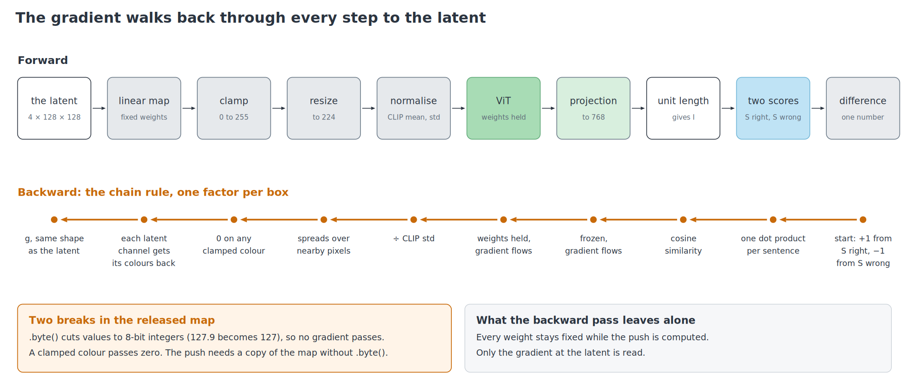</a>

*Forward row: the latent (4 × 128 × 128), linear map (fixed weights), clamp (0 to 255), resize (to 224), normalise (CLIP mean, std), ViT (weights held, green), projection (to 768), unit length (gives I), two scores (S right, S wrong), difference (one number). Backward row, orange, right to left: start +1 from S right and −1 from S wrong; one dot product per sentence; cosine similarity; frozen, gradient flows; weights held, gradient flows; ÷ CLIP std; spreads over nearby pixels; 0 on any clamped colour; each latent channel gets its colours back; g, same shape as the latent. Left box: `.byte()` cuts values to 8-bit integers (127.9 becomes 127), so no gradient passes; a clamped colour passes zero; the push needs a copy of the map without `.byte()`. Right box: every weight stays fixed while the push is computed; only the gradient at the latent is read.* ✅ *Read at full size.*

The chain rule is taken apart on the miniature's four links on [the miniature's gradient](03-the-miniature.md#the-gradient-back-to-the-latent), and [the chain rule card](../../../../../Obsidian/Mathematics/Calculus/Chain%20Rule.md#where-to-learn-this) holds its textbook pages.

🔤 **The name:** the gradient of a cosine
- **gradient**: the direction in which a number rises fastest, one slope per input.
- **cosine**: the dot product of two length-1 vectors.
- **On the picture:** the backward dot labelled "unit length", where the vector h is divided by its own length to give I.
- **Formula, in those words:** for I = h / ‖h‖ and a fixed vector ΔT, ∂(I · ΔT)/∂h = (ΔT − (ΔT · I) I) / ‖h‖: take off the part of ΔT along I, then divide by h's length.
- **Consequence:** on the miniature, (ΔT − (−0.0308) I) / 1.0182 = (0.2154, −0.1728), and its dot product with I = (0.6259, 0.7799) is 0.1348 − 0.1348 = 0. The gradient can only turn the picture's vector and never lengthen it. ✅ The key's `dD_dh`, the dot product computed this session. The learning tree has no page deriving this; the ladder's [rebuild companion, section 7](../../../2-classifier-guidance/artifacts/scenes/noisyclip-sentence-score/rebuild-from-fundamentals.md#7-the-gradient-of-a-cosine) holds it and lists it as a gap.

## How the push joins CO3

Navigation: ⬅️ [The gradient walks back to the latent](#the-gradient-walks-back-to-the-latent) | 📋 [TOC](#table-of-contents) | [Next](#all-of-it-at-once) ➡️

**The gradient is taken at the latent, and the push is subtracted from both of CO3's predictions, which lowers CO3's guided prediction by exactly the push.** ✅ `co3_push.py`, lines 30 to 36, and the figure.

<table><tr>
<td><a href="../../../2-classifier-guidance/artifacts/scenes/noisyclip-sentence-score/0.5-network-view/nc10-how-the-push-joins-co3.png">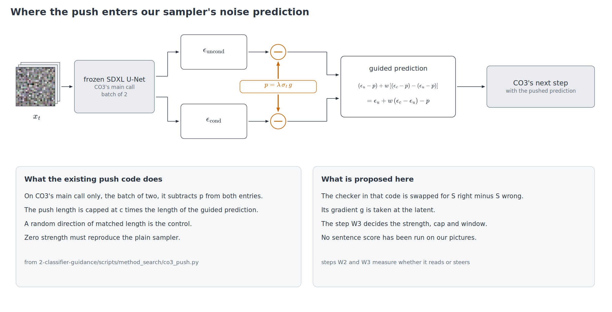</a> Where the push enters CO3</td>
<td><a href="../../../2-classifier-guidance/artifacts/scenes/noisyclip-sentence-score/1-illustrations/ni4-the-push-bends-the-noise-prediction.png">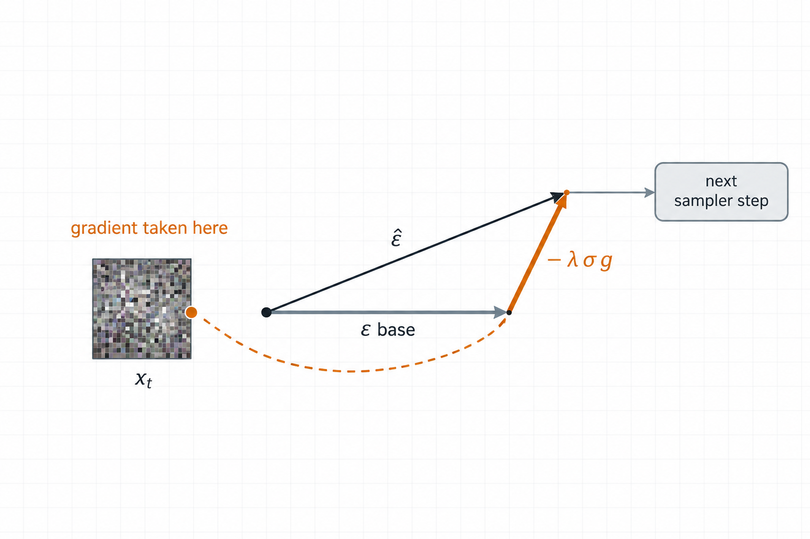</a> The push bends the noise prediction</td>
</tr></table>

*Left: x_t goes through "frozen SDXL U-Net, CO3's main call, batch of 2" to ε_uncond and ε_cond; the orange box p = λ σ_t g is subtracted from both; the guided prediction reads (ε_u − p) + w[(ε_c − p) − (ε_u − p)] = ε_u + w(ε_c − ε_u) − p and goes to "CO3's next step, with the pushed prediction". Lower left, "what the existing push code does": on CO3's main call only, it subtracts p from both entries; the push length is capped at c times the length of the guided prediction; a random direction of matched length is the control; zero strength must reproduce the plain sampler. Lower right, "what is proposed here": the checker is swapped for S right minus S wrong, its gradient taken at the latent, the strength, cap and window left to step W3, and "No sentence score has been run on our pictures. Steps W2 and W3 measure whether it reads or steers".* ✅ *Right: the illustration, ε base, the orange −λσg from its tip, and ε̂ to their sum, with "gradient taken here" at the x_t tile.* ✅ *Both read at full size. The reading test's measured result is in [the reading finding](../../../2-classifier-guidance/report/the-sentence-score/can-a-sentence-score-read-the-five-properties.md), and the label's "will measure" is set against it under [where the sources disagree](01-overview.md#where-the-sources-disagree).*

**The guided prediction, by what moves.** Take one number of each, ε_u = 1, ε_c = 2, CO3's guidance w = 0.8 and a push p = 0.1 (invented to show the arithmetic). Unpushed, ε_u + w(ε_c − ε_u) = 1 + 0.8 = 1.8. With p off both entries, (1 − 0.1) + 0.8[(2 − 0.1) − (1 − 0.1)] = 0.9 + 0.8 = 1.7 = 1.8 − 0.1. The push's own w-weighted part cancels inside the bracket, so the guided prediction falls by p whatever w is. Subtract p from ε_c alone and the guided prediction would fall by w p = 0.08 instead. CO3's guidance of 0.8 is from [the push step's design](../../../artifacts/notes/progress/noise-text-critic/03-does-it-steer/design.md), line 37 ✍️.

Mixing an unconditional and a conditional prediction as ε_u + w(ε_c − ε_u) is classifier-free guidance: guidance because w steers the prediction toward the prompt, classifier-free because no separate classifier supplies the steer. [The classifier-free guidance card](../../../../../Obsidian/Artificial%20Intelligence/Generative%20Modeling/Diffusion%20Models/Classifier-Free%20Guidance.md#where-to-learn-this) holds its textbook pages.

## All of it at once

Navigation: ⬅️ [How the push joins CO3](#how-the-push-joins-co3) | 📋 [TOC](#table-of-contents) | [Next](#where-this-came-from) ➡️

**The last figure repeats the overview with every real size, and its orange lane ends at x_t because that is where the gradient is read; the result then joins ε_base, so nothing is added to the latent directly.** ✍️ The network-view card.

*Bottom centre: the noisy input x_t, 4 × 128 × 128, through "linear map to RGB, no VAE decode: 3 × 128 × 128, resize to 3 × 224 × 224 and normalise (not in the released code)" into the green image encoder (tuned, 24 blocks), giving I of 768 numbers inside the CLIP ViT-L/14 frame. Left and right: the right and wrong sentences through the same frozen text encoder to T_right and T_wrong of 768 numbers. Two product nodes give S right and S wrong, and the top bar reads "S right minus S wrong (a number between −2 and 2)". The orange lane takes the gradient at x_t, g = ∇_{x_t}[S_right − S_wrong], multiplies by λ σ_t and subtracts it from "ε base, product or CO3 noise prediction" to give ε̂_t = ε_base − λ σ_t ∇_{x_t}[S_right − S_wrong] for the next sampler step.* ✅ *Read at full size.*

The same picture opens [the code page](04-the-code.md), where each of its boxes is tied to the code that computes it.

## Where this came from

Navigation: ⬅️ [All of it at once](#all-of-it-at-once) | 📋 [TOC](#table-of-contents) | [Next](#read-more) ➡️

| What | How it was established | When |
|---|---|---|
| The section order | Read in the ladder's `0.5-network-view/README.md` and `ladder.json` `reading_order` | 2026-11-24 |
| Every label and number on the eighteen pictures | Read on each at full size; paths and labels passed `is_showable`; none is on the held list | 2026-11-24 |
| The schedule table, parameter counts, multiplier 98.86 | Read in the ladder's `numbers/numbers.json` | 2026-11-24 |
| The clamp shares, and the halved-weights case | Recomputed from the weights as normal tail areas | 2026-11-24 |
| The word-check toy's ratios at c = 0.25 and 1, D at a smaller gap, the row share 0.4236 and the cosine gradient's dot product with I | Computed this session from the two answer keys with numpy | 2026-11-24 |
| The real word-check ratios and noun-swap distances | Stated by the network-view card, citing `word-check.json` | 2026-11-24 |
| What was tuned and what was compared | Stated by the network-view card and the checkpoint comparison | 2026-11-24 |
| That the illustrations are teaching drawings | Stated by the illustrations card and `ladder.json` | 2026-11-24 |

## Read more

Navigation: ⬅️ [Where this came from](#where-this-came-from) | 📋 [TOC](#table-of-contents)

| What | Where |
|---|---|
| CLIP's own insides, read through a small network | [the CLIP ladder](../../../../../goal-setting/learning/papers/deep-learning/diffusion-models/compositional-diffusion-models/scorers/clip-read-through-a-small-network.md) |
| CLIP from its fundamentals, including the cosine as a dot product of unit vectors | [the CLIP rebuild](../../../../../goal-setting/learning/papers/deep-learning/diffusion-models/compositional-diffusion-models/scorers/rebuild-clip-from-fundamentals.md) |
| CLIP on one small network, as a textbook chapter | [the CLIP chapter](../../../../../goal-setting/learning/deep-learning/generative-models/02-stable-diffusion-and-clip/textbook/01-clip-on-one-small-network.md) |
| The schedule and forward noising, worked | [the schedule section](../../../../../goal-setting/learning/deep-learning/generative-models/02-stable-diffusion-and-clip/textbook/02-one-denoising-step-on-one-small-network.md#21-the-schedule-and-forward-noising) |
| The cosine and the linear map, with textbook pages and videos | [the cosine similarity card](../../../../../Obsidian/Mathematics/Linear%20Algebra/Cosine%20Similarity.md#where-to-learn-this) and [the linear map card](../../../../../Obsidian/Mathematics/Linear%20Algebra/Linear%20Map.md#where-to-learn-this) |
| The six illustrations as a set, with their prompts | [the illustrations card](../../../2-classifier-guidance/artifacts/scenes/noisyclip-sentence-score/1-illustrations/README.md) |

⬅️ Previous: [one sampler step](01-overview.md) | 📋 [The pages of this method](01-overview.md#the-pages-of-this-method) | Next: [the miniature](03-the-miniature.md) ➡️

<!-- built-to: PAGE_LOOK_FORMAT v1 -->
