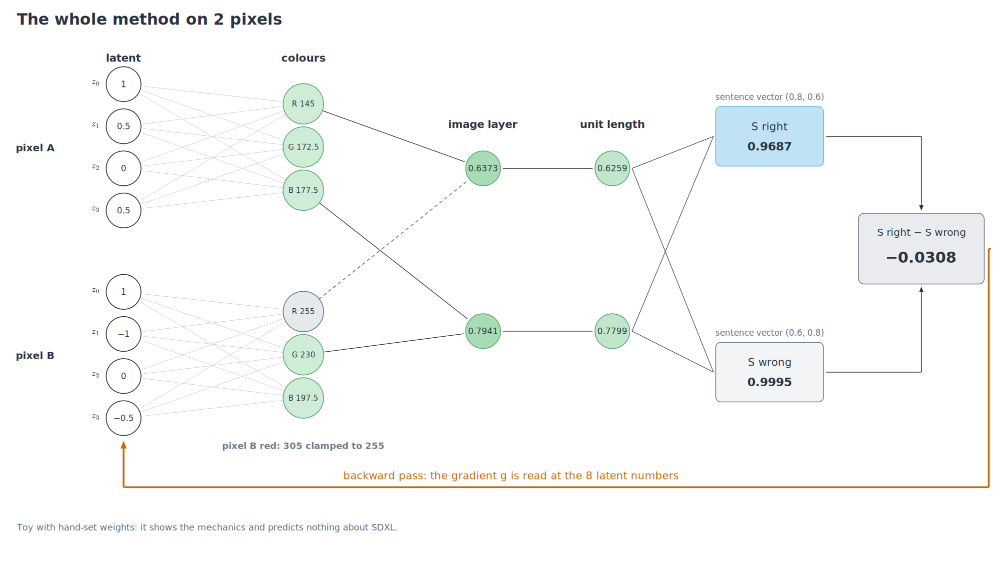
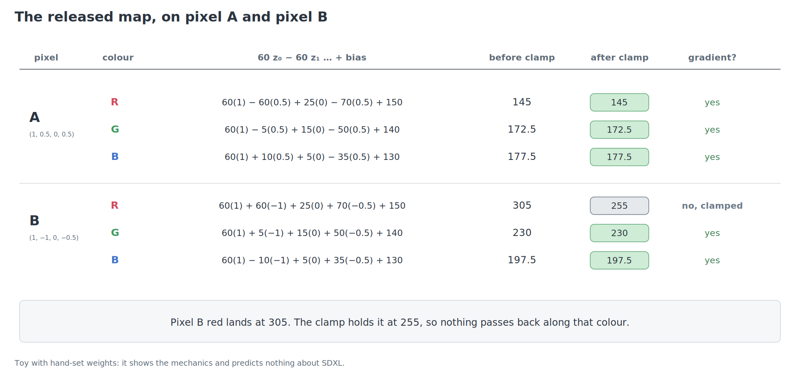
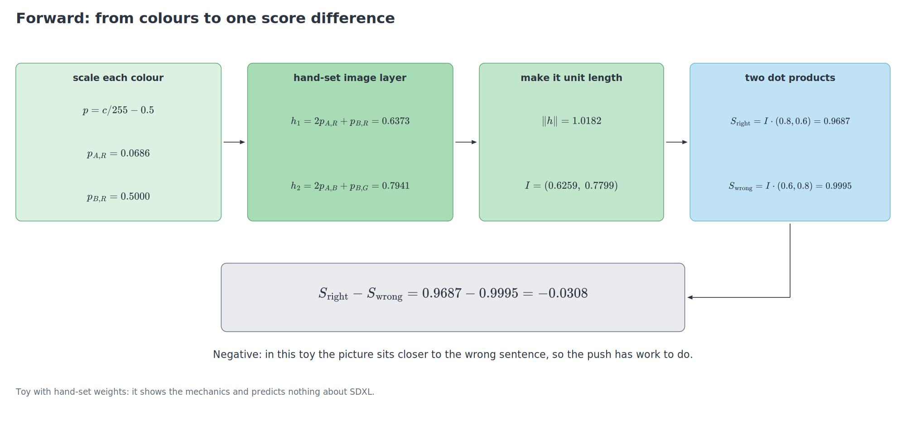
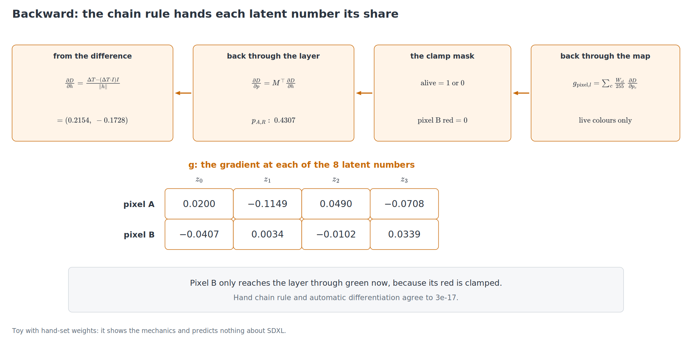
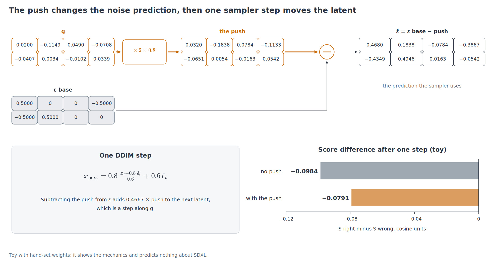
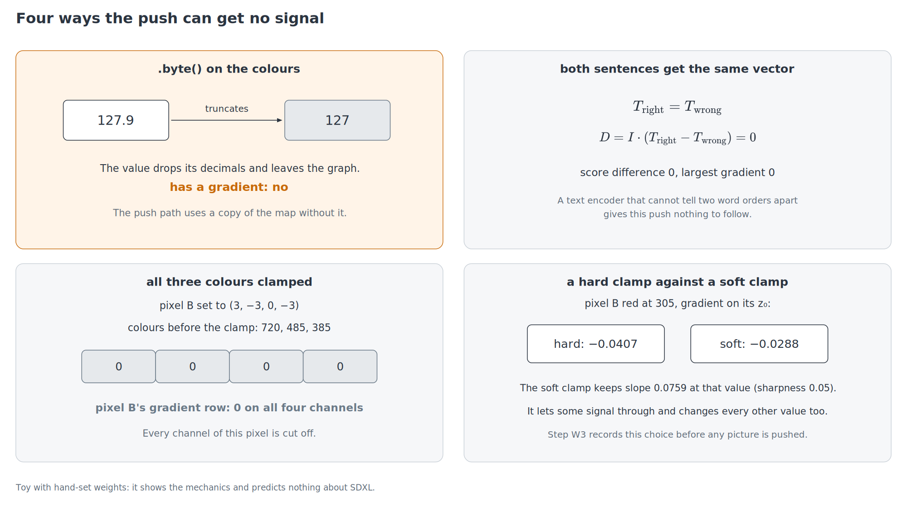
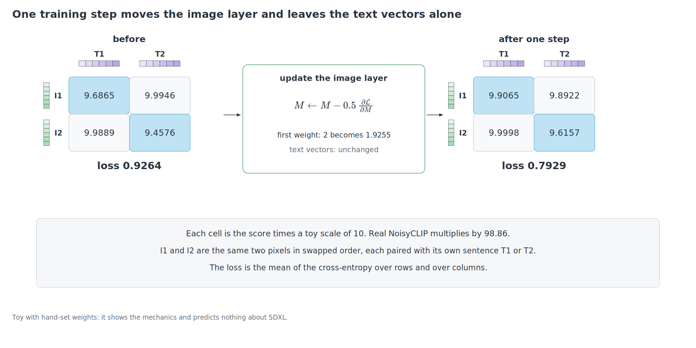
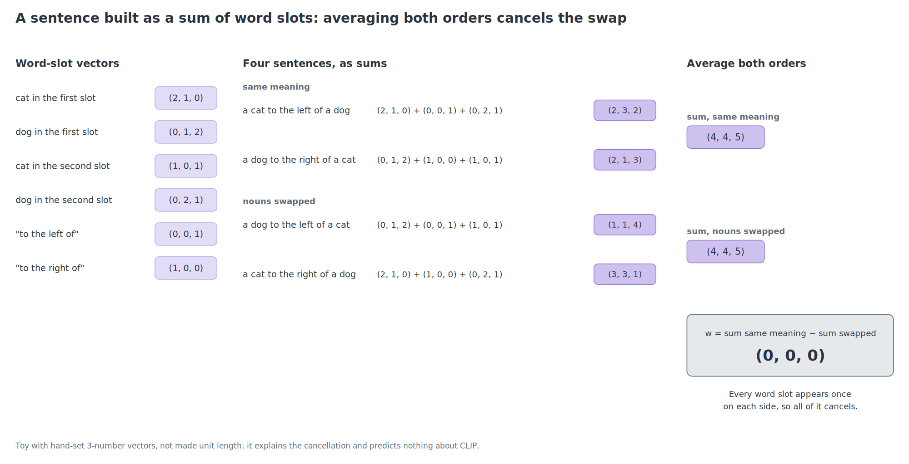
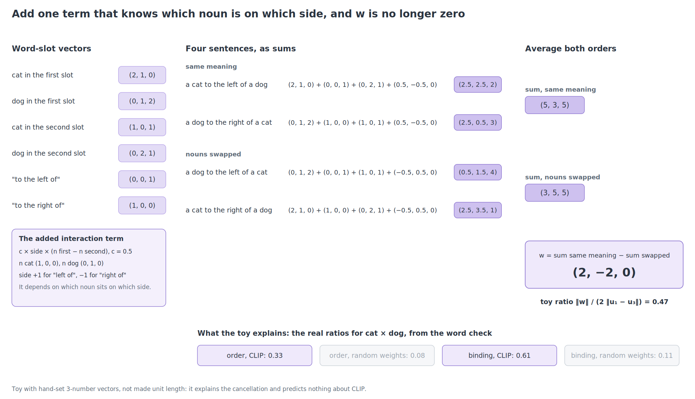

# 🌍 Context: the sentence-score push, worked on 8 latent numbers

⬅️ Previous: [the network view](02-the-network-view.md) | 📋 [The pages of this method](01-overview.md#the-pages-of-this-method) | Next: [the code](04-the-code.md) ➡️

This page shrinks the whole push until every number fits on paper: a latent of 2 pixels with 4 channels each, NoisyCLIP's real colour map, a hand-set 2 × 6 layer standing in for the 24-block vision encoder, and two hand-set sentence vectors. It runs the forward pass, the gradient back, the push and one sampler step, breaks the push four ways, trains the layer one step, and then works the toy behind the [text-only word check](../../../artifacts/notes/progress/noise-text-critic/02-can-it-read/review.md#text-only-word-check). Its weights were never trained on data, so a number here shows what a part computes and says nothing about whether NoisyCLIP reads or steers a real picture. Everything here comes from [the ladder's miniature](../../../2-classifier-guidance/artifacts/scenes/noisyclip-sentence-score/2-miniature/README.md) and its two answer keys.

<a href="../../../2-classifier-guidance/artifacts/scenes/noisyclip-sentence-score/2-miniature/mm0-the-whole-miniature.png"></a>

*Left to right. Latent: pixel A's four channels (1, 0.5, 0, 0.5) and pixel B's (1, −1, 0, −0.5). Colours: pixel A's R 145, G 172.5, B 177.5; pixel B's R 255 (grey, "pixel B red: 305 clamped to 255"), G 230, B 197.5. Image layer: 0.6373 and 0.7941, fed by pixel A's red and blue and pixel B's red (dashed) and green. Unit length: 0.6259 and 0.7799. Sentence vectors (0.8, 0.6) and (0.6, 0.8) give S right 0.9687 (blue) and S wrong 0.9995 (grey), and S right − S wrong = −0.0308. The orange lane reads "backward pass: the gradient g is read at the 8 latent numbers". Footer: toy with hand-set weights; it shows the mechanics and predicts nothing about SDXL.* ✅ *Read at full size; every number matches the answer key.*

## Table of contents

- [Words this page uses](#words-this-page-uses)
- [The toy](#the-toy)
- [The linear map on two pixels](#the-linear-map-on-two-pixels)
- [Forward to the score difference](#forward-to-the-score-difference)
- [The gradient back to the latent](#the-gradient-back-to-the-latent)
- [Why this is a classifier's gradient](#why-this-is-a-classifiers-gradient)
- [The push and one sampler step](#the-push-and-one-sampler-step)
- [Break it four ways](#break-it-four-ways)
- [One training step](#one-training-step)
- [The word check on a toy](#the-word-check-on-a-toy)
- [Run it yourself](#run-it-yourself)
- [Where this came from](#where-this-came-from)

## Words this page uses

Navigation: 📋 [TOC](#table-of-contents) | [Next](#the-toy) ➡️

**Pixel A, pixel B**: the toy latent's two positions, each with channels z₀ to z₃.

**Colour c and scaled colour p**: c is a colour after the map and clamp, 0 to 255; p = c / 255 − 0.5 puts it on −0.5 to 0.5. p_{A,R} is pixel A's red.

**Image layer M**: a hand-set 2 × 6 table taking the six scaled colours to two numbers h. Row 1 is 2 p_{A,R} + p_{B,R}; row 2 is 2 p_{A,B} + p_{B,G}.

**ΔT**: T_right − T_wrong, the gap between the two sentence vectors.

**Alive**: 1 for a colour inside 0 to 255, which passes its gradient, and 0 for a clamped one.

**W3**: Loop 9's step planned to push CO3's renders with the sentence score, allowed only on steps where its reading test, W2, found the score readable.

## The toy

Navigation: ⬅️ [Words this page uses](#words-this-page-uses) | 📋 [TOC](#table-of-contents) | [Next](#the-linear-map-on-two-pixels) ➡️

**One latent of 8 numbers is scored against two sentences of 2 numbers each, and the toy starts closer to the wrong one.** ✅

| Part | In the miniature | In NoisyCLIP |
|---|---|---|
| latent | 2 pixels × 4 channels | 4 × 128 × 128 |
| colour map | the released weights and biases | the same |
| clamp | hard, 0 to 255 | the same, then `.byte()` in the released code |
| resize and normalise | left out | bicubic 128 to 224, then CLIP's mean and spread |
| image encoder | M, 2 × 6, then made length 1 | ViT-L/14, 24 blocks, projection to 768, length 1 |
| sentence vectors | T_right (0.8, 0.6), T_wrong (0.6, 0.8) | CLIP-L's frozen text encoder, 768 numbers |
| score multiplier | 10 | 98.86 |
| sampler step | DDIM, σ 0.8 to 0.6, signal 0.6 to 0.8, λ = 2 | DDIM inside CO3, λ never set |

✅ Read in the ladder's `2-miniature/miniature.py`, lines 15 to 25, and its README's list of what is simplified.

🧸 **Toy:** the 8 latent numbers above, the released colour map, the hand-set M and the two sentence vectors. Expected before computing: pixel B's red overshoots 255 because its z₁ and z₃ are negative and their red weights are negative too, so pixel B reaches the layer only through green; and with T_wrong leaning toward the layer's second number, the toy starts closer to the wrong sentence.

## The linear map on two pixels

Navigation: ⬅️ [The toy](#the-toy) | 📋 [TOC](#table-of-contents) | [Next](#forward-to-the-score-difference) ➡️

**Pixel B's red comes to 305, so the clamp holds it at 255 and that colour stops carrying a gradient.** ✅

<a href="../../../2-classifier-guidance/artifacts/scenes/noisyclip-sentence-score/2-miniature/mm1-from-latent-to-colours.png"></a>

*One row per pixel and colour: the weighted sum written out, the value before the clamp, after it, and whether a gradient passes. Pixel A: 145, 172.5, 177.5, all passing. Pixel B: red 60(1) + 60(−1) … reads 305 before and 255 after, "no, clamped"; green 230 and blue 197.5 pass.* ✅ *Read at full size. For pixel B the figure prints each written sum with the weight's sign flipped where the latent value is negative: red reads "60(1) + 60(−1) + 25(0) + 70(−0.5) + 150", which taken literally is 115, beside a printed value of 305. The values match the key and the table below; the written sums do not* ✅ *(worked this session).*

| Colour | Pixel A (1, 0.5, 0, 0.5) | Pixel B (1, −1, 0, −0.5) |
|---|---|---|
| red, 60 z₀ − 60 z₁ + 25 z₂ − 70 z₃ + 150 | 60 − 30 + 0 − 35 + 150 = 145 | 60 + 60 + 0 + 35 + 150 = 305, held at 255 |
| green, 60 z₀ − 5 z₁ + 15 z₂ − 50 z₃ + 140 | 172.5 | 230 |
| blue, 60 z₀ + 10 z₁ − 5 z₂ − 35 z₃ + 130 | 177.5 | 197.5 |

✅ The answer key's `rgb_before_clamp` and `rgb_after_clamp`.

## Forward to the score difference

Navigation: ⬅️ [The linear map on two pixels](#the-linear-map-on-two-pixels) | 📋 [TOC](#table-of-contents) | [Next](#the-gradient-back-to-the-latent) ➡️

**Scaled, passed through M and made length 1, the picture's vector is I = (0.6259, 0.7799), and D = 0.9687 − 0.9995 = −0.0308.** ✅

<a href="../../../2-classifier-guidance/artifacts/scenes/noisyclip-sentence-score/2-miniature/mm2-forward-to-the-two-scores.png"></a>

*Four cards. Scale each colour: p = c / 255 − 0.5, so p_{A,R} = 0.0686 and p_{B,R} = 0.5000. Hand-set image layer: h₁ = 2 p_{A,R} + p_{B,R} = 0.6373, h₂ = 2 p_{A,B} + p_{B,G} = 0.7941. Make it unit length: ‖h‖ = 1.0182, I = (0.6259, 0.7799). Two dot products: S_right = I · (0.8, 0.6) = 0.9687, S_wrong = I · (0.6, 0.8) = 0.9995. Bottom: S_right − S_wrong = −0.0308, "in this toy the picture sits closer to the wrong sentence, so the push has work to do".* ✅ *Read at full size.*

By hand: h₁ = 2 × 0.0686 + 0.5000 = 0.6373 and h₂ = 2 × 0.1961 + 0.4020 = 0.7941; √(0.6373² + 0.7941²) = 1.0182. ✅ The key's `scaled`, `h` and `h_length`.

## The gradient back to the latent

Navigation: ⬅️ [Forward to the score difference](#forward-to-the-score-difference) | 📋 [TOC](#table-of-contents) | [Next](#why-this-is-a-classifiers-gradient) ➡️

**The chain rule hands each of the 8 latent numbers its share of D's slope; pixel B reaches the layer only through green, and the largest entry is −0.1149, on pixel A's z₁.** ✅

<a href="../../../2-classifier-guidance/artifacts/scenes/noisyclip-sentence-score/2-miniature/mm3-the-gradient-back-to-the-latent.png"></a>

*Four cards, each one factor of the chain rule. From the difference: ∂D/∂h = (ΔT − (ΔT · I) I) / ‖h‖ = (0.2154, −0.1728). Back through the layer: ∂D/∂p = Mᵀ ∂D/∂h, 0.4307 on p_{A,R}. The clamp mask: alive is 1 or 0, pixel B's red 0. Back through the map: g_{pixel, l} = Σ_c (W_{cl} / 255) ∂D/∂p_c over live colours only. The table: g for pixel A (0.0200, −0.1149, 0.0490, −0.0708) and pixel B (−0.0407, 0.0034, −0.0102, 0.0339). The note: pixel B only reaches the layer through green, because its red is clamped; hand chain rule and automatic differentiation agree to 3e-17.* ✅ *Read at full size; matches the key's `g` and `checks`.*

$$
\textcolor{#c86a0a}{\underbrace{g_{\text{pixel},\,l}}_{\text{one latent number's share}}}
= \sum_{c}\ \underbrace{\frac{W_{cl}}{255}}_{\text{the map's weight, rescaled}}\ \underbrace{\text{alive}_c}_{\text{1 or 0}}\ \underbrace{\frac{\partial D}{\partial p_c}}_{\text{the colour's slope}}
$$

Pixel A's z₁, by hand: its colours' slopes are ∂D/∂p = (0.4307, 0, −0.3456) for red, green and blue, all alive, and z₁'s weights are −60, −5 and +10, so g = (−60 × 0.4307 − 5 × 0 + 10 × (−0.3456)) / 255 = (−25.84 − 3.46) / 255 = −0.1149. ✅ The key's `dD_dp` and `g`, the sum redone this session.

🔤 **The name:** chain rule
- **chain**: links joined end to end. On the picture, the four orange cards in a row.
- **rule**: here, how a slope passes through a joined calculation: the slope of the end with respect to the start is the product of each link's own slope.
- **Formula, in those words:** g = (map's weights) × (alive) × (layer's weights) × (slope at the unit vector), one factor per card.
- **Consequence:** set one link's factor to 0 and everything upstream of it gets nothing from that path. Pixel B's red is alive = 0 and the layer never reads pixel B's blue, so pixel B's z₀ gets its whole −0.0407 through green: 60 × (−0.1728) / 255 = −0.0407. ✅ The key, the product redone this session.

## Why this is a classifier's gradient

Navigation: ⬅️ [The gradient back to the latent](#the-gradient-back-to-the-latent) | 📋 [TOC](#table-of-contents) | [Next](#the-push-and-one-sampler-step) ➡️

**Treat the two sentences as a two-class classifier, and the gradient of its log-probability of the right sentence is g times a positive number, so the push has classifier guidance's direction.** ✅ The key's `two_sentence_classifier`, which the script checks to rounding error (4.4e-16).

$$
\nabla_{x_t} \log p(\text{right} \mid x_t) = \underbrace{\big(1 - p(\text{right} \mid x_t)\big)}_{\text{how unsure it still is}}\ \underbrace{e^{t_s}}_{\text{score multiplier}}\ \textcolor{#c86a0a}{\underbrace{\nabla_{x_t}\big[S_{\text{right}} - S_{\text{wrong}}\big]}_{g}}
$$

| Multiplier e^{t_s} | p(right) | (1 − p) e^{t_s} |
|---|---|---|
| 10, the miniature's | 0.4236 | 5.7643 ✅ the key |
| 98.86, NoisyCLIP's, on the same cosines | 0.0454 | 94.37 ✅ computed this session |

p(right) is the two-way softmax of 10 × 0.9687 and 10 × 0.9995: 1 / (1 + e^{10 × (0.9995 − 0.9687)}) = 1 / (1 + e^{0.308}) = 0.4236. The factor shrinks toward 0 as p(right) nears 1, while the push's fixed λ does not. Taught for a cat and dog classifier at [the classifier guidance rebuild, rung 26](../../../../../goal-setting/learning/papers/deep-learning/diffusion-models/compositional-diffusion-models/guided-sampling/rebuild-classifier-guidance-from-fundamentals.md#rung-26-the-classifiers-slope-is-one-minus-its-probability-times-the-log-odds-slope).

## The push and one sampler step

Navigation: ⬅️ [Why this is a classifier's gradient](#why-this-is-a-classifiers-gradient) | 📋 [TOC](#table-of-contents) | [Next](#break-it-four-ways) ➡️

**With λ = 2 and σ_t = 0.8 the push is 1.6 g; taken off ε_base, one DDIM step moves D from −0.0984 without the push to −0.0791 with it.** ✅

<a href="../../../2-classifier-guidance/artifacts/scenes/noisyclip-sentence-score/2-miniature/mm4-the-push-joins-the-noise-prediction.png"></a>

*Top: g (orange cells) × 2 × 0.8 gives the push (0.0320, −0.1838, 0.0784, −0.1133 | −0.0651, 0.0054, −0.0163, 0.0542), subtracted from ε base (0.5, 0, 0, −0.5 | −0.5, 0.5, 0, 0) to give ε̂ (0.4680, 0.1838, −0.0784, −0.3867 | −0.4349, 0.4946, 0.0163, −0.0542), "the prediction the sampler uses". Lower left: one DDIM step, x_next = 0.8 (x_t − 0.8 ε̂_t) / 0.6 + 0.6 ε̂_t; subtracting the push from ε adds 0.4667 × push to the next latent, a step along g. Lower right: across, S right − S wrong in cosine units from −0.12 to 0; "no push" −0.0984, "with the push" −0.0791.* ✅ *Read at full size.*

$$
x_{\text{next}} = \underbrace{0.8}_{\text{next signal}}\ \frac{x_t - \underbrace{0.8}_{\sigma_t}\,\hat\epsilon_t}{\underbrace{0.6}_{\text{signal now}}} + \underbrace{0.6}_{\text{next }\sigma}\ \hat\epsilon_t
\quad\Rightarrow\quad \text{coefficient on } \hat\epsilon_t = 0.6 - \frac{0.8 \times 0.8}{0.6} = -0.4667
$$

🔤 **The name:** DDIM, denoising diffusion implicit model
- **denoising**: taking noise out.
- **diffusion**: noise spreading into a picture tick by tick during training, which the sampler runs backwards. On the picture, the "DDIM step" box at the lower left.
- **implicit**: the DDIM paper's word for a model whose samples are a fixed function of the starting noise, with no fresh noise drawn on the way. In the step above, ε̂ is used twice: once to guess the clean latent, and once to put back the noise the next level should hold.
- **Formula, in those words:** guess the clean latent as (x_t − 0.8 ε̂) / 0.6, scale it by the next signal 0.8, and add the next noise level 0.6 times the same ε̂.
- **Consequence:** on pixel A's z₀ (x_t = 1, ε̂ = 0.468) the clean guess is 1.0427 and the next value 1.1149, the same on every run. Make the step draw fresh noise instead (the paper's setting η = 1): a new random number times 0.4961 joins, the reused ε̂ keeps a weight of only 0.3375, and the value becomes 0.9921 plus the draw, 1.4882 for a draw of +1 and 0.4960 for −1. The coefficient on ε̂ moves from −0.4667 to −0.7292, so the same push would move the next latent 0.7292 times its size instead of 0.4667. ✅ Computed this session from the step's four settings. [The DDIM card](../../../../../Obsidian/Artificial%20Intelligence/Generative%20Modeling/Diffusion%20Models/DDIM.md#where-to-learn-this) holds its textbook pages.

| λ | push length | D after the step |
|---|---|---|
| 0 | 0 | −0.0984 |
| 1 | 0.124 | −0.0886 |
| 2 | 0.248 | −0.0791, the key's |
| 4 | 0.495 | −0.0613 |
| 8 | 0.990 | −0.0305 |

✅ The λ = 2 row is the key's; the others computed this session by redoing the key's arithmetic. D rises with λ, and the rise per unit of λ shrinks from 0.0098 between 0 and 1 to 0.0077 per unit between 4 and 8. 🔍 A longer step lands further from the latent where g was taken, so g describes the slope there less well.

🔤 **The name:** the push
- **On the picture:** the orange "the push" cells and the minus node.
- **Formula, in those words:** push = strength × noise level × the score difference's slope at the latent.
- **Consequence:** λ = 0 is the plain step and gives −0.0984; that row is the zero control a real run would need, the push path switched on and multiplied by zero. ✅

## Break it four ways

Navigation: ⬅️ [The push and one sampler step](#the-push-and-one-sampler-step) | 📋 [TOC](#table-of-contents) | [Next](#one-training-step) ➡️

**The push gets no signal through a byte conversion, through two sentences with the same vector, or through a pixel whose three colours are all clamped; a soft clamp lets a little through and changes every other value too.** ✅

<a href="../../../2-classifier-guidance/artifacts/scenes/noisyclip-sentence-score/2-miniature/mm5-four-ways-the-gradient-dies.png"></a>

*Four panels. ".byte() on the colours": 127.9 truncates to 127, "has a gradient: no", and the push path uses a copy of the map without it. "Both sentences get the same vector": T_right = T_wrong, D = I · (T_right − T_wrong) = 0, score difference 0 and largest gradient 0. "All three colours clamped": pixel B set to (3, −3, 0, −3) gives colours 720, 485 and 385 before the clamp and a gradient row of 0, 0, 0, 0. "A hard clamp against a soft clamp": at pixel B's red of 305 the gradient on its z₀ is −0.0407 hard and −0.0288 soft; the soft clamp keeps slope 0.0759 there at sharpness 0.05, and "step W3 records this choice before any picture is pushed". W3 is the push of CO3's renders, which was stopped before the choice was measured.* ✅ *Read at full size; matches the key's `breaks`.*

💥 **Broken run (without):** the released map with its `.byte()` conversion left in the push path.
- **Predict:** what gradient reaches the 8 latent numbers?
- **Wrong:** none: `.byte()` turns 127.9 into 127 and leaves the computation graph, so PyTorch has no slope to send back.
- **Right**, with the conversion dropped from the push's copy of the map: g of length 0.1547, largest entry −0.1149.

💥 **Broken run (without):** pixel B moved to (3, −3, 0, −3), so all three of its colours leave 0 to 255.
- **Predict:** pixel B's four entries of g?
- **Wrong:** 0, 0, 0, 0.
- **Right**, at pixel B's own (1, −1, 0, −0.5), where only red is clamped: (−0.0407, 0.0034, −0.0102, 0.0339).

🔤 **The name:** soft clamp
- **soft**: giving way gradually instead of at a hard edge.
- **Formula, in those words:** soft(v) = v − (1/β) log(1 + e^{β(v − 255)}) + (1/β) log(1 + e^{−βv}), with sharpness β = 0.05: close to v inside 0 to 255, close to the limit outside, with a slope everywhere.
- **Consequence:** at pixel B's red of 305 the slope is 1 − σ(0.05 × 50) = 0.0759 instead of 0, so pixel B's z₀ entry moves from −0.0407 to −0.0288; it also changes pixel A's z₁ from −0.1149 to −0.1162, because the soft colours shift h. ✅ The key's `hard_vs_soft`.

## One training step

Navigation: ⬅️ [Break it four ways](#break-it-four-ways) | 📋 [TOC](#table-of-contents) | [Next](#the-word-check-on-a-toy) ➡️

**One gradient step of size 0.5 on M takes the contrastive loss from 0.9264 to 0.7929, and the sentence vectors do not move, because the text side is frozen.** ✅

<a href="../../../2-classifier-guidance/artifacts/scenes/noisyclip-sentence-score/2-miniature/mm6-one-training-step.png"></a>

*Rows I1 and I2 are the same two pixels in swapped order; columns T1 and T2 are the two sentences; each cell is the cosine times the toy's multiplier of 10; the diagonal (blue) is each latent with its own sentence. Before: 9.6865, 9.9946 / 9.9889, 9.4576, loss 0.9264. Update: M ← M − 0.5 ∂L/∂M; the first weight goes from 2 to 1.9255; text vectors unchanged. After: 9.9065, 9.8922 / 9.9998, 9.6157, loss 0.7929. The loss is the mean of the cross-entropy over rows and over columns.* ✅ *Read at full size.*

Row I1 before the step: the diagonal's share is e^{9.6865} / (e^{9.6865} + e^{9.9946}) = 1 / (1 + e^{0.3081}) = 0.4236, so its cross-entropy is −ln 0.4236 = 0.859. The rows average 0.9263 and the columns 0.9265, giving 0.9264. After the step I1 now prefers T1 (9.9065 against 9.8922), and only the image layer moved to make that happen. ✅ Recomputed this session from the key's `logits_before`.

## The word check on a toy

Navigation: ⬅️ [One training step](#one-training-step) | 📋 [TOC](#table-of-contents) | [Next](#run-it-yourself) ➡️

**If a sentence vector were a sum of one vector per word slot, averaging both word orders would cancel a noun swap exactly; one term that knows which noun sits on which side makes it survive.** ✅ [The word-check toy's key](../../../2-classifier-guidance/artifacts/scenes/noisyclip-sentence-score/2-miniature/word_check_toy_key.json). These vectors are hand-set, 3 numbers each and not length 1.

<table><tr>
<td><a href="../../../2-classifier-guidance/artifacts/scenes/noisyclip-sentence-score/2-miniature/mm7-a-sum-of-word-slots-cancels.png"></a><br>A sum of word slots cancels</td>
<td><a href="../../../2-classifier-guidance/artifacts/scenes/noisyclip-sentence-score/2-miniature/mm8-one-interaction-term-survives.png"></a><br>One interaction term survives</td>
</tr></table>

*Left: word-slot vectors cat-first (2, 1, 0), dog-first (0, 1, 2), cat-second (1, 0, 1), dog-second (0, 2, 1), "to the left of" (0, 0, 1), "to the right of" (1, 0, 0). "a cat to the left of a dog" = (2, 3, 2) and "a dog to the right of a cat" = (2, 1, 3) sum to (4, 4, 5); "a dog to the left of a cat" = (1, 1, 4) and "a cat to the right of a dog" = (3, 3, 1) also sum to (4, 4, 5); so w = (0, 0, 0), because every word slot appears once on each side.* ✅ *Right: add c × side × (n_first − n_second) with c = 0.5, n_cat = (1, 0, 0), n_dog = (0, 1, 0), side +1 for "left of" and −1 for "right of". The sums become (5, 3, 5) and (3, 5, 5), w = (2, −2, 0), toy ratio ‖w‖ / (2 ‖u₁ − u₃‖) = 0.47; beside it the real cat and dog ratios from the word check: order 0.33 and binding 0.61 with CLIP, 0.08 and 0.11 with random weights.* ✅ *Both read at full size.*

$$
\underbrace{\text{ratio}}_{\text{0 to 1}} = \frac{\textcolor{#6b4fbb}{\lVert w \rVert}}{2\,\underbrace{\lVert u_1 - u_3 \rVert}_{\text{how far one swap moves the sentence}}},
\qquad w = 4c\,(n_{\text{cat}} - n_{\text{dog}})
$$

| c | w | ratio |
|---|---|---|
| 0, a pure sum of word slots | (0, 0, 0) | 0 ✅ the key |
| 0.25 | (1, −1, 0) | 0.24 ✅ computed this session |
| 0.5 | (2, −2, 0) | 0.4714 ✅ the key |
| 1 | (4, −4, 0) | 0.78 ✅ computed this session |

With c = 0.5, ‖w‖ = √8 = 2.828 and u₁ − u₃ = (2.5, 2.5, 2) − (0.5, 1.5, 4) = (2, 1, −2) of length 3, so the ratio is 2.828 / 6 = 0.4714. Trained CLIP's 0.33 for cat and dog order says its text side carries a term of this kind, weakly; the random-weights encoder's 0.08 says an untrained encoder of the same shape mostly does not ✍️ (the miniature's README, section 9).

## Run it yourself

Navigation: ⬅️ [The word check on a toy](#the-word-check-on-a-toy) | 📋 [TOC](#table-of-contents) | [Next](#where-this-came-from) ➡️

**Two scripts make every number on this page; the first stops with an assertion error if the hand chain rule, finite differences or the classifier identity disagree.** ✍️ The miniature's README.

🔨 **Build:** from `2-classifier-guidance/artifacts/scenes/noisyclip-sentence-score/2-miniature/`, as the README gives it:

```bash
CUDA_VISIBLE_DEVICES= PYTHONDONTWRITEBYTECODE=1 uv run --no-project --with torch python miniature.py
PYTHONDONTWRITEBYTECODE=1 python3 word_check_toy.py
```

The first prints the colours, h, I, both scores, D = −0.0308, g and the two checks (hand against automatic differentiation 2.8e-17, finite differences 1.4e-10, both in the key); the second stops if the pure sum of word slots does not cancel (`word_check_toy.py`, line 44). Different numbers mean a weight, a sentence vector or the step settings changed.

**The checks, one at a time.** The sentences above name four ways of getting g, and each is one idea.

- The hand chain rule is the four-link product worked [above](#the-gradient-back-to-the-latent), written out by hand in the script.
- Automatic differentiation is PyTorch recording every step of the forward pass and multiplying the links back on its own, the `torch.autograd.grad` call in [the code page's words](04-the-code.md#words-this-page-uses).
- Finite differences use no calculus: nudge one latent number up and down a little and divide the change in D by the size of the nudge. Nudge pixel A's z₁ up by 0.001 and D goes to −0.030927, down by 0.001 and it goes to −0.030697; the change of −0.000230 over 0.002 is a slope of −0.1149, the chain rule's number. The same nudge on pixel B's z₀ gives −0.0407. ✅ Computed this session with a fresh copy of the toy's forward pass.
- The classifier identity is the equation in [why this is a classifier's gradient](#why-this-is-a-classifiers-gradient).

> [!WARNING]
> Both scripts rewrite their answer keys inside the ladder folder (`miniature.py` line 170, `word_check_toy.py` line 60). Run them on a copy of the folder, or expect changed files in `git status`. They were not re-run for these pages; the numbers were read from the keys as they stand.

## Where this came from

Navigation: ⬅️ [Run it yourself](#run-it-yourself) | 📋 [TOC](#table-of-contents)

| What | How it was established | When |
|---|---|---|
| The toy's latent, weights, sentence vectors, step settings and multiplier | Read in the ladder's `2-miniature/miniature.py`, lines 15 to 25 | 2026-11-24 |
| Every forward, backward, push, break and training value | Read in `miniature_answer_key.json` | 2026-11-24 |
| The word-check toy's vectors, sums and ratio | Read in `word_check_toy_key.json` | 2026-11-24 |
| D for λ = 0, 1, 4 and 8, the factor at 98.86, the row share and cross-entropies, pixel A's z₁ sum, the ratios at c = 0.25 and 1 | Computed this session from the keys' values with numpy, in a scratch folder | 2026-11-24 |
| The labels on mm0 to mm8 | Read on each at full size; paths and labels passed `is_showable`; none is on the held list | 2026-11-24 |
| What the toy simplifies, and the build commands | Stated by the miniature's README; the commands not run here | 2026-11-24 |

⬅️ Previous: [the network view](02-the-network-view.md) | 📋 [The pages of this method](01-overview.md#the-pages-of-this-method) | Next: [the code](04-the-code.md) ➡️

<!-- built-to: PAGE_LOOK_FORMAT v1 -->
