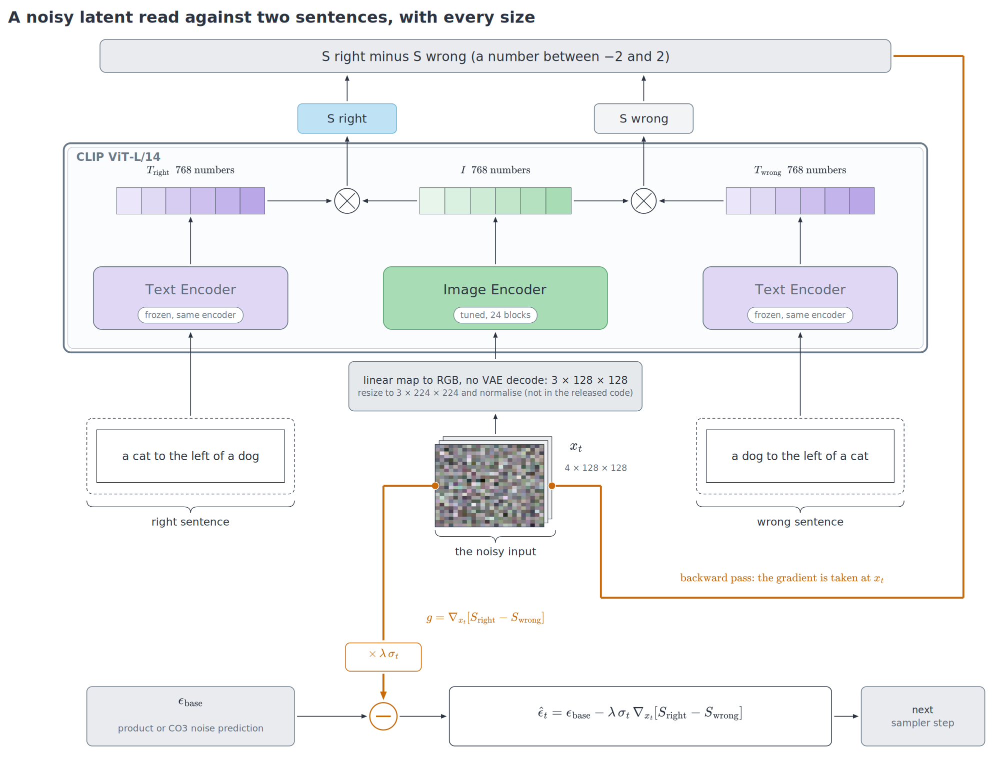

# 🌍 Context: the sentence-score push, the code behind it

⬅️ Previous: [the miniature](03-the-miniature.md) | 📋 [The pages of this method](01-overview.md#the-pages-of-this-method) | Next: [training our own encoder](05-training-our-own-encoder.md) ➡️

This page reads the code block by block, in the order a half-drawn latent meets it, and ties each block to a box of the read-and-push figure and to its twin in the miniature's `miniature.py`. Two kinds of code carry the method. The released NoisyCLIP code ([novasearch/noisyclip](https://github.com/novasearch/noisyclip) at commit `016b913`) catches the latents, maps them to colour and fine-tunes the encoder; it was read and never run here. This project's own code reads the latents through a differentiable copy of that map and would have pushed CO3 with the result; the reading part ran in the reading test and the pushing part never ran. The ladder's own [code walk](../../../2-classifier-guidance/artifacts/scenes/noisyclip-sentence-score/3-code/walk-noisyclip.md) reads the released files at the same commit, and its line numbers still hold. Our files' line numbers are as they stand at commit `abf0f247`, with the files clean.

<a href="../../../2-classifier-guidance/artifacts/scenes/noisyclip-sentence-score/0.5-network-view/nc2-the-whole-read-and-push-path.png"></a>

*The read-and-push path with every size. The noisy input x_t (4 × 128 × 128) passes "linear map to RGB, no VAE decode: 3 × 128 × 128, resize to 3 × 224 × 224 and normalise (not in the released code)" into the green image encoder (tuned, 24 blocks), giving I of 768 numbers; the two sentences pass the same frozen text encoder to T_right and T_wrong of 768 numbers; two product nodes give S right and S wrong; the top bar reads "S right minus S wrong (a number between −2 and 2)". The orange lane takes g = ∇_{x_t}[S_right − S_wrong] at x_t, multiplies by λ σ_t and subtracts it from "ε base, product or CO3 noise prediction".* ✅ *Read at full size.* *The figure shows how the method is wired; no run of the push produced a number on it, and the noise thumbnail is synthetic* ✍️ *(the network-view card).*

## Table of contents

- [Words this page uses](#words-this-page-uses)
- [The blocks and where they live](#the-blocks-and-where-they-live)
- [Catching the half-drawn latents](#catching-the-half-drawn-latents)
- [Four channels become three colours](#four-channels-become-three-colours)
- [The clamp and the byte conversion](#the-clamp-and-the-byte-conversion)
- [Our differentiable copy of the map](#our-differentiable-copy-of-the-map)
- [Which parameters train](#which-parameters-train)
- [The batch and the loss](#the-batch-and-the-loss)
- [The score difference in our code](#the-score-difference-in-our-code)
- [Where a push enters the sampler](#where-a-push-enters-the-sampler)
- [How it fails and how you know it worked](#how-it-fails-and-how-you-know-it-worked)
- [Where this came from](#where-this-came-from)

## Words this page uses

Navigation: 📋 [TOC](#table-of-contents) | [Next](#the-blocks-and-where-they-live) ➡️

**Forward hook**: a function PyTorch calls every time a module runs, given the module's inputs and outputs, without changing them.

**`einsum`**: one line that multiplies and sums arrays along named axes; `"...lxy,lr -> ...rxy"` sums over the latent channel `l` and keeps the colour `r`.

**`.byte()`**: converts numbers to 8-bit integers from 0 to 255 by dropping the decimals.

**`requires_grad`**: PyTorch's switch for whether a tensor's slope is tracked; a parameter with it off is frozen.

**`torch.autograd.grad(y, x)`**: asks PyTorch for the slope of y with respect to x, through every recorded step between them.

**CO3's two-entry prediction**: CO3 calls the U-Net on a batch of 2, the unconditional entry ε_u and the conditional entry ε_c, and combines them as ε_u + w (ε_c − ε_u).

## The blocks and where they live

Navigation: ⬅️ [Words this page uses](#words-this-page-uses) | 📋 [TOC](#table-of-contents) | [Next](#catching-the-half-drawn-latents) ➡️

**The released code supplies the map, the frozen parts and the loss; our code supplies the differentiable path, the score difference and the place the push enters.** ✅

| Block | Where it lives | What it computes | Box on the figure | The miniature's twin |
|---|---|---|---|---|
| catching the latents | released `src/generate_latents.py`, lines 41 to 42 and 75 to 84 | saves the U-Net's first input on every call, 50 tensors per image | the noisy input x_t | `X`, line 18 |
| the colour map | released `src/latent_to_image.py`, lines 9 to 17 | c = W z + b | linear map to RGB | `linear_map`, lines 36 to 37 |
| the clamp and byte conversion | released `src/latent_to_image.py`, line 18 | clamp to 0 to 255, then 8-bit integers | linear map to RGB | `hard`, lines 40 to 41 |
| the differentiable copy | [our sentence-score helpers](../../../2-classifier-guidance/scripts/noise_text_critic/common.py), `latent_to_rgb` lines 84 to 88, `rgb_to_clip` lines 91 to 96 | the same map with no `.byte()`, then resize and normalise | linear map, resize and normalise | `encode`, lines 52 to 55 |
| which parameters train | released `src/train_model_classic.py`, lines 47 to 51 and 71 | freezes names containing "text" and the score multiplier | the frozen and tuned tags | the text vectors held fixed, lines 120 to 135 |
| the batch and the loss | released `src/train_model_classic.py`, lines 14 to 20 | Hugging Face's contrastive loss over the batch | none: training is the top lane of [the three jobs](02-the-network-view.md) | `contrastive`, lines 124 to 128 |
| the score difference | [the push step's script](../../../2-classifier-guidance/scripts/noise_text_critic/w3_steer.py), `SentenceScore` lines 105 to 133 | right cosine minus the highest wrong cosine | S right, S wrong and the top bar | `difference`, lines 58 to 60 |
| the push into CO3 | [our CO3 push code](../../../2-classifier-guidance/scripts/method_search/co3_push.py), lines 30 to 36 and 62 to 76; the fixed-length version in `w3_steer.py`, lines 158 to 168 | g at the latent, scaled, subtracted from both of CO3's entries | the orange lane and the minus node | `push = LAMBDA * SIGMA * g`, line 94 |

The miniature's file is [the ladder's miniature script](../../../2-classifier-guidance/artifacts/scenes/noisyclip-sentence-score/2-miniature/miniature.py). ✅

## Catching the half-drawn latents

Navigation: ⬅️ [The blocks and where they live](#the-blocks-and-where-they-live) | 📋 [TOC](#table-of-contents) | [Next](#four-channels-become-three-colours) ➡️

**A forward hook on SDXL's U-Net saves its first input on every call, so one 50-step image gives 50 saved latents, index 0 the noisiest.** ✅ Read in the released checkout.

```python
    def hook(self, module, input, output):
        self.temp_latents.append(input[0].detach().cpu())
```

Released `src/generate_latents.py`, lines 41 to 42; lines 75 to 84 register the hook, run the pipeline and save the list. The pipeline scales its Euler latent before the U-Net sees it, so the saved tensor is z_t / √(σ_Euler² + 1) = √ᾱ_t z_0 + √(1 − ᾱ_t) ε, the same scale as our DDIM latent x_t ✍️ ([the code walk, block 1](../../../2-classifier-guidance/artifacts/scenes/noisyclip-sentence-score/3-code/walk-noisyclip.md#1-catching-the-half-drawn-latents)).

> [!WARNING]
> A raw Euler latent has a spread near σ_Euler, 13.12 at step 0 and 3.09 at step 15 ✅ (the ladder's numbers file). Fed to the colour map without that scaling it would push almost every pixel past the clamp. The reading test checked its own path against the authors' on this point: image vectors from the two paths agreed at cosine 0.995 at steps 0 and 15 for NoisyCLIP, against a bar of 0.99 ✍️ ([the reading finding, section 2](../../../2-classifier-guidance/report/the-sentence-score/can-a-sentence-score-read-the-five-properties.md#2-the-models-do-read-once-the-picture-is-mostly-drawn)).

## Four channels become three colours

Navigation: ⬅️ [Catching the half-drawn latents](#catching-the-half-drawn-latents) | 📋 [TOC](#table-of-contents) | [Next](#the-clamp-and-the-byte-conversion) ➡️

**Each colour is a fixed weighted sum of the four channels at the same position, plus a bias, and no VAE decoder runs.** ✅

```python
def latents_to_rgb(latents):
    weights = (
        (60, -60, 25, -70),
        (60, -5, 15, -50),
        (60, 10, -5, -35)
    )
    weights_tensor = torch.t(torch.tensor(weights, dtype=latents.dtype).to(latents.device))
    biases_tensor = torch.tensor((150, 140, 130), dtype=latents.dtype).to(latents.device)
    rgb_tensor = torch.einsum("...lxy,lr -> ...rxy", latents, weights_tensor) + biases_tensor.unsqueeze(-1).unsqueeze(-1)
```

Released `src/latent_to_image.py`, lines 9 to 17. `torch.t` flips the table to 4 × 3 so the `einsum` sums over the latent channel and keeps the colour. On the miniature's pixel A, (1, 0.5, 0, 0.5), the first row gives red = 60 − 30 + 0 − 35 + 150 = 145, the number worked on [the miniature's linear map](03-the-miniature.md#the-linear-map-on-two-pixels). ✅

## The clamp and the byte conversion

Navigation: ⬅️ [Four channels become three colours](#four-channels-become-three-colours) | 📋 [TOC](#table-of-contents) | [Next](#our-differentiable-copy-of-the-map) ➡️

**One line clamps each colour to 0 to 255, keeps the first of two identical copies, and converts to 8-bit integers; the conversion has no gradient and a clamped value passes 0.** ✅

```python
    image_array = rgb_tensor.clamp(0, 255)[0].byte().cpu().numpy()
    image_array = image_array.transpose(1, 2, 0)  # Rearrange dimensions for image
    return Image.fromarray(image_array)
```

Released `src/latent_to_image.py`, lines 18 to 20. `[0]` takes the first of the two classifier-free guidance copies, which are identical ✍️ (the code walk, block 3). The released path ends in a PNG on disk, built for ranking seeds, which is all the paper does with the score ✍️ ([the NoisyCLIP reading note](../../../artifacts/notes/progress/noise-text-critic/01-reading/noisyclip.md)).

🔤 **The name:** `.byte()`
- **byte**: 8 bits, enough for a whole number from 0 to 255.
- **On the picture:** inside the grey "linear map to RGB" box; the [gradient figure](02-the-network-view.md#the-gradient-walks-back-to-the-latent) names it as the first of the two breaks.
- **Formula, in those words:** drop everything after the decimal point and keep the whole number.
- **Consequence:** 127.9 becomes 127, and the result is no longer part of PyTorch's recorded computation, so `torch.autograd.grad` has no path back through it ✅ (the miniature key's `breaks.byte`: `has_gradient` false).

## Our differentiable copy of the map

Navigation: ⬅️ [The clamp and the byte conversion](#the-clamp-and-the-byte-conversion) | 📋 [TOC](#table-of-contents) | [Next](#which-parameters-train) ➡️

**Our copy keeps the weighted sum, leaves out `.byte()`, and adds the resize to 224 and CLIP's normalisation, which the released code leaves to a preprocessed dataset.** ✅

```python
def latent_to_rgb(x: torch.Tensor) -> torch.Tensor:
    """(B, 4, H, W) latent to (B, 3, H, W) on the 0 to 255 scale, before any clamp."""
    w = torch.tensor(WEIGHTS, device=x.device, dtype=x.dtype)
    b = torch.tensor(BIASES, device=x.device, dtype=x.dtype).view(1, 3, 1, 1)
    return torch.einsum("blhw,rl->brhw", x, w) + b


def rgb_to_clip(rgb: torch.Tensor) -> torch.Tensor:
    """(B, 3, H, W) on 0 to 255 to CLIP's normalised 224 by 224 input."""
    y = F.interpolate(rgb / 255.0, size=(224, 224), mode="bicubic", align_corners=False, antialias=False)
    mean = torch.tensor(CLIP_MEAN, device=y.device, dtype=y.dtype).view(1, 3, 1, 1)
    std = torch.tensor(CLIP_STD, device=y.device, dtype=y.dtype).view(1, 3, 1, 1)
    return (y - mean) / std
```

`common.py`, lines 84 to 96; `WEIGHTS` and `BIASES` at lines 33 and 34 are the released numbers. The clamp sits between the two, in `SentenceScore.image` (`w3_steer.py`, line 128), hard or soft by a switch:

```python
def soft_clamp(v: torch.Tensor, beta: float = SOFT_BETA) -> torch.Tensor:
    """Close to v inside 0 to 255, close to the limit outside, with a gradient everywhere."""
    return v - F.softplus(beta * (v - 255.0)) / beta + F.softplus(-beta * v) / beta
```

`w3_steer.py`, lines 100 to 102. At the miniature's pixel B red of 305 the soft clamp keeps a slope of 0.0759, so pixel B's z₀ gets −0.0288 where the hard clamp gives −0.0407 ✅ (the key's `hard_vs_soft`). The push step's design chose between them by a measured rule (soft if the hard clamp holds more than 5% of values and the two paths' image vectors agree at cosine 0.99 or better) ✍️ ([the push step's design](../../../artifacts/notes/progress/noise-text-critic/03-does-it-steer/design.md), line 87); the measurement never ran ✍️ (its review).

## Which parameters train

Navigation: ⬅️ [Our differentiable copy of the map](#our-differentiable-copy-of-the-map) | 📋 [TOC](#table-of-contents) | [Next](#the-batch-and-the-loss) ➡️

**The released flag freezes every parameter whose name contains "text" and the score multiplier, which would leave the image projection trainable; the published weights show that projection unchanged.** ✅ The code; ✍️ the checkpoint comparison.

```python
    elif only_vision:
        for name, param in model.named_parameters():
            param.requires_grad = not ("text" in name)
        if hasattr(model, "logit_scale"):
            model.logit_scale.requires_grad = False
```

Released `src/train_model_classic.py`, lines 47 to 51; line 71 freezes `logit_scale` again for every run. `text_model.*` and `text_projection.*` contain "text" and freeze; `vision_model.*` and `visual_projection.weight` do not. Against base CLIP, `visual_projection.weight`, `text_projection.weight` and the first text layer's key projection differ by 0, and the first vision layer's key projection differs by 6.1% of its norm; only those tensors were compared, and the command that produced the checkpoint is not released ✍️ ([the checkpoint comparison](../../../artifacts/notes/progress/noise-text-critic/01-reading/tools/checkpoint-compare.txt)).

🔤 **The name:** `logit_scale`
- **logit**: a score before a softmax turns it into a share. **scale**: what it is multiplied by.
- **On the picture:** not drawn; it multiplies every cell of the training matrix on [the network view](02-the-network-view.md#training-on-noisy-latents).
- **Formula, in those words:** the stored number is t_s, and every cosine is multiplied by e^{t_s} before the softmax.
- **Consequence:** NoisyCLIP stores 4.59375 and base CLIP 4.60517, multipliers of 98.86 and 100.00 ✍️ (the ladder's numbers file). A push that differentiates the scaled logit instead of the cosine is 98.86 times longer at the same λ ✍️ (the code walk, block 8).

## The batch and the loss

Navigation: ⬅️ [Which parameters train](#which-parameters-train) | 📋 [TOC](#table-of-contents) | [Next](#the-score-difference-in-our-code) ➡️

**The script holds no loss code: `return_loss: True` makes Hugging Face's `CLIPModel` compute the mean of the picture-to-caption and caption-to-picture cross-entropies over the batch.** ✅ The code; ✍️ the reading note for what `CLIPModel` computes.

```python
def collate_fn_standard_clip(batch):
    return {
        "pixel_values": torch.stack([b["pixel_values"] for b in batch]),
        "input_ids": torch.stack([b["input_ids"] for b in batch]),
        "attention_mask": torch.stack([b["attention_mask"] for b in batch]),
        "return_loss": True
    }
```

Released `src/train_model_classic.py`, lines 14 to 20. The loss is the one taken apart on [the network view](02-the-network-view.md#training-on-noisy-latents) and worked on [the miniature's training step](03-the-miniature.md#one-training-step), 0.9264 to 0.7929. The script's defaults are not the paper's settings:

| Setting | Script default | Paper, p. 8 |
|---|---|---|
| epochs | 5 | 10 |
| batch size | 64 | 128 |
| learning rate | 1e-4 | 5.7e-5 |
| weight decay | 0.0 | 0.1 |
| base model | `openai/clip-vit-base-patch32` | ViT-L/14 |

✍️ The code walk, block 6, with the default lines it quotes (286 to 287, 304 to 306, 314 to 315). The script adds no noise and picks no step: the window of latents 20 to 29 exists only in the paper (p. 6) and in a dataset that is not released ✍️ (the code walk, block 7).

## The score difference in our code

Navigation: ⬅️ [The batch and the loss](#the-batch-and-the-loss) | 📋 [TOC](#table-of-contents) | [Next](#where-a-push-enters-the-sampler) ➡️

**Our score takes the right sentence's cosine minus the highest of several wrong sentences' cosines, a generalisation of the ladder's one right against one wrong.** ✅

```python
    def image(self, x: torch.Tensor) -> torch.Tensor:
        if self.which == "latent_clip":
            return latent_clip_image(self.model, x)
        rgb = latent_to_rgb(x)
        rgb = soft_clamp(rgb) if self.clamp == "soft" else rgb.clamp(0, 255)
        return image_features(self.model, rgb_to_clip(rgb))

    def __call__(self, x: torch.Tensor) -> torch.Tensor:
        f = self.image(x)
        return (f @ self.right.T)[:, 0] - (f @ self.wrong.T).max(1).values
```

`w3_steer.py`, lines 124 to 133. `image_features` and `text_features` (`common.py`, lines 114 to 120) normalise each vector to length 1, so every product here is a cosine. With one wrong sentence the `max` is that sentence's cosine, and the score is the ladder's D: on the miniature, 0.9687 − 0.9995 = −0.0308 ✅ (the key). The reading test scored exactly this on 220 cat and dog pictures ✍️ ([the reading finding](../../../2-classifier-guidance/report/the-sentence-score/can-a-sentence-score-read-the-five-properties.md#words-this-page-uses)).

🔤 **The name:** highest wrong
- **highest**: the largest of several. **wrong**: the sentences that name a mistake, such as "a photo of one animal" and "one animal that is part cat and part dog" for counting.
- **Formula, in those words:** D = S_right − max over the wrong sentences of S_wrong, so the score is positive only when the right sentence beats every wrong one.
- **Consequence:** the gradient of a maximum flows only to the wrong sentence that is currently highest. Run back on the reading finding's clean pair at seed 239: right 0.260, best wrong 0.235, D = +0.025 ✍️ ([the reading finding, section 3](../../../2-classifier-guidance/report/the-sentence-score/can-a-sentence-score-read-the-five-properties.md#3-counting-fails-even-on-the-finished-picture)).

## Where a push enters the sampler

Navigation: ⬅️ [The score difference in our code](#the-score-difference-in-our-code) | 📋 [TOC](#table-of-contents) | [Next](#how-it-fails-and-how-you-know-it-worked) ➡️

**On CO3's main call the wrapper subtracts the push from both entries of the two-entry prediction, which lowers the guided prediction by exactly the push.** ✅

```python
    def forward(self, sample, timestep, *args, **kwargs):
        out = self.inner(sample, timestep, *args, **kwargs)
        if self.pusher is None or sample.shape[0] != 2:
            return out
        eps = out["sample"]
        push = self.pusher(sample[:1], timestep, eps).to(device=eps.device, dtype=eps.dtype)
        return UNet2DConditionOutput(sample=eps - push)
```

`co3_push.py`, lines 30 to 36. The guided prediction then reads (ε_u − p) + w[(ε_c − p) − (ε_u − p)] = ε_u + w(ε_c − ε_u) − p, worked with numbers on [the network view](02-the-network-view.md#how-the-push-joins-co3). Two pushers can sit behind `self.pusher`, and they size the push differently:

| | `Pusher` in `co3_push.py` | `SentencePusher` in `w3_steer.py` |
|---|---|---|
| what it differentiates | a checker's `log_prob_both` (line 64) | `SentenceScore`, right minus highest wrong (line 160) |
| the push | `raw = strength * sigma * grad` (line 68), the ladder's λ σ_t g | `grad / norm * size` with `size = 0.4 × ‖guided prediction‖` (lines 167 to 168) |
| a ceiling | `cap` × ‖guided prediction‖ (lines 69 to 72) | none needed: the length is fixed |
| ever run with a sentence score | no | no: the push step was stopped |

✅ Read in both files. The ladder's equations follow the first; the push step's design follows the second. Both are quoted under [where the sources disagree](01-overview.md#where-the-sources-disagree).

```python
        with torch.enable_grad(), torch.autocast(device_type=x.device.type, enabled=False):
            z = x.detach().float().requires_grad_(True)
            grad = torch.autograd.grad(self.score(z).sum(), z)[0]
        norm = grad.norm()
        if not torch.isfinite(norm) or norm == 0:
            self.dead += 1
            self.applied.append(0.0)
            return torch.zeros_like(x)
        uncond, cond = eps[:1].float(), eps[1:2].float()
        size = self.length * (uncond + self.guidance * (cond - uncond)).norm()
        push = grad / norm * size * (0.0 if self.mode == "zero" else 1.0)
```

`w3_steer.py`, lines 158 to 168. The gradient is taken at `x.detach()` with tracking switched on, in full precision; a gradient of length 0 is counted in `self.dead` and gives no push.

🔤 **The name:** fixed length
- **fixed**: set once and not changed by the gradient. **length**: the push's size, ‖p‖.
- **Formula, in those words:** p = 0.4 × ‖ε_guided‖ × g / ‖g‖: keep g's direction, throw away its size, and set the size to 0.4 of the prediction's.
- **Consequence:** on the miniature, the λ σ_t form gives a push of length 1.6 × 0.1547 = 0.248; the fixed-length form, with ε_base's length √(4 × 0.25) = 1.0 standing in for the guided prediction, gives 0.4 whatever g's size, 1.6 times longer here. Double g and the first push doubles while the second does not change. ✅ Computed this session from the key's `g_length` and `eps_base`.

## How it fails and how you know it worked

Navigation: ⬅️ [Where a push enters the sampler](#where-a-push-enters-the-sampler) | 📋 [TOC](#table-of-contents) | [Next](#where-this-came-from) ➡️

**The push code has three controls ready, and none ran with a sentence score: a zero push must reproduce plain CO3, a random direction of the same length must not help, and a gradient of length 0 is counted as dead.** ✍️ [The push step's design](../../../artifacts/notes/progress/noise-text-critic/03-does-it-steer/design.md), lines 95 to 103, and `w3_steer.py`, lines 145 to 168.

💥 **Broken run (without):** the push path built on the released map, `.byte()` included.
- **Predict:** what does `torch.autograd.grad` return for the latent?
- **Wrong:** PyTorch raises an error, because the score no longer depends on the latent through any recorded step.
- **Right**, through `latent_to_rgb` and `rgb_to_clip`: a gradient of the latent's shape, 0 only at clamped colours.

🔍 The "Wrong" line is what `.byte()` implies for `torch.autograd.grad`, inferred from the miniature key's `has_gradient: false`; it was not run.

**How you know the reading path is right.** The reading test compared this path's image vectors with the authors' PNG path, on 16 latents by the code walk's account of the check: cosine 0.995 at steps 0 and 15 for NoisyCLIP, over the bar of 0.99 ✍️ ([the reading finding, section 2](../../../2-classifier-guidance/report/the-sentence-score/can-a-sentence-score-read-the-five-properties.md#2-the-models-do-read-once-the-picture-is-mostly-drawn)). The scores it produced were near chance at steps 0 to 15, and the push step was stopped on that result ✍️ ([the push step's review](../../../artifacts/notes/progress/noise-text-critic/03-does-it-steer/review.md)).

> [!NOTE]
> Line 1 of the released `train_model_classic.py` is the bare word `python`, which would raise a `NameError` if the file were run as released 🔍 (the code walk, block 7, inferred and not run).

## Where this came from

Navigation: ⬅️ [How it fails and how you know it worked](#how-it-fails-and-how-you-know-it-worked) | 📋 [TOC](#table-of-contents)

| What | How it was established | When |
|---|---|---|
| Every released excerpt | Read in the released checkout named in the ladder's `ladder.json` (`novasearch/noisyclip`, commit `016b913`), lines 41 to 42 of `generate_latents.py`, 9 to 20 of `latent_to_image.py`, 14 to 20, 47 to 51 and 71 of `train_model_classic.py`; they match the code walk's quotes | 2026-11-24 |
| Every excerpt of our code and its line numbers | Read in `common.py`, `w3_steer.py` and `co3_push.py` at commit `abf0f247`, all three clean | 2026-11-24 |
| The script defaults against the paper, the Euler scaling, the `[0]` copies, the missing preprocessing, the bare `python` line | Stated by the code walk | 2026-11-24 |
| The checkpoint comparison and the two multipliers | Stated by the checkpoint comparison and the ladder's numbers file | 2026-11-24 |
| The clamp rule and the controls | Stated by the push step's design | 2026-11-24 |
| The push lengths 0.248 and 0.4 | Computed this session from the miniature key | 2026-11-24 |
| The path check and the null scores | Stated by the reading finding | 2026-11-24 |
| What the opening figure shows | Read at full size; its path and labels passed `is_showable`; it is not on the held list | 2026-11-24 |

⬅️ Previous: [the miniature](03-the-miniature.md) | 📋 [The pages of this method](01-overview.md#the-pages-of-this-method) | Next: [training our own encoder](05-training-our-own-encoder.md) ➡️

<!-- built-to: PAGE_LOOK_FORMAT v1 -->
