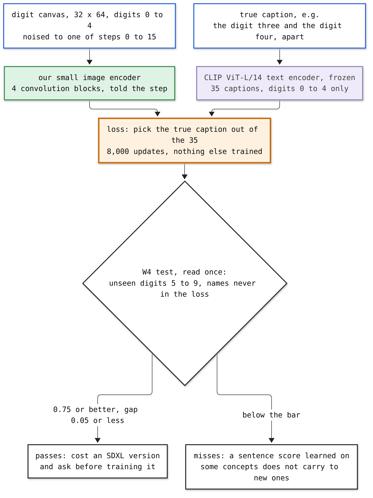

# 🌍 Context: the sentence-score push, training our own encoder on digits

⬅️ Previous: [the code](04-the-code.md) | 📋 [The pages of this method](01-overview.md#the-pages-of-this-method) | Next: [the methods index](../00-INDEX.md) ➡️

This page explains the third route Loop 9 took to a sentence score, its step W4: train a small noise-aware image encoder of our own, NoisyCLIP's recipe in miniature, on digit canvases against CLIP's frozen text encoder, and ask whether the score it learns on digits 0 to 4 reads digits 5 to 9, whose names never reached its loss. It reads and never pushes. The question behind it is whether a sentence score learned on some concepts reaches concepts outside its training set, and digits are the cheapest place to ask before any SDXL version ([the own-encoder design](../../../artifacts/notes/progress/noise-text-critic/04-train-our-own/design.md), line 3). The digit canvases are the ones the digit-map checkers train on, described on [the digit-map checkers overview](../03-the-digit-map-checkers/01-overview.md#words-this-page-uses). The result belongs to [the own-encoder finding](../../../2-classifier-guidance/report/the-sentence-score/does-our-own-noise-aware-model-read-unseen-digit-pairs.md): null.

<a href="../../../2-classifier-guidance/artifacts/scenes/noisyclip-sentence-score/overview/ov3-our-own-encoder-on-digits.png"></a>

*One training example, read left to right in five columns. What goes in: "caption bank: 35 captions naming only the digits 0 to 4", the true caption "the digit three and the digit four, apart", and "a real 32 × 64 MNIST canvas, two seen digits apart (noise illustrative)", a 4 on the left and a 3 on the right. Our encoder: a grey "step t, 0 to 15" box feeds the green "Our encoder: 4 convolution blocks, told the step, trained from scratch"; the inset opens it: a 32 × 64 canvas, "each block halves the grid", widths 64, 128, 256, 256, "flatten 2048, then 768 numbers". The text encoder is CLIP-L, 12 layers, frozen. Pick the true caption: the canvas's vector meets the true caption and the "34 other captions" at two dot nodes, giving a blue "true caption" bar and a grey "best other" bar. Test on unseen digits: the training loss L = −log of e^{cos(f(x_t, t), g(c*))/τ} over the sum across the 35 captions, τ = 0.07, "only the image encoder f learns"; then "test: digits 5 to 9, read once, their names never reach the loss" and "read with the checker score: true caption minus best other caption". The dashed line reads "no push in this step: it reads and does not steer".* ✅ *Read at full size.* *No run produced a number on this picture: the noise on the canvas and the bar heights are illustrative, and the sizes come from the design* ✍️ *(the overview card). The canvas is MNIST training images 8281 and 41843, drawn with step V1's own `make_canvas`* ✍️ *(the overview card). Its "step t 0 to 15" is one side of a disagreement quoted [below](#where-the-sources-disagree).*

## Table of contents

- [Words this page uses](#words-this-page-uses)
- [What one training example does](#what-one-training-example-does)
- [The names, taken apart](#the-names-taken-apart)
- [The loss, by what moves](#the-loss-by-what-moves)
- [The code](#the-code)
- [How it fails and what came out](#how-it-fails-and-what-came-out)
- [Where the sources disagree](#where-the-sources-disagree)
- [Where this came from](#where-this-came-from)
- [Read more](#read-more)

## Words this page uses

Navigation: 📋 [TOC](#table-of-contents) | [Next](#what-one-training-example-does) ➡️

**Canvas**: a 32 by 64 greyscale picture of pasted MNIST digits, one of five kinds: `apart` (two digits, one per half), `overlaid`, `same_half`, `single`, and `wrong` (two digits apart, one of them not an asked digit).

**Seen and unseen digits**: seen digits are 0 to 4, the only ones in training; unseen digits are 5 to 9, read once at the end.

**Caption bank**: every training sentence, each embedded once by CLIP ViT-L/14's frozen text encoder into 768 numbers.

**True caption**: the one sentence that describes a canvas, such as "the digit three and the digit four, apart". The lower digit is always named first, so a caption says nothing about left and right.

**Checker score**: the true caption's cosine with the canvas minus the highest cosine among the wrong sentences, as in [the code page's score](04-the-code.md#the-score-difference-in-our-code).

**The judged window**: the digit sampler's steps 14 to 25 of 50, which keep as much of the canvas as SDXL's steps 0 to 15 keep of a picture.

## What one training example does

Navigation: ⬅️ [Words this page uses](#words-this-page-uses) | 📋 [TOC](#table-of-contents) | [Next](#the-names-taken-apart) ➡️

**A canvas of seen digits is noised to a random step, read by our encoder told that step, and pulled toward its true caption among the bank's 35 sentences; only our encoder learns.** ✅ Read in `w4_train.py`, lines 171 to 190.

<a href="../../../artifacts/notes/progress/noise-text-critic/way-3-train-our-own.png"></a>

*The loop's third way, drawn before the run, top to bottom. Blue boxes: "digit canvas, 32 × 64, digits 0 to 4, noised to one of steps 0 to 15" and "true caption, e.g. the digit three and the digit four, apart". Green: "our small image encoder, 4 convolution blocks, told the step". Lilac: "CLIP ViT-L/14 text encoder, frozen, 35 captions, digits 0 to 4 only". Orange: "loss: pick the true caption out of the 35, 8,000 updates, nothing else trained". The diamond: "W4 test, read once: unseen digits 5 to 9, names never in the loss". Left branch, "0.75 or better, gap 0.05 or less": "passes: cost an SDXL version and ask before training it". Right branch, "below the bar": "misses: a sentence score learned on some concepts does not carry to new ones". The run took the right branch.* ✅ *Read at full size; the branch taken is the finding's.*

| Box on the overview | What the code does | NoisyCLIP's twin |
|---|---|---|
| the canvas | a seen-digit canvas from V1's `train` split, 20,000 canvases ✍️ the design | a half-drawn SDXL latent |
| step t | one of the digit sampler's first 26 timesteps, 999 down to 489, as an index into a learned table of 128 numbers ✅ `STEPS`, line 49, and `nn.Embedding`, line 125 | no step input: NoisyCLIP is never told the step ✍️ the reading note |
| our encoder | four blocks of convolution, group norm, a scale and shift from the step, SiLU and halving; flatten; a linear layer to 768; length 1 ✅ lines 106 to 134 | ViT-L/14, 24 blocks, fine-tuned from CLIP |
| the text encoder | CLIP ViT-L/14's, frozen; 35 seen captions in training, 100 captions over all ten digits at test ✅ `all_captions`, lines 80 to 84 | the same text encoder |
| the loss | cross-entropy over the 35 cosines divided by τ = 0.07 ✅ line 183, `TAU` line 52 | the contrastive loss over the batch, multiplier 98.86 |
| the test | digits 5 to 9 read once with the checker score and each step's threshold from the seen half ✍️ the design, line 94 | none: the paper tests no held-out concepts ✍️ the reading note |

The caption counts are computed from `all_captions`: 5 single-digit captions plus 3 for each of the 10 pairs of seen digits make 35; over all ten digits, 10 plus 3 × 45 make 145, of which the test's `pair_sentences` uses one right and 20 wrong for each asked pair. ✅ Counted this session from lines 80 to 103.

## The names, taken apart

Navigation: ⬅️ [What one training example does](#what-one-training-example-does) | 📋 [TOC](#table-of-contents) | [Next](#the-loss-by-what-moves) ➡️

**Each name points at one part of the opening picture.**

🔤 **The name:** noise-aware
- **noise**: the random grey speckle added to the canvas. **aware**: knowing about it. On the picture, the grey "step t" box feeding the green encoder.
- **Formula, in those words:** each block's features h become h (1 + γ) + β, where γ and β are read from the step's learned table, so the same encoder treats each noise level differently (`FilmBlock`, lines 113 to 117).
- **Consequence:** across the judged window the clean canvas's weight in x_t rises from about 0.076 near timestep 712 to 0.308 near timestep 480, against noise weighted 0.997 and 0.951 ✍️ ([the digit-map checkers' network view](../03-the-digit-map-checkers/02-the-network-view.md#the-canvas-and-its-noise), the same schedule at the nearest tabled timesteps). The seen-digit score climbs from 0.64 at step 14 to 0.89 at step 25 as that weight grows ✅ (the result file).

🔤 **The name:** caption bank
- **caption**: a sentence that describes a picture. **bank**: a store kept ready to draw from. On the picture, the top-left blue box, "35 captions naming only the digits 0 to 4", and the "34 other captions" strip.
- **Formula, in those words:** every training canvas is compared with all 35 at once, and the loss rewards the true one's share.
- **Consequence:** a caption naming seven is not in the bank, so no update pushes a 7's vector toward or away from it. Reading a 7 then rests on where an unseen shape happens to land, and the unseen digits read 0.590 against 0.758 seen ✅ (the result file; the reasoning is [the finding's](../../../2-classifier-guidance/report/the-sentence-score/does-our-own-noise-aware-model-read-unseen-digit-pairs.md#concepts-this-uses)).

🔤 **The name:** temperature τ
- **temperature**: borrowed from physics, where a hot system spreads over many states and a cold one settles in the likeliest. Here τ divides every cosine before the softmax.
- **On the picture:** "τ = 0.07" in the training-loss box.
- **Formula, in those words:** share of caption c = e^{cos_c / τ} / Σ e^{cos / τ}; a small τ turns small cosine gaps into large share gaps.
- **Consequence:** worked in [the next section](#the-loss-by-what-moves) on the miniature's two cosines: τ = 0.1 gives the true caption a share of 0.4236, τ = 0.07 gives 0.3917.

🔤 **The name:** unseen
- **unseen**: never shown in training. Here, digits 5 to 9: their canvases are absent from the `train` split and their names from the bank, which the code checks before training (`w4_train.py`, `main`: a training caption naming an unseen digit stops the run).
- **Consequence:** on the one comparison that needs the encoder to know which digits are present, `apart` against `wrong`, unseen digits read 0.502, where a rule that sees only the layout reads 0.5 ✅ (the result file).

## The loss, by what moves

Navigation: ⬅️ [The names, taken apart](#the-names-taken-apart) | 📋 [TOC](#table-of-contents) | [Next](#the-code) ➡️

**The loss is minus the log of the share the softmax gives the true caption, with every cosine divided by τ = 0.07.** ✅ `w4_train.py`, line 183, and the design, lines 80 to 86.

$$
\underbrace{\mathcal{L}}_{\text{the loss}} = -\log \frac{\exp\!\big(\cos(\textcolor{#1d6b3a}{f(x_t, t)},\ \textcolor{#6b4fbb}{g(c^\star)}) / \tau\big)}{\sum_{c\,\in\,\text{bank}} \exp\!\big(\cos(\textcolor{#1d6b3a}{f(x_t, t)},\ \textcolor{#6b4fbb}{g(c)}) / \tau\big)}
$$

f (green) is our encoder, read at the noisy canvas x_t and told the step t; g (lilac) is the frozen text encoder; c* is the true caption.

The worked case borrows the miniature's two cosines from [its training step](03-the-miniature.md#one-training-step): its first latent has cosine 0.96865 with its own sentence and 0.99946 with the other, a two-caption bank. ✅ The miniature key's `logits_before`, divided by its multiplier of 10; the shares computed this session.

| Symbol | On the two-caption case | If it moved |
|---|---|---|
| cos with c* | 0.96865 | raise it to 0.99946, level with the other, and the share becomes exactly 0.5 |
| τ | 0.1, the miniature's multiplier of 10 | at W4's 0.07 the gap 0.0308 is divided by a smaller number, the true share falls from 0.4236 to 0.3917 and the loss rises from 0.859 to 0.937 |
| the bank's size | 2 | at W4's 35 captions with every cosine equal, the true share is 1 / 35 = 0.0286 and the loss ln 35 = 3.555, the loss an untrained encoder starts near |
| what learns | f only | g never moves, so the caption vectors are the same fixed targets for every canvas, as in NoisyCLIP's training ([the network view](02-the-network-view.md#training-on-noisy-latents)) |

The same loss shape is NoisyCLIP's, read over a batch's captions instead of a fixed bank, with a multiplier of 98.86, that is τ of about 0.0101. ✅ 1 / 98.86.

## The code

Navigation: ⬅️ [The loss, by what moves](#the-loss-by-what-moves) | 📋 [TOC](#table-of-contents) | [Next](#how-it-fails-and-what-came-out) ➡️

**One block is told the step, four blocks make the encoder, and one line is the loss.** ✅ Read in [the own-encoder script](../../../2-classifier-guidance/scripts/noise_text_critic/w4_train.py) at commit `abf0f247`, clean.

```python
class FilmBlock(nn.Module):
    def __init__(self, c_in: int, c_out: int, t_dim: int):
        super().__init__()
        self.conv = nn.Conv2d(c_in, c_out, 3, padding=1)
        self.norm = nn.GroupNorm(8, c_out)
        self.film = nn.Linear(t_dim, 2 * c_out)

    def forward(self, x, emb):
        h = self.norm(self.conv(x))
        gamma, beta = self.film(emb).chunk(2, dim=1)
        h = h * (1 + gamma[:, :, None, None]) + beta[:, :, None, None]
        return F.avg_pool2d(F.silu(h), 2)


class NoisyDigitEncoder(nn.Module):
    """Noisy canvas and step index to one 768-number vector. The flatten keeps left and right distinct."""

    def __init__(self, out_dim: int = 768, t_dim: int = 128):
        super().__init__()
        self.step = nn.Embedding(len(STEPS), t_dim)
        widths = (64, 128, 256, 256)
        self.blocks = nn.ModuleList(FilmBlock(c_in, c_out, t_dim) for c_in, c_out in zip((1, *widths[:-1]), widths))
        self.out = nn.Linear(256 * (H // 16) * (W // 16), out_dim)

    def forward(self, x, step_index):
        emb = self.step(step_index)
        for block in self.blocks:
            x = block(x, emb)
        return F.normalize(self.out(x.flatten(1)), dim=-1)
```

Lines 106 to 134. Each block halves the grid: 32 × 64 becomes 16 × 32, 8 × 16, 4 × 8 and 2 × 4, and 256 channels × 2 × 4 = 2,048 numbers are flattened into the linear layer, the "flatten 2048, then 768 numbers" of the overview's inset ✅ (the ladder's numbers file, `w4_design`). Flattening, rather than averaging over the grid, keeps left and right apart, as the docstring says.

```python
        x0 = to_x(split["x"][pick], device)
        step = torch.randint(0, len(STEPS), (len(pick),), generator=gen, device=device)
        xt = noised(x0, step, torch.randn(x0.shape, generator=gen, device=device))
        loss = F.cross_entropy(model(xt, step) @ bank.T / TAU, y[torch.from_numpy(pick).to(device)])
```

Lines 180 to 183, inside `train`. Every canvas in a batch of 256 gets its own random step from the 26, its own noise (`noised`, lines 162 to 164, x_t = √ᾱ x_0 + √(1 − ᾱ) ε), and one row of 35 cosines divided by τ; `bank` is the 35 seen captions' frozen vectors. 8,000 updates with Adam at 2 × 10⁻⁴ ✅ (lines 53 to 55 and 173).

## How it fails and what came out

Navigation: ⬅️ [The code](#the-code) | 📋 [TOC](#table-of-contents) | [Next](#where-the-sources-disagree) ➡️

**The encoder learned the seen digits and did not carry them to unseen ones: 0.758 balanced accuracy on seen digits over the judged window, 0.590 on unseen digits, and 0.502 on unseen `apart` against `wrong`, against a bar of 0.75 on each.** ✅ Read in [the own-encoder result file](../../../artifacts/notes/progress/noise-text-critic/04-train-our-own/final.json); the verdict, null, is [the own-encoder finding's](../../../2-classifier-guidance/report/the-sentence-score/does-our-own-noise-aware-model-read-unseen-digit-pairs.md) ✍️.

**It could learn at all.** The overfit test put 16 of 16 fixed canvases under their true caption, against 15 needed, before the full run ✍️ (the finding, section 1).

| Step of the digit sampler | 14 | 16 | 18 | 20 | 22 | 24 | 25 |
|---|---|---|---|---|---|---|---|
| Seen digits 0 to 4 | 0.64 | 0.67 | 0.72 | 0.77 | 0.83 | 0.88 | 0.89 |
| Unseen digits 5 to 9 | 0.52 | 0.55 | 0.59 | 0.58 | 0.67 | 0.64 | 0.63 |

✅ Read in the result file's `per_step`, rounded to two places; they match the finding's table. Balanced accuracy is the mean of the share of yes-canvases called yes and the share of no-canvases called no, 0.5 at chance, taught in [the reading finding's concepts](../../../2-classifier-guidance/report/the-sentence-score/can-a-sentence-score-read-the-five-properties.md#concepts-this-uses).

💥 **Broken run (without):** an unseen digit's name taken out of the loss, which is the design itself for digits 5 to 9.
- **Predict:** on `apart` against `wrong`, where both kinds hold two separate digits and only which digits they are differs, what does the unseen split read?
- **Wrong:** 0.502 unseen, where a rule that sees only the layout reads 0.5.
- **Right**, for digits whose names and canvases were in training: 0.637 seen, still under the bar of 0.75.

✅ The result file's `apart_vs_wrong`. The loop's verdict reads this as "CLIP's frozen words do not carry an image encoder to concepts it never trained on" ✍️ ([Loop 9's verdict](../../../artifacts/notes/progress/noise-text-critic/05-verdict.md), line 33).

> [!NOTE]
> Digits are not photographs: a 32 by 64 canvas has ten concepts and clean shapes, so this miss does not show that an SDXL version would fail ✍️ (the design, line 124). The finding records an SDXL version at about 70 GPU-hours, from inferred figures, and the loop did not recommend it ✍️.

## Where the sources disagree

Navigation: ⬅️ [How it fails and what came out](#how-it-fails-and-what-came-out) | 📋 [TOC](#table-of-contents) | [Next](#where-this-came-from) ➡️

**Two places where two records say different things about this step. This page reports both and resolves none; the finding lists both among its four.**

| What | One source | The other source |
|---|---|---|
| The steps the encoder trains on | [the ladder's README](../../../2-classifier-guidance/artifacts/scenes/noisyclip-sentence-score/README.md), line 59: "noised to one of steps 0 to 15"; the opening picture: "step t, 0 to 15"; the third-way drawing: "noised to one of steps 0 to 15" | [the own-encoder design](../../../artifacts/notes/progress/noise-text-critic/04-train-our-own/design.md), line 88: "one of the 26 timesteps `ddim_timesteps(50)[:26]`, the digit sampler's steps 0 to 25"; `w4_train.py`, line 49: `STEPS = ddim_timesteps(50)[:26]` |
| The timesteps of the judged window | the design, line 92: "steps 14 to 25 (timesteps 712 to 480)" | the result file's `timesteps`: 714 at step 14 and 489 at step 25 ✅ read this session |

## Where this came from

Navigation: ⬅️ [Where the sources disagree](#where-the-sources-disagree) | 📋 [TOC](#table-of-contents) | [Next](#read-more) ➡️

| What | How it was established | When |
|---|---|---|
| The encoder, the loss line, τ, the steps, the batch, the updates, the learning rate | Read in `w4_train.py`, lines 46 to 55, 80 to 134, 162 to 190, at commit `abf0f247` | 2026-11-24 |
| 35 training captions and 145 over all digits | Counted this session from `all_captions` | 2026-11-24 |
| Seen 0.758, unseen 0.590, `apart` against `wrong` 0.637 and 0.502, the per-step scores, the timesteps | Read in `04-train-our-own/final.json` | 2026-11-24 |
| The overfit test, the verdict, the SDXL cost | Stated by the own-encoder finding | 2026-11-24 |
| The shares 0.4236 and 0.3917, the losses 0.859, 0.937 and 3.555 | Computed this session from the miniature key's cosines | 2026-11-24 |
| What the two pictures show | Opened at full size; their paths and every visible label passed `is_showable` in `scripts/shared/disallowed_subjects.py`; neither is on [the held pictures list](../../../artifacts/notes/progress/held-pictures.md) | 2026-11-24 |
| The canvas's source images and the illustrative noise and bars | Stated by the overview card | 2026-11-24 |

## Read more

Navigation: ⬅️ [Where this came from](#where-this-came-from) | 📋 [TOC](#table-of-contents)

| What | Where |
|---|---|
| The finding, with its canvases still owed | [the own-encoder finding](../../../2-classifier-guidance/report/the-sentence-score/does-our-own-noise-aware-model-read-unseen-digit-pairs.md) |
| The full design, every bar written before the run | [the own-encoder design](../../../artifacts/notes/progress/noise-text-critic/04-train-our-own/design.md) |
| The same bars on a checker trained on the digit model's own features | [the digit checker finding](../../../2-classifier-guidance/report/abstract-checkers-on-digits/does-a-checker-learn-plurality-on-unseen-digits.md) and [the digit-map checkers overview](../03-the-digit-map-checkers/01-overview.md) |
| Cross-entropy, softmax and temperature, with textbook pages | [the cross-entropy card](../../../../../Obsidian/Mathematics/Statistics/Information%20Theory/Cross-Entropy.md#where-to-learn-this), [the softmax card](../../../../../Obsidian/Artificial%20Intelligence/Deep%20Learning/Softmax.md#where-to-learn-this) and [the temperature card](../../../../../Obsidian/Artificial%20Intelligence/Deep%20Learning/Temperature.md#where-to-learn-this) |

⬅️ Previous: [the code](04-the-code.md) | 📋 [The pages of this method](01-overview.md#the-pages-of-this-method) | Next: [the methods index](../00-INDEX.md) ➡️

<!-- built-to: PAGE_LOOK_FORMAT v1 -->
