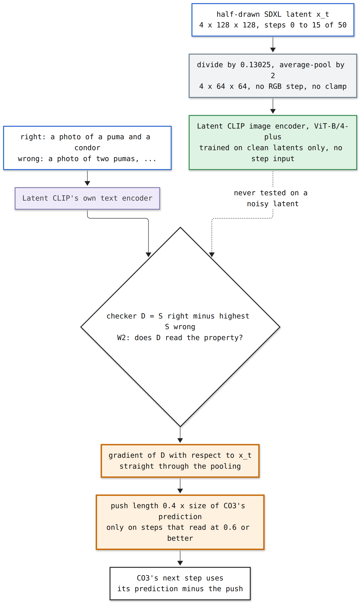
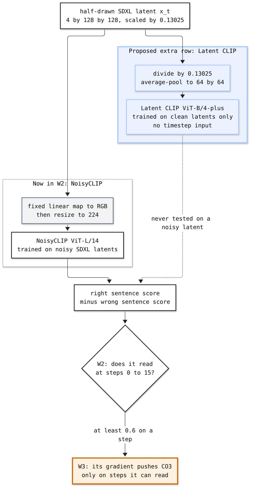
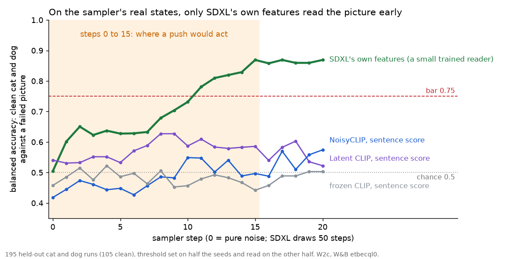

# 🌍 Context: Latent CLIP's push, one sampler step

⬅️ Previous: [the methods index](../00-INDEX.md) | 📋 [The pages of this method](#the-pages-of-this-method) | Next: [reading a latent with no VAE](02-reading-a-latent-with-no-vae.md) ➡️

Latent CLIP is a CLIP model whose picture side reads SDXL's latent directly, the small 4-channel code SDXL draws in, so no decoder has to turn the latent into a picture first. Loop 9 proposed it as a second reader for the sentence-score push. The idea was to read the half-drawn latent, score it against a right and a wrong sentence, and subtract the gradient of the difference from the sampler's noise prediction. The push never ran. Loop 9's reading test found no step from 0 to 15 at which Latent CLIP (or any other sentence score) could tell the right sentence from the wrong one, and the owner stopped the push on that result. This folder explains the method as designed, what Loop 9 measured about it, and a second test Loop 9 ran on the same encoders: a linear probe that asks whether their vectors carry counting and prompt match at all. NoisyCLIP's own version of the push is explained in [the sentence-score push](../04-the-sentence-score-push/01-overview.md) and drawn in section 1 of [the sentence-score ladder](../../../2-classifier-guidance/artifacts/scenes/noisyclip-sentence-score/README.md#1-noisyclips-sentence-score-push). What product-of-experts composition means is on [PoE composition](../../world/poe-composition.md#what-poe-composition-is).

*Three words this paragraph leans on are taught elsewhere with pictures and worked numbers:* CLIP's two towers on [the CLIP card](../../../../../Obsidian/Artificial%20Intelligence/Deep%20Learning/Contrastive%20Image-Text%20Training.md#where-to-learn-this), the gradient on [the gradient card](../../../../../Obsidian/Mathematics/Calculus/Gradient.md#where-to-learn-this), and the noise prediction on [the product-of-experts overview](../01-the-product-of-experts/01-overview.md#words-this-page-uses).

*One proposed sampling step, read left to right in five columns. What goes in: two sentences (right, "a cat and a dog, two animals"; wrong, "one animal, part cat, part dog") and the half-drawn latent x_t, outlined blue. The grey box divides the latent by 0.13025 and pools it to 4 × 64 × 64, with "no RGB, no clamp" beneath. Latent CLIP: the grey text encoder ("its own, 12 layers, frozen") and the green vision encoder ("ViT-B/4-plus, 12 layers, clean latents only, no step input"). Embeddings: one strip per sentence and one for the picture. Compare: two dot products, drawn as a blue "right" bar and a grey "wrong" bar. Third score and push: S_right − S_wrong (green box), its gradient taken at x_t (orange), and the orange arrow back to the noise prediction ε̂. The box at the top right writes the step as ε̂ = ε_cat + ε_dog − ε_∅ − λ σ_t ∇_{x_t}(S_right − S_wrong), and says "the same push and CO3 join as NoisyCLIP; only the reader of x_t changes". The inset opens the vision encoder: a 64 × 64 latent cut into 16 × 16 patches, 12 layers, one vector of 640 numbers.* ✅ *Read on the picture at full size. The noise on the latent and both bar heights are illustrative, and no run of Loop 9 produced a number on it* ✍️ *([the overviews' card](../../../2-classifier-guidance/artifacts/scenes/noisyclip-sentence-score/overview/README.md)). The equation's form, with a strength λ and the plain product, differs from the push Loop 9 wrote into code; see [where the sources disagree](#where-the-sources-disagree).*

## Table of contents

- [Words this page uses](#words-this-page-uses)
- [What one step would do](#what-one-step-would-do)
- [The names, taken apart](#the-names-taken-apart)
- [The push, by what moves](#the-push-by-what-moves)
- [How it fails and how you would know it worked](#how-it-fails-and-how-you-would-know-it-worked)
- [What is measured where](#what-is-measured-where)
- [Where the sources disagree](#where-the-sources-disagree)
- [The pages of this method](#the-pages-of-this-method)
- [Where this came from](#where-this-came-from)
- [Read more](#read-more)
- [Cross-references](#cross-references)

## Words this page uses

Navigation: 📋 [TOC](#table-of-contents) | [Next](#what-one-step-would-do) ➡️

**Half-drawn latent x_t**: the latent at sampler step t of 50, a block of 4 × 128 × 128 numbers that SDXL's decoder turns into a 1,024 × 1,024 picture once sampling ends. Step 0 is the noisiest and step 49 the last.

**Sentence score S**: how close the picture's vector lands to one sentence's vector, as the cosine of two vectors of length 1, from −1 to 1.

A cosine reads the angle between two arrows: 1 when they point the same way, 0.5 at 60°, 0 at right angles and −1 when they point opposite ways. ✅ Computed. [The cosine similarity card](../../../../../Obsidian/Mathematics/Linear%20Algebra/Cosine%20Similarity.md#where-to-learn-this) works it by hand on two short vectors.

**Checker score D**: the right sentence's score minus the highest score among the wrong sentences. Positive means the right sentence won.

**CO3**: a published sampler correction for composing two prompts, which the push was designed to join. [The readout checker's overview](../02-the-readout-checker/01-overview.md#words-this-page-uses) says what it does and at what settings it runs.

**Push**: the extra arrow subtracted from the sampler's noise prediction at a step, built from the gradient of D.

**The loop's steps.** W1b read the Latent CLIP paper and its released code. W2 scored the three sentence models (NoisyCLIP, frozen CLIP and Latent CLIP) on cat and dog latents at steps 0 to 15, with no training. W2b fitted a linear probe on each model's picture vectors. W3 was the push itself, allowed only on steps W2 found readable.

## What one step would do

Navigation: ⬅️ [Words this page uses](#words-this-page-uses) | 📋 [TOC](#table-of-contents) | [Next](#the-names-taken-apart) ➡️

**At each pushed step the latent is divided by 0.13025, pooled to 64 × 64, read by Latent CLIP's picture side, compared with each sentence, and the gradient of the right-minus-wrong score is scaled and subtracted from CO3's prediction.** ✅ Read in `latent_clip_image` and `latent_to_latent_clip` in `2-classifier-guidance/scripts/noise_text_critic/common.py` (lines 123 to 125 and 169 to 170) and `SentenceScore` and `SentencePusher` in `w3_steer.py` (lines 105 to 133 and 136 to 169).

Each box of the opening picture has a twin in the code and a counterpart in NoisyCLIP's push:

| Box | In Latent CLIP's push | In NoisyCLIP's push, for contrast |
|---|---|---|
| the half-drawn latent | x_t, 4 × 128 × 128, steps 0 to 15 of 50 ✅ | the same ✅ |
| the input path | divide by 0.13025, average-pool by 2, giving 4 × 64 × 64 ✅ | a fixed linear map from 4 channels to 3 colours, a clamp to 0 to 255, a resize to 224 ✍️ |
| the picture side | ViT-B/4-plus, 12 layers, trained by its authors on clean latents only, given no step ✍️ | CLIP ViT-L/14 with its picture side retrained on noisy SDXL latents ✍️ |
| the text side | its own text encoder, 640 numbers out ✅ | CLIP's frozen text encoder, 768 numbers out ✍️ |
| the score | D = S_right − the highest S_wrong ✅ | the same ✅ |
| the push and where it joins | a fixed length 0.4 × ‖ε_g‖ along the gradient of D, subtracted from both of CO3's predictions ✅ | the same ✅ |

The ✅ cells are read in the code above and in the released config (`numbers/sources/latent-vit-b-4-512-plus-config.json` in the ladder folder: `patch_size` 4, `layers` 12, `embed_dim` 640). The ✍️ cells are the reading note's account of the two papers.

Loop 9 drew the method twice before the ladder's overview existed. They sit side by side here because they answer one question: where Latent CLIP enters, and what had to pass before it could push.

<table><tr>
<td> Latent CLIP's push as Loop 9 designed it</td>
<td> Latent CLIP beside NoisyCLIP</td>
</tr></table>

*Left: the design top to bottom. The right sentence is "a photo of a puma and a condor" and the wrong ones start "a photo of two pumas", because W3 was to push on CO3's tuning pairs. The checker diamond reads "D = S right minus highest S wrong; W2: does D read the property?", and a dotted arrow from the encoder is labelled "never tested on a noisy latent". The orange boxes are the gradient "straight through the pooling" and the push, "length 0.4 x size of CO3's prediction, only on steps that read at 0.6 or better".* ✅ *Right: the reading note's proposal. One latent goes either through NoisyCLIP's path ("Now in W2") or through a blue "Proposed extra row: Latent CLIP"; both give the right-minus-wrong score; the diamond asks "W2: does it read at steps 0 to 15?", and only "at least 0.6 on a step" reaches the orange "W3: its gradient pushes CO3 only on steps it can read".* ✅ *Both read on the pictures at full size and in their `.mmd` sources.*

## The names, taken apart

Navigation: ⬅️ [What one step would do](#what-one-step-would-do) | 📋 [TOC](#table-of-contents) | [Next](#the-push-by-what-moves) ➡️

**Latent CLIP is CLIP's recipe trained on latents in place of pixels, and the checker score is the right sentence's win margin.**

🔤 **The name:** Latent CLIP
- **latent**: present but hidden, from the Latin for "lying hidden". Here it is the compressed code SDXL draws in, which a person never sees until the decoder turns it into a picture. On the picture, the blue-outlined tile at the left.
- **CLIP**: Contrastive Language-Image Pre-training. *Contrastive*: learned by comparing matched pairs against mismatched ones, a picture with its own caption against the captions of other pictures. *Language-image*: two towers, one for sentences and one for pictures, ending in the same space. *Pre-training*: trained once, by its authors, before anyone uses it. On the picture, the grey text encoder and the green vision encoder.
- **Formula, in those words:** S = I · T, the picture's vector dotted with the sentence's vector, both of length 1, so S is a cosine from −1 to 1.
- **Consequence:** take the word "latent" away and the picture side needs pixels. The latent is 4 × 128 × 128 = 65,536 numbers; the decoded picture is 1,024 × 1,024 × 3 = 3,145,728 numbers, 48 times as many, and a decoder pass sits between the two. Latent CLIP skips that pass; the latent it reads after pooling is 4 × 64 × 64 = 16,384 numbers. ✅ Computed from the sizes. Used as a reward, it gives benchmark scores close to pixel CLIP's at about 21% less run time, its authors report. ✍️ [The Latent CLIP reading note](../../../artifacts/notes/progress/noise-text-critic/01-reading/latent-clip.md#what-it-does), line 7.

🔤 **The name:** checker score D (right minus highest wrong)
- **right**: the sentence that describes what the picture should become. On the picture, "a cat and a dog, two animals".
- **highest wrong**: of the sentences describing a failure, the one the picture is closest to. W2's counting test has two: "a photo of one animal" and "one animal that is part cat and part dog". ✅ `SENTENCES` in `common.py`, lines 39 to 40.
- **Formula, in those words:** D = S_right − max(S_wrong). D is above 0 when the right sentence wins and below 0 when any wrong sentence beats it.
- **Consequence:** taking the highest wrong score means the push always works against the nearest failure. If the picture's scores were 0.20 for the right sentence, 0.21 for "one animal" and 0.18 for "part cat and part dog" (illustrative), D = 0.20 − 0.21 = −0.01; drop "one animal" from the list and D becomes 0.20 − 0.18 = +0.02, a win the picture has not earned. On W2's latents, the cut-off chosen for Latent CLIP's counting score sat at −0.054 at step 0 and −0.042 at step 15, so a picture was called "two separate animals" when its right sentence lost to the best wrong one by less than about 0.05. ✅ `thresholds` under `counting.latent_clip` in the [W2 result file](../../../artifacts/notes/progress/noise-text-critic/02-can-it-read/result.json); the rule `d > threshold` is `w2_read.py` line 162.

How Latent CLIP reads a latent with no decoder, and what its name's "ViT-B/4-plus" says, is on [the next page](02-reading-a-latent-with-no-vae.md#the-names-taken-apart).

## The push, by what moves

Navigation: ⬅️ [The names, taken apart](#the-names-taken-apart) | 📋 [TOC](#table-of-contents) | [Next](#how-it-fails-and-how-you-would-know-it-worked) ➡️

**The push is the direction in which D rises fastest, set to a fixed length of 0.4 times CO3's own prediction, and subtracted from both of CO3's predictions.** ✅ Read in [the W3 design](../../../artifacts/notes/progress/noise-text-critic/03-does-it-steer/design.md#how-the-push-enters-co3), lines 73 to 79, and `SentencePusher` in `w3_steer.py`, lines 159 to 169. The colours are the ladder's: red for what a network outputs, green for the picture side's score, orange for the push.

$$
\textcolor{#c86a0a}{\underbrace{p_t}_{\text{the push}}}
= \underbrace{b}_{0.4}\;
\underbrace{\lVert \textcolor{#c0262d}{\varepsilon_g} \rVert}_{\text{CO3's guided prediction's length}}\;
\textcolor{#1d6b3a}{\underbrace{\frac{\nabla_{x_t} D}{\lVert \nabla_{x_t} D \rVert}}_{\text{where D rises, length 1}}},
\qquad
\textcolor{#c0262d}{\hat\varepsilon_g} = \textcolor{#c0262d}{\varepsilon_g} - \textcolor{#c86a0a}{p_t},
\qquad
\textcolor{#c0262d}{\hat\varepsilon_u} = \textcolor{#c0262d}{\varepsilon_u} - \textcolor{#c86a0a}{p_t}
$$

ε_g is CO3's guided prediction, ε_u + 0.8 (ε_c − ε_u), and ε_u its unconditional one. ✅ `w3_steer.py`, line 167.

**The guided prediction starts at the no-prompt prediction and walks a set share of the way toward the prompt's.** ε_c is the joint prompt's prediction. ✍️ [The readout checker's push page](../02-the-readout-checker/03-the-push-and-its-cap.md#where-the-push-enters-the-sampler). The idea, guiding by the gap between a prompted and an unprompted prediction, is classifier-free guidance, worked on [the classifier-free guidance card](../../../../../Obsidian/Artificial%20Intelligence/Generative%20Modeling/Diffusion%20Models/Classifier-Free%20Guidance.md#where-to-learn-this).

$$
\textcolor{#c0262d}{\underbrace{\varepsilon_g}_{\text{the guided prediction}}}
= \textcolor{#c0262d}{\underbrace{\varepsilon_u}_{\text{no prompt}}}
+ \textcolor{#6b7a88}{\underbrace{0.8}_{\text{the guidance}}}\,
\big(\textcolor{#c0262d}{\underbrace{\varepsilon_c}_{\text{the joint prompt}}} - \textcolor{#c0262d}{\varepsilon_u}\big)
$$

On one number, with the illustrative values ε_u = 1.0 and ε_c = 2.0 the readout checker's page also uses:

| Move the guidance | ε_g | What it shows |
|---|---|---|
| 0 | 1.0 | the prompt is ignored |
| 0.8, as CO3 runs | 1.8 | four fifths of the way from no prompt to the joint prompt |
| 1 | 2.0 | exactly the joint prompt's prediction |
| 2 | 3.0 | past the joint prompt, by as much again as the gap |

✅ Computed this session; the values are the toy's, not a run's.

A worked case. b = 0.4 and the 0.6 gate are the design's. The prediction length 100 and the gradient lengths are illustrative, because the push never ran and no run recorded them.

| Move | ‖∇D‖ | b | ‖ε_g‖ | Push length | What it shows |
|---|---|---|---|---|---|
| as designed | 0.02 | 0.4 | 100 | 0.4 × 100 = 40 | the push is four tenths of CO3's prediction |
| the gradient ten times longer | 0.2 | 0.4 | 100 | 40 | only the gradient's direction is used, so how sure Latent CLIP is never changes the length |
| b doubled | 0.02 | 0.8 | 100 | 80 | the length follows b alone, which is why W3 had no strength to tune |
| a step outside the gate | any | 0.4 | 100 | 0 | a step whose reading on W2's threshold half was under 0.6 gets no push |

🔤 **The name:** threshold half and reading half
- **threshold**: the line a value has to cross to count as a yes, here the cut-off on D above which a picture is called "two separate animals".
- **half**: W2 splits the seeds in two. On the threshold half it chooses each step's cut-off and which steps pass the 0.6 gate; on the reading half it applies those choices once and reads the score.
- **Formula, in those words:** a step's score is the balanced accuracy on the reading half, with the cut-off chosen on the threshold half.
- **Consequence:** read Latent CLIP's 7 gated counting steps on the half that chose them and they score a mean of 0.622; read them on the other half and the mean falls to 0.538.

| Step | 3 | 4 | 5 | 6 | 10 | 11 | 12 | Mean |
|---|---|---|---|---|---|---|---|---|
| threshold half | 0.623 | 0.600 | 0.601 | 0.615 | 0.605 | 0.680 | 0.633 | 0.622 |
| reading half | 0.579 | 0.473 | 0.519 | 0.444 | 0.673 | 0.540 | 0.538 | 0.538 |

✅ Computed from `balanced_accuracy_threshold_half` and `balanced_accuracy_reading_half` under `counting.latent_clip` in the [W2 result file](../../../artifacts/notes/progress/noise-text-critic/02-can-it-read/result.json); each cell is that step's balanced accuracy.

> [!NOTE]
> Subtracting the push lowers both predictions by the same p_t, so the step's guided direction ε_c − ε_u is unchanged and the whole prediction shifts toward where D rises. 🔍 This follows from the two subtractions above; [the readout checker's push page](../02-the-readout-checker/03-the-push-and-its-cap.md#where-the-push-enters-the-sampler) shows the same place in `co3_push.py`.

## How it fails and how you would know it worked

Navigation: ⬅️ [The push, by what moves](#the-push-by-what-moves) | 📋 [TOC](#table-of-contents) | [Next](#what-is-measured-where) ➡️

**The push fails before it starts when D cannot tell right from wrong at the pushed steps, and on Loop 9's tests Latent CLIP's D could not.** ✍️

*Up: balanced accuracy for telling a clean cat and dog from a failed picture, from 0.35 to 1.0, where 0.5 is chance. Across: the sampler step from 0 (pure noise) to 20 of SDXL's 50; steps 0 to 15, where a push would act, are shaded. One line per reader: SDXL's own features read by a small trained reader (green, the readout checker), Latent CLIP's sentence score (purple), NoisyCLIP's (blue) and frozen CLIP's (grey). Dashed red: the 0.75 bar. Dotted: chance. Footer: 195 held-out cat and dog runs, 105 clean, cut-off set on half the seeds and read on the other half, W&B `etbecql0`. Latent CLIP's line stays between 0.53 and 0.63; the green line crosses the bar at step 11.* ✅ *Read on the picture at full size. These are measured, on the sampler's real states.*

Balanced accuracy is the share of clean pictures called clean and the share of failed pictures called failed, averaged, so a reader that guesses or says the same thing every time scores 0.5. It is taken apart on a worked count on [the linear probe page](04-the-linear-probe-on-frozen-vectors.md#the-names-taken-apart).

**It would have worked** if, on W3's 12 tuning pairs, CO3 with the push drew more faithful pairs than CO3 alone and than a random push of the same length. ✍️ [The W3 design](../../../artifacts/notes/progress/noise-text-critic/03-does-it-steer/design.md). That comparison was never rendered.

**Why it was never rendered.** W3 pushes only on steps whose balanced accuracy on W2's threshold half reaches 0.6 (`READ_GATE` in `w3_steer.py`, line 35). Latent CLIP's counting score passed that gate at 7 of the 16 steps (3, 4, 5, 6, 10, 11 and 12), but on the reading half those steps averaged 0.538, near chance. ✅ Computed from `counting.latent_clip` in the W2 result file. No sentence score read any property over steps 0 to 15, so the owner stopped W3 on 2026-11-24 and none of its 4.5 budgeted GPU-hours was spent. ✍️ [The W3 review](../../../artifacts/notes/progress/noise-text-critic/03-does-it-steer/review.md), lines 3 to 7. The verdicts belong to [the reading finding](../../../2-classifier-guidance/report/the-sentence-score/can-a-sentence-score-read-the-five-properties.md) and [the fairness finding](../../../2-classifier-guidance/report/the-sentence-score/is-the-sentence-score-test-fair.md).

**The input path itself works on finished pictures.** At step 49, Latent CLIP's prompt-match score read 0.73 on the threshold half, over the 0.6 check that a model reads what its paper says it reads. ✅ `published_behaviour` in the W2 result file (0.7348).

## What is measured where

Navigation: ⬅️ [How it fails and how you would know it worked](#how-it-fails-and-how-you-would-know-it-worked) | 📋 [TOC](#table-of-contents) | [Next](#where-the-sources-disagree) ➡️

**Every Latent CLIP number from this project is a reading score; no push was rendered, and the verdicts belong to the findings.** Every gap between Latent CLIP and another model is a mixed comparison, because its architecture, text side, training data and input path all differ. ✍️ [The W2 design](../../../artifacts/notes/progress/noise-text-critic/02-can-it-read/design.md), line 39.

| Statement | Measured on | Mark and source |
|---|---|---|
| Latent CLIP's sentence score reads counting at 0.560 mean balanced accuracy over steps 0 to 15, prompt match 0.479, left-right order 0.507, against a 0.75 bar | 220 eye-labelled cat and dog latents, noised, W&B `70g3qw2f` | ✍️ [the reading finding, section 1](../../../2-classifier-guidance/report/the-sentence-score/can-a-sentence-score-read-the-five-properties.md#1-no-model-reads-any-property-at-steps-0-to-15) |
| On the sampler's real states, clean pair against failed, it reads 0.574 over steps 0 to 15, the best of the sentence scores | 195 real cat and dog runs, W&B `etbecql0` | ✍️ [the fairness finding, section 1](../../../2-classifier-guidance/report/the-sentence-score/is-the-sentence-score-test-fair.md#1-on-the-samplers-real-states-only-sdxls-own-features-read-early) |
| A linear probe on its picture vectors reads counting and prompt match on 7 unseen pairs at 0.527 each, null | 4,039 pictures, job 94220 | ✍️ [the linear probe finding](../../../2-classifier-guidance/report/the-sentence-score/does-a-linear-probe-on-frozen-image-vectors-read-unseen-pairs.md#1-no-encoder-reads-the-unseen-pairs), worked on [this folder's probe page](04-the-linear-probe-on-frozen-vectors.md) |
| Whether Latent CLIP's gradient moves a half-drawn latent | not measured | open: W3 was stopped |
| The authors' benchmark gains when it is used as a reward on a one-step model | the paper's own benchmarks | ✍️ [the reading note](../../../artifacts/notes/progress/noise-text-critic/01-reading/latent-clip.md#which-of-the-five-properties-it-bears-on); not this project's measurement |

## Where the sources disagree

Navigation: ⬅️ [What is measured where](#what-is-measured-where) | 📋 [TOC](#table-of-contents) | [Next](#the-pages-of-this-method) ➡️

**Five places where two records say different things about this method. These pages report both and resolve none.**

| What | One source | The other source |
|---|---|---|
| How long the push is | the opening picture's equation, λ σ_t ∇(S_right − S_wrong); [the ladder's notation](../../../2-classifier-guidance/artifacts/scenes/noisyclip-sentence-score/NOTATION.md), lines 14 to 16 (p = λ σ_t g, with λ "the strength of the push"); the reading note, line 223 | [the W3 design](../../../artifacts/notes/progress/noise-text-critic/03-does-it-steer/design.md#how-the-push-enters-co3), lines 75 to 79, `PUSH_LENGTH = 0.4` in `w3_steer.py` line 34, and the left Loop 9 picture: a fixed length 0.4 × ‖ε_g‖, no strength to tune |
| Which prediction the push leaves | the opening picture's equation: ε_cat + ε_dog − ε_∅, the plain product | the same picture's note ("the same push and CO3 join as NoisyCLIP"), the W3 design and `co3_push.py`: CO3's guided and unconditional predictions |
| How many wrong sentences D compares against | the opening picture: one wrong sentence and S_right − S_wrong | `SENTENCES` in `common.py`, lines 39 to 42, and `SentenceScore` in `w3_steer.py`, line 133: two or three wrong sentences and the highest of them |
| Whether a result on this project's pictures exists | [the ladder's card](../../../2-classifier-guidance/artifacts/scenes/noisyclip-sentence-score/README.md#what-is-established-and-what-is-proposed), line 65: "No result on this project's pictures exists yet. Steps W2 and W3 measure whether it reads or steers" | the W2 review: W2 ran and read nothing early (W&B `70g3qw2f`); the W3 review: W3 was stopped and rendered nothing |
| What Latent CLIP's 7 gated counting steps read on the reading half | [the W2 review](../../../artifacts/notes/progress/noise-text-critic/02-can-it-read/review.md), line 36: "passes at 7 steps whose reading-half values average 0.56" | the W2 result file: those steps (3, 4, 5, 6, 10, 11, 12) read 0.579, 0.473, 0.519, 0.444, 0.673, 0.540 and 0.538, a mean of 0.538; 0.560 is the mean over all 16 steps |

## The pages of this method

Navigation: ⬅️ [Where the sources disagree](#where-the-sources-disagree) | 📋 [TOC](#table-of-contents) | [Next](#where-this-came-from) ➡️

**Two pages open Latent CLIP's parts, forward and backward, and the last page covers the linear probe.**

1. This page: one proposed step, the names, the push equation, and what stopped it.
2. [Reading a latent with no VAE](02-reading-a-latent-with-no-vae.md): the divide by 0.13025, the pooling, the patches and the 640-number vector, and how far the pushed steps sit from anything it trained on.
3. [How its push differs from NoisyCLIP's](03-how-its-push-differs-from-noisyclips.md): the gradient back through the pooling with no clamp, the blocks it leaves, and how its authors used the same gradient.
4. [The linear probe on frozen vectors](04-the-linear-probe-on-frozen-vectors.md): one logistic regression per step on each encoder's vectors, step W2b.

The ladder draws no network view, miniature or code walk for Latent CLIP; its zoom ladder opens only NoisyCLIP's parts. The pages above are built from the overview, the reading note, the released config and Loop 9's code.

## Where this came from

Navigation: ⬅️ [The pages of this method](#the-pages-of-this-method) | 📋 [TOC](#table-of-contents) | [Next](#read-more) ➡️

| What | How it was established | When |
|---|---|---|
| The step: divide, pool, encode, D, fixed-length push into both CO3 predictions | Read in `common.py` lines 38 to 42, 123 to 125 and 165 to 170, and `w3_steer.py` lines 34 to 35 and 105 to 169 | 2026-11-24 |
| Sizes: patch 4, 12 layers, 640 out | Read in the ladder's `numbers/sources/latent-vit-b-4-512-plus-config.json` and `numbers.json` (`latent_clip`) | 2026-11-24 |
| What the three pictures show | Read on each at full size and in the two `.mmd` sources; every path and visible label passed `is_showable` in `scripts/shared/disallowed_subjects.py`, and none is on [the held pictures list](../../../artifacts/notes/progress/held-pictures.md) | 2026-11-24 |
| The cut-offs −0.054 and −0.042, the 7 gated steps and their mean 0.538, the step 49 check 0.7348 | Read and computed from the W2 result file | 2026-11-24 |
| W3 never rendered, and why | Stated by the W3 review, lines 3 to 7 | 2026-11-24 |
| The 21% time saving and the benchmark scores | Stated by the reading note from the paper | 2026-11-23 |
| The 48 times and 16,384 | Computed from the sizes | 2026-11-24 |

## Read more

Navigation: ⬅️ [Where this came from](#where-this-came-from) | 📋 [TOC](#table-of-contents) | [Next](#cross-references) ➡️

| What | Where |
|---|---|
| CLIP's two towers, the shared space and the contrastive loss, on one small network | [the CLIP chapter](../../../../../goal-setting/learning/deep-learning/generative-models/02-stable-diffusion-and-clip/textbook/01-clip-on-one-small-network.md) |
| The paper read in full, with the three ways the project could use it | [the Latent CLIP reading note](../../../artifacts/notes/progress/noise-text-critic/01-reading/latent-clip.md) |
| NoisyCLIP's version of the push, opened part by part | [the sentence-score push](../04-the-sentence-score-push/01-overview.md), built from [the sentence-score ladder](../../../2-classifier-guidance/artifacts/scenes/noisyclip-sentence-score/README.md) |
| Loop 9's answer in one page | [the Loop 9 summary](../../../artifacts/notes/progress/noise-text-critic/00-executive-summary.md) |

⬅️ Previous: [the methods index](../00-INDEX.md) | 📋 [The pages of this method](#the-pages-of-this-method) | Next: [reading a latent with no VAE](02-reading-a-latent-with-no-vae.md) ➡️

## Cross-references

Navigation: ⬅️ [Read more](#read-more) | 📋 [TOC](#table-of-contents)

- The mention of **Latent CLIP** in [the finding "Can a sentence score read the five properties on a half-drawn picture?"](../../../2-classifier-guidance/report/the-sentence-score/can-a-sentence-score-read-the-five-properties.md).
- The mention of **Latent CLIP** in [the finding "Does a linear probe on frozen image vectors read unseen pairs?"](../../../2-classifier-guidance/report/the-sentence-score/does-a-linear-probe-on-frozen-image-vectors-read-unseen-pairs.md).
- The mention of **Latent CLIP** in [the finding "Is the sentence-score test fair, and can anything read the half-drawn picture at all?"](../../../2-classifier-guidance/report/the-sentence-score/is-the-sentence-score-test-fair.md).
- The mention of **Latent CLIP** in [the report index, section "Project 2: classifier guidance"](../../../report/00-INDEX.md#project-2-classifier-guidance).

<!-- built-to: PAGE_LOOK_FORMAT v1 -->
