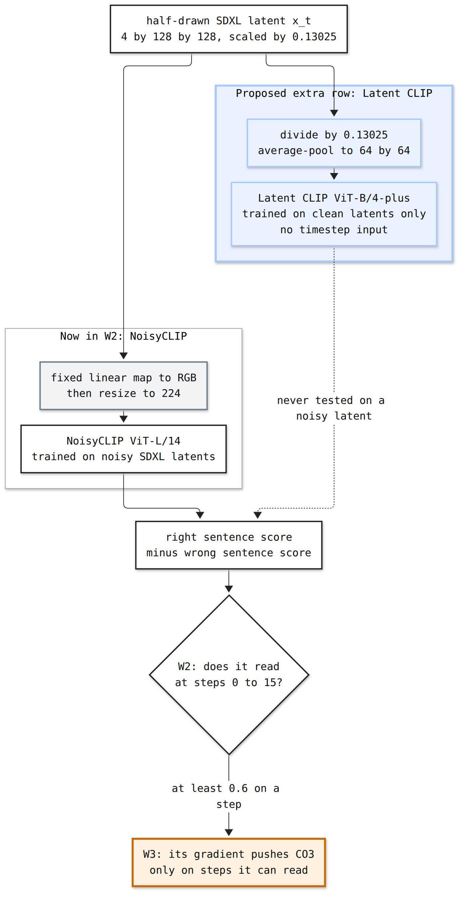

# 🌍 Context: Latent CLIP, reading a latent with no VAE

⬅️ Previous: [one sampler step](01-overview.md) | 📋 [The pages of this method](01-overview.md#the-pages-of-this-method) | Next: [how its push differs from NoisyCLIP's](03-how-its-push-differs-from-noisyclips.md) ➡️

This page follows a half-drawn SDXL latent forward into Latent CLIP's picture side: the division that undoes SDXL's scaling, the pooling that halves each side, the patches, and the 640 numbers that come out. It then measures how far the latents Loop 9 wanted to push sit from the clean latents Latent CLIP trained on. NoisyCLIP's own input path (a linear map to colour, a clamp and a resize) is opened in [the sentence-score ladder](../../../2-classifier-guidance/artifacts/scenes/noisyclip-sentence-score/README.md#the-deep-dives-in-the-overviews-order) and only contrasted here.

*The two input paths from one latent, top to bottom. The top box is the half-drawn latent, "4 by 128 by 128, scaled by 0.13025". Left, in the grey frame "Now in W2: NoisyCLIP": "fixed linear map to RGB, then resize to 224", then "NoisyCLIP ViT-L/14, trained on noisy SDXL latents". Right, in the blue frame "Proposed extra row: Latent CLIP": "divide by 0.13025, average-pool to 64 by 64", then "Latent CLIP ViT-B/4-plus, trained on clean latents only, no timestep input", whose arrow to the score is dotted and labelled "never tested on a noisy latent". Both meet at "right sentence score minus wrong sentence score", then the diamond "W2: does it read at steps 0 to 15?".* ✅ *Read on the picture at full size and in `latent-clip-beside-noisyclip.mmd`. It is a design drawing; no number on it comes from a run.*

## Table of contents

- [Words this page uses](#words-this-page-uses)
- [The path, stage by stage](#the-path-stage-by-stage)
- [The names, taken apart](#the-names-taken-apart)
- [The input, by what moves](#the-input-by-what-moves)
- [How far the pushed steps sit from its training](#how-far-the-pushed-steps-sit-from-its-training)
- [How it fails and how you know it worked](#how-it-fails-and-how-you-know-it-worked)
- [Where this came from](#where-this-came-from)
- [Read more](#read-more)

## Words this page uses

Navigation: 📋 [TOC](#table-of-contents) | [Next](#the-path-stage-by-stage) ➡️

**VAE**: the variational autoencoder SDXL uses at both ends. Its encoder squeezes a 1,024 × 1,024 picture into a 4 × 128 × 128 latent, and its decoder turns a latent back into a picture. "No VAE" means the latent is read as it stands, never decoded.

The encoder, the decoder and the squeeze between them are drawn and worked on [the VAE card](../../../../../Obsidian/Artificial%20Intelligence/Generative%20Modeling/Variational%20Autoencoders/Variational%20Autoencoders.md#where-to-learn-this).

**Scaling factor 0.13025**: the number SDXL multiplies the VAE's latent by before sampling, so the sampler works on values of a convenient size. The sampler's x_t is on that scaled footing.

**Patch**: a small square cut from the input; a vision transformer reads one patch as one token.

**Token**: one row the transformer works on, a list of 768 numbers here.

**Signal and noise weights**: x_t = √ᾱ_t · x_0 + σ_t · ε, where x_0 is the clean latent, ε standard noise, √ᾱ_t the weight on the clean latent and σ_t = √(1 − ᾱ_t) the weight on the noise.

## The path, stage by stage

Navigation: ⬅️ [Words this page uses](#words-this-page-uses) | 📋 [TOC](#table-of-contents) | [Next](#the-names-taken-apart) ➡️

**A 4 × 128 × 128 latent becomes 4 × 64 × 64 after one division and one pooling, then 256 patches, and leaves as one vector of 640 numbers of length 1.** ✅

| Stage | Shape | What happens | Source |
|---|---|---|---|
| the half-drawn latent x_t | 4 × 128 × 128, on SDXL's scaled footing | the sampler's state at step t | ✅ the ladder's notation |
| divide by 0.13025 | 4 × 128 × 128 | every value multiplied by 7.678, back to the VAE's own footing | ✅ `latent_to_latent_clip`, `common.py` line 125 |
| average-pool by 2 | 4 × 64 × 64 | each 2 × 2 block of each channel replaced by its mean | ✅ the same line |
| cut into patches of 4 × 4 | 16 × 16 = 256 patches of 4 × 4 × 4 = 64 numbers | each patch becomes one token of 768 numbers | ✅ config: `patch_size` 4, `width` 768; `numbers.json`: `patches` 256 |
| 12 transformer layers | 256 tokens and one summary token, 768 each | the tokens read each other | ✅ config: `layers` 12; ✍️ the position table holds 257 entries, per the reading note, line 111 |
| project and normalise | 640 | one vector, set to length 1 | ✅ config: `embed_dim` 640; `encode_image(..., normalize=True)`, `common.py` line 170 |

🔤 **The name:** summary token and position table
- **summary token**: one extra token put in front of the 256 patch tokens. It is the same for every picture when it goes in; the 12 layers let it read every patch, and its row is what comes out as the picture's vector. On the overview's inset, the step from the 16 × 16 grid to the one vector of 640 numbers.
- **position**: where a token sits in the sequence, first, second and so on. **table**: one stored row per place. The position table holds one learned row per place, which is added to the token in that place, so the layers can tell the top-left patch from the bottom-right one.
- **Formula, in those words:** rows needed = patches + 1 summary token = 256 + 1 = 257, the 257 entries the table above quotes.
- **Consequence:** change what goes in and the rows needed change while the table stays at 257. A 64 × 64 latent cut into 4 × 4 patches needs 16 × 16 + 1 = 257 rows, a fit. The unpooled 128 × 128 latent needs 32 × 32 + 1 = 1,025, which is why the pooling below exists. The B/8 model on a 64 × 64 latent needs 8 × 8 + 1 = 65. ✅ Computed from the sizes.

The CLIP code walk draws the same two steps on CLIP's own picture side in [a class row in front, a position row added](https://claude.ai/artifact/4yYMLJMJZUdLM2vKzrjMn6#cls_pos), and [the vision transformer card](../../../../../Obsidian/Artificial%20Intelligence/Deep%20Learning/Vision%20Transformer.md#where-to-learn-this) lists where patches and the summary token are taught.

The model is the authors' library at commit `716e61a`, copied under the loop's `vendor/` folder, with the B/4-plus checkpoint `epoch_34.pt` loaded in safe mode with a strict key match. ✅ `common.py`, lines 27 to 30 and 128 to 161.

## The names, taken apart

Navigation: ⬅️ [The path, stage by stage](#the-path-stage-by-stage) | 📋 [TOC](#table-of-contents) | [Next](#the-input-by-what-moves) ➡️

**Three names on the picture each point at one stage of the table above.**

🔤 **The name:** unscaled latent
- **scaled**: multiplied by a fixed number to change its size. SDXL multiplies the VAE's latent by 0.13025, so the sampler's values are about 0.13 times the VAE's.
- **un-**: undone. The unscaled latent is the sampler's x_t divided by 0.13025, which is what the VAE's encoder gives out and what Latent CLIP trained on. On the picture, the first half of "divide by 0.13025".
- **Formula, in those words:** unscaled = x_t / 0.13025 = 7.678 × x_t.
- **Consequence:** skip the division and every input is 7.678 times smaller than any latent Latent CLIP has seen. The reading note puts the same point as "about 7.7 times below the range it was trained on". ✍️ [The reading note](../../../artifacts/notes/progress/noise-text-critic/01-reading/latent-clip.md#what-to-copy-what-to-avoid), line 84.

🔤 **The name:** average pooling
- **average**: the sum divided by the count.
- **pooling**: putting several things into one shared pool. Here, 4 neighbouring values (a 2 × 2 block of one channel) become 1.
- **Formula, in those words:** each output value is the mean of the 2 × 2 block under it, so 128 × 128 becomes 64 × 64 in each of the 4 channels.
- **Consequence:** without it, Latent CLIP's patch cutter would make 32 × 32 = 1,024 patches from a 128 × 128 latent against a position table of 257, and the addition fails. 🔍 The reading note's reading of the code at `transformer.py:492`, not run (line 111). Pooling to 64 × 64 is the authors' own notebook workaround, tried by them on 10 clean latents, where 9 of 10 pictures ranked their own caption first among the 10. ✍️ The reading note, line 113.

🔤 **The name:** ViT-B/4-plus
- **ViT**: vision transformer, a transformer that reads a picture as a sequence of patches.
- **B**: Base, the middle of the usual sizes. Its picture side has 85.8 million parameters, against 304 million for the ViT-L/14 that NoisyCLIP is built on. ✍️ The reading note, line 238, from the paper's Table 6.
- **/4**: each patch is 4 × 4 cells of the latent. On the overview's inset, the 16 × 16 grid over the 64 × 64 latent.
- **plus**: the wider of the two released versions. The other, B/8, cuts 8 × 8 patches (64 tokens) and has a text width of 512; B/4-plus has 256 patch tokens and a text width of 640. ✍️ The reading note, lines 11 and 13. That "plus" names the wider text side is 🔍 inferred from those two rows.
- **Consequence:** halving the patch side from 8 to 4 multiplies the patches by 4, from 8 × 8 = 64 to 16 × 16 = 256, so each token covers 4 × 4 latent cells instead of 8 × 8. On a 1,024 × 1,024 picture pooled to 64 × 64, one 4 × 4 patch covers 64 × 64 pixels. ✅ Computed: the latent is 8 times smaller than the picture on each side, and pooling halves it again.

## The input, by what moves

Navigation: ⬅️ [The names, taken apart](#the-names-taken-apart) | 📋 [TOC](#table-of-contents) | [Next](#how-far-the-pushed-steps-sit-from-its-training) ➡️

**What Latent CLIP sees at one cell is the mean of four latent values, each made of clean latent and noise, all multiplied by 7.678.** ✅ The colours: blue for the latent, grey for the fixed steps.

$$
\textcolor{#1f5fd0}{\underbrace{u}_{\text{one input cell}}}
= \textcolor{#6b7a88}{\underbrace{\tfrac14 \sum_{2\times2}}_{\text{average pool}}}\;
\frac{\overbrace{\sqrt{\bar\alpha_t}\,\textcolor{#1f5fd0}{x_0}}^{\text{clean latent, weighted}} + \overbrace{\sigma_t\,\varepsilon}^{\text{noise, weighted}}}{\textcolor{#6b7a88}{\underbrace{0.13025}_{\text{SDXL's scale}}}}
$$

🧸 **Toy:** one 2 × 2 block of one channel of x_t, with the illustrative values (0.10, −0.30, 0.25, 0.05). Expected before computing: the mean of the four is small, 0.025, so the cell Latent CLIP reads is about 7.7 times that.

| Move | The four values | The one input cell u |
|---|---|---|
| none | (0.10, −0.30, 0.25, 0.05) divided by 0.13025 is (0.768, −2.303, 1.919, 0.384) | their mean, 0.192 |
| skip the division | (0.10, −0.30, 0.25, 0.05) | 0.025, 7.678 times smaller |
| swap two values inside the block | (−0.30, 0.10, 0.25, 0.05) | 0.192, unchanged: where a value sits inside its block is lost |
| one value doubled, 0.25 to 0.50 | (0.768, −2.303, 3.839, 0.384) | 0.672 |

✅ Computed this session. The toy's four values are illustrative; 0.13025 and the pool of 2 are the code's.

**What the noise does to the input's size.** Pure noise of size 1 per latent value becomes noise of size 1 / 0.13025 = 7.678 after the division, and the mean of 4 independent values halves that, so pure noise reaches Latent CLIP at a standard deviation of 3.839. At step 0, where σ_t = 0.9971, that is 3.83, the "about 3.8" the reading note gives. ✅ Computed from the schedule in the ladder's `numbers.json`; ✍️ the reading note, line 162. Without the division it would be 0.499.

## How far the pushed steps sit from its training

Navigation: ⬅️ [The input, by what moves](#the-input-by-what-moves) | 📋 [TOC](#table-of-contents) | [Next](#how-it-fails-and-how-you-know-it-worked) ➡️

**Latent CLIP trained on clean latents only, and at steps 0 to 15 the clean part of its input is between about a ninth and nine tenths of the noise part's size.** 🔍

Its authors trained it on 2.7 billion VAE-encoded pictures, each a clean 64 × 64 × 4 latent, and the training loader adds no noise and passes no step. ✍️ [The reading note](../../../artifacts/notes/progress/noise-text-critic/01-reading/latent-clip.md#3-does-it-read-noise), lines 21 and 145. Clean encoder latents have a standard deviation of 5.7 to 10.5 per channel, on the unscaled footing. ✍️ The reading note, line 162, from the library notebook.

| Step of 50 | Weight on the clean latent, √ᾱ_t | Weight on the noise, σ_t | Clean part's size at Latent CLIP, 5.7 to 10.5 times √ᾱ_t | Noise part's size after the pool, σ_t / 0.13025 / 2 |
|---|---|---|---|---|
| 0 | 0.076 | 0.9971 | 0.43 to 0.80 | 3.83 |
| 5 | 0.1311 | 0.9914 | 0.75 to 1.38 | 3.81 |
| 10 | 0.2085 | 0.9780 | 1.19 to 2.19 | 3.75 |
| 15 | 0.3076 | 0.9515 | 1.75 to 3.23 | 3.65 |

✅ The weights are read in the ladder's `numbers.json` (`schedule`, from SDXL's scheduler config); the two right-hand columns are computed from them. 🔍 The clean column assumes pooling leaves the clean latent's spread about unchanged, since neighbouring latent values are alike; nobody measured it. So the input's overall size is in the range Latent CLIP knows, while most of what it holds is noise it never trained on. The reading note reaches the same reading at line 162 and marks it inferred.

> [!NOTE]
> The authors' own tests score only clean or finished latents. Their "generated ImageNet" set is noised to a 66% noise level and then denoised by SDXL-Turbo before Latent CLIP reads it, so no published number covers a noisy latent. ✍️ The reading note, line 147.

## How it fails and how you know it worked

Navigation: ⬅️ [How far the pushed steps sit from its training](#how-far-the-pushed-steps-sit-from-its-training) | 📋 [TOC](#table-of-contents) | [Next](#where-this-came-from) ➡️

**The path is checked on finished latents, where Latent CLIP should read: at step 49 its prompt-match score read 0.73 on W2's threshold half, over the 0.6 check.** ✅ `published_behaviour` in [the W2 result file](../../../artifacts/notes/progress/noise-text-critic/02-can-it-read/result.json), 0.7348.

💥 **Broken run (without):** the division by 0.13025 left out.
- **Predict:** on the toy's block, what cell does Latent CLIP read?
- **Wrong:** 0.025, and pure noise at step 0 arrives at 0.499 instead of 3.83.
- **Right**, with the division: 0.192, and 3.83.

Nobody ran this broken path, so whether the step 49 check would have caught it is 🔍 inferred: a reader handed inputs 7.678 times smaller than its training latents would be expected to fail a check it otherwise passes.

**Loading can fail silently in the other direction.** The checkpoint is a Python pickle, and a plain `torch.load` can run code stored in it. W2 loads it with `weights_only=True` and a strict key match, so a mismatched or unsafe file stops the run. The first smoke test (job 94094) failed exactly there, because the checkpoint stores numpy numbers under numpy 1's class names; the second (job 94096) loaded it after those classes were allowed by name. ✍️ [The W2 review](../../../artifacts/notes/progress/noise-text-critic/02-can-it-read/review.md), lines 47 and 48; ✅ the allow list read in `common.py`, lines 139 to 155.

**What reading the path well does not show.** A path that passes at step 49 can still read nothing at steps 0 to 15, and on W2's latents Latent CLIP's counting score averaged 0.560 there, against a 0.75 bar. ✍️ [The reading finding](../../../2-classifier-guidance/report/the-sentence-score/can-a-sentence-score-read-the-five-properties.md#1-no-model-reads-any-property-at-steps-0-to-15). That finding cannot say whether the noise, the pooling or the smaller model caused it, and lists all three.

## Where this came from

Navigation: ⬅️ [How it fails and how you know it worked](#how-it-fails-and-how-you-know-it-worked) | 📋 [TOC](#table-of-contents) | [Next](#read-more) ➡️

| What | How it was established | When |
|---|---|---|
| The divide, the pool, the normalised output, the safe load | Read in `2-classifier-guidance/scripts/noise_text_critic/common.py`, lines 27 to 31 and 123 to 170 | 2026-11-24 |
| Patch 4, width 768, 12 layers, 640 out, 256 patches | Read in the ladder's `numbers/sources/latent-vit-b-4-512-plus-config.json` and `numbers.json` | 2026-11-24 |
| 257 position entries, 85.8 and 304 million parameters, the B/8 sizes, the 10-latent notebook test | Stated by the reading note from the paper and its code | 2026-11-23 |
| Training on clean latents only, the 5.7 to 10.5 spread, the 66% noise test | Stated by the reading note, lines 21, 27, 145 to 147 and 162 | 2026-11-23 |
| The schedule weights at steps 0, 5, 10 and 15 | Read in the ladder's `numbers.json`, which agrees with the reading note's table at lines 155 to 160 | 2026-11-24 |
| The toy's moves, 7.678, 3.839, the clean and noise columns | Computed this session | 2026-11-24 |
| The step 49 check, 0.7348 | Read in the W2 result file | 2026-11-24 |
| The opening picture's labels | Read on the picture at full size and in its `.mmd` source; checked with `is_showable` | 2026-11-24 |

## Read more

Navigation: ⬅️ [Where this came from](#where-this-came-from) | 📋 [TOC](#table-of-contents)

| What | Where |
|---|---|
| A picture side that cuts patches and adds a summary token, worked on one small network | [the CLIP chapter, section 1.3](../../../../../goal-setting/learning/deep-learning/generative-models/02-stable-diffusion-and-clip/textbook/01-clip-on-one-small-network.md#13-the-picture-tower-two-patches-and-a-summary-token) |
| Why each vector is set to length 1 before the dot product | [the CLIP chapter, section 1.4](../../../../../goal-setting/learning/deep-learning/generative-models/02-stable-diffusion-and-clip/textbook/01-clip-on-one-small-network.md#14-one-shared-space-project-then-divide-by-length) |
| NoisyCLIP's map from 4 channels to colour, and its clamp | [the sentence-score ladder's deep dives](../../../2-classifier-guidance/artifacts/scenes/noisyclip-sentence-score/README.md#the-deep-dives-in-the-overviews-order) |

⬅️ Previous: [one sampler step](01-overview.md) | 📋 [The pages of this method](01-overview.md#the-pages-of-this-method) | Next: [how its push differs from NoisyCLIP's](03-how-its-push-differs-from-noisyclips.md) ➡️

<!-- built-to: PAGE_LOOK_FORMAT v1 -->
