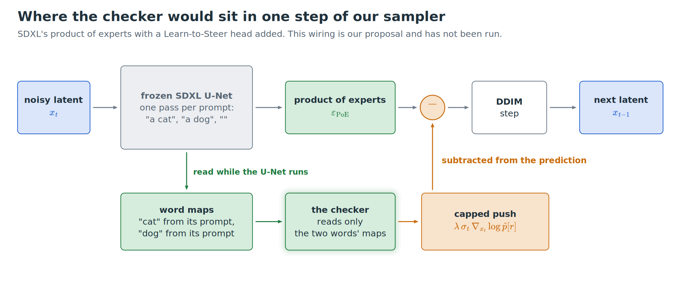

# 🌍 Context: the word-map checker, one sampler step

⬅️ Previous: [the methods index](../00-INDEX.md) | 📋 [The pages of this method](#the-pages-of-this-method) | Next: [the network view](02-the-network-view.md) ➡️

The word-map checker is a small trained classifier that reads where two words of the prompt landed on the picture, says which spatial relation the two subjects are in (above, below, left of, right of), and pushes the sampler toward the relation that was asked for. It is Learn-to-Steer's method ([arXiv 2509.02295v2](https://arxiv.org/pdf/2509.02295v2#page=4)), and Loop 7 chose it as the first of Paper 2's five proposed checkers because it is the only one with a trained precedent. Learn-to-Steer ran it on FLUX and on SD 1.4 and 2.1. Putting it on SDXL's product of experts is this project's proposal, and nothing in this folder has been trained or run on SDXL. What the product of experts is, and the piece it leaves out, are on [the product-of-experts overview](../01-the-product-of-experts/01-overview.md) and [PoE composition](../../world/poe-composition.md#what-poe-composition-is); what a fused cat-dog is, on [the chimera page](../../world/chimera.md#what-a-chimera-is). This folder adds the zoom ladder's pictures, a latent of 8 numbers where every value can be followed by hand, and the code. Every picture comes from [the word-map checker ladder](../../../2-classifier-guidance/artifacts/scenes/word-map-checker/README.md) unless its caption names another source.

*One step of our sampler with a word-map checker added, left to right. Blue is an input or the latent (x_t, then x_{t−1}). Grey is the frozen SDXL U-Net, run once per prompt: "a cat", "a dog" and the empty prompt "". Green is what is computed inside: the product's noise prediction ε_PoE, the word maps of "cat" (from its own prompt) and "dog" (from its own prompt), and the checker, which reads only those two maps. Orange is the push, λ σ_t ∇_{x_t} log p̂[r], shortened by a cap and subtracted from the prediction at the circle before the DDIM step.* ✅ *Read on the figure at full size. Its subtitle says "This wiring is our proposal and has not been run."* ✅

## Table of contents

- [Words this page uses](#words-this-page-uses)
- [What is established and what is proposed](#what-is-established-and-what-is-proposed)
- [What one step does](#what-one-step-does)
- [The names, taken apart](#the-names-taken-apart)
- [The push, by what moves](#the-push-by-what-moves)
- [How it fails and how you know it worked](#how-it-fails-and-how-you-know-it-worked)
- [What is measured where](#what-is-measured-where)
- [Where the sources disagree](#where-the-sources-disagree)
- [The pages of this method](#the-pages-of-this-method)
- [Where this came from](#where-this-came-from)
- [Read more](#read-more)

## Words this page uses

Navigation: 📋 [TOC](#table-of-contents) | [Next](#what-is-established-and-what-is-proposed) ➡️

**Latent x_t**: the noisy picture SDXL works on at timestep t, 4 channels of 128 × 128 numbers. The decoder turns the finished latent into the 1024 × 1024 picture.

**Token**: one piece of the prompt after it is cut up for the text encoder. SDXL's prompts are always padded to 77 tokens, a start token first.

**Head**: the small trained network the checker is. Learn-to-Steer's paper calls it the relation classifier C.

**Relation r**: the spatial relation the prompt asks for, one of above, below, left of and right of. The head also has a fifth class, "neutral", used in training and never asked for.

**Push**: the extra arrow taken off the product's noise prediction at a step, built from the head's gradient.

**Learn-to-Steer**: the paper this method comes from (Yiflach, Atzmon and Chechik). It never ran on SDXL or on a product of experts.

**The miniature**: the ladder's latent of 8 numbers, worked in full on [the miniature page](04-the-miniature.md). Its weights are set by hand, so it shows what each part computes and predicts nothing about a trained head.

## What is established and what is proposed

Navigation: ⬅️ [Words this page uses](#words-this-page-uses) | 📋 [TOC](#table-of-contents) | [Next](#what-one-step-does) ➡️

**Every number on SDXL in this folder is a size counted from its config or a measurement of the plain product; no word-map head has been trained or run on SDXL.** ✅ The ladder's README, "What is established and what is proposed".

| Statement | Status | Mark and source |
|---|---|---|
| A head trained on word maps steers SD 2.1 to 0.54 [GenEval](../../../../../goal-setting/learning/deep-learning/diffusion-models/12-scoring-and-rival-methods/textbook/04-geneval.md) position (the fraction of 400 images with the right relation, 0 to 1), against 0.07 with no steering | established, on SD 2.1 | ✍️ the paper, p. 5, Table 1, as the [reading note](../../../artifacts/notes/progress/abstract-checkers/01-reading/learn-to-steer.md#numbers) and the ladder's numbers file record it |
| On 16 object categories absent from training it reaches 0.60 on FLUX.1-dev, against 0.18 with no steering | established, on FLUX.1-dev; the categories were chosen as words absent from training, with no planned split | ✅ the paper's text, p. 7, in the ladder's saved copy; Table 2 values ✍️ the reading note |
| The same wiring on SDXL's product of experts | proposed, never built | ✅ the ladder's README and wm0's subtitle |
| A hand-written push that pulls the two SDXL word maps apart drew two animals on 0 of 8 seeds | measured on SDXL, draft calls, no verdict recorded; it used a correlation loss, so it does not test a trained head | ✍️ [the early-push report](../../../2-classifier-guidance/report/classifier-guided-poe/does-an-early-push-separate-the-cat-and-dog.md#which-kind-of-push-moves-the-animals), row `result-sheet-layout` |

> [!IMPORTANT]
> The 0-of-8 result is the only run on SDXL word maps, and it is not this method. It used one hand-written loss (the correlation of the two maps, seeds 9 to 16, steps 0 to 19), so the reading note warns against reading it as evidence against a trained head. No verdict is recorded for it.

## What one step does

Navigation: ⬅️ [What is established and what is proposed](#what-is-established-and-what-is-proposed) | 📋 [TOC](#table-of-contents) | [Next](#the-names-taken-apart) ➡️

**At each pushed step the U-Net's own attention weights for "cat" and "dog" are kept, the head turns them into a chance for each relation, and the gradient of the asked relation's log chance is shortened and taken off the product's noise prediction.** ✍️ The ladder's [sampler code walk](../../../2-classifier-guidance/artifacts/scenes/word-map-checker/3-code/walk-our-sampler.md), whose push code is checked on [the code page](05-the-code.md#our-sampler-the-push-and-the-cap).

The word gradient is taken apart on the 8-number latent on [the miniature page](04-the-miniature.md#stage-3-the-gradient-back-to-the-latent): one slope per latent number, saying how much the head's log chance changes when that number moves. Textbook pages and videos are on [the gradient card](../../../../../Obsidian/Mathematics/Calculus/Gradient.md#where-to-learn-this). ✅

Each box of the opening picture has a twin in the miniature, in Learn-to-Steer and in the SDXL proposal:

| Box | In the miniature | In Learn-to-Steer | On SDXL, proposed |
|---|---|---|---|
| the noisy latent | 2 × 2 patches with a cat channel and a dog channel, 8 numbers ✅ | the model's latent ✍️ | 4 × 128 × 128 ✅ |
| the word maps | 2 attention layers, keys 2 and 1, each patch sharing one unit with a background token ✅ | every layer's and head's map, each resized to 16 × 16 and divided by its sum: 195 per word on SD 2.1 (inferred), 1,368 on FLUX ✍️ | 1,300 per word, from 70 layers ✅ counted from SDXL's config by the ladder |
| the head | two hidden units that compare the maps' centres of mass, five logits at scale 4 ✅ | a trained network of 1,964,581 weights on its SD 2.1 settings ✍️ | a head trained on SDXL's maps |
| the push | one push of 2 × 0.8 × the gradient, capped at 0.4 of the product's length ✅ | no push on the prediction: the latent itself is moved, up to 16 times per step at step size 5 ✍️ | one capped push per step on steps 0 to 15 of 50 ✍️ the ladder's numbers file |

"Head" means two things in this table. In "every layer's and head's map" it is an attention head, one of the parallel attention computations inside one U-Net layer, each giving its own map per word. In the row "the head" it is the checker. [The network view's word list](02-the-network-view.md#words-this-page-uses) keeps the two apart, and these pages call only the checker "the head". ✅ Read on that page.

## The names, taken apart

Navigation: ⬅️ [What one step does](#what-one-step-does) | 📋 [TOC](#table-of-contents) | [Next](#the-push-by-what-moves) ➡️

**Each name points at one box of the opening picture; the numbers are the miniature's, from its answer key.** ✅

🔤 **The name:** word attention map
- **word**: one subject word of the prompt, "cat" or "dog". On the picture, the two quoted words in the green "word maps" box.
- **attention**: how much a part listens to something. Inside the U-Net, each patch of the latent spreads a total weight of 1 over the 77 tokens of its prompt; the share it gives a token is its attention to that token.
- **map**: a picture of where something is. Lay one word's share at every patch back out on the grid and you have a picture of where that word landed.
- **Formula, in those words:** A[p] = the share of patch p's attention that goes to the word. On the miniature a patch with cat-ness 2 and key 2 scores e^(2·2) against a background token's e^0, so "cat" takes e^4 / (1 + e^4) = 0.9820 of it; a patch with cat-ness −1 gives "cat" 0.1192.
- **Consequence:** raise that patch's cat-ness from 2 to 3 and the share rises only from 0.9820 to 0.9975, because a share close to 1 has little room left. ✅ Computed this session. A map shows where the model reads the word, which need not be where that animal sits: on a real SDXL step of "a cat and a dog", both words light up both animals (see [the network view](02-the-network-view.md#three-inputs-and-where-the-maps-are-read)).

🔤 **The name:** cross-attention
- **cross**: across two different kinds of thing. Here the latent's patches ask, and the prompt's words answer.
- **attention**: each asker takes a weighted mix of the answerers, the weights adding to 1.
- **Formula, in those words:** a patch's weight on token i is e^(score with i) / the sum of e^(score with every token). The word map is one token's column of that patch-by-token table.
- **Consequence:** the weights of one patch must add to 1, so two words in one prompt compete for each patch. In one joint prompt "cat" takes e^4 / (1 + e^4 + e^4) = 0.4955 of the miniature's fused patch; in its own prompt, as the product runs it, it takes 0.9820. ✅ The answer key.

🔤 **The name:** spatial relation
- **spatial**: about places on the picture.
- **relation**: how two things stand to each other.
- **On the picture:** what the checker's one output names: is the cat above, below, left of or right of the dog.
- **Formula, in those words:** the head's chance for each relation, p̂[r] = e^(logit for r) / the sum of e^(every logit).
- **Consequence:** on the miniature's fused body both maps are identical, so all five logits are 0 and each relation gets 0.2. After one of Learn-to-Steer's updates the cat's map has moved left and the dog's right, and "left of" gets 0.7961. ✅ The answer key.

🔤 **The name:** checker
- **checker**: something that answers a yes-or-no or which-one question about what it is shown. Here it is Learn-to-Steer's relation classifier, shown only the two words' maps and never the picture.
- **On the picture:** the glowing green box, "reads only the two words' maps".
- **Consequence:** because it never sees the picture, the checker cannot tell two separate animals from one fused body whose two word maps sit apart. That risk is drawn in [the illustrations](03-the-illustrations.md#the-map-can-move-without-a-second-animal). 🔍 Stated by the ladder as untested, not measured.

## The push, by what moves

Navigation: ⬅️ [The names, taken apart](#the-names-taken-apart) | 📋 [TOC](#table-of-contents) | [Next](#how-it-fails-and-how-you-know-it-worked) ➡️

**The sampler uses the product's prediction minus the head's gradient, scaled by a strength and the noise level and then shortened to at most c times the product's own length.** ✅ Read in `_classifier_guided.py`; see [the code page](05-the-code.md#our-sampler-the-push-and-the-cap). The colours are the ladder's: blue for inputs, green for hidden values, red for outputs, orange for the push.

$$
\textcolor{#c0262d}{\underbrace{\varepsilon'}_{\text{what the sampler uses}}}
= \textcolor{#1d7a3e}{\underbrace{\varepsilon_{\text{PoE}}}_{\text{the product}}}
- \textcolor{#c86a0a}{\underbrace{\lambda\,\sigma_t\,\nabla_{x_t}\log\hat p[r]}_{\text{the raw push}}}
\cdot \underbrace{\min\!\Big(1,\ \frac{c\,\lVert\varepsilon_{\text{PoE}}\rVert}{\lVert\lambda\,\sigma_t\,\nabla_{x_t}\log\hat p[r]\rVert}\Big)}_{\text{the cap's shortening}}
$$

The worked case is the miniature's fused body, one push then one DDIM step, with λ = 2, σ_t = 0.8 (signal share ᾱ_t = 0.36) and c = 0.4. ✅ The answer key, every variant recomputed this session.

| Symbol | On the miniature | If it moved |
|---|---|---|
| ε_PoE | ±0.5 on every number, length 1.4142 | its length sets the ceiling: the cap is always 0.4 of it |
| ∇ log p̂[r] | minus the loss gradient: (0.0938, −0.0938, 0.3715, −0.3715) on the cat channel, the mirror on the dog's, length 0.7664 | largest on the bottom row, where the map has not decided |
| λ σ_t | 2 × 0.8 = 1.6, so the raw push has length 1.2262 | λ = 4 doubles it to 2.4524 and the cap cuts it back to the same 0.5657; λ = 0.5 gives 0.3065, under the cap, so it passes unshortened |
| c | 0.4, so the ceiling is 0.4 × 1.4142 = 0.5657 and the raw push is scaled by 0.5657 / 1.2262 = 0.4613 | c = 0.8 raises the ceiling to 1.1314 and the scale to 0.9227 |
| ε' after one DDIM step | the head's chance for "left of" goes from 0.2 to 0.2367; with no push it stays 0.2 | |

**How much reaches the latent.** The DDIM step carries a change in the prediction into the next latent at the rate √(1 − ᾱ_{t−1}) − √(1 − ᾱ_t) √(ᾱ_{t−1}/ᾱ_t) = 0.6 − 0.8 × 0.8/0.6 = −0.4667, so the capped push of length 0.5657 moves the latent by 0.264. Learn-to-Steer's 16 updates at step size 5 move the same latent by 6.0072 and take "left of" to 0.9936. ✅ The answer key. The weights are hand-set, so the size of the gap says nothing about SDXL; its direction means a head that fails at our dose would still need testing at theirs.

🔤 **The name:** DDIM step
- **DDIM**: denoising diffusion implicit model.
- **Denoising**: taking noise out.
- **Diffusion**: the noise was spread into the picture the way ink spreads in water, and the sampler runs that spreading backwards.
- **Implicit**: each step follows a fixed rule from the current latent and the prediction, with no fresh random noise, so the same starting noise always gives the same picture.
- **On the picture:** the last blue arrow, from the circle where the push is taken off to the next latent x_{t−1}.
- **Formula, in those words:** guess the clean latent from the prediction, then put back noise at the next, smaller level using the same prediction. The two noise numbers are ᾱ_t, the share of the latent that is still signal, and σ_t = √(1 − ᾱ_t), the noise level: ᾱ_t = 0.36 gives σ_t = 0.8 on the miniature.

$$
\textcolor{#1f5fd0}{\underbrace{x_{t-1}}_{\text{the next latent}}}
= \sqrt{\bar\alpha_{t-1}}\;\textcolor{#1d7a3e}{\underbrace{\hat x_0}_{\text{the clean guess}}}
+ \sqrt{1-\bar\alpha_{t-1}}\;\textcolor{#c0262d}{\underbrace{\varepsilon'}_{\text{the pushed prediction}}},
\qquad
\textcolor{#1d7a3e}{\hat x_0} = \frac{\textcolor{#1f5fd0}{x_t} - \sigma_t\,\textcolor{#c0262d}{\varepsilon'}}{\sqrt{\bar\alpha_t}}
$$

- **Consequence:** the rate −0.4667 above holds for this one pair of noise levels. Move the step later, to ᾱ_t = 0.64 and ᾱ_{t−1} = 0.81 (toy values, not the sampler's schedule), and the rate becomes √0.19 − 0.6 × √(0.81/0.64) = −0.2391, so the same capped push of length 0.5657 moves the latent 0.1353 instead of 0.264. ✅ Computed this session. Textbook pages and videos are on [the DDIM card](../../../../../Obsidian/Artificial%20Intelligence/Generative%20Modeling/Diffusion%20Models/DDIM.md#where-to-learn-this).

## How it fails and how you know it worked

Navigation: ⬅️ [The push, by what moves](#the-push-by-what-moves) | 📋 [TOC](#table-of-contents) | [Next](#what-is-measured-where) ➡️

**Nothing has worked on SDXL yet, and the ladder names three ways the method can mislead before it is run.** ✅ Each is computed in the miniature's answer key.

**It can read the word instead of the picture.** A head trained only on true captions put weight 5.5886 on the relation word's trace and gave "right of" 0.9929 to a cat truly on the left whose prompt said "right of". Trained on true and wrong captions, its weight on the trace fell to 0 and the same case got 0.0085. ✅ Worked on [the miniature page](04-the-miniature.md#stage-5-three-ways-it-misleads).

**A hand-written map loss can have no pull at all.** On identical maps the correlation of the two maps is 1, its maximum, so its gradient is 0, where the head's has length 0.7664. ✅ SDXL's maps are never identical (their top 10% overlap by 0.506 to 0.814), so this limit case does not explain the 0 of 8. ✍️ The ladder.

**The head has no class for "fused".** Identical maps give 0.2 to all five classes: the head can say it cannot tell which side, and cannot say the two are one body. ✅ A head for the product would need one (inferred by the reading note). 🔍

💥 **Broken run (without):** the trained head replaced by our hand-written correlation loss, pushed on SDXL.
- **Predict:** of 8 seeds, how many end with two animals?
- **Wrong:** 0 of 8, seeds 9 to 16, push on steps 0 to 19; strong pushes zoomed into one face. ✍️ The early-push report; draft calls, no verdict recorded.
- **Right**, with a trained head at a matched dose: no finding holds this case.

**How you would know it worked.** The design's bar for the spatial checker on SDXL is a balanced accuracy over steps 0 to 15 of at least 0.75, within 0.05 of held-out animal pairs, and at least 0.75 on right against wrong relation. ✍️ [Loop 7's checker design](../../../artifacts/notes/progress/abstract-checkers/03-design.md#the-design-on-one-page), row 2. In the sampler, a push at strength 0 never calls the head, so the run is byte-identical to the plain product; that is the check a new head must keep. ✅ [The code page](05-the-code.md#our-sampler-the-push-and-the-cap).

🔤 **The name:** balanced accuracy
- **accuracy**: the share of answers that are right.
- **balanced**: each true class counts equally, however many test cases it has, so the score is the average of the share right within each class.
- **On a toy:** 20 test pairs of word maps, 16 truly "left of" and 4 truly "right of", with the truth down the side and the checker's answer across the top.

| Truth | checker says "left of" | checker says "right of" | right within the class |
|---|---|---|---|
| left of, 16 pairs | 16 | 0 | 16/16 = 1 |
| right of, 4 pairs | 4 | 0 | 0/4 = 0 |

- **Formula, in those words:** the mean of the last column, (16/16 + 0/4) / 2 = 0.50, where plain accuracy is (16 + 0) / 20 = 0.80.
- **Consequence:** this checker always answers "left of" and knows nothing, yet it passes a plain-accuracy bar of 0.75 at 0.80 and fails the balanced one at 0.50, which is chance for two classes. A checker that gets 14 of the 16 and 3 of the 4 scores 0.85 plain and 0.8125 balanced, and passes both. ✅ Computed this session; the toy's counts are invented.

## What is measured where

Navigation: ⬅️ [How it fails and how you know it worked](#how-it-fails-and-how-you-know-it-worked) | 📋 [TOC](#table-of-contents) | [Next](#where-the-sources-disagree) ➡️

**Miniature numbers are exact and say nothing about performance; Learn-to-Steer's numbers belong to its models; SDXL numbers are sizes or plain-product measurements.**

| Statement | Measured on | Mark and source |
|---|---|---|
| every miniature value on these pages | the hand-set 8-number latent | ✅ the ladder's `miniature_answer_key.json`, key values recomputed this session |
| 1,300 maps per word, 100 at 64 × 64 and 1,200 at 32 × 32 | SDXL's U-Net config | ✅ the ladder's numbers file, counted from the saved config |
| 10 of the 16 proposed pushed steps sit above t = 800 | SDXL's scheduler, 50 steps | ✅ counted this session from the numbers file's 16 timesteps, 981 down to 681 |
| a word-map detector scores 18.0 of 100 at t = 800 and 58.4 at t = 200 | SD 2.1, Detector Guidance's paper | ✍️ the ladder's numbers file, citing the Detector Guidance reading note |
| the top 10% of the two maps overlap by 0.506 to 0.814 under the product and 0.225 to 0.394 under "a cat and a dog" | SDXL, 8 seeds, steps 2 to 40, median per step | ✍️ [the early-push report](../../../2-classifier-guidance/report/classifier-guided-poe/does-an-early-push-separate-the-cat-and-dog.md#which-kind-of-push-moves-the-animals) |
| the leakage fix lifts GenEval position from 0.425 to 0.57 | FLUX.1-schnell validation | ✅ the paper's text, p. 8, in the ladder's saved copy |
| a trained word-map head steers SDXL's product | not measured | open |

The leakage fix in the table is training on a wrong relation word as well as the true one, taken apart as [relation leakage on the network view](02-the-network-view.md#training-on-the-right-and-the-wrong-word). ✅ Read on that page.

## Where the sources disagree

Navigation: ⬅️ [What is measured where](#what-is-measured-where) | 📋 [TOC](#table-of-contents) | [Next](#the-pages-of-this-method) ➡️

**Five places where two records say different things about this method. These pages report both and resolve none.**

| What | One source | The other source |
|---|---|---|
| What the wrong-word training example is labelled | [Loop 7's checker design](../../../artifacts/notes/progress/abstract-checkers/03-design.md#the-design-on-one-page), line 27: "The same picture appears with its true relation (label 1) and a wrong one (label 0), Learn-to-Steer's fix" | the ladder's [Learn-to-Steer code walk](../../../2-classifier-guidance/artifacts/scenes/word-map-checker/3-code/walk-learn-to-steer.md#10-training-data-two-inversions-one-label), line 349: "Both sets of maps carry the true relation as the label", and the paper, p. 4: "both sets of extracted attention maps are labeled with the ground-truth relation" |
| How the push is sized | the design, lines 96 to 99: a fixed length, ε̂ = ε_product − ‖ε_product‖ Σ b ∇ℓ_k / ‖∇ℓ_k‖ with b = 0.4, "here it is the exact length" | the ladder's [miniature](../../../2-classifier-guidance/artifacts/scenes/word-map-checker/2-miniature/README.md#stage-4-two-ways-to-apply-it), lines 128 to 130, the [sampler walk](../../../2-classifier-guidance/artifacts/scenes/word-map-checker/3-code/walk-our-sampler.md#6-the-cap), line 191, and wm0: λ σ_t ∇ log p̂[r] shortened only when longer than 0.4 of the product |
| What the SDXL head reads | the design, lines 75 to 77: average over heads and layers in each grid, shrink 64 × 64 to 32 × 32 by area pooling, divide by the sum, read with `PairHead` at 32 × 32 | the ladder's [sampler walk](../../../2-classifier-guidance/artifacts/scenes/word-map-checker/3-code/walk-our-sampler.md#what-a-learn-to-steer-head-on-sdxl-would-change), lines 263 and 265: keep all 1,300 maps per word, each resized to 16 × 16 as the authors do |
| How the head is told the time | the design, line 81: "one learned embedding for each of the 16 pushed steps" | the sampler walk, line 267: translate t into the authors' step buckets, so steps 0 to 4 are read with bucket 5 |
| Where Learn-to-Steer reaches 0.60 on unseen categories | the ladder's [README](../../../2-classifier-guidance/artifacts/scenes/word-map-checker/README.md#what-is-established-and-what-is-proposed), line 11, and its closing page, line 344: "Its 0.60 GenEval position ... on 16 unseen categories is on FLUX.1-dev" | the [reading note](../../../artifacts/notes/progress/abstract-checkers/01-reading/learn-to-steer.md#numbers), lines 66 to 67 and 101, and the paper's text, p. 7: 0.60 on FLUX.1-dev and also 0.60 on SD 2.1 |

The ladder also records one place where the paper and its own code differ: the paper prints 15 optimisation iterations per step (p. 16), and the released loop runs `range(15 + 1)` passes, each able to update, so up to 16. ✍️ [The code page](05-the-code.md#where-the-code-and-the-paper-differ) lists it with the others.

## The pages of this method

Navigation: ⬅️ [Where the sources disagree](#where-the-sources-disagree) | 📋 [TOC](#table-of-contents) | [Next](#where-this-came-from) ➡️

**The pages follow the ladder's rungs from this one step down to the code.**

1. This page: one sampler step, the names, the push equation, and what is established against what is proposed (ladder level 0, whose system picture is [journey 13's artifact](https://claude.ai/artifact/FBbwapTjp1dbEmzpLspRBT), linked rather than redrawn).
2. [The network view](02-the-network-view.md): SDXL's three inputs, where the maps are read, how a word's stack becomes one map, the head, the two inversions and the two ways the gradient enters (level 0.5).
3. [The illustrations](03-the-illustrations.md): the six rendered pictures that tell the idea, each tied to its number (level 1).
4. [The miniature](04-the-miniature.md): the 8-number latent worked stage by stage (level 2).
5. [The code](05-the-code.md): the authors' code as the ladder read it, and our sampler's push as it stands now (level 3, its two walks merged on one page).

The ladder's rebuild companion and closing page are linked under [read more](#read-more) rather than given pages of their own.

## Where this came from

Navigation: ⬅️ [The pages of this method](#the-pages-of-this-method) | 📋 [TOC](#table-of-contents) | [Next](#read-more) ➡️

| What | How it was established | When |
|---|---|---|
| The established and proposed split | Read in the ladder's README and closing page | 2026-11-24 |
| The opening picture's labels | Read on wm0 at full size | 2026-11-24 |
| Every miniature number, and the λ, c and cat-ness variants | Read in `miniature_answer_key.json`; recomputed from its formulas with numpy | 2026-11-24 |
| The push and cap code, and the strength-0 canary | Read in `poe_repair/methods/_classifier_guided.py`, unchanged since `3867b3f1`, working tree clean | 2026-11-24 |
| Paper quotes on pp. 4, 7, 8 and 16 | Read in the ladder's saved text of the paper, `numbers/sources/learn-to-steer-paged.txt` | 2026-11-24 |
| Table 1 and Table 2 values | Read in the reading note and the numbers file; not rechecked against the paper's tables | 2026-11-24 |
| The 0-of-8 row and the overlap medians | Read in the early-push report, lines 50 to 56 | 2026-11-24 |
| The design's bar and its disagreeing lines | Read in Loop 7's checker design | 2026-11-24 |

## Read more

Navigation: ⬅️ [Where this came from](#where-this-came-from) | 📋 [TOC](#table-of-contents)

| What | Where |
|---|---|
| The method read through the small network, one idea at a time | [the ladder's closing page](../../../2-classifier-guidance/artifacts/scenes/word-map-checker/read-through-a-small-network.md) |
| Each equation down to first-course maths, 25 moves, each linked to where the learning tree teaches it | [the ladder's rebuild companion](../../../2-classifier-guidance/artifacts/scenes/word-map-checker/rebuild-from-fundamentals.md) |
| The paper, read and checked page by page | [the Learn-to-Steer reading note](../../../artifacts/notes/progress/abstract-checkers/01-reading/learn-to-steer.md) |
| The five checkers and every bar written before any run | [Loop 7's checker design](../../../artifacts/notes/progress/abstract-checkers/03-design.md) |
| The same idea on the digit canvas, where it did run | [the digit-map checkers](../03-the-digit-map-checkers/01-overview.md) |
| The push and cap used by Paper 2's kept checker | [the readout checker's push page](../02-the-readout-checker/03-the-push-and-its-cap.md) |

⬅️ Previous: [the methods index](../00-INDEX.md) | 📋 [The pages of this method](#the-pages-of-this-method) | Next: [the network view](02-the-network-view.md) ➡️

<!-- built-to: PAGE_LOOK_FORMAT v1 -->
