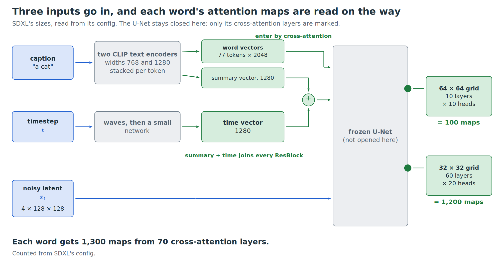
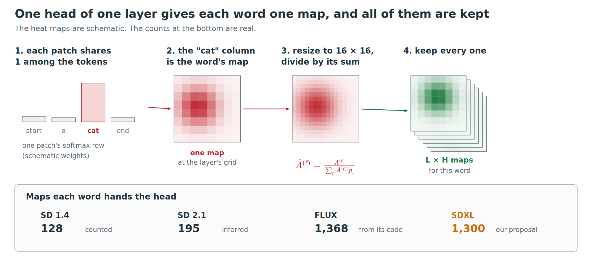
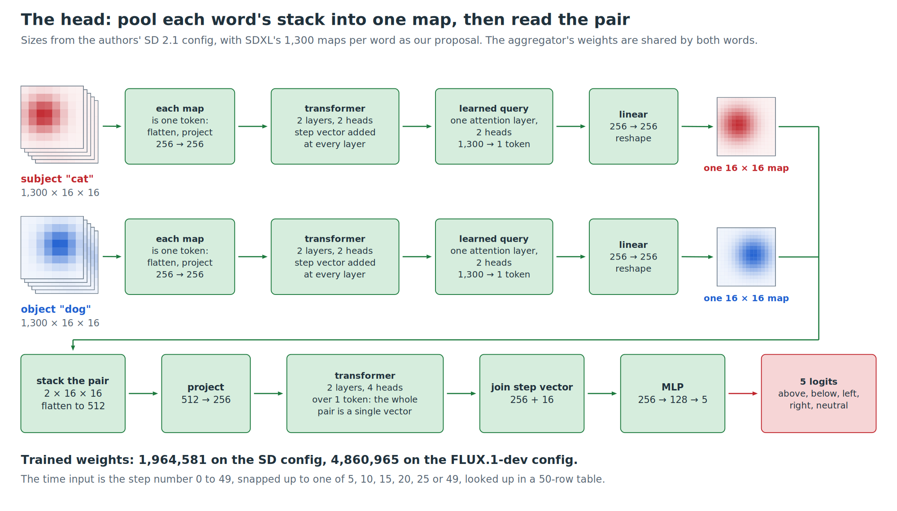
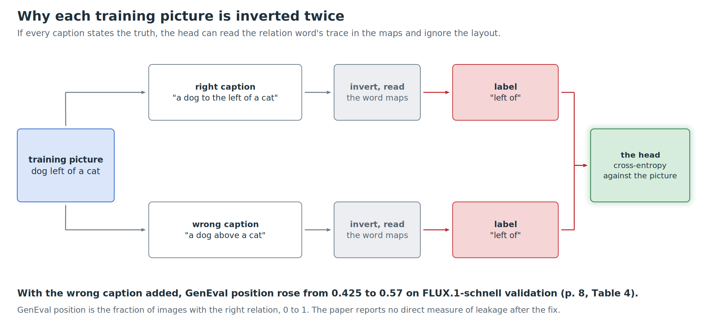
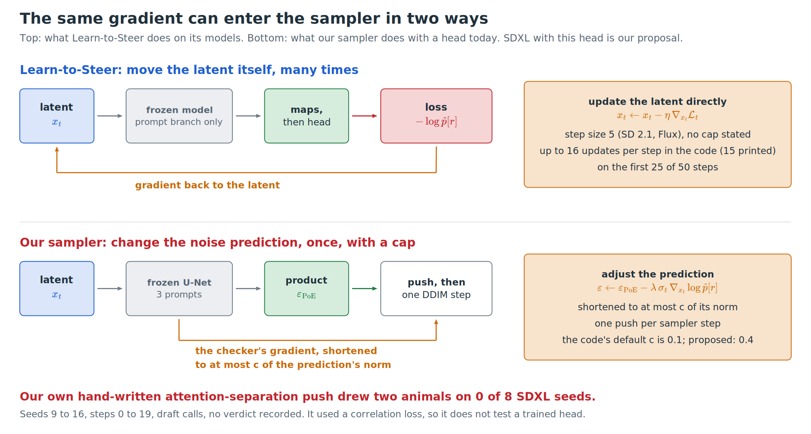
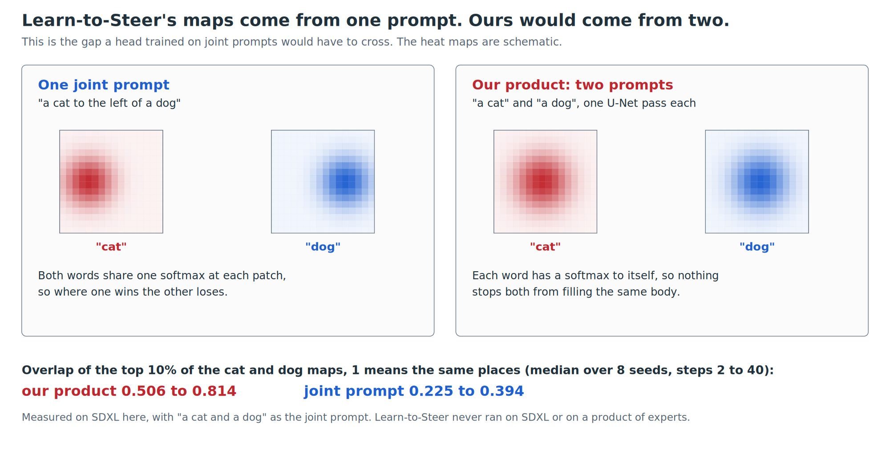

# 🌍 Context: the word-map checker, the network view

⬅️ Previous: [one sampler step](01-overview.md) | 📋 [The pages of this method](01-overview.md#the-pages-of-this-method) | Next: [the illustrations](03-the-illustrations.md) ➡️

This page opens the checker box of [the overview's picture](01-overview.md) into the network it would be on SDXL: where SDXL's three inputs go, where each word's maps are read, how a word's 1,300 maps become one, how the head reads the pair, why each training picture is inverted twice, and the two ways the head's gradient can enter a sampler. The U-Net itself stays closed. Sizes on SDXL are counted from its public config; the head's sizes are the authors' SD 2.1 and FLUX.1-dev settings, rebuilt by the ladder from their code. Learn-to-Steer never ran on SDXL, so every SDXL row of the head is our proposal. Every `wm` figure is from [the ladder's network view](../../../2-classifier-guidance/artifacts/scenes/word-map-checker/0.5-network-view/README.md).

*SDXL's three inputs, left to right. Blue: the caption "a cat", the timestep t and the noisy latent x_t (4 × 128 × 128). Grey: the two CLIP text encoders (widths 768 and 1280, stacked per token), the small network that turns t into a time vector, and the closed U-Net. Green: 77 word vectors of 2048 numbers, which enter the U-Net by cross-attention; a summary vector of 1280, added to the 1280-number time vector and joined to every ResBlock. The two dark dots on the U-Net's right edge are where the maps are read: the 64 × 64 grid, 10 layers × 10 heads = 100 maps, and the 32 × 32 grid, 60 layers × 20 heads = 1,200 maps. Footer: each word gets 1,300 maps from 70 cross-attention layers, counted from SDXL's config.* ✅ *Read on the figure at full size; the counts match the numbers file.* *The ladder notes that SDXL also folds six size numbers into the summary-and-time join, which this figure leaves out.* ✍️

## Table of contents

- [Words this page uses](#words-this-page-uses)
- [Three inputs, and where the maps are read](#three-inputs-and-where-the-maps-are-read)
- [From one layer to a word's stack](#from-one-layer-to-a-words-stack)
- [The head reads the two stacks](#the-head-reads-the-two-stacks)
- [Training on the right and the wrong word](#training-on-the-right-and-the-wrong-word)
- [Two ways the gradient enters](#two-ways-the-gradient-enters)
- [One joint prompt against two prompts](#one-joint-prompt-against-two-prompts)
- [Where this came from](#where-this-came-from)
- [Read more](#read-more)

## Words this page uses

Navigation: 📋 [TOC](#table-of-contents) | [Next](#three-inputs-and-where-the-maps-are-read) ➡️

**Attention head**: one of several parallel attention computations inside one U-Net layer, each with its own weights and its own map per word. It is a different thing from the checker's head, which this folder calls "the head".

**Layer-and-head number ℓ**: one (layer, attention head) pair, so one map per word. SDXL has 1,300 of them.

**Grid**: the latent's patches at one depth of the U-Net, 64 × 64 or 32 × 32 on SDXL.

**Step bucket b**: the sampler step number, 0 to 49, snapped up to one of 5, 10, 15, 20, 25 or 49 before the authors' head reads it.

**Inversion**: running a sampler backwards from a real picture to the noisy latent that would have drawn it, so the U-Net's maps on that picture can be read.

## Three inputs, and where the maps are read

Navigation: ⬅️ [Words this page uses](#words-this-page-uses) | 📋 [TOC](#table-of-contents) | [Next](#from-one-layer-to-a-words-stack) ➡️

**Nothing new is computed to get the maps: the U-Net already computes every patch's weights over the 77 tokens, and the method keeps a copy.** ✍️ The ladder's [code walk, block 1](../../../2-classifier-guidance/artifacts/scenes/word-map-checker/3-code/walk-learn-to-steer.md#1-catching-each-attention-map).

<table><tr>
<td> One patch asks the words (journey 13)</td>
<td> Where "cat" and "dog" land on a real SDXL step (journey 02)</td>
</tr></table>

*Left: one patch of the noisy latent x_t (drawn in pixel space at t = 481) at the 64 × 64 grid sends one weight to each of the 77 word vectors; the weights add to 1, the thickest arrow goes to "cat", and their mix of the word vectors returns to the patch. The weights are drawn, with heads and repeated layers left out.* ✅ *Right: real weights from one forward pass of SDXL on "a cat and a dog" at t = 481, averaged over heads and over the 10 blocks at 64 × 64 (top) and the 60 at 32 × 32 (bottom), with each animal outlined in blue. Each map has its own colour scale, its smallest and largest weight under its bar: "cat" at 64 × 64 runs 0.1149 to 0.2316. Both words are bright over both animals. At the patch on the cat's head (32 × 32, row 11, column 21) the weights are 0.1501 for "cat" and 0.1871 for "dog".* ✅ *Read on both figures at full size.*

**What the right picture says for this method.** The U-Net finds the animals, but does not keep each word on its own animal, so a word's map at this step marks "an animal here" more than "the cat here". ✍️ The figure's own footer. That single real step is a joint prompt at the middle of the run; whether the product's maps carry more at the early steps the push would use is not measured.

| What goes in | What it becomes | Where the maps come from |
|---|---|---|
| the caption | 77 word vectors of 2048, and one summary vector of 1280 | the word vectors are the keys and values of every cross-attention layer |
| the timestep t | a time vector of 1280, added to the summary vector | not a source of maps |
| the noisy latent x_t | the patches that ask | each patch's query against the 77 keys gives one row of weights |

✅ Read on wm1; the per-grid counts match `word_maps.sdxl` in [the ladder's numbers file](../../../2-classifier-guidance/artifacts/scenes/word-map-checker/numbers/numbers.json).

## From one layer to a word's stack

Navigation: ⬅️ [Three inputs, and where the maps are read](#three-inputs-and-where-the-maps-are-read) | 📋 [TOC](#table-of-contents) | [Next](#the-head-reads-the-two-stacks) ➡️

**Each layer-and-head gives a word one map; Learn-to-Steer resizes every one to 16 × 16, divides it by its own sum, and keeps them all as a stack.** ✍️ The ladder's [code walk, block 4](../../../2-classifier-guidance/artifacts/scenes/word-map-checker/3-code/walk-learn-to-steer.md#4-bringing-every-map-to-16-by-16).

*Left to right: (1) one patch shares a weight of 1 among its tokens, "cat" taking the most; (2) the "cat" column over every patch is the word's map at that layer's grid; (3) the map is resized to 16 × 16 and divided by its sum, Â^(ℓ) = A^(ℓ) / Σ_p A^(ℓ)[p]; (4) all L × H maps of the word are kept. The heat maps are drawn, not measured. The box gives the maps each word hands the head: SD 1.4 128 (counted), SD 2.1 195 (inferred, its config was not reachable), FLUX 1,368 (from the authors' code), SDXL 1,300 (our proposal).* ✅ *Read on the figure; the counts match the numbers file.*

$$
\textcolor{#1d7a3e}{\underbrace{\hat A^{(\ell)}_s}_{\text{the kept map}}}
= \frac{\operatorname{bilinear}_{16}\big(\textcolor{#1d7a3e}{\underbrace{A^{(\ell)}_s}_{\text{the word's column}}}\big)}
{\underbrace{\sum_p \operatorname{bilinear}_{16}\big(A^{(\ell)}_s\big)[p]}_{\text{its total, divided out}}}
$$

Worked on the miniature, whose maps are already 2 × 2 so the resize does nothing: layer 1's cat map (0.9820, 0.9820, 0.1192, 0.1192) adds to 2.2024, and dividing gives (0.4459, 0.4459, 0.0541, 0.0541). ✅ The answer key.

| Move | Â after it | What it shows |
|---|---|---|
| none | (0.4459, 0.4459, 0.0541, 0.0541) | the map as the head reads it |
| double every weight | unchanged | how loudly the word was read is lost; only where it landed is kept |
| use layer 2 (key 1) instead | (0.3830, 0.3830, 0.1170, 0.1170) | a softer layer spreads the same word more evenly |

✅ The answer key; the doubling follows from the division.

🔤 **The name:** renormalise
- **re-**: again. **normalise**: make something add up to a standard total, here 1.
- **On the picture:** step 3's formula, the map divided by its own sum.
- **Formula, in those words:** each cell's share of the word's whole map, Â[p] = A[p] / Σ A.
- **Consequence:** a word that takes little of the picture and one that takes much enter the head with the same total, 1. So the head reads where each word is and cannot read how strongly the U-Net attended to it. ✍️ The ladder's rebuild companion, rung 7.

🔤 **The name:** bilinear resize
- **bi-**: two. **linear**: along a straight line. A new cell's value is read off a straight line between its neighbours across, then a straight line down.
- **On the picture:** the step from the layer's grid to 16 × 16.
- **Consequence:** shrinking 32 to 16 places each new cell at the middle of a 2 × 2 block and averages all 4 cells at 0.25 each. Shrinking 64 to 16 the same way, with no antialiasing, reads only the middle 4 of each block's 16 cells, and the other 12 have no influence. ✍️ The ladder's code walk, block 4, found by moving one input cell at a time through `F.interpolate` on CPU. SDXL's 100 maps from its 64 grid would be read this way.

## The head reads the two stacks

Navigation: ⬅️ [From one layer to a word's stack](#from-one-layer-to-a-words-stack) | 📋 [TOC](#table-of-contents) | [Next](#training-on-the-right-and-the-wrong-word) ➡️

**One shared network pools each word's stack into a single 16 × 16 map; the pair is then flattened into one vector, joined with a step vector, and read into five logits.** ✍️ The ladder's [code walk, blocks 5 and 6](../../../2-classifier-guidance/artifacts/scenes/word-map-checker/3-code/walk-learn-to-steer.md#5-the-aggregator-many-maps-into-one).

*Top two rows, the aggregator, run once per word with shared weights: 1,300 maps of 16 × 16 (SDXL, our proposal) each become one token of 256 numbers; a transformer of 2 layers and 2 heads mixes them, with the step vector added at every layer; a learned query (one attention layer, 2 heads) pools the 1,300 tokens to 1; a linear layer reshapes it to one 16 × 16 map, red for "cat", blue for "dog". Bottom row, the classifier: the pair is stacked (2 × 16 × 16), flattened to 512, projected to 256, passed through a 2-layer, 4-head transformer that sees a single token, joined with a 16-number step vector (256 + 16), and an MLP (256 → 128 → 5) gives logits for above, below, left, right and neutral. Trained weights: 1,964,581 on the authors' SD settings, 4,860,965 on their FLUX.1-dev settings.* ✅ *Read on the figure at full size; the counts match the numbers file.*

| Part | SD 2.1 settings | FLUX.1-dev settings | Trained weights, SD 2.1 settings |
|---|---|---|---|
| aggregator: transformer layers, attention heads, pooling heads | 2, 2, 2 | 4, 4, 4 | 1,068,032 |
| classifier: transformer layers, attention heads | 2, 4 | 4, 8 | 896,549 |
| total | | | 1,964,581; 4,860,965 on FLUX.1-dev |

✍️ The ladder's numbers file, `head`, counted by rebuilding the authors' layers. The weight count does not depend on how many maps go in, so the same head would take 1,300 SDXL maps without changing size, but it would read SDXL's layers in positions trained on another model's. ✍️ The ladder's sampler walk, item 5.

🔤 **The name:** learned query
- **query**: a question. In attention, the vector that scores every token and so decides how much of each to take.
- **learned**: its numbers are trained with the rest of the head and do not depend on the input.
- **Formula, in those words:** one trained vector q scores each of the word's 1,300 tokens; a softmax turns the scores into weights adding to 1; the pooled result is the weighted sum of the tokens.
- **Consequence:** the miniature fixes the weights at 3/4 for layer 1 and 1/4 for layer 2, so the cat's top-left cell becomes 0.75 × 0.4459 + 0.25 × 0.3830 = 0.4302. Swap them to 1/4 and 3/4 and it becomes 0.3987. ✅ The first from the answer key, the second computed this session. The paper's plain mean over all maps scored higher on position, 0.78 against 0.70, and gave dull backgrounds. ✍️ The paper, p. 13, Table 9, as the numbers file records it.

🔤 **The name:** logit
- **logit**: short for "log-odds unit", an unscaled score for one class. Five classes, five logits.
- **On the picture:** the red box at the end, "5 logits".
- **Formula, in those words:** a class's chance is e^(its logit) divided by the sum of e^(every logit), the softmax.
- **Consequence:** all logits equal gives each class 1/5 = 0.2, which is what the miniature's fused body gets; raise one logit by 1 and its chance rises from 0.2 to e / (e + 4) = 0.405. ✅ Computed this session.

> [!NOTE]
> The classifier's transformer sees the whole flattened pair as one token, and attention over one token always has weight 1, so it cannot compare positions. Every comparison between the two maps happens in the 512 → 256 projection and the feed-forward layers. The paper's description reads as if the transformer compares positions. ✍️ The ladder's code walk, block 6, citing `model.py:76-80`.

The head is told the time as a step bucket, not as t: sampler steps 0 to 5 read bucket 5, 6 to 10 bucket 10, and so on to 26 to 49 reading 49, because the head trained on maps from steps 5, 10, 15, 20, 25 and 49 only. ✍️ The numbers file, `schedule.bucket_rule`. Our proposed steps 0 to 15 would read buckets 5, 10 and 15.

## Training on the right and the wrong word

Navigation: ⬅️ [The head reads the two stacks](#the-head-reads-the-two-stacks) | 📋 [TOC](#table-of-contents) | [Next](#two-ways-the-gradient-enters) ➡️

**Each training picture is inverted twice, under its true caption and under a wrong relation word, and both sets of maps carry the true label, so the head cannot succeed by reading the relation word.** ✅ The paper's text, p. 4, in the ladder's saved copy.

*One training picture (blue), a dog left of a cat, goes up to the right caption "a dog to the left of a cat" and down to the wrong caption "a dog above a cat". Each is inverted and its word maps read (grey), and both get the label "left of" (red) before the head's cross-entropy (green). Footer: with the wrong caption added, GenEval position (the fraction of images with the right relation, 0 to 1) rose from 0.425 to 0.57 on FLUX.1-schnell's validation set, and the paper reports no direct measure of leakage after the fix.* ✅

🔤 **The name:** relation leakage
- **relation**: the spatial word in the caption, here "above" or "left of".
- **leakage**: the answer seeping into the input by a side route. The maps were made by a U-Net reading a caption that contains the relation word, so a faint trace of the word sits in them.
- **Formula, in those words:** if every training caption is true, the trace and the label always agree, and a head can score well by reading the trace alone.
- **Consequence:** the paper's first heads reached high training accuracy and failed during generation; inverted under "above" for a dog actually left of a cat, they answered "above". ✅ The paper's text, p. 4. On the miniature's two-feature version the trace's weight goes from 5.5886 to 0 once the wrong captions are added. ✅ The answer key, worked on [the miniature page](04-the-miniature.md#stage-5-three-ways-it-misleads).

> [!WARNING]
> In the authors' data code an image whose wrong-word inversion fails the quality check (reconstruction below 20 dB) keeps its true-word samples with no wrong-word partner, and the code does not count how often that happened. ✍️ The ladder's code walk, block 10. Whether it matters for leakage is untested.

## Two ways the gradient enters

Navigation: ⬅️ [Training on the right and the wrong word](#training-on-the-right-and-the-wrong-word) | 📋 [TOC](#table-of-contents) | [Next](#one-joint-prompt-against-two-prompts) ➡️

**Learn-to-Steer moves the latent itself, up to 16 times per step and with no cap; our sampler changes the noise prediction once per step, under a cap.** ✍️ The ladder's two code walks.

*Top, Learn-to-Steer: the latent goes through the frozen model on the prompt's branch only, the maps go to the head, the loss is −log p̂[r], and the orange gradient goes back into the latent: x_t ← x_t − η ∇ L_t, step size 5 on SD 2.1 and Flux, no cap stated, up to 16 updates per step in the code (15 printed), on the first 25 of 50 steps. Bottom, our sampler: the latent goes through the frozen U-Net with 3 prompts to the product ε_PoE; the head's gradient becomes ε ← ε_PoE − λ σ_t ∇ log p̂[r], shortened to at most c of the prediction's length, once per step; the code's default c is 0.1 and 0.4 is proposed. Footer: our hand-written attention-separation push drew two animals on 0 of 8 SDXL seeds (seeds 9 to 16, steps 0 to 19, draft calls, no verdict recorded), and it used a correlation loss, so it does not test a trained head.* ✅

$$
\textcolor{#1f5fd0}{\underbrace{x_t}_{\text{the latent}}} \;\leftarrow\; x_t - \underbrace{\eta}_{\text{step size, 5}}\;\textcolor{#c86a0a}{\underbrace{\nabla_{x_t}\mathcal L_t}_{\text{the loss's slope}}},
\qquad \textcolor{#c0262d}{\underbrace{\mathcal L_t}_{\text{the loss}}} = -\log \hat p[r]
$$

On the miniature the first update moves the cat's bottom-left number from −1 to −1 + 5 × 0.3715 = 0.8577 and its top-right from 2 to 2 − 5 × 0.0938 = 1.5311, and "left of" goes from 0.2 to 0.7961. Halve η to 2.5 and each number moves half as far in that first update. Set η to 0 and nothing moves. ✅ The answer key; the halving follows from the update.

| | Learn-to-Steer | Our sampler |
|---|---|---|
| what changes | the latent, before the prediction is made | the noise prediction, after the product is formed |
| updates per sampler step | up to 16, stopping early once the loss falls to a small target | 1 |
| size | η × the raw gradient, no cap | λ σ_t × the gradient, shortened to at most c ‖ε_PoE‖ |
| which steps | the first 25 of 50 | steps 0 to 15 of 50, proposed |
| cost | SD 2.1 from 4.5 s to 90 s per image; FLUX.1-dev from 11 s to 6 minutes | one extra backward pass per pushed step, not timed for a word-map head |

✅ The paper's text, pp. 7 and 16; the rest ✍️ the ladder's code walks. The dose is worked number by number on [the miniature page](04-the-miniature.md#stage-4-two-ways-to-apply-it).

## One joint prompt against two prompts

Navigation: ⬅️ [Two ways the gradient enters](#two-ways-the-gradient-enters) | 📋 [TOC](#table-of-contents) | [Next](#where-this-came-from) ➡️

**Learn-to-Steer's head trained on maps from one prompt naming both subjects, where the two words compete at every patch; a product of experts would hand it maps from two prompts that never compete.** ✅ Read on wm6; ✍️ the ladder's sampler walk.

*Left panel, one joint prompt "a cat to the left of a dog": the cat map (red) and the dog map (blue) sit apart, because both words share one softmax at each patch, so where one wins the other loses. Right panel, our product, "a cat" and "a dog", one U-Net pass each: both maps sit in the middle, because each word has a softmax to itself and nothing stops both filling one body. The heat maps are drawn. Bottom: the overlap of the top 10% of the cat and dog maps (intersection over union; 1 means the same places), median over 8 seeds at each of steps 2 to 40: 0.506 to 0.814 for the product, 0.225 to 0.394 for the joint prompt. These were measured on SDXL with "a cat and a dog" as the joint prompt, not the panel's "a cat to the left of a dog".* ✅ *Read on the figure at full size; the medians* ✍️ *the early-push report, which computed them from its `overlap.json`.*

🔤 **The name:** two prompts that never compete
- **compete**: share one fixed total, so one's gain is the other's loss. Each patch's weights over the tokens of one prompt add to 1.
- **On the picture:** left panel, the two words in one prompt; right panel, each word in its own.
- **Formula, in those words:** in one prompt "cat" takes e^4 / (1 + e^4 + e^4) at the miniature's fused patch; in its own prompt it takes e^4 / (1 + e^4).
- **Consequence:** 0.4955 in the joint prompt against 0.9820 alone. Lower the dog-ness of that patch to 0 and "cat" in the joint prompt rises to e^4 / (1 + e^4 + 1) = 0.9647, because the competitor dropped out. ✅ The answer key and this session's arithmetic. A head trained only on competing maps would be reading a kind of map it has not seen. No result covers whether it can. ✍️ The closing page, "What is still open".

## Where this came from

Navigation: ⬅️ [One joint prompt against two prompts](#one-joint-prompt-against-two-prompts) | 📋 [TOC](#table-of-contents) | [Next](#read-more) ➡️

| What | How it was established | When |
|---|---|---|
| The labels on wm1 to wm6, nv4b and sd4b | Read on each figure at full size | 2026-11-24 |
| SDXL's 1,300 maps and the per-grid split | Read in the ladder's numbers file, counted from the saved SDXL config | 2026-11-24 |
| The head's shapes, settings and weight counts | Stated by the ladder's numbers file and code walk; the authors' code was not checked out here | 2026-11-24 |
| The resize reading only the middle 4 of 16 cells | Stated by the ladder's code walk, block 4 | 2026-11-20 |
| Paper quotes on pp. 4, 7, 8 and 16 | Read in the ladder's saved text of the paper | 2026-11-24 |
| Miniature values, and the swapped pooling weights, the raised logit and the dropped competitor | Read in the answer key; the variants computed this session | 2026-11-24 |
| The overlap medians | Stated by the early-push report | 2026-11-24 |

## Read more

Navigation: ⬅️ [Where this came from](#where-this-came-from) | 📋 [TOC](#table-of-contents)

| What | Where |
|---|---|
| The network view's own reading order, with the journey figures it reuses | [the ladder's network view](../../../2-classifier-guidance/artifacts/scenes/word-map-checker/0.5-network-view/README.md) |
| Softmax, the dot product, bilinear resizing, renormalising and the learned query, each linked to the page that teaches it | [the ladder's rebuild companion, sections 1 to 3](../../../2-classifier-guidance/artifacts/scenes/word-map-checker/rebuild-from-fundamentals.md#1-the-cross-attention-softmax) |
| The symbols, beside the ones the paper prints | [the ladder's notation](../../../2-classifier-guidance/artifacts/scenes/word-map-checker/NOTATION.md) |

⬅️ Previous: [one sampler step](01-overview.md) | 📋 [The pages of this method](01-overview.md#the-pages-of-this-method) | Next: [the illustrations](03-the-illustrations.md) ➡️

<!-- built-to: PAGE_LOOK_FORMAT v1 -->
