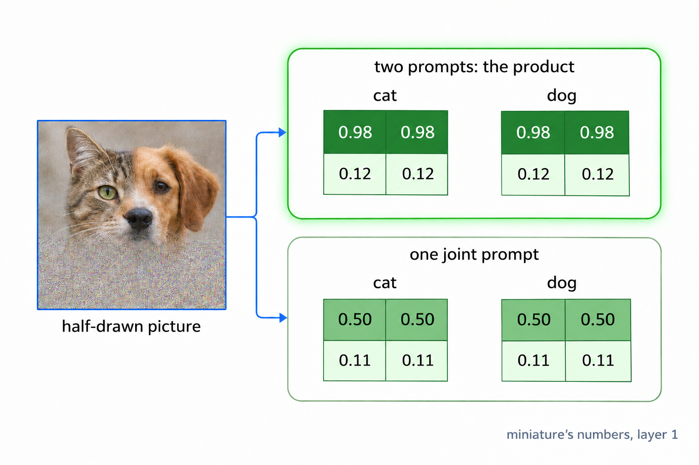
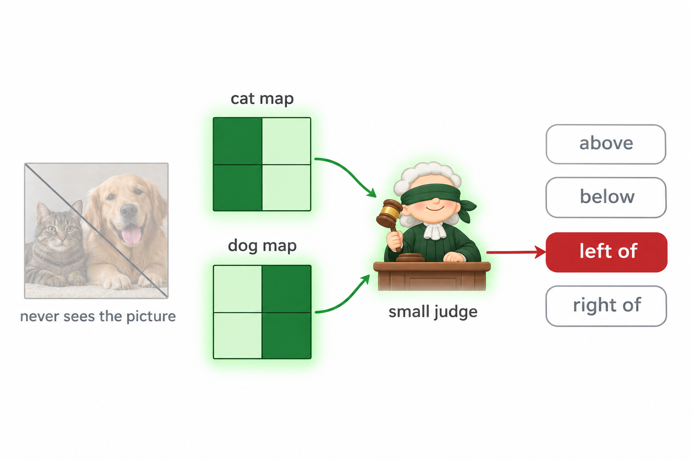
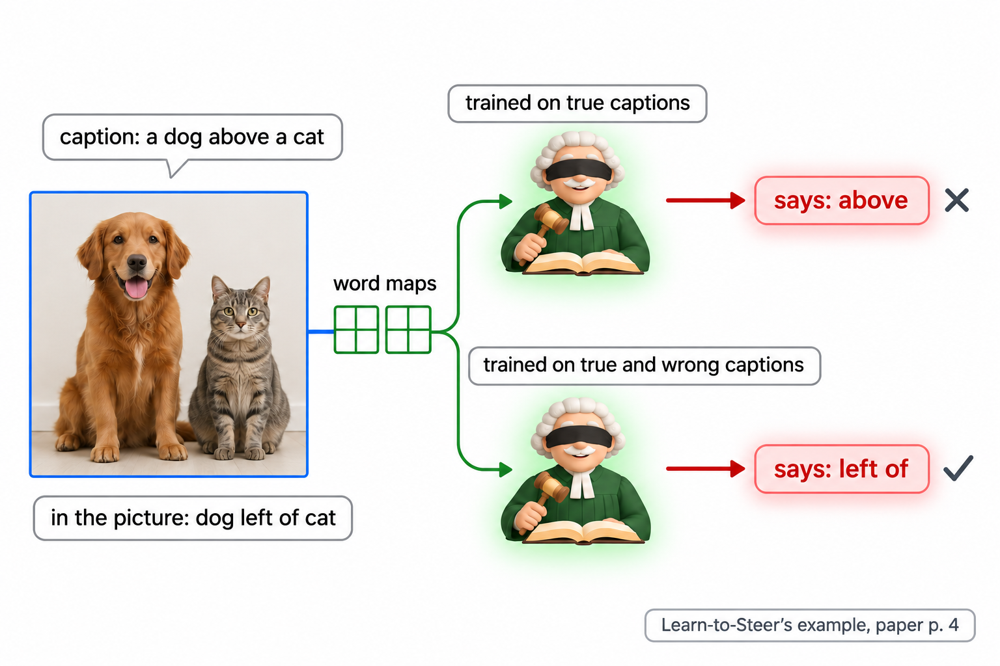
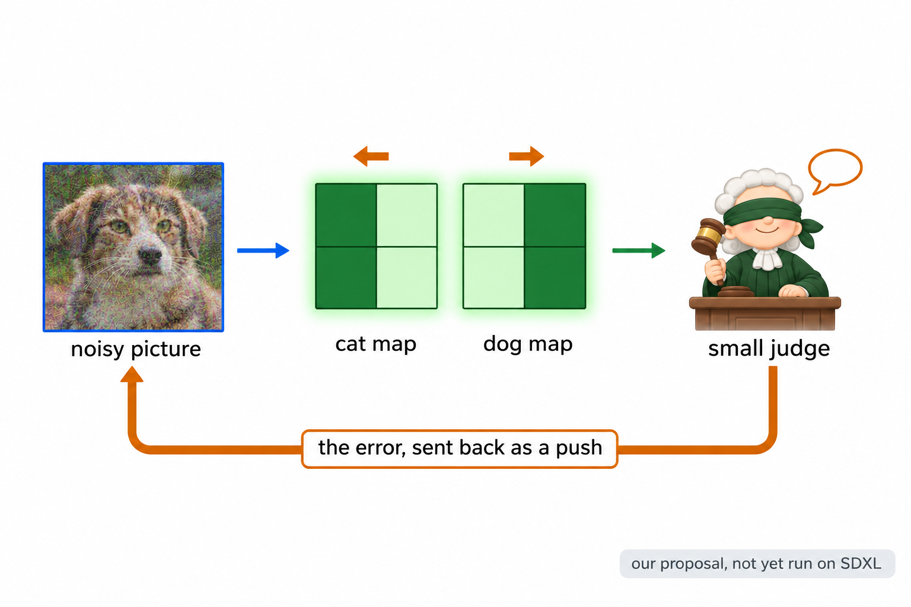
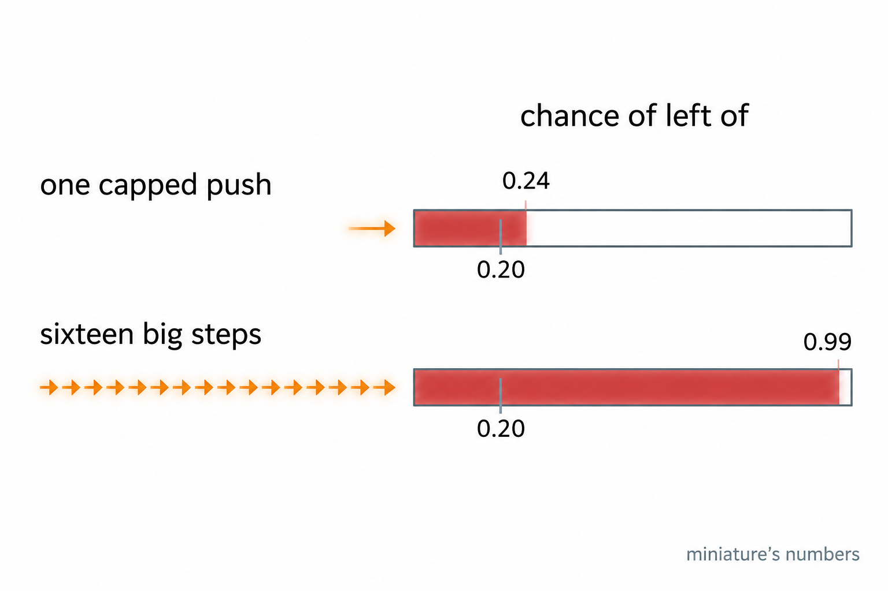
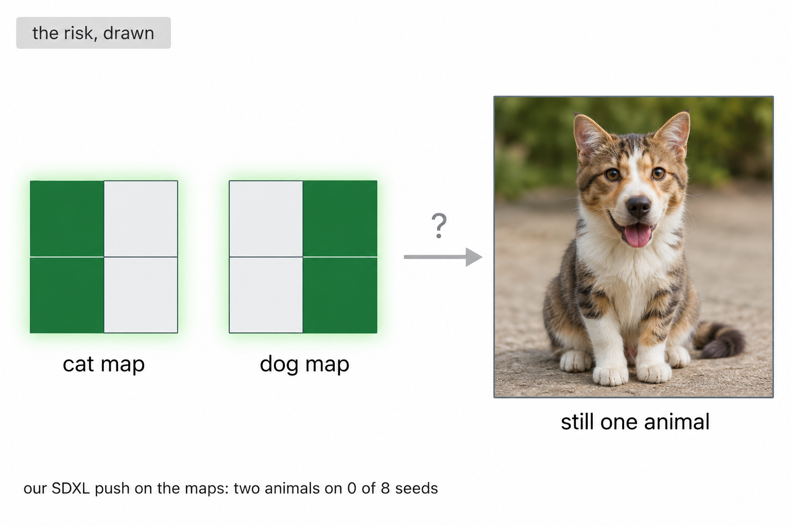

# 🌍 Context: the word-map checker, the idea in six pictures

⬅️ Previous: [the network view](02-the-network-view.md) | 📋 [The pages of this method](01-overview.md#the-pages-of-this-method) | Next: [the miniature](04-the-miniature.md) ➡️

This page tells the method's idea in the ladder's six rendered illustrations, in the order the method runs: where each word landed, a head that reads only the two maps, the trap of reading the word, the push back to the noise, the size of that push, and the risk that the maps move while the picture does not. Each picture is drawn on the miniature's story and prints the miniature's or the paper's numbers, and each section names the number and where it comes from. The illustrations were drawn by an image model from prompts, so every photo tile in them is a teaching drawing and none is an SDXL sample. All six are from [the ladder's illustrated map](../../../2-classifier-guidance/artifacts/scenes/word-map-checker/1-illustrations/diagram-prompts.md), which records each prompt and the note it was checked against; all six are marked rendered and accepted.

*Left, blue frame: a half-drawn picture of one fused animal across the top half, a cat's ear and eye on one side of the face and a dog's muzzle and ear on the other; the bottom half is grain. Top panel, glowing, "two prompts: the product": the 2 × 2 maps of "cat" and "dog" each print 0.98 on the top row and 0.12 on the bottom row. Bottom panel, "one joint prompt": the same two maps print 0.50 on top and 0.11 below. Tag: "miniature's numbers, layer 1".* ✅ *Read on the picture at full size; the photo is a drawing.*

## Table of contents

- [Words this page uses](#words-this-page-uses)
- [Where each word landed](#where-each-word-landed)
- [A small judge reads only the two maps](#a-small-judge-reads-only-the-two-maps)
- [It learned the word instead of the picture](#it-learned-the-word-instead-of-the-picture)
- [The judge's complaint pushes the noise](#the-judges-complaint-pushes-the-noise)
- [One capped nudge against sixteen big steps](#one-capped-nudge-against-sixteen-big-steps)
- [The map can move without a second animal](#the-map-can-move-without-a-second-animal)
- [Where this came from](#where-this-came-from)

## Words this page uses

Navigation: 📋 [TOC](#table-of-contents) | [Next](#where-each-word-landed) ➡️

**The small judge**: the pictures' figure for the trained head, a robed judge wearing a blindfold because the head reads only the two maps and never the picture.

**A 2 × 2 map**: the miniature's word map, one share per patch: top left, top right, bottom left, bottom right. Dark green is a large share, pale green a small one.

**Answer chip**: a rounded label naming one relation, filled red when it is the head's answer.

## Where each word landed

Navigation: ⬅️ [Words this page uses](#words-this-page-uses) | 📋 [TOC](#table-of-contents) | [Next](#a-small-judge-reads-only-the-two-maps) ➡️

**The product's two prompts never compete, so both words light up the same fused body at full strength, 0.98 each, where one joint prompt would split each patch between them.** ✅ The opening picture.

| Map cell | Two prompts, the product | One joint prompt | From the answer key |
|---|---|---|---|
| top row | 0.98 | 0.50 | `maps.cat_layer1` 0.9820; `maps.joint_prompt_cat_layer1` 0.4955 |
| bottom row | 0.12 | 0.11 | 0.1192; 0.1065 |

✅ The answer key. The pictures print two decimals.

**What it answers.** The failure this picture is drawn against is expecting the two words to divide the picture between them. Under the product they do not: nothing in two separate softmaxes stops "cat" and "dog" both taking the whole fused top row. ✍️ The prompt's faithfulness note.

## A small judge reads only the two maps

Navigation: ⬅️ [Where each word landed](#where-each-word-landed) | 📋 [TOC](#table-of-contents) | [Next](#it-learned-the-word-instead-of-the-picture) ➡️

**The checker never looks at the picture: it reads where the two words landed and names their relation.** ✅ Read on the picture.

*Far left, faded and struck through: a photo of a cat on the left and a dog on the right, "never sees the picture"; no arrow touches it. Centre left: the cat map, bright in its left column, and the dog map, bright in its right column. Centre: the blindfolded small judge. Right: four answer chips, above, below, left of, right of, with only "left of" filled red.* ✅ *Read on the picture.*

🔤 **The name:** the small judge, the head C
- **small**: about two million trained weights, against SDXL's U-Net of billions. ✍️ The numbers file gives 1,964,581 on the authors' SD 2.1 settings.
- **judge**: it hands down a verdict, one relation, and does nothing else.
- **blindfold**: its only inputs are the two maps and the step bucket; the picture, the latent and the words themselves never reach it.
- **Consequence:** because it reads maps only, the same head could in principle read maps of words it never trained on. That is why Loop 7 chose maps. Learn-to-Steer reports 0.60 GenEval position on 16 object categories it calls absent from training, on FLUX.1-dev. ✅ The paper's text, p. 7. The price is the last picture on this page.

## It learned the word instead of the picture

Navigation: ⬅️ [A small judge reads only the two maps](#a-small-judge-reads-only-the-two-maps) | 📋 [TOC](#table-of-contents) | [Next](#the-judges-complaint-pushes-the-noise) ➡️

**A head trained only on true captions reads the caption's relation word out of the maps; one trained on true and wrong captions reads the layout.** ✅ Read on the picture; the paper's example, p. 4.

*Left: a photo of a brown dog on the left and a grey tabby cat on the right, with the wrong caption "a dog above a cat" and the label "in the picture: dog left of cat". The word maps split to two blindfolded judges. Top, "trained on true captions": "says: above", with a cross. Bottom, "trained on true and wrong captions": "says: left of", with a check mark. Tag: "Learn-to-Steer's example, paper p. 4".* ✅ *Read on the picture.*

**Whose result each row is.** The top row is the paper's observation (p. 4). The bottom row is what the fix is meant to do: the paper reports GenEval position rising from 0.425 to 0.57 with the fix, and no direct rate at which the trained head still follows a wrong word. ✅ The paper's text, pp. 4 and 8. The miniature puts numbers on both rows: 0.9929 for "right of" on a cat truly on the left whose prompt says "right of" with true captions only, 0.0085 with both. ✅ The answer key, worked on [the miniature page](04-the-miniature.md#stage-5-three-ways-it-misleads).

## The judge's complaint pushes the noise

Navigation: ⬅️ [It learned the word instead of the picture](#it-learned-the-word-instead-of-the-picture) | 📋 [TOC](#table-of-contents) | [Next](#one-capped-nudge-against-sixteen-big-steps) ➡️

**The head's error is sent back to the noisy picture, and the update moves the cat's map left and the dog's map right; the head's own weights do not change.** ✅ Read on the picture; ✍️ the prompt's faithfulness note.

*Upper row, left to right: a grainy noisy picture of one fused animal (blue frame), the cat map and the dog map with a small orange arrow above each, pointing left over the cat map and right over the dog map, and the small judge. Lower lane, right to left: one thick orange arrow from the judge back to the picture, "the error, sent back as a push". Tag: "our proposal, not yet run on SDXL".* ✅ *Read on the picture.*

**The numbers behind the arrows.** On the miniature's fused body the gradient of the loss on the cat channel is (−0.0938, +0.0938, −0.3715, +0.3715) over top left, top right, bottom left, bottom right, and the dog channel's is the mirror. Stepping against it raises the cat's left column and the dog's right column, which is the two orange arrows. ✅ The answer key, derived on [the miniature page](04-the-miniature.md#stage-3-the-gradient-back-to-the-latent).

## One capped nudge against sixteen big steps

Navigation: ⬅️ [The judge's complaint pushes the noise](#the-judges-complaint-pushes-the-noise) | 📋 [TOC](#table-of-contents) | [Next](#the-map-can-move-without-a-second-animal) ➡️

**On the miniature one capped push moves the chance of the asked relation from 0.20 to 0.24, and Learn-to-Steer's 16 updates move it to 0.99.** ✅ Read on the picture; the answer key's `dose`.

*Two horizontal meters of the head's chance for "left of", 0 to 1. Top, "one capped push", one orange arrow: a grey mark at 0.20 and the red fill ending at 0.24. Bottom, "sixteen big steps", 16 orange arrows: the same mark at 0.20 and the fill ending at 0.99. Tag: "miniature's numbers". The bar lengths are the image model's and land within 3 percentage points of the printed values, so the printed numbers are the values.* ✅ *Read on the picture;* ✍️ *the ladder's record of the render's limits.*

🔤 **The name:** dose
- **dose**: how much of a treatment is given. Here, the step size, the number of updates per sampler step, and the number of sampler steps treated.
- **On the picture:** the count of orange arrows, 1 against 16, and how far each fills the meter.
- **Consequence:** at our dose the chance moves 0.2367 − 0.2 = 0.0367; at Learn-to-Steer's it moves 0.9936 − 0.2 = 0.7936. The latent moves 0.264 against 6.0072. ✅ The answer key. The weights are hand-set, so the ratio applies to the miniature alone; it is the reason a head that fails at one capped push per step has not yet been tested.

## The map can move without a second animal

Navigation: ⬅️ [One capped nudge against sixteen big steps](#one-capped-nudge-against-sixteen-big-steps) | 📋 [TOC](#table-of-contents) | [Next](#where-this-came-from) ➡️

**Separating the two word maps is not the same as drawing two animals, and our own push on SDXL's maps drew two animals on 0 of 8 seeds.** ✅ Read on the picture; ✍️ the early-push report for the count.

*Left: the cat map bright in its left column and the dog map bright in its right column, already separated. Middle: a grey arrow with a question mark. Right: one finished photo of a single fused animal, a cat's ears and coat with a dog's face, "still one animal". Tag: "the risk, drawn". Bottom line: "our SDXL push on the maps: two animals on 0 of 8 seeds".* ✅ *Read on the picture.*

> [!WARNING]
> This picture draws a risk, not a measurement. The 0-of-8 run recorded its pictures and did not record whether its maps separated, so it cannot say which of the two failed: the maps never moved, or they moved and the picture did not follow. ✍️ The prompt's faithfulness note, and [Loop 7's checker design](../../../artifacts/notes/progress/abstract-checkers/03-design.md#what-every-checker-shares), which asks every future run to log the overlap of the two maps at each pushed step for this reason.

How a fused render looks, and why the project counts it as a failure, is on [the chimera page](../../world/chimera.md#what-a-chimera-is).

## Where this came from

Navigation: ⬅️ [The map can move without a second animal](#the-map-can-move-without-a-second-animal) | 📋 [TOC](#table-of-contents)

| What | How it was established | When |
|---|---|---|
| Every label and number on wi1 to wi6 | Read on each picture at full size | 2026-11-24 |
| What each picture was asked to show, and the failure it answers | Read in each prompt's faithfulness note in `diagram-prompts.md` | 2026-11-24 |
| All six rendered and accepted; wi5's bar lengths within 3 points | Stated by the ladder's `ladder.json` and `render-status.json` | 2026-11-24 |
| The miniature values behind wi1, wi4 and wi5 | Read in the answer key | 2026-11-24 |
| The paper's leakage example and the 0.425 to 0.57 rise | Read in the ladder's saved text of the paper, pp. 4 and 8 | 2026-11-24 |
| The 0 of 8 | Stated by the early-push report, row `result-sheet-layout` | 2026-11-24 |
| Each path and each picture's visible words pass `is_showable`, and none is on the held-pictures list | Checked this session | 2026-11-24 |

⬅️ Previous: [the network view](02-the-network-view.md) | 📋 [The pages of this method](01-overview.md#the-pages-of-this-method) | Next: [the miniature](04-the-miniature.md) ➡️

<!-- built-to: PAGE_LOOK_FORMAT v1 -->
