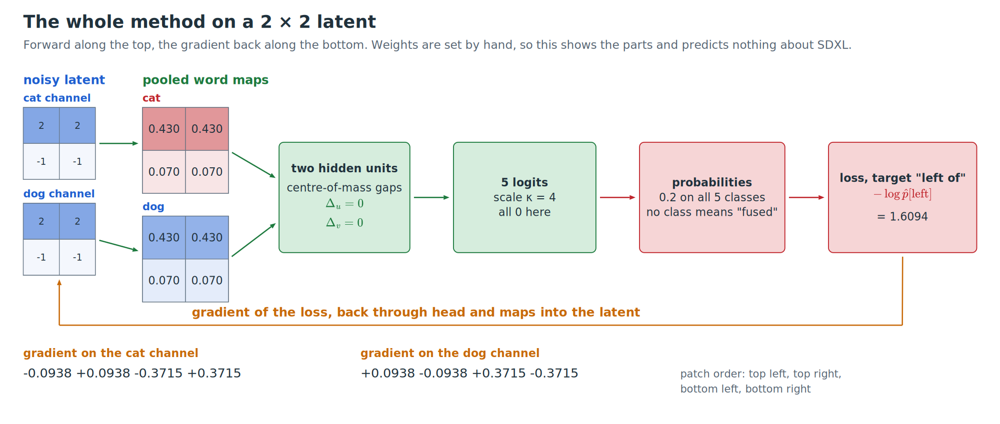
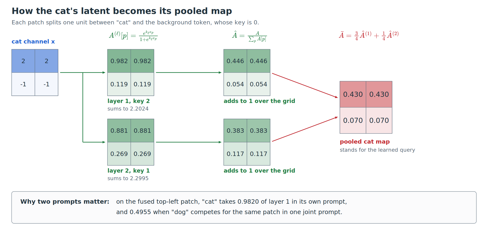
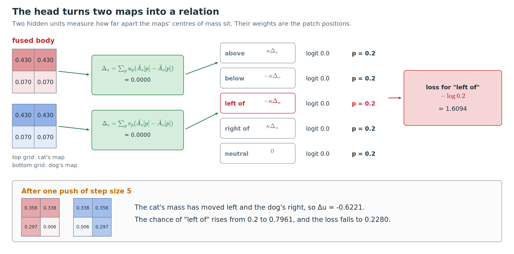
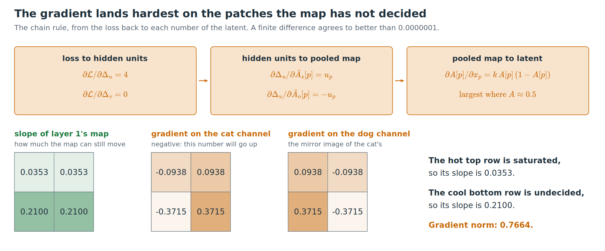
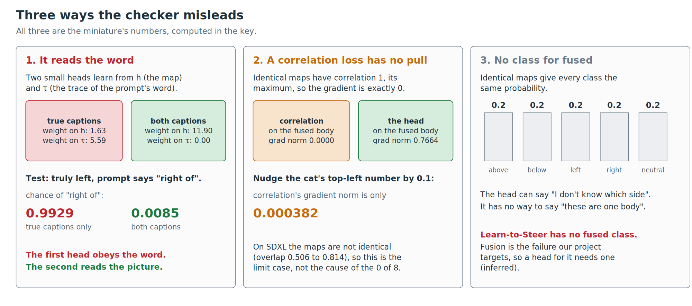

# 🌍 Context: the word-map checker, worked on an 8-number latent

⬅️ Previous: [the illustrations](03-the-illustrations.md) | 📋 [The pages of this method](01-overview.md#the-pages-of-this-method) | Next: [the code](05-the-code.md) ➡️

This page shrinks the method until every number fits on paper: a latent of 2 × 2 patches with a cat channel and a dog channel, two cross-attention layers, and a head of two hidden units. It runs the forward pass on one fused body, carries the loss back to the latent, applies the gradient both ways (Learn-to-Steer's 16 updates and our one capped push), and shows three ways the method misleads. Every weight is set by hand, so nothing here predicts how a trained head would do on SDXL; it shows what each part computes. Every value comes from [the ladder's miniature](../../../2-classifier-guidance/artifacts/scenes/word-map-checker/2-miniature/README.md) and its answer key, and the key values used below were recomputed this session from the formulas.

*Forward along the top, left to right. Blue: the noisy latent, cat channel and dog channel, each 2 on the top row and −1 on the bottom row: one fused body along the top. Green: the pooled word maps, 0.430 on top and 0.070 below for both words; then two hidden units, the centre-of-mass gaps Δ_u = 0 and Δ_v = 0; then 5 logits at scale κ = 4, all 0. Red: probabilities 0.2 on all 5 classes ("no class means fused"), and the loss for the target "left of", −log 0.2 = 1.6094. Orange, back along the bottom: the gradient on the cat channel, −0.0938, +0.0938, −0.3715, +0.3715 in the order top left, top right, bottom left, bottom right, and the mirror on the dog channel.* ✅ *Read on the figure at full size; every value matches the answer key.*

## Table of contents

- [Words this page uses](#words-this-page-uses)
- [The toy](#the-toy)
- [Stage 1: the latent becomes two word maps](#stage-1-the-latent-becomes-two-word-maps)
- [Stage 2: the head reads a relation](#stage-2-the-head-reads-a-relation)
- [Stage 3: the gradient back to the latent](#stage-3-the-gradient-back-to-the-latent)
- [Stage 4: two ways to apply it](#stage-4-two-ways-to-apply-it)
- [Stage 5: three ways it misleads](#stage-5-three-ways-it-misleads)
- [Run it yourself](#run-it-yourself)
- [Where this came from](#where-this-came-from)

## Words this page uses

Navigation: 📋 [TOC](#table-of-contents) | [Next](#the-toy) ➡️

**Patch p**: one of the four cells, top left, top right, bottom left, bottom right, always in that order.

**Cat-ness and dog-ness**: the two numbers at each patch, one per channel. Large means that animal is being drawn there.

**Key k**: how strongly one attention layer turns a patch's cat-ness into a share for "cat". Layer 1 has k = 2, layer 2 has k = 1.

**Position weights u and v**: each patch's place, u = (−1, 1, −1, 1) from left to right and v = (1, 1, −1, −1) from top to bottom.

**Fused body**: the starting latent, where both animals occupy the same top row.

## The toy

Navigation: ⬅️ [Words this page uses](#words-this-page-uses) | 📋 [TOC](#table-of-contents) | [Next](#stage-1-the-latent-becomes-two-word-maps) ➡️

**Eight numbers stand for SDXL's latent, two layers stand for its 1,300 maps per word, and two hidden units stand for the trained head.** ✅ Read in `miniature.py`, lines 26 to 45, and the miniature's card.

| Miniature piece | Stands for | Where the real one lives |
|---|---|---|
| 2 × 2 patches, 2 channels, 8 numbers | SDXL's latent, 4 × 128 × 128 | our sampler, `poe_repair/methods/_classifier_guided.py` |
| 2 cross-attention layers, keys 2 and 1 | SDXL's 70 layers, 1,300 maps per word | the U-Net's cross-attention blocks |
| a background token with key 0 | every other token of the prompt | the 77-token softmax |
| fixed pooling weights 3/4 and 1/4 | the learned query | the authors' aggregator |
| two hidden units Δ_u, Δ_v | the flatten, project, transformer and MLP layers | the authors' classifier |
| scale κ = 4 | the head's trained weights and its step vector | the authors' classifier |
| ᾱ_t = 0.36, ᾱ_{t−1} = 0.64, λ = 2, c = 0.4 | one step of our sampler | `_classifier_guided.py` |

✍️ The "where" column is the ladder's.

🧸 **Toy:** one fused body (both channels 2 on top, −1 below), the prompt "a cat to the left of a dog", the hand-set head. Expected before working it: the two maps are identical, so the head cannot prefer any relation and gives each 0.2; the gradient should push the cat's mass left and the dog's right, and most strongly where the maps have not decided.

## Stage 1: the latent becomes two word maps

Navigation: ⬅️ [The toy](#the-toy) | 📋 [TOC](#table-of-contents) | [Next](#stage-2-the-head-reads-a-relation) ➡️

**Each patch shares one unit of attention between the word and a background token; the shares over all patches are that word's map, which is divided by its sum and mixed 3/4 and 1/4 across the two layers.** ✅

*The cat channel (blue, 2 on top, −1 below) through layer 1 (key 2: 0.982 on top, 0.119 below, sum 2.2024) and layer 2 (key 1: 0.881 and 0.269, sum 2.2995); each divided by its sum (0.446 and 0.054; 0.383 and 0.117); mixed 3/4 and 1/4 into the pooled cat map (red, 0.430 and 0.070). The box: on the fused top-left patch "cat" takes 0.9820 of layer 1 in its own prompt and 0.4955 when "dog" competes in one joint prompt.* ✅

$$
\textcolor{#1d7a3e}{\underbrace{A^{(\ell)}[p]}_{\text{the word's share of patch } p}}
= \frac{e^{\,\underbrace{k_\ell}_{\text{the layer's key}}\;\textcolor{#1f5fd0}{\underbrace{x_p}_{\text{cat-ness}}}}}{\underbrace{1}_{\text{background, } e^0} + e^{\,k_\ell\,x_p}},
\qquad
\textcolor{#1d7a3e}{\bar A} = \tfrac34\,\frac{A^{(1)}}{\sum_p A^{(1)}} + \tfrac14\,\frac{A^{(2)}}{\sum_p A^{(2)}}
$$

| Step | top left | top right | bottom left | bottom right | sum |
|---|---|---|---|---|---|
| A^(1), key 2 | 0.9820 | 0.9820 | 0.1192 | 0.1192 | 2.2024 |
| A^(2), key 1 | 0.8808 | 0.8808 | 0.2689 | 0.2689 | 2.2995 |
| Â^(1) = A^(1) / 2.2024 | 0.4459 | 0.4459 | 0.0541 | 0.0541 | 1 |
| Â^(2) = A^(2) / 2.2995 | 0.3830 | 0.3830 | 0.1170 | 0.1170 | 1 |
| Ā = 3/4 Â^(1) + 1/4 Â^(2) | 0.4302 | 0.4302 | 0.0698 | 0.0698 | 1 |

✅ The answer key, recomputed this session. The dog channel is identical, so its pooled map is too.

| Move one symbol | What changes |
|---|---|
| raise one patch's cat-ness from 2 to 3 | layer 1's share there rises from 0.9820 to 0.9975: almost nothing, because the share is already near 1 |
| set both keys to 1 | both layers give the same map, so the pooling weights stop mattering; the gradient's length later becomes 0.7754 and the 16 updates end at 0.9875 |
| put "dog" in the same prompt | the background stays, a second e^4 joins the denominator, and "cat" takes 0.4955 |

✅ The first and third computed this session; the second is the key's `exercise_equal_keys`.

## Stage 2: the head reads a relation

Navigation: ⬅️ [Stage 1: the latent becomes two word maps](#stage-1-the-latent-becomes-two-word-maps) | 📋 [TOC](#table-of-contents) | [Next](#stage-3-the-gradient-back-to-the-latent) ➡️

**Two hidden units measure how far the cat's centre of mass sits right of and above the dog's, and five logits turn those gaps into a relation; identical maps give 0.2 to every class.** ✅

*Left: the fused body's pooled maps, cat on top and dog below, both 0.430 and 0.070. Green: Δ_u = Σ_p u_p (Ā_s[p] − Ā_o[p]) = 0.0000 and Δ_v = 0.0000. Five relation boxes with their logits (κΔ_v for above, −κΔ_v below, −κΔ_u left of, κΔ_u right of, 0 neutral), each 0.0, each p = 0.2. Red: the loss for "left of", −log 0.2 = 1.6094. Inset, after one of Learn-to-Steer's updates at step size 5: the cat map (0.358, 0.338, 0.297, 0.006) and its mirror for the dog; Δ_u = −0.6221; "left of" rises to 0.7961 and the loss falls to 0.2280.* ✅

$$
\textcolor{#1d7a3e}{\underbrace{\Delta_u}_{\text{how far right the cat sits of the dog}}} = \sum_p \underbrace{u_p}_{\text{patch's place, } -1 \text{ or } +1}\big(\textcolor{#1d7a3e}{\bar A_s[p]} - \textcolor{#1d7a3e}{\bar A_o[p]}\big),
\qquad
\textcolor{#c0262d}{\underbrace{\hat p[\text{left of}]}_{\text{the head's chance}}} = \frac{e^{-\kappa\Delta_u}}{\sum_j e^{\ell_j}}
$$

🔤 **The name:** centre of mass
- **centre**: the middle point. **mass**: how much there is. A map's centre of mass is the average place, each patch weighted by its share.
- **On the picture:** the two green boxes; with u as the weights, Δ_u is the cat map's average left-right place minus the dog's.
- **Formula, in those words:** Δ_u = (sum over patches of place × cat share) − (the same for dog). Negative means the cat sits further left.
- **Consequence:** on the fused body both averages are equal and Δ_u = 0. After one update the cat map reads (0.3582, 0.3382, 0.2973, 0.0063) and the dog's the mirror, so Δ_u = −0.6221 and "left of" gets 0.7961. ✅ The answer key. A hand-set head like this one is exactly a comparison of centres of mass, the rule hand-written losses use; Learn-to-Steer's point is that a trained head finds its own rule. ✍️ The miniature's card.

🔤 **The name:** the scale κ
- **scale**: how strongly a gap becomes a score.
- **Formula, in those words:** logit for "left of" = −κ Δ_u.
- **Consequence:** at the same Δ_u = −0.6221, κ = 2 gives "left of" 0.5135, κ = 4 gives 0.7961 (the key's, from the unrounded gap), κ = 8 gives 0.9797. A larger κ is a surer head for the same layout. ✅ Computed this session from the key's Δ_u.

## Stage 3: the gradient back to the latent

Navigation: ⬅️ [Stage 2: the head reads a relation](#stage-2-the-head-reads-a-relation) | 📋 [TOC](#table-of-contents) | [Next](#stage-4-two-ways-to-apply-it) ➡️

**The chain rule carries the loss back through the gap and the maps, and it lands hardest on the bottom row, where the maps have not decided.** ✅

*Top, three chain-rule steps: loss to hidden units (∂L/∂Δ_u = 4, ∂L/∂Δ_v = 0); hidden units to pooled map (∂Δ_u/∂Ā_s[p] = u_p, and −u_p for the dog); pooled map to latent (∂A[p]/∂x_p = k A[p](1 − A[p]), largest near A = 0.5). Bottom: the slope of layer 1's map, 0.0353 on the saturated top row and 0.2100 on the undecided bottom row; the gradient on the cat channel, (−0.0938, 0.0938, −0.3715, 0.3715), and the mirror on the dog channel; gradient norm 0.7664.* ✅

🔤 **The name:** saturated
- **saturated**: soaked so full it can take no more, like a sponge that has stopped absorbing.
- **On the picture:** the top row, whose share for "cat" is already 0.9820, so its slope is 0.0353 against 0.2100 on the bottom row at 0.1192.
- **Formula, in those words:** the slope of a share is k × the share × what is left of it, k A (1 − A), so it is largest when the share is half and the rest half.
- **Consequence:** with layer 1's key of 2, raise the top-left cat-ness from 2 to 3 and the share goes from 0.9820 to 0.9975 while the slope falls from 0.0353 to 0.0049. Lower it to 0 and the share is 0.5 and the slope 0.5, its largest. A push lands where the map is still undecided because a saturated patch barely answers. ✅ Computed this session.

$$
\textcolor{#c86a0a}{\frac{\partial \mathcal L}{\partial x_p}}
= \underbrace{\frac{\partial \mathcal L}{\partial \Delta_u}}_{=\,4}\;
\underbrace{\frac{\partial \Delta_u}{\partial \bar A[p]}}_{=\,u_p}\;
\underbrace{\frac{\partial \bar A[p]}{\partial x_p}}_{\text{the map's slope, with the division by its sum}}
$$

For the cat channel's bottom-left number (u = −1), both layers add up: −4 × (0.75 × 0.209987 / 2.202433 + 0.25 × 0.196612 / 2.299477) = −4 × (0.071507 + 0.021376) = −0.3715. A finite difference on all 8 numbers agrees to 1.2 × 10⁻¹⁰. ✅ The answer key, recomputed this session.

🔤 **The name:** finite difference
- **difference**: one value minus another. **finite**: of a real, measurable size, against the infinitely small change a derivative takes.
- **On the picture:** a check beside the orange lane: nudge one latent number, run the whole forward pass again, and see how far the loss moved.
- **Formula, in those words:** slope ≈ (loss after a nudge of h − loss before) / h.
- **Consequence:** for the cat's bottom-left number a nudge of h = 1 gives −0.3156, h = 0.1 gives −0.3798, and h = 0.001 gives −0.3716, closing on the chain rule's −0.3715 as the nudge shrinks. A finite difference agreeing with the chain rule is what shows the hand-worked slopes have no slip. ✅ Computed this session with a reimplementation of the miniature from the formulas on this page, which reproduces the key's loss 1.6094 and gradient length 0.7664. The chain rule itself is on [the chain rule card](../../../../../Obsidian/Mathematics/Calculus/Chain%20Rule.md#where-to-learn-this).

🔤 **The name:** gradient
- **gradient**: a slope, how steeply something rises. Here a list of 8 slopes, one per latent number: how much the loss changes per unit change in that number.
- **On the picture:** the two orange grids.
- **Formula, in those words:** each slope is the product of the slopes along the chain from the loss back to that number.
- **Consequence:** the 4 at the front is κ (1 − p̂_left + p̂_right) at a tie, so doubling κ to 8 doubles every slope and the length goes from 0.7664 to 1.5328. Replace the head by a correlation of the two maps and the same fused body gives a gradient of exactly 0 (Stage 5). ✅ The first by the chain rule, since the tie's probabilities do not depend on κ; the second, the key.

## Stage 4: two ways to apply it

Navigation: ⬅️ [Stage 3: the gradient back to the latent](#stage-3-the-gradient-back-to-the-latent) | 📋 [TOC](#table-of-contents) | [Next](#stage-5-three-ways-it-misleads) ➡️

**Learn-to-Steer moves the latent itself up to 16 times per sampler step; our sampler changes the noise prediction once, under a cap. On the miniature the first reaches 0.9936 for "left of" and the second 0.2367.** ✅

*Top: the chance of "left of" going into each of Learn-to-Steer's 16 updates at step size 5 (across: update number 0 to 15; up: the chance, 0.20 before the first, 0.80 before the second, 0.99 before the last); the latent after the loop, cat channel (2.58, −0.69, 1.53, −3.02) and the dog channel's mirror; final chance 0.9936. Bottom, one push on the product's prediction then one DDIM step: raw push λ σ_t ∇ log p̂[r] of length 1.2262; cap c ‖ε_PoE‖ = 0.4 × 1.4142 = 0.5657; applied, scaled by 0.4613 to length 0.5657; after the DDIM step "left of" is 0.2367, against 0.2000 with no push. Footer: change in the latent due to steering in one sampler step, 0.2640 with the capped push and 6.0072 with the 16 updates.* ✅

| Pass | Loss | Chance of "left of" | Gradient length |
|---|---|---|---|
| 0 | 1.6094 | 0.2000 | 0.7664 |
| 1 | 0.2280 | 0.7961 | 0.0948 |
| 2 | 0.1884 | 0.8283 | 0.0785 |
| 15 | 0.0069 | 0.9931 | 0.0098 |
| after the last update | 0.0064 | 0.9936 | |

✅ The answer key's `lts_loop`. The steps get smaller as the head grows sure, because a sure head has little left to ask for. The fused top row ends as a cat down the left column and a dog down the right.

🔤 **The name:** cap
- **cap**: a ceiling. The push may be at most c times the length of the product's prediction.
- **On the picture:** the white "cap" box between the raw push and the applied one.
- **Formula, in those words:** if the raw push is longer than c ‖ε_PoE‖, shrink it to that length and keep its direction; otherwise leave it.
- **Consequence:** with c = 0.4 the raw 1.2262 is cut to 0.5657. Double λ to 4 and the raw push doubles to 2.4524, but the cap cuts it to the same 0.5657, so above the cap λ changes nothing. Halve λ to 1 and the raw 0.6131 is still just over the cap. ✅ Computed this session. The cap is our addition: Learn-to-Steer states none. ✍️ The ladder's sampler walk.

> [!NOTE]
> The race is not fair, and the ladder says so: the weights are hand-set and each method keeps its own step size. It shows only that Learn-to-Steer's dose is far larger than one capped push per step, which is why a head must be tested at a matched dose before it is called a failure.

## Stage 5: three ways it misleads

Navigation: ⬅️ [Stage 4: two ways to apply it](#stage-4-two-ways-to-apply-it) | 📋 [TOC](#table-of-contents) | [Next](#run-it-yourself) ➡️

**A head trained only on true captions follows the word, a correlation loss has no pull on a fully fused pair, and the head has no way to say "these are one body".** ✅ All three computed in the answer key.

*Panel 1, "It reads the word": two small heads learn from h (a weak spatial reading of the map) and τ (the trace of the prompt's relation word). True captions only: weight 1.63 on h, 5.59 on τ. Both captions: 11.90 on h, 0.00 on τ. Test, truly left with the prompt saying "right of": chance of "right of" 0.9929 against 0.0085. Panel 2, "A correlation loss has no pull": on the fused body the correlation's gradient length is 0.0000 and the head's 0.7664; nudging the cat's top-left number by 0.1 gives the correlation a gradient of only 0.000382. Panel 3, "No class for fused": 0.2 on each of above, below, left, right and neutral.* ✅

🔤 **The name:** correlation of the two maps
- **co-relation**: how two lists rise and fall together. 1 means they rise and fall in step, 0 means no pattern, −1 means one is high exactly where the other is low.
- **On the picture:** panel 2, the hand-written loss that replaces the head.
- **Formula, in those words:** take each map's mean off every cell, multiply the two maps cell by cell, add, and divide by the two maps' lengths. The hand-written loss scores minus this.
- **Consequence:** on the fused body the two pooled maps are both (0.4302, 0.4302, 0.0698, 0.0698), so the correlation is 1, its largest, and the slope there is flat. After one of Learn-to-Steer's updates the cat map is (0.3582, 0.3382, 0.2973, 0.0063) and the dog's is its mirror, and the correlation is −0.0489. A cat map of (0.5, 0, 0.5, 0) against a dog map of (0, 0.5, 0, 0.5), each animal down one column, gives −1. ✅ Computed this session. Textbook pages are on [the correlation coefficient card](../../../../../Obsidian/Mathematics/Statistics/Correlation%20Coefficient.md#where-to-learn-this).

💥 **Broken run (without):** the head trained on true captions only.
- **Predict:** shown a cat truly on the left whose prompt says "right of", what chance does it give "right of"?
- **Wrong:** 0.9929. It learned the word.
- **Right**, trained on true and wrong captions: 0.0085.

💥 **Broken run (misuse):** the trained head replaced by our hand-written loss, minus the correlation of the two maps.
- **Predict:** on the fused body, how long is its gradient?
- **Wrong:** 0. Identical maps have correlation 1, its maximum, where every slope is flat.
- **Right**, with the head: 0.7664.

SDXL's maps are not identical (their top 10% overlap by 0.506 to 0.814), so this limit case does not explain why our correlation push drew two animals on 0 of 8 SDXL seeds. ✍️ The miniature's card and the early-push report.

**The head has no class for "fused".** Identical maps give 0.2 to all five classes: the head can say it cannot tell which side, and cannot say the two are one body. Fusion is the failure this project targets, so a head for the product would need one. 🔍 Inferred by the reading note; untested.

## Run it yourself

Navigation: ⬅️ [Stage 5: three ways it misleads](#stage-5-three-ways-it-misleads) | 📋 [TOC](#table-of-contents) | [Next](#where-this-came-from) ➡️

**One script writes every number on this page and stops with an assertion error if the hand-worked chain rule disagrees with a finite difference.** ✍️ The miniature's card.

🔨 **Build:** from the ladder's `2-miniature/` folder, `PYTHONDONTWRITEBYTECODE=1 uv run --no-project --with numpy python -I miniature.py`. It prints the 16 updates ending at 0.9936 for "left of". Different numbers mean a key, a pooling weight, κ or the step size changed.

**On paper.** Write the two 2 × 2 channels, compute layer 1's map by hand, then redo the bottom-left cat number of Stage 3. You should get −0.3715.

> [!WARNING]
> The script rewrites `miniature_answer_key.json` beside it. Copy the folder to a scratch place first, as the ladder's card says, or expect a changed file in `git status`. It was not run for these pages; the numbers were read from the key and recomputed by hand.

## Where this came from

Navigation: ⬅️ [Run it yourself](#run-it-yourself) | 📋 [TOC](#table-of-contents)

| What | How it was established | When |
|---|---|---|
| The toy's pieces, keys, positions, κ, ᾱ values, λ and c | Read in `miniature.py`, lines 26 to 45 | 2026-11-24 |
| Every forward, gradient, loop, push and broken-run value | Read in `miniature_answer_key.json` | 2026-11-24 |
| A^(1), A^(2), Ā, the bottom-left slope, the cap arithmetic and the DDIM rate | Recomputed this session with numpy from the formulas | 2026-11-24 |
| The cat-ness 3, κ = 2 and 8, λ = 1 and 4 and doubled-κ variants | Computed this session from the key's values | 2026-11-24 |
| The labels on mm0 to mm5 | Read on each figure at full size | 2026-11-24 |
| The build command and the warning that it rewrites the key | Stated by the miniature's card; not run here | 2026-11-24 |

⬅️ Previous: [the illustrations](03-the-illustrations.md) | 📋 [The pages of this method](01-overview.md#the-pages-of-this-method) | Next: [the code](05-the-code.md) ➡️

<!-- built-to: PAGE_LOOK_FORMAT v1 -->
