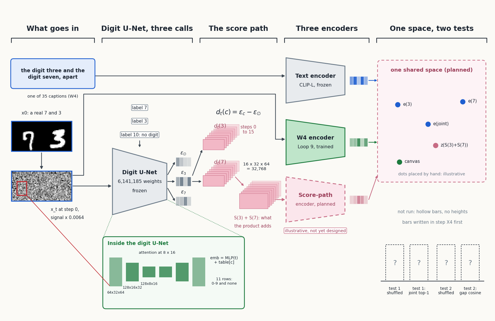
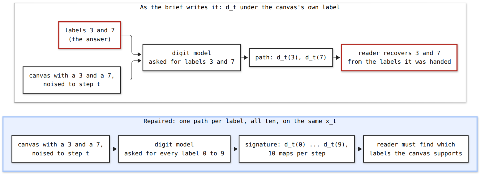
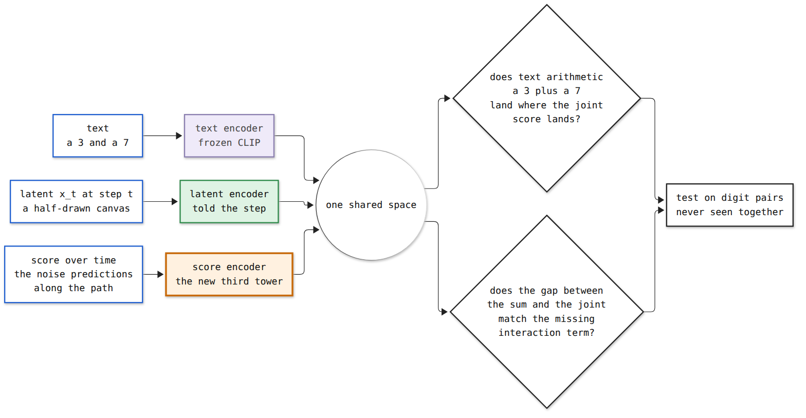
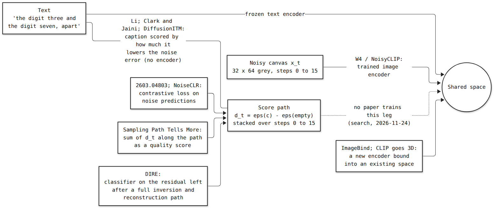

# 🌍 Context: the score path, one canvas end to end

⬅️ Previous: [the methods index](../00-INDEX.md) | 📋 [The pages of this method](#the-pages-of-this-method) | Next: [the network view](02-the-network-view.md) ➡️

The score path is Loop 10's idea for a third kind of input beside a caption and a noisy canvas. At each early sampler step the frozen digit model is asked about one noisy canvas once with a digit label and once with no label, and the difference says what that label adds. Kept for sixteen steps, those differences form a path that a planned encoder would place in one space with caption vectors and canvas vectors, matched the way CLIP matches pictures to captions. What the product of experts is, and the interaction term it leaves out, are on [PoE composition](../../world/poe-composition.md#what-poe-composition-is) and [the interaction term](../../world/interaction-term.md#what-the-interaction-term-is); the sampler step the differences come from is on [the product-of-experts overview](../01-the-product-of-experts/01-overview.md). This folder adds the ladder's pictures, a four-pixel miniature, and the code. Every picture comes from [the score-path ladder](../../../artifacts/notes/progress/score-space/00-ladder/README.md) unless its caption names another source.

*One canvas and one caption, end to end. Left: the clean canvas x₀, a real 7 and 3 from MNIST's test images, and the same canvas noised to step 0, where the clean canvas is multiplied by 0.0064 inside x_t. Second column: the frozen digit U-Net, 6,141,185 weights, called three times on that x_t, with label 7, label 3 and label 10 (no digit), giving three noise guesses ε₇, ε₃ and ε_∅. Third column: the rose stacks are d_t(3) and d_t(7), each label's guess minus the no-label guess, kept for steps 0 to 15; one stack is 16 × 32 × 64 = 32,768 numbers, and S(3) + S(7) is what the product adds. Fourth column: the CLIP-L text encoder (frozen), Loop 9's W4 canvas encoder (trained), and the score-path encoder, dashed and marked "illustrative, not yet designed". Right: the shared space, whose dots are placed by hand, and four hollow bars for the two tests, which never ran. The inset opens the U-Net from 64 × 32 × 64 down to 128 × 8 × 16 with attention at 8 × 16.* ✅ *Read on the figure at full size. The canvas is real; the noise on it is one numpy draw, the dots and the bars are illustrative.* ✍️ *(the ladder's README, "Which numbers are real")*

## Table of contents

- [Words this page uses](#words-this-page-uses)
- [What one canvas goes through](#what-one-canvas-goes-through)
- [The names, taken apart](#the-names-taken-apart)
- [The difference, by what moves](#the-difference-by-what-moves)
- [Two ways to define the path](#two-ways-to-define-the-path)
- [How it fails and how you know it worked](#how-it-fails-and-how-you-know-it-worked)
- [Where the idea came from](#where-the-idea-came-from)
- [What is measured where](#what-is-measured-where)
- [Where the sources disagree](#where-the-sources-disagree)
- [The pages of this method](#the-pages-of-this-method)
- [Where this came from](#where-this-came-from)
- [Read more](#read-more)

## Words this page uses

Navigation: 📋 [TOC](#table-of-contents) | [Next](#what-one-canvas-goes-through) ➡️

**Canvas**: a black picture 32 pixels tall and 64 wide, room for one handwritten MNIST digit in each half, pixels from −1 (background) to +1 (ink).

**Frozen digit U-Net**: the trained digit model, which takes a noisy canvas, a timestep and one label (a digit 0 to 9, or 10 for no digit) and returns a noise guess ε of the canvas's shape. "Frozen" means no weight of it changes here.

**Timestep t and step k**: t says how noisy the canvas is, from 999 (all noise) down to 0 (clean). The sampler visits 50 of them; step k is the k-th, so step 0 is t 999 and step 15 is t 693.

**Label-added difference d_t(c)**: the noise guess with label c minus the guess with no label, on the same canvas at the same timestep. Large where the label changes what the model would remove.

**Product**: the digit product of experts, ε_PoE = ε_∅ + d_t(a) + d_t(b), the same U-Net asked once per digit and the two differences added to the no-label guess.

**W4**: Loop 9's trained canvas encoder, which reads a noisy canvas into the same 768-number space as CLIP-L's caption vectors. Its design is [W4's design page](../../../artifacts/notes/progress/noise-text-critic/04-train-our-own/design.md).

**The miniature**: the ladder's four-pixel toy with hand-set integer weights, worked in full on [the miniature page](03-the-miniature.md). It predicts nothing about the digit models.

## What one canvas goes through

Navigation: ⬅️ [Words this page uses](#words-this-page-uses) | 📋 [TOC](#table-of-contents) | [Next](#the-names-taken-apart) ➡️

**At each of 16 steps the U-Net runs once per label on the same noisy canvas, the no-label guess is subtracted from each, and the differences are kept side by side instead of being added into the sampler's prediction.** ✅ Read in `product_eps`, `canvas_unet.py` lines 172 to 177, which forms the same differences and adds them away.

Each box of the picture has a twin in the miniature and in the real code:

| Box | In the miniature | On the real digit model | Exists? |
|---|---|---|---|
| the noisy canvas | four pixels, x = (1, −1, 2, 0) at step 0 ✅ | 1 × 32 × 64, the clean canvas times 0.0064 plus noise at step 0 ✅ | yes |
| the three calls | ε(x, c) = x + u_c + v_c ⊙ x, with u and v hand-set integers ✅ | the U-Net with labels a, b and 10 ✅ | yes |
| one difference d_t(c) | four numbers, d(3) = (−1, −1, 0, 0) at step 0 ✅ | 1 × 32 × 64 per label per step ✅ | yes; Loop 10 computed it in step X5 ✍️ |
| the score path S(c) | two steps laid end to end, 8 numbers ✅ | 16 steps, 32,768 numbers per label ✅ | computed only in step X5's form, see [two ways to define the path](#two-ways-to-define-the-path) ✍️ |
| the score-path encoder | a 2 × 8 integer matrix E ✅ | not designed ✅ | planned, never built |
| the shared space and the two tests | a 2-number space, the tests worked by hand ✅ | no cell has a value ✅ | planned, never run |

The "exists" column is read from [the score-path finding](../../../2-classifier-guidance/report/does-the-score-path-carry-which-digits-are-present.md#still-open), which says the text-aligned encoder and the two arithmetic tests were not run, by the design's rule and the owner's answer to board question 76. ✍️

## The names, taken apart

Navigation: ⬅️ [What one canvas goes through](#what-one-canvas-goes-through) | 📋 [TOC](#table-of-contents) | [Next](#the-difference-by-what-moves) ➡️

**Each name points at one part of the opening picture, and each move uses the miniature's or the real numbers.**

🔤 **The name:** score path
- **score**: in everyday speech, a mark of how well something does. In diffusion it is the arrow pointing toward pictures the model finds more likely, and the noise guess is that arrow scaled and flipped ([noise prediction is the score](../../../../../goal-setting/learning/deep-learning/diffusion-models/02-sampler-correctors-for-composition/plans/08-noise-prediction-is-the-score.md)). Here the word is used for the label-added part of it, d_t(c). On the picture, one rose tile.
- **path**: a route walked one step after another. On the picture, the rose stack: the same label's tile at steps 0, 1, ..., 15.
- **Formula, in those words:** S(c) = [d_{t₀}(c), d_{t₁}(c), ..., d_{t₁₅}(c)], what label c adds at each of the first 16 steps, laid end to end.
- **Consequence:** a single step throws away how the label's effect changes as the picture forms. In the miniature, d(7) is (0, 0, −1, −2) at step 0 and (0, 0, −1, 0) at step 1, because the canvas moved; keep only step 0 and that change is gone. ✅ The miniature's answer key.

🔤 **The name:** signature
- **signature**: a mark that identifies who made it, without stating their name. Here, the pattern a canvas leaves on the model's answers.
- **On the picture of [two ways to define the path](#two-ways-to-define-the-path):** the blue lower row, the ten maps d_t(0), ..., d_t(9) on one noisy canvas at one step.
- **Formula, in those words:** ask the model about every digit, subtract the no-digit guess from each, keep all ten. A **signature path** is those ten stacked over a window of steps.
- **Consequence:** with only the canvas's own labels (3 and 7), the labels pick which differences are computed, so a reader is handed the answer. With all ten, a 3 on the canvas has to show up as a larger or differently shaped d_t(3) than d_t(5). ✍️ [The ideas page, A1](../../../artifacts/notes/progress/score-space/03-ideas.md#a-the-score-path-itself). On the real model one signature path is 10 × 16 × 2,048 = 327,680 numbers before pooling. ✅ Computed.

🔤 **The name:** third space
- **third**: one more after two. The first two here are captions and noisy canvases, which Loop 9 already matched (CLIP-L's text side and W4).
- **space**: a set of points where distance means something. On the picture, the dashed box at the right, where every input becomes one 768-number vector and nearby vectors are meant to mean the same thing.
- **Formula, in those words:** three encoders f_T, f_I and f_S send a caption, a canvas and a score path to vectors of the same length, compared by cosine.
- **Consequence:** if the score path is a third space, the product's path for a 3 and a 7 can be compared directly with the caption "the digit three and the digit seven, apart". With no score-path encoder there is no rose dot in that box, which is the state the repository is in: the dots there are placed by hand. ✅ Read on the figure.

🔤 **The name:** contrastive
- **contrast**: setting two things side by side to show how they differ. Here, each input is compared with its own caption and with every other caption in the batch at once.
- **On the [miniature's matrix](03-the-miniature.md#the-encoder-and-the-contrastive-score):** a 3 × 3 table of cosines, the pale blue diagonal holding each path beside its own caption.
- **Formula, in those words:** divide each cosine by a temperature τ, turn each row and each column into shares with a softmax, and the loss is how little share the diagonal gets, averaged over rows and columns.
- **Consequence:** with W4's τ = 0.07 the miniature's loss is 0.0456 and the product path's own caption takes 0.961 of its row; at τ = 1 the same cosines give a loss of 0.806 and a share of 0.397. ✅ Recomputed this session from the answer key's cosines.

## The difference, by what moves

Navigation: ⬅️ [The names, taken apart](#the-names-taken-apart) | 📋 [TOC](#table-of-contents) | [Next](#two-ways-to-define-the-path) ➡️

**One difference is one label's guess minus the no-label guess at the same canvas and timestep; a path is sixteen of them in order.** ✅ The colours are the ladder's: grey for the frozen model's output, rose for the score path.

$$
\textcolor{#c76b84}{\underbrace{d_t(c)}_{\text{what label } c \text{ adds}}}
= \textcolor{#6b7a88}{\underbrace{\epsilon_\theta(x_t, t, c)}_{\text{guess told } c}}
- \textcolor{#6b7a88}{\underbrace{\epsilon_\theta(x_t, t, \varnothing)}_{\text{guess told nothing}}},
\qquad
\textcolor{#c76b84}{\underbrace{S(c)}_{\text{the path}}} = \big[\, d_{t_0}(c),\ \dots,\ d_{t_{15}}(c) \,\big]
$$

The worked case is the miniature's step 0, where the toy model is ε(x, c) = x + u_c + v_c ⊙ x, with u₃ = (−2, −1, 0, 0) and v₃ = (1, 0, 0, 0). ✅ The miniature's answer key.

| Symbol | Value at step 0 | Move | After the move |
|---|---|---|---|
| x_t | (1, −1, 2, 0) | raise the first pixel from 1 to 3 | d(3) becomes (1, −1, 0, 0): the v part reads the canvas, so the difference depends on where the canvas is ✅ |
| ε(x, 3) | (0, −2, 2, 0) | keep it without subtracting | the "difference" would be (0, −2, 2, 0), mostly the canvas's own noise, carrying the 2 on pixel R1 that label 3 never touched |
| ε(x, ∅) | (1, −1, 2, 0), equal to x | | |
| d(3) | (−1, −1, 0, 0) | ask label 10 in place of 3 | d = (0, 0, 0, 0): the no-label call adds nothing to itself |
| S(3) | (−1, −1, 0, 0, −1, −1, 0, 0) over steps 0 and 1 | | |

**What the real canvas gives the model to read.** One ink pixel (+1) and one background pixel (−1) with the same noise draw 0.5 differ by 2√ᾱ_t inside x_t: 0.0128 at step 0 (√ᾱ 0.0064), 0.174 at step 15 (√ᾱ 0.0871), and 0.616 at t 480 (√ᾱ 0.308), while the noise on each pixel stays about 1.0 to 0.95 in size. ✅ Computed this session from the schedule in `canvas_unet.py` lines 36 to 38. Every difference in the early window is computed on a canvas where a digit moves a pixel by about a hundredth of the noise.

## Two ways to define the path

Navigation: ⬅️ [The difference, by what moves](#the-difference-by-what-moves) | 📋 [TOC](#table-of-contents) | [Next](#how-it-fails-and-how-you-know-it-worked) ➡️

**The ladder draws the path under the canvas's own labels; Loop 10's ideas page marks that form wrong as stated and replaces it with the signature, all ten labels on the same canvas, which is what step X5 measured.** ✍️

*Top row, "as the brief writes it": the labels 3 and 7 (red, "the answer") choose which two calls are made, so a reader of d_t(3) and d_t(7) recovers 3 and 7 from the labels it was handed (red). Bottom row, "repaired", on blue: the model is asked for every label 0 to 9 on the same noised canvas, giving ten maps per step, and the reader must find which labels the canvas supports.* ✅ *Read on the figure; its source is [the diagram file](../../../artifacts/notes/progress/score-space/03-score-path-defined-two-ways.mmd).*

| | The score path S(c) | The signature path |
|---|---|---|
| labels asked per step | the canvas's own two, a and b | all ten, 0 to 9 |
| U-Net calls per step | 3 | 11 |
| size per step | 2 × 32 × 64 | 10 × 32 × 64 |
| whose pages use it | the ladder, its pictures and its miniature | [the ideas page](../../../artifacts/notes/progress/score-space/03-ideas.md#a-the-score-path-itself), [the design](../../../artifacts/notes/progress/score-space/04-design.md) and [the finding](../../../2-classifier-guidance/report/does-the-score-path-carry-which-digits-are-present.md) |
| what a reader of it can learn | which of the two asked digits acts where | which digits the canvas supports |

✅ The calls per step read in `product_eps` (3) and in `step_features`, `x5_signal.py` lines 66 to 75 (11). The rest of this folder follows the ladder's pictures, and says where a number belongs to the signature instead.

## How it fails and how you know it worked

Navigation: ⬅️ [Two ways to define the path](#two-ways-to-define-the-path) | 📋 [TOC](#table-of-contents) | [Next](#where-the-idea-came-from) ➡️

**The design built the encoder only if the signature first carried which digits are on the canvas; it carried them below the bar, so no encoder was trained.** ✍️ [The score-path finding](../../../2-classifier-guidance/report/does-the-score-path-carry-which-digits-are-present.md), null by the written rule.

*From the finding. Up: presence accuracy, the balanced accuracy of calling "this digit is on the canvas", averaged over digits 0 to 4 on 2,000 canvases, 0.5 is chance. Across: the timestep, noisier at the left. Left panel: the early window, t 999 to 693. Right panel: t 712 to 480, which carries the same share of signal as SDXL's steps 0 to 15. The thick red line is the signature; the dashed line is the bar of 0.75.* ✅ *Read on the picture at full size.*

💥 **Broken run (without):** the early window the ladder draws, steps 0 to 15.
- **Predict:** does a trained reader of the signature tell which digits are present?
- **Wrong:** 0.513 at best, at t 754, which is chance.
- **Right**, in the window matched to SDXL's noise: 0.700 at t 480, still under the 0.75 bar.

✍️ [The finding, section 1](../../../2-classifier-guidance/report/does-the-score-path-carry-which-digits-are-present.md#1-the-signature-misses-the-bar-in-both-windows). The pipeline itself worked: at t 100 the reader on the noisy canvas read 0.950 against its 0.9 floor ([section 3](../../../2-classifier-guidance/report/does-the-score-path-carry-which-digits-are-present.md#3-the-checks-that-the-reader-works)). The finding owns these numbers and its verdict; this page only points at them.

## Where the idea came from

Navigation: ⬅️ [How it fails and how you know it worked](#how-it-fails-and-how-you-know-it-worked) | 📋 [TOC](#table-of-contents) | [Next](#what-is-measured-where) ➡️

**Loop 9 drew the score path as a new third tower beside text and canvas, and Loop 10's reading found no paper that trains an encoder on it.** ✍️

<table><tr>
<td> Loop 9's three-way idea</td>
<td> The closest papers, placed by what they read</td>
</tr></table>

*Left: Loop 9's idea. Text, a noisy canvas and "score over time, the noise predictions along the path" each go through an encoder (frozen CLIP; a canvas encoder told the step; the score encoder, "the new third tower", in orange) into one shared space, which feeds two questions: does "a 3" plus "a 7" land where the joint score lands, and does the gap between the sum and the joint match the missing interaction term, both on digit pairs never seen together.* ✅ *Its source is [the diagram file](../../../artifacts/notes/progress/noise-text-critic/three-way-space-idea.mmd). Right: the caption reaches the shared space through a frozen text encoder and the canvas through W4 or NoisyCLIP; the score path's arrow is dotted and labelled "no paper trains this leg (search, 2026-11-24)". Papers that score captions by noise error (Li et al.; Clark and Jaini; DiffusionITM), put a contrastive loss on noise predictions (2603.04803; NoiseCLR), sum d_t as a quality score (Sampling Path Tells More) or classify a reconstruction residual (DIRE) point at the score path; ImageBind and CLIP goes 3D, which bind a new encoder into an existing space, point at the space.* ✅ *Read on the figure; the table behind it is [the reading table](../../../artifacts/notes/progress/score-space/01-reading/reading-table.md).*

🔤 **The name:** joint path
- **joint**: held together, as one. Here, a model told "a 3 and a 7" in one label.
- **On the left picture:** "the joint score" in the first diamond.
- **Consequence:** the digit models have 11 labels, the digits 0 to 9 and no digit, and no label for a pair, so a joint path has no definition on them. The ideas page marks the test that needs it dead on digits and replaces the missing term with Loop 8's count-checker push ✍️ ([the ideas page, C2a](../../../artifacts/notes/progress/score-space/03-ideas.md#c-the-two-arithmetic-tests)). The miniature builds one only by giving its toy a pair label the real models lack ✅.

## What is measured where

Navigation: ⬅️ [Where the idea came from](#where-the-idea-came-from) | 📋 [TOC](#table-of-contents) | [Next](#where-the-sources-disagree) ➡️

**Every miniature number is hand-set and predicts nothing; every size is read from the code; the one measurement belongs to the finding.**

| Statement | Measured on | Mark and source |
|---|---|---|
| the miniature's differences, paths, embeddings, cosines and loss | the hand-set four-pixel toy | ✅ the ladder's `miniature_answer_key.json` |
| the U-Net has 6,141,185 weights; a path is 16 × 32 × 64 = 32,768 numbers | the code, built on the CPU with untrained weights | ✅ the ladder's `numbers.json`; the weights by part re-added this session |
| the timesteps 999 to 693 and their signal scales 0.0064 to 0.0871 | the schedule in `canvas_unet.py` | ✅ `numbers.json`, and recomputed from the schedule this session |
| the signature reads presence at best 0.700 at t 480 and 0.513 in the early window, against a 0.75 bar | the real digit model, step X5, W&B `gq51nl74` | ✍️ [the score-path finding](../../../2-classifier-guidance/report/does-the-score-path-carry-which-digits-are-present.md), null |
| the score-path encoder, the shared space, the two arithmetic tests | nothing | planned in [the design](../../../artifacts/notes/progress/score-space/04-design.md#run-group-2-step-x6-a-text-aligned-reader-of-the-signature), not run, per the finding's still-open list ✍️ |

## Where the sources disagree

Navigation: ⬅️ [What is measured where](#what-is-measured-where) | 📋 [TOC](#table-of-contents) | [Next](#the-pages-of-this-method) ➡️

**Four places where two records say different things about this method. These pages report both and resolve none.**

| What | One source | The other source |
|---|---|---|
| What a score path is | the ladder's `NOTATION.md` line 12: "$S(c)$ \| the score path: $d_t(c)$ at steps 0 to 15"; `ladder.json` line 2; `read-through-a-small-network.md` line 3: the model "asked three times ... (no digit, a 3, a 7)" | [the ideas page](../../../artifacts/notes/progress/score-space/03-ideas.md#a-the-score-path-itself), line 49, A1: that form is "wrong as stated" because it "hands the answer to the reader"; the design (line 23) and the finding read all ten labels |
| Which window W4 trains on | the ladder's sp2 subtitle and `numbers.json`: steps 0 to 15 "the window W4 trains on"; the code walk quotes `STEPS16 = ddim_timesteps(50)[:16]` at commit `2dcb2beb` | `w4_train.py` now, lines 47 to 51: `STEPS = ddim_timesteps(50)[:26]`, judged on steps 14 to 25 (commit `c6bb5095`) |
| Which sampler steps the SDXL-matched window holds | the ideas page, line 30, and the finding's figure title: "steps 14 to 25" | the 50-step schedule: step 14 is t 714, outside 712 to 480, so the steps inside the window are 15 to 25 (computed this session from `ddim_timesteps(50)`) |
| Whether any d_t has been computed | the ladder's README, line 27: the tiles "are empty because none has been computed"; line 62: "No $d_t$ map, no score path ... exists" | the finding: step X5 computed the ten d_t maps in both windows on 6,000 canvases, cached under `/datasets/mmolefe/poe_repair_min/loop-10/` |

## The pages of this method

Navigation: ⬅️ [Where the sources disagree](#where-the-sources-disagree) | 📋 [TOC](#table-of-contents) | [Next](#where-this-came-from) ➡️

**The pages go from one canvas end to end down to the code, in the order of the ladder's `ladder.json`.**

1. This page: the overview picture, the names, the difference equation, the two definitions and the measured result (the ladder's overview rung).
2. [The network view](02-the-network-view.md): the system, the U-Net, where d_t comes from, the sixteen steps, the planned encoder and the three similarity matrices (the ladder's level 0 and level 0.5, merged: level 0 is one picture and opens that page).
3. [The miniature](03-the-miniature.md): four pixels, two steps, a toy encoder, the contrastive score and the two tests (level 2).
4. [The code](04-the-code.md): the blocks a score path is built from, and the one block that built the signature (level 3).

The ladder's level 1, illustrations, was skipped by Loop 10's rule of no image-generation runs, and its rebuild companion was not written, so neither has a page. ✍️ `ladder.json`. Its closing page is linked under [read more](#read-more).

## Where this came from

Navigation: ⬅️ [The pages of this method](#the-pages-of-this-method) | 📋 [TOC](#table-of-contents) | [Next](#read-more) ➡️

| What | How it was established | When |
|---|---|---|
| The opening picture's labels and what is illustrative | Read on the figure at full size, and in the ladder's README | 2026-11-24 |
| Three calls per step in the product, eleven in the signature | Read in `product_eps`, `canvas_unet.py` lines 171 to 177, and `step_features`, `x5_signal.py` lines 66 to 75 | 2026-11-24 |
| The miniature's values and the τ = 1 case | Read in `miniature_answer_key.json`; the τ = 1 loss and share recomputed from its cosines | 2026-11-24 |
| The signal gaps 0.0128, 0.174 and 0.616 | Computed from √ᾱ_t, the schedule recomputed from `BETAS` (linear 1e-4 to 0.02) | 2026-11-24 |
| 327,680 numbers per signature path | Computed, 10 × 16 × 2,048 | 2026-11-24 |
| The A1 repair and the joint path being dead on digits | Stated by the ideas page, A1 and C2a | 2026-11-24 |
| The result, its verdict and that X6 to X8 did not run | Stated by the score-path finding | 2026-11-24 |
| The window in `w4_train.py` | Read in the file and in `git diff 2dcb2beb` on it | 2026-11-24 |
| Every picture passed `is_showable` on its path and its visible labels, and none is on the held-pictures list | Run with `scripts/shared/disallowed_subjects.py` | 2026-11-24 |

## Read more

Navigation: ⬅️ [Where this came from](#where-this-came-from) | 📋 [TOC](#table-of-contents)

| What | Where |
|---|---|
| CLIP's two towers, the shared space and the contrastive loss, on one small network | [the CLIP chapter](../../../../../goal-setting/learning/deep-learning/generative-models/02-stable-diffusion-and-clip/textbook/01-clip-on-one-small-network.md) |
| Why a noise guess is a score, scaled | [noise prediction is the score](../../../../../goal-setting/learning/deep-learning/diffusion-models/02-sampler-correctors-for-composition/plans/08-noise-prediction-is-the-score.md) |
| The ladder's close: one sentence, the toy and real paths side by side | [the score path, read through a small network](../../../artifacts/notes/progress/score-space/00-ladder/read-through-a-small-network.md) |
| Every idea the reading suggested, cut into its assumptions | [Loop 10's ideas page](../../../artifacts/notes/progress/score-space/03-ideas.md) |
| The experiment as designed, every bar written before the runs | [Loop 10's design](../../../artifacts/notes/progress/score-space/04-design.md) |
| Another method that reads d_t, two maps at a time | [the digit-map checkers](../03-the-digit-map-checkers/01-overview.md) |

⬅️ Previous: [the methods index](../00-INDEX.md) | 📋 [The pages of this method](#the-pages-of-this-method) | Next: [the network view](02-the-network-view.md) ➡️

<!-- built-to: PAGE_LOOK_FORMAT v1 -->
