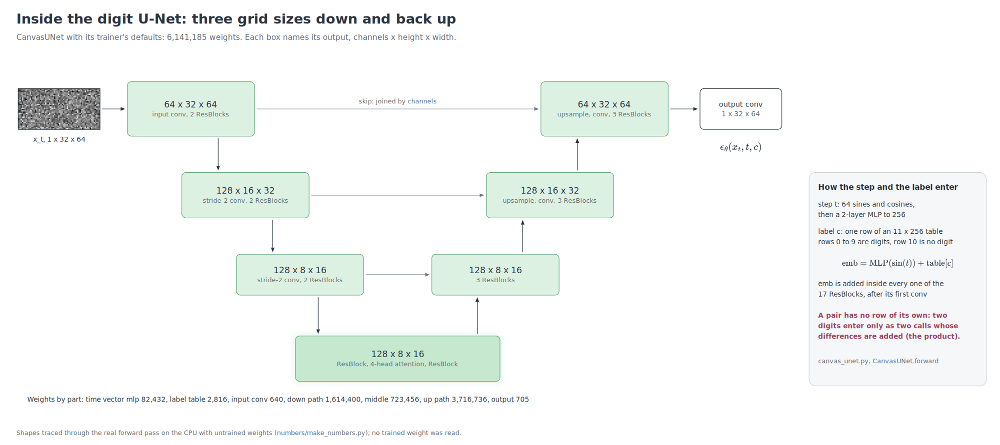
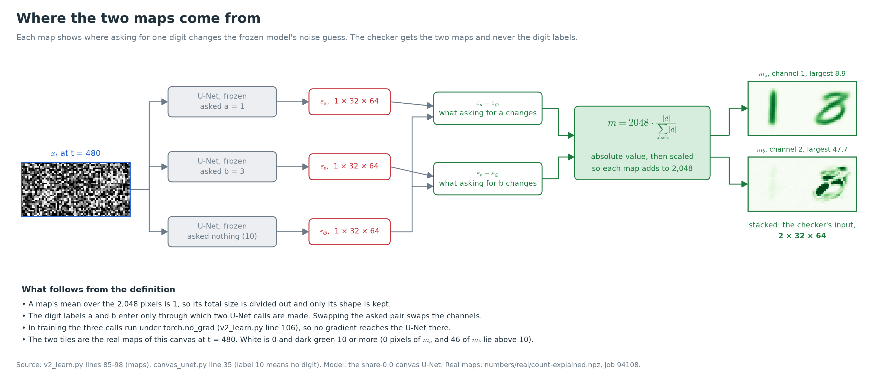
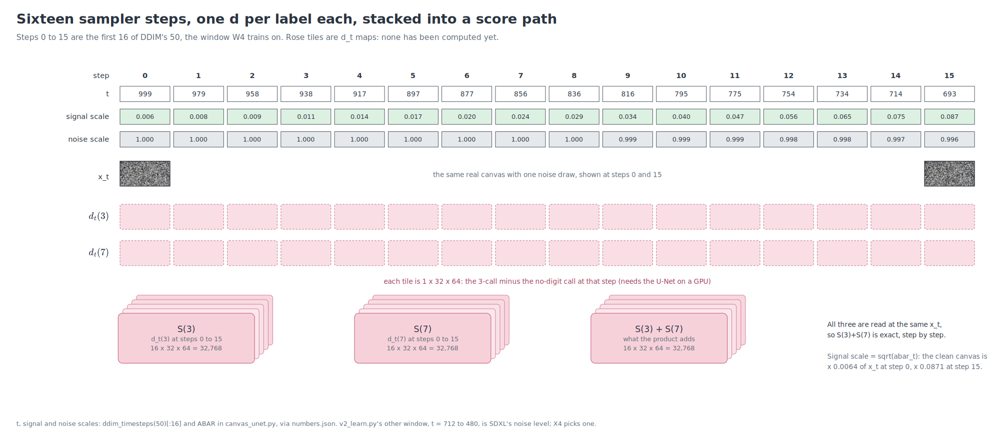
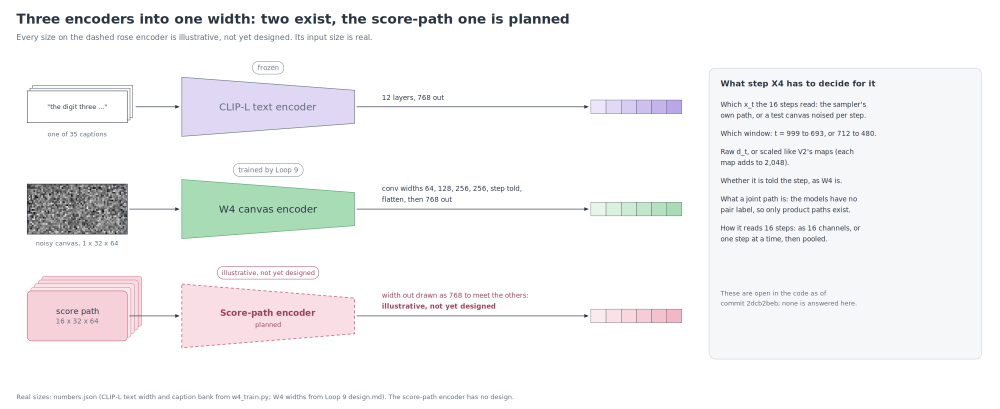
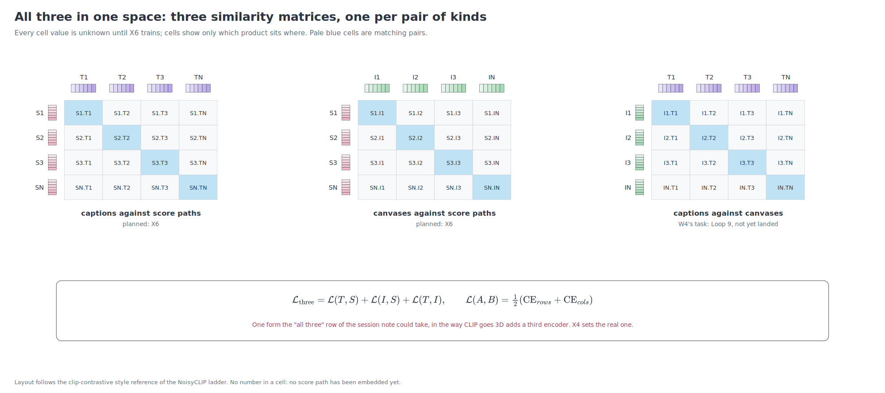

# 🌍 Context: the score path, the network view

⬅️ Previous: [one canvas end to end](01-overview.md) | 📋 [The pages of this method](01-overview.md#the-pages-of-this-method) | Next: [the miniature](03-the-miniature.md) ➡️

This page opens the score path from the whole system down to its parts: where it comes from in the digit U-Net, its real size over sixteen steps, the encoder it would need, and the three similarity matrices a shared space would train on. Solid parts in every figure exist in the repository and carry sizes read from the code; dashed rose parts belong to the score-path encoder, which was planned and never designed. Every size comes from the ladder's `numbers/numbers.json`, and the figures are the ladder's [network view](../../../artifacts/notes/progress/score-space/00-ladder/README.md#level-05-the-network-view). The ladder's level 0, one system picture, opens this page; the overview page says why.

*Where a score path comes from, and where Loop 10 would send it. Top lane: one of 35 captions through the CLIP-L text encoder (lilac, frozen) to T, 768 numbers. Middle lane: the real canvas x₀ (a 7 and a 3, built by `make_canvas`, 32 × 64), noised, into the digit U-Net (grey, 6,141,185 weights, frozen, share-0.0 or share-0.01 on the cluster), told the step t and one of 11 labels; then d_t(a) and d_t(b), each the label call minus the no-digit call, 1 × 32 × 64; then the score path, steps 0 to 15 stacked, 16 × 32 × 64 = 32,768; then the dashed rose score-path encoder, "illustrative, not yet designed". Below the middle lane, e_PoE = e_null + d(a) + d(b) feeds a DDIM step (50 steps, eta 0) that makes the next x_t, with the note "or a test canvas noised once per step: X4 decides". Bottom lane: the noised canvas into W4's canvas encoder (green, Loop 9, 4 conv blocks) to I, 768 numbers. Right: the planned shared space, holding T against S, I against S and T against I, and the two tests.* ✅ *Read on the figure at full size. The noise on the canvases is one numpy draw.* ✍️ *(the figure's footer)*

## Table of contents

- [Words this page uses](#words-this-page-uses)
- [The system](#the-system)
- [Inside the digit U-Net](#inside-the-digit-u-net)
- [Where d_t comes from](#where-d_t-comes-from)
- [Sixteen steps make a path](#sixteen-steps-make-a-path)
- [Three encoders into one width](#three-encoders-into-one-width)
- [Three similarity matrices](#three-similarity-matrices)
- [Where this came from](#where-this-came-from)
- [Read more](#read-more)

## Words this page uses

Navigation: 📋 [TOC](#table-of-contents) | [Next](#the-system) ➡️

**Channel**: one layer of a volume, one number per grid cell. A volume written 64 × 32 × 64 has 64 channels on a 32 × 64 grid.

**ResBlock**: two convolutions with the block's input added back to its output, so each block learns a correction to what it is given.

**Signal scale √ᾱ_t and noise scale √(1 − ᾱ_t)**: the weights on the clean canvas and on the noise inside x_t = √ᾱ_t x₀ + √(1 − ᾱ_t) ε. At step 0 they are 0.0064 and 1.000.

**Encoder**: a network that turns one input into one vector of fixed length, here 768 numbers.

**DDIM step**: the sampler's move from one noise level to the next, using the noise guess. The code is read on [the product-of-experts code page](../01-the-product-of-experts/04-the-code.md#the-sampler-step).

**V2**: the step on Loop 8's lane of the progress board that trained the digit-map checkers on digits 0 to 4 and tested whether they tell how many digits a canvas holds on digits 5 to 9, which they never trained on. The V2 learning script is its code.

**W4**: Loop 9's step that trained a small canvas encoder of our own, which reads a noisy digit canvas into the same 768-number space as CLIP-L's caption vectors. "W4" on this page names both that step and the encoder it trained.

**X4**: Loop 10's design step, which wrote the small experiment's run groups, cost and pass marks and was checked by the owner. Choices the ladder left open were left for X4 to settle.

**X5**: Loop 10's first run group, which fitted probes on the signature (the digit model's ten label differences on one noisy canvas), on the raw noise and on the noisy canvas, to test whether the signature carries which digits are present.

**X6**: Loop 10's planned second run group, which would train a reader of score paths into a space shared with captions (two-way) and with captions and canvases together (three-way).

## The system

Navigation: ⬅️ [Words this page uses](#words-this-page-uses) | 📋 [TOC](#table-of-contents) | [Next](#inside-the-digit-u-net) ➡️

**Two lanes of the system exist and one is planned: captions and noisy canvases already reach 768-number vectors, and the score path stops at the rose box before the encoder.** ✅

| Lane | Input | Encoder | Output | State |
|---|---|---|---|---|
| text | one of 35 captions naming digits 0 to 4 | CLIP-L's text side, frozen, 12 layers | T, 768 numbers | exists ✅ |
| canvas | the noisy canvas x_t | W4, trained by Loop 9, four conv blocks of 64, 128, 256 and 256 channels | I, 768 numbers | exists; owned by Loop 9 ✅ |
| score path | S(a) and S(b), 16 × 32 × 64 each | the score-path encoder | S, drawn as 768 to meet the others | planned, not designed ✅ |

✅ `numbers.json`, `w4_text_with_latent`. **The DDIM loop is drawn** because x_t can come from two places: the product's own run, where each step's x_t is made by the step before, or a clean test canvas noised afresh at each step. The ladder left the choice to step X4 ✍️ (`ladder.json`, `open_for_x4`). Step X5 read test canvases noised at each timestep with one noise draw per canvas shared across the window's 16 steps ✍️ ([the finding's limits](../../../2-classifier-guidance/report/does-the-score-path-carry-which-digits-are-present.md#what-this-cannot-tell-you)). One sampler step of the product with a checker added is drawn on [the digit-map checkers' overview](../03-the-digit-map-checkers/01-overview.md#what-one-step-does), which the ladder links instead of redrawing.

## Inside the digit U-Net

Navigation: ⬅️ [The system](#the-system) | 📋 [TOC](#table-of-contents) | [Next](#where-d_t-comes-from) ➡️

**The U-Net shrinks the canvas from 32 × 64 to 8 × 16 and back, and it is told one label as one row of an 11-row table, so a pair of digits can only enter as two calls.** ✅

*The U-Net with its trainer's defaults, 6,141,185 weights. Each box names its output as channels × height × width. Down the left: input conv and 2 ResBlocks at 64 × 32 × 64, then a stride-2 conv and 2 ResBlocks at 128 × 16 × 32, then another at 128 × 8 × 16. Bottom: ResBlock, 4-head attention, ResBlock at 128 × 8 × 16. Up the right: 3 ResBlocks per level back to 64 × 32 × 64, each level joined by channels to its twin on the way down (the grey "skip" arrows). Output conv: 1 × 32 × 64, the noise guess ε_θ(x_t, t, c). Side card: the step becomes 64 sines and cosines, then a 2-layer MLP to 256; the label c is one row of an 11 × 256 table, rows 0 to 9 digits and row 10 no digit; their sum is added inside every one of the 17 ResBlocks after its first conv. In red: "A pair has no row of its own: two digits enter only as two calls whose differences are added (the product)". Footer: weights by part.* ✅ *Read on the figure; the shapes were traced through the real forward pass with untrained weights.* ✍️ *(the figure's footer)*

| Part | Weights | Check |
|---|---|---|
| time vector MLP, 64 → 256 → 256 | 82,432 | 64 × 256 + 256 + 256 × 256 + 256 = 82,432 ✅ |
| label table, 11 rows of 256 | 2,816 | 11 × 256 = 2,816 ✅ |
| input conv | 640 | |
| down path | 1,614,400 | |
| middle | 723,456 | |
| up path | 3,716,736 | |
| output | 705 | |
| total | 6,141,185 | the seven parts re-added this session ✅ |

🔤 **The name:** U-Net
- **U**: the letter's shape. On the picture, the boxes go down the left side to the smallest grid and back up the right.
- **Net**: network. Each box is a few layers of it.
- **Consequence:** each stride-2 step halves the grid, 32 × 64 to 16 × 32 to 8 × 16, so the attention at the bottom compares 128 patches that each cover 4 × 4 pixels of the canvas. The skips carry the full-size detail across, which the bottom has lost. ✅ The shapes in `numbers.json`.

The U-Net, the attention at its bottom and the MLP that lifts the step to 256 numbers are taught with worked examples on [the U-Net card](../../../../../Obsidian/Artificial%20Intelligence/Deep%20Learning/U-Net.md#where-to-learn-this), [the attention card](../../../../../Obsidian/Artificial%20Intelligence/Deep%20Learning/Attention.md#where-to-learn-this) and [the multilayer perceptron card](../../../../../Obsidian/Artificial%20Intelligence/Deep%20Learning/Multilayer%20Perceptron.md#where-to-learn-this).

🔤 **The name:** label table (an embedding)
- **label**: the name tag the model is told, here a digit 0 to 9 or 10 for none.
- **table**: rows looked up by number. Row c holds 256 learned numbers. The literature calls such a table an embedding: each label is placed, or embedded, as a point in a 256-number space.
- **Formula, in those words:** emb = MLP(sincos₆₄(t)) + table[c], added inside each ResBlock.
- **Consequence:** asking for label 3 adds row 3 and asking for nothing adds row 10. There is no row 11 for "a 3 and a 7", so ε_θ(x_t, t, "3 and 7") cannot be computed, and the joint path of [Loop 9's idea](01-overview.md#where-the-idea-came-from) has no definition here. ✅ `canvas_unet.py` line 35 (`NULL = 10`) and line 110.

## Where d_t comes from

Navigation: ⬅️ [Inside the digit U-Net](#inside-the-digit-u-net) | 📋 [TOC](#table-of-contents) | [Next](#sixteen-steps-make-a-path) ➡️

**One difference is two of the three calls subtracted, and the digit-map ladder already draws those calls; the score path keeps what that figure keeps before its last box.** ✅

*From the digit-map ladder. A noisy canvas at t = 480 goes through the frozen U-Net asked a = 1, b = 3 and nothing (label 10), giving three noise guesses of 1 × 32 × 64 (red). The two green boxes are ε_a − ε_∅ and ε_b − ε_∅, "what asking for a changes" and "what asking for b changes": these are d_t(1) and d_t(3). The green box after them takes each one's absolute value and scales it to add to 2,048, and the two tiles at the right are the real scaled maps of that canvas, largest values 8.9 and 47.7.* ✅ *Read on the figure at full size. The full walk is on [the digit-map checkers' network view](../03-the-digit-map-checkers/02-the-network-view.md#the-two-maps).*

| | Loop 8's maps | The score path as the ladder draws it | The signature X5 read |
|---|---|---|---|
| labels | the asked pair, a and b | the asked pair, a and b | all ten |
| sign | dropped (absolute value) | open for X4 | kept |
| size | divided out, each map adds to 2,048 | open for X4 | kept |
| steps | one at a time | 16 stacked | one at a time, and the window stacked once |

✅ Loop 8's column read in `maps`, `v2_learn.py` lines 85 to 98; the ladder's in `ladder.json`, `open_for_x4` ("raw d_t or V2's scaled maps"); the signature's in `step_features`, `x5_signal.py` line 75 (`d = e_c - e_null`, "signed and unnormalised").

## Sixteen steps make a path

Navigation: ⬅️ [Where d_t comes from](#where-d_t-comes-from) | 📋 [TOC](#table-of-contents) | [Next](#three-encoders-into-one-width) ➡️

**Over the ladder's sixteen steps the clean canvas's weight inside x_t grows from 0.0064 to 0.0871 while the noise's stays at 1.000 to 0.996, so the whole window is almost pure noise.** ✅

*Columns are steps 0 to 15 of the 50-step DDIM run. Rows: the timestep t (999 down to 693), the signal scale √ᾱ_t (green, 0.006 to 0.087), the noise scale √(1 − ᾱ_t) (grey, 1.000 to 0.996), the same real canvas with one noise draw at steps 0 and 15, and two rows of dashed rose tiles for d_t(3) and d_t(7), each 1 × 32 × 64, left empty because the figure computed none. Below: the three stacks S(3), S(7) and S(3) + S(7), each 16 × 32 × 64 = 32,768 numbers. Side note: all three are read at the same x_t, so S(3) + S(7) is exact, step by step.* ✅ *Read on the figure at full size.*

| Step | 0 | 3 | 7 | 11 | 15 |
|---|---|---|---|---|---|
| t | 999 | 938 | 856 | 775 | 693 |
| √ᾱ_t, weight on the clean canvas | 0.0064 | 0.0115 | 0.0243 | 0.0474 | 0.0871 |
| √(1 − ᾱ_t), weight on the noise | 1.0000 | 0.9999 | 0.9997 | 0.9989 | 0.9962 |

✅ `numbers.json`, `sampler.window_steps_0_to_15`.

**The noising equation, by what moves.** The two weights in the table are the two coefficients of the equation that makes every noisy canvas, coloured as the figure colours them: green for the clean canvas's weight, grey for the noise's.

$$
\underbrace{x_t}_{\text{the noisy canvas}}
= \textcolor{#5fa877}{\underbrace{\sqrt{\bar\alpha_t}}_{\text{weight on the clean canvas}}}\,x_0
+ \textcolor{#6b7a88}{\underbrace{\sqrt{1-\bar\alpha_t}}_{\text{weight on the noise}}}\,\epsilon
$$

The worked case is one ink pixel (x₀ = +1) and one background pixel (x₀ = −1) with the same noise draw ε = 0.5, the case the overview page uses. ✅ Computed this session from the same linear schedule.

| Move | Ink pixel in x_t | Background pixel in x_t | What the picture does |
|---|---:|---:|---|
| t at 999, step 0 | 0.506 | 0.494 | the two pixels are 0.013 apart, so the digit is invisible under the noise |
| t to 693, step 15 | 0.585 | 0.411 | the green weight grows to 0.0871 and the gap to 0.174 |
| t to 100, where step X5 checked its reader | 1.108 | −0.784 | the green weight is 0.946 and the digit stands out |

**When the two are combined.** The squares of the two weights add to 1 at every t (0.0064² + 1.000² and 0.946² + 0.324² both give 1), so as t falls the green weight's square gains exactly what the grey one's loses, and x_t keeps the same overall size while the share that is canvas grows. ✅ Computed this session.

🔤 **The name:** window
- **window**: an opening that shows some of what is behind it and hides the rest. Here, the run of sampler steps whose differences are kept.
- **On the picture:** the sixteen columns; everything after step 15 is outside.
- **Formula, in those words:** t_k = `ddim_timesteps(50)[k]` for k = 0 to 15.
- **Consequence:** move the window to t 712 to 480, the timesteps whose signal share matches SDXL's first 16 steps, and the clean canvas's weight runs from 0.0761 to 0.308 in place of 0.0064 to 0.0871, about 3.5 times the early window's largest value at its far end. That later window is where the signature read its best, 0.700 at t 480, against 0.513 in the early one ✍️ ([the finding](../../../2-classifier-guidance/report/does-the-score-path-carry-which-digits-are-present.md#1-the-signature-misses-the-bar-in-both-windows)). ✅ The two weights recomputed from the schedule.

## Three encoders into one width

Navigation: ⬅️ [Sixteen steps make a path](#sixteen-steps-make-a-path) | 📋 [TOC](#table-of-contents) | [Next](#three-similarity-matrices) ➡️

**Two encoders exist and the score-path one is planned; every size on it except its input is illustrative.** ✅

*Top: a caption, one of 35, into CLIP-L's text encoder (frozen), 12 layers, 768 out. Middle: a noisy canvas, 1 × 32 × 64, into W4's canvas encoder (trained by Loop 9), conv widths 64, 128, 256 and 256, told the step, flattened, 768 out. Bottom: a score path, 16 × 32 × 64, into the dashed score-path encoder, "width out drawn as 768 to meet the others: illustrative, not yet designed". Side card: the six things step X4 had to decide, open in the code as of commit `2dcb2beb`.* ✅ *Read on the figure at full size.*

Step X4's design answered the side card for the signature. The encoder was never trained, so every right-hand cell is a plan. ✍️

| What the figure leaves to X4 | What [the design](../../../artifacts/notes/progress/score-space/04-design.md#run-group-2-step-x6-a-text-aligned-reader-of-the-signature) planned |
|---|---|
| which x_t: the sampler's own path or a test canvas noised per step | test canvases noised per step for reading and training; the product's own run for the arithmetic tests |
| which window: t 999 to 693 or 712 to 480 | both, read apart; the encoder only in a window that passed step X5 |
| raw d_t, or scaled like Loop 8's maps | raw: signed and unnormalised, pooled to 8 × 16 |
| whether it is told the step | not stated |
| what a joint path is | none: the missing term is Loop 8's count-checker push |
| how it reads 16 steps | one shared network φ per label, given that label's maps over the window and its caption vector, averaged over the ten labels |

🔤 **The name:** encoder
- **encode**: to put into a code, as a message into Morse. Here, a 16 × 32 × 64 path into 768 numbers.
- **On the picture:** the trapezoids, wide where the input enters and narrow where the vector leaves.
- **Formula, in those words (the design's plan):** f(path) = W · (1/10) Σₖ φ(d_window(k), g("the digit k")), with φ the same for every label k and g the frozen text encoder.
- **Consequence:** because φ is shared and is told each label's name, a digit the encoder never trained on, a 7 say, would enter through g("the digit seven"); an encoder with one fixed slot per label could not read that slot until it had seen a 7. The design's control replaces the name with a learned vector per label to measure what the name buys. ✍️ [The ideas page, B1b](../../../artifacts/notes/progress/score-space/03-ideas.md#b-ideas-for-one-shared-space).

## Three similarity matrices

Navigation: ⬅️ [Three encoders into one width](#three-encoders-into-one-width) | 📋 [TOC](#table-of-contents) | [Next](#where-this-came-from) ➡️

**If all three kinds share one space, training compares every pair of kinds in its own matrix, with each item's own partner on the diagonal; no cell has ever held a value.** ✅

*Three 4 × 4 grids, one per pair of kinds. Left: captions T1 to TN across, score paths S1 to SN down, "planned: X6". Middle: canvases I1 to IN against score paths, "planned: X6". Right: captions against canvases, "W4's task: Loop 9, not yet landed". Each cell is named by its row and column (S1.T1) and holds no number; the pale blue diagonal pairs each item with its own partner. Box below: L_three = L(T, S) + L(I, S) + L(T, I), with L(A, B) = ½(CE_rows + CE_cols), "one form the all-three row of the session note could take".* ✅ *Read on the figure at full size.*

$$
\underbrace{\mathcal{L}(A, B)}_{\text{one matrix's loss}}
= \tfrac12\Big(\underbrace{\mathrm{CE}_{\text{rows}}}_{\text{each row picks its partner}} + \underbrace{\mathrm{CE}_{\text{cols}}}_{\text{each column picks its partner}}\Big),
\qquad
\underbrace{\text{cell}_{ij}}_{\text{one comparison}} = \frac{\cos(a_i, b_j)}{\underbrace{\tau}_{0.07}}
$$

The worked case is the [miniature's 3 × 3 matrix](03-the-miniature.md#the-encoder-and-the-contrastive-score), where every term has a number.

CE stands for cross-entropy: for one row, minus the log of the share the row's softmax gives the row's own partner, so a row that gives its partner 0.961 costs 0.039 and one that gives 1/3 costs 1.099. ✅ Computed this session. Both words are taken apart on that miniature matrix, and taught with worked numbers on [the cross-entropy card](../../../../../Obsidian/Mathematics/Statistics/Information%20Theory/Cross-Entropy.md#where-to-learn-this) and [the softmax card](../../../../../Obsidian/Artificial%20Intelligence/Deep%20Learning/Softmax.md#where-to-learn-this).

> [!NOTE]
> The summed three-way loss is the ladder's illustration ✍️ (README, "Illustrative"). The design planned "all three" as the score-path encoder trained against W4's frozen canvas encoder and the frozen text encoder, the way ImageBind and CLIP goes 3D add an encoder, and only after text with score path passed. It never ran, and W4 had no result when Loop 10 closed ✍️ ([the design](../../../artifacts/notes/progress/score-space/04-design.md#run-group-2-step-x6-a-text-aligned-reader-of-the-signature)).

🔤 **The name:** similarity matrix
- **similarity**: how alike two things are. Here, the cosine of the angle between two 768-number vectors, 1 when they point the same way and 0 when they are at right angles.
- **matrix**: a table of numbers with rows and columns. On the picture, one grid.
- **Consequence:** in the miniature the product path's row reads cosines 0.71, 0.71 and 0.98 against "one 3", "one 7" and "a 3 and a 7, apart". Swap the last caption for "a 3 on top of a 7" and its cell drops to 0.86, so the right caption still wins the row, by less. ✅ The miniature's answer key.

## Where this came from

Navigation: ⬅️ [Three similarity matrices](#three-similarity-matrices) | 📋 [TOC](#table-of-contents) | [Next](#read-more) ➡️

| What | How it was established | When |
|---|---|---|
| Every label on the five figures | Read on each figure at full size | 2026-11-24 |
| Every shape, weight count and schedule value | Read in the ladder's `numbers/numbers.json`; the time MLP, label table and total re-added this session | 2026-11-24 |
| The early and matched windows' signal weights | Recomputed from `BETAS`, linear 1e-4 to 0.02 over 1,000 steps | 2026-11-24 |
| What X4 left open | Read in `ladder.json`, `open_for_x4`, and on sp3's side card | 2026-11-24 |
| What the design planned for each | Stated by the design, "Words this uses" and run groups 1 to 3 | 2026-11-24 |
| What X5 read: signed, unnormalised, all ten labels | Read in `x5_signal.py`, `step_features`, lines 66 to 86 | 2026-11-24 |
| That the encoder and the three-way space did not run | Stated by the score-path finding, "Still open" | 2026-11-24 |

## Read more

Navigation: ⬅️ [Where this came from](#where-this-came-from) | 📋 [TOC](#table-of-contents)

| What | Where |
|---|---|
| One shared space: project, then divide by length, in CLIP | [the CLIP chapter, section 1.4](../../../../../goal-setting/learning/deep-learning/generative-models/02-stable-diffusion-and-clip/textbook/01-clip-on-one-small-network.md#14-one-shared-space-project-then-divide-by-length) |
| Every picture against every caption, and the loss asked both ways | [the CLIP chapter, section 1.5](../../../../../goal-setting/learning/deep-learning/generative-models/02-stable-diffusion-and-clip/textbook/01-clip-on-one-small-network.md#15-every-picture-against-every-caption) |
| The same U-Net's maps, scaled, read by a trained checker | [the digit-map checkers' network view](../03-the-digit-map-checkers/02-the-network-view.md) |

⬅️ Previous: [one canvas end to end](01-overview.md) | 📋 [The pages of this method](01-overview.md#the-pages-of-this-method) | Next: [the miniature](03-the-miniature.md) ➡️

<!-- built-to: PAGE_LOOK_FORMAT v1 -->
