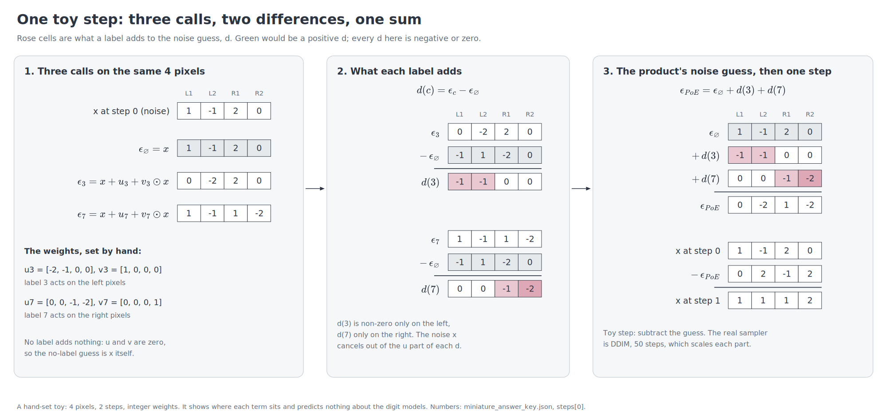
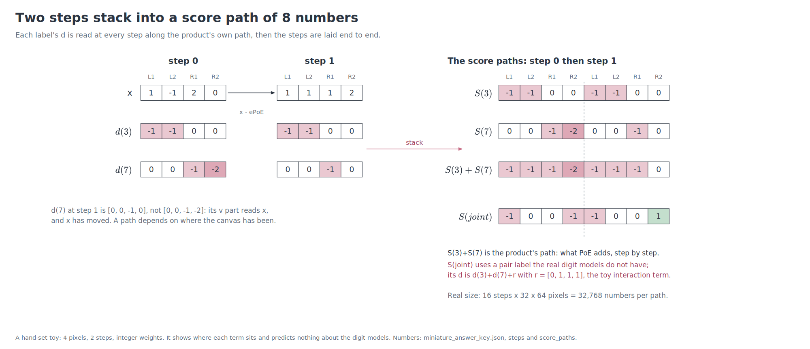
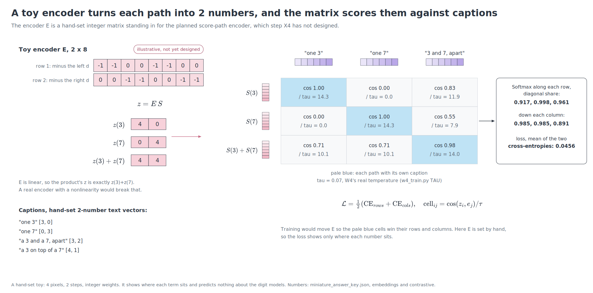
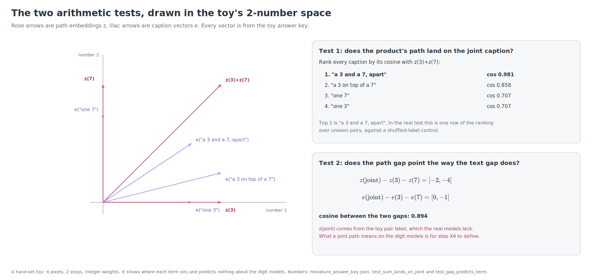

# 🌍 Context: the score path, worked on a four-pixel canvas

⬅️ Previous: [the network view](02-the-network-view.md) | 📋 [The pages of this method](01-overview.md#the-pages-of-this-method) | Next: [the code](04-the-code.md) ➡️

This page shrinks the score path until every number fits on paper: a canvas of four pixels, a "model" that is one line of integer arithmetic, two sampler steps, an encoder that is one 2 × 8 matrix, and captions that are two numbers each. It runs one step, stacks two into paths, scores the paths against captions the way a contrastive space would, and works the two tests Loop 10 planned. Every weight is set by hand, so no number here predicts anything about the digit models; the toy shows where each term sits. The only real number in it is W4's temperature, 0.07. Everything comes from [the ladder's miniature script](../../../artifacts/notes/progress/score-space/00-ladder/2-miniature/miniature.py) and its answer key.

*One toy step. Columns L1, L2 are the left half and R1, R2 the right. Panel 1, three calls on the same four pixels: x at step 0 is (1, −1, 2, 0); the no-label guess ε_∅ is x itself (grey); ε₃ = x + u₃ + v₃ ⊙ x is (0, −2, 2, 0) and ε₇ is (1, −1, 1, −2). Below: the weights, u₃ = (−2, −1, 0, 0) and v₃ = (1, 0, 0, 0), so label 3 acts on the left pixels; u₇ = (0, 0, −1, −2) and v₇ = (0, 0, 0, 1), so label 7 acts on the right. Panel 2, what each label adds: d(3) = (−1, −1, 0, 0) and d(7) = (0, 0, −1, −2), rose where negative. Panel 3: ε_PoE = ε_∅ + d(3) + d(7) = (0, −2, 1, −2), and the toy step x − ε_PoE gives x at step 1 = (1, 1, 1, 2).* ✅ *Read on the figure at full size; every value matches the answer key's `steps[0]`.*

## Table of contents

- [Words this page uses](#words-this-page-uses)
- [The toy](#the-toy)
- [One step: three calls, two differences](#one-step-three-calls-two-differences)
- [Two steps make a path](#two-steps-make-a-path)
- [The encoder and the contrastive score](#the-encoder-and-the-contrastive-score)
- [The two tests](#the-two-tests)
- [What the toy cannot say](#what-the-toy-cannot-say)
- [Run it yourself](#run-it-yourself)
- [Where this came from](#where-this-came-from)

## Words this page uses

Navigation: 📋 [TOC](#table-of-contents) | [Next](#the-toy) ➡️

**u_c and v_c**: the toy model's two hand-set weights per label. u_c is added wherever the canvas is; v_c is multiplied by the canvas, so its effect depends on what the canvas holds.

**⊙**: multiply pixel by pixel.

**Embedding z**: the two numbers the toy encoder gives one path.

**Caption vector e**: the two numbers a caption is given by hand, standing in for CLIP-L's 768.

**Cosine**: how alike two vectors' directions are, their dot product divided by both lengths: 1 for the same direction, 0 at right angles, −1 opposite.

The cosine is taught with worked numbers on [the cosine similarity card](../../../../../Obsidian/Mathematics/Linear%20Algebra/Cosine%20Similarity.md#where-to-learn-this).

**W4**: Loop 9's step that trained a small canvas encoder of our own, which reads a noisy digit canvas into the same 768-number space as CLIP-L's caption vectors. "W4" on this page names both that step and the encoder it trained.

**X5**: Loop 10's first run group, which fitted probes on the signature (the digit model's ten label differences on one noisy canvas), on the raw noise and on the noisy canvas, to test whether the signature carries which digits are present.

## The toy

Navigation: ⬅️ [Words this page uses](#words-this-page-uses) | 📋 [TOC](#table-of-contents) | [Next](#one-step-three-calls-two-differences) ➡️

**Four pixels, two steps, integer weights: label 3 acts on the left half and label 7 on the right.** ✅

| Part | In the miniature | On the real digit model |
|---|---|---|
| canvas | 4 pixels, starting at x = (1, −1, 2, 0) | 32 × 64 pixels |
| model | ε(x, c) = x + u_c + v_c ⊙ x, with u_∅ = v_∅ = 0 | the frozen U-Net, 6,141,185 weights |
| sampler step | x ← x − ε_PoE | DDIM, 50 steps, which scales each part |
| path | 2 steps × 4 pixels = 8 numbers | 16 steps × 2,048 pixels = 32,768 numbers |
| encoder | one 2 × 8 integer matrix E | not designed |
| captions | four hand-set 2-number vectors | CLIP-L's 768-number text vectors |
| temperature τ | 0.07, W4's real value | 0.07 in W4 |
| joint label | "3 and 7", whose d is d(3) + d(7) + r, with r = (0, 1, 1, 1) | none: the model has no pair label |

✅ Read in `miniature.py`, lines 1 to 35, and `numbers.json`.

🧸 **Toy:** the canvas (1, −1, 2, 0), labels 3 and 7, two toy steps. Expected before running: d(3) is non-zero only on the left and d(7) only on the right; the product's path embeds as exactly z(3) + z(7), because E is linear; and the product's path sits nearest the caption "a 3 and a 7, apart", because its two numbers are equal and that caption's are the most nearly equal.

## One step: three calls, two differences

Navigation: ⬅️ [The toy](#the-toy) | 📋 [TOC](#table-of-contents) | [Next](#two-steps-make-a-path) ➡️

**Subtracting the no-label guess cancels the canvas out of the u part, so what is left is exactly what the label adds.** ✅

| Stage | L1 | L2 | R1 | R2 |
|---|---:|---:|---:|---:|
| x at step 0 | 1 | −1 | 2 | 0 |
| ε_∅ = x | 1 | −1 | 2 | 0 |
| ε₃ | 0 | −2 | 2 | 0 |
| d(3) = ε₃ − ε_∅ | −1 | −1 | 0 | 0 |
| ε₇ | 1 | −1 | 1 | −2 |
| d(7) = ε₇ − ε_∅ | 0 | 0 | −1 | −2 |
| ε_PoE = ε_∅ + d(3) + d(7) | 0 | −2 | 1 | −2 |
| x at step 1 = x − ε_PoE | 1 | 1 | 1 | 2 |

✅ The answer key, `steps[0]`. **By hand:** d(3) at L1 is u₃ + v₃ x = −2 + 1 × 1 = −1. Every d at step 0 is negative or zero, as the figure's subtitle says. ✅

The step is where the product sums the differences away. A score path keeps d(3) and d(7) apart before that sum, which is the one change from the product's own arithmetic. ✍️ [The ladder's close](../../../artifacts/notes/progress/score-space/00-ladder/read-through-a-small-network.md).

## Two steps make a path

Navigation: ⬅️ [One step: three calls, two differences](#one-step-three-calls-two-differences) | 📋 [TOC](#table-of-contents) | [Next](#the-encoder-and-the-contrastive-score) ➡️

**Each label's difference is read at both steps along the product's own run and laid end to end, and d(7) changes between the steps because its v part reads a canvas that has moved.** ✅

*Left: x at steps 0 and 1, and d(3) and d(7) at each. Right: the score paths, step 0 then step 1, eight cells each, a dashed line between the steps; rose cells are negative, the one green cell positive. Notes: d(7) at step 1 is (0, 0, −1, 0), not (0, 0, −1, −2), "its v part reads x, and x has moved"; S(3) + S(7) is the product's path; S(joint) uses a pair label the real digit models do not have, its d being d(3) + d(7) + r with r = (0, 1, 1, 1); real size 16 × 32 × 64 = 32,768 numbers per path.* ✅ *Read on the figure at full size.*

| Path | Step 0 | Step 1 |
|---|---|---|
| S(3) | −1, −1, 0, 0 | −1, −1, 0, 0 |
| S(7) | 0, 0, −1, −2 | 0, 0, −1, 0 |
| S(3) + S(7), the product's | −1, −1, −1, −2 | −1, −1, −1, 0 |
| S(joint), toy only | −1, 0, 0, −1 | −1, 0, 0, 1 |

✅ The answer key, `score_paths`.

**Why d(3) did not change.** v₃ reads only L1, and L1 is 1 at both steps, so d(3) at L1 is −2 + 1 = −1 twice. v₇ reads R2, which went from 0 to 2, so d(7) at R2 went from −2 + 0 = −2 to −2 + 2 = 0. ✅ A path differs from one step repeated only where a v part reads a pixel that moved.

## The encoder and the contrastive score

Navigation: ⬅️ [Two steps make a path](#two-steps-make-a-path) | 📋 [TOC](#table-of-contents) | [Next](#the-two-tests) ➡️

**A hand-set matrix turns each 8-number path into 2 numbers, and the contrastive matrix divides each cosine by 0.07 so the right caption takes almost all of its row.** ✅

*Left: the toy encoder E, 2 × 8, marked "illustrative, not yet designed". Row 1 is minus the left d at both steps, row 2 minus the right d. z = E S gives z(3) = (4, 0), z(7) = (0, 4) and z(3) + z(7) = (4, 4); "E is linear, so the product's z is exactly z(3) + z(7). A real encoder with a nonlinearity would break that." Captions, hand-set: "one 3" (3, 0), "one 7" (0, 3), "a 3 and a 7, apart" (3, 2), "a 3 on top of a 7" (4, 1). Right: rows S(3), S(7), S(3) + S(7); columns "one 3", "one 7", "3 and 7, apart"; each cell a cosine and that cosine over τ = 0.07, the pale blue diagonal pairing each path with its own caption. Box: the softmax's share on the diagonal, 0.917, 0.998 and 0.961 along rows and 0.985, 0.985 and 0.891 down columns; the loss, the mean of the two cross-entropies, 0.0456.* ✅ *Read on the figure at full size.*

| Row | "one 3" | "one 7" | "a 3 and a 7, apart" |
|---|---:|---:|---:|
| z(3) = (4, 0) | 1.000 / 0.07 = 14.29 | 0 | 0.832 / 0.07 = 11.89 |
| z(7) = (0, 4) | 0 | 1.000 / 0.07 = 14.29 | 0.555 / 0.07 = 7.92 |
| z(3) + z(7) = (4, 4) | 0.707 / 0.07 = 10.10 | 0.707 / 0.07 = 10.10 | 0.981 / 0.07 = 14.01 |

✅ The answer key, `contrastive`.

$$
\underbrace{\mathcal{L}}_{0.0456}
= \tfrac12\Big(\underbrace{\tfrac13\textstyle\sum_i -\log p^{\text{row}}_{ii}}_{\text{rows: } 0.0427} + \underbrace{\tfrac13\textstyle\sum_j -\log p^{\text{col}}_{jj}}_{\text{columns: } 0.0485}\Big),
\qquad
p^{\text{row}}_{ij} = \frac{e^{\cos(z_i, e_j)/\textcolor{#c76b84}{\tau}}}{\sum_k e^{\cos(z_i, e_k)/\textcolor{#c76b84}{\tau}}}
$$

**By hand, the product's row.** Its three cells over τ are 10.10, 10.10 and 14.01. Subtract the largest: −3.91, −3.91 and 0, so e^−3.91 = 0.020 twice and 1 once; the diagonal's share is 1 / (1 + 2 × 0.020) = 0.961, and its cross-entropy −log 0.961 = 0.039. ✅ The key gives 0.9613 and 0.0394.

🔤 **The name:** softmax
- **max**: pick the largest.
- **soft**: give a share to every cell instead of all to one, the larger the cell the larger its share.
- **On the matrix:** the product's row, cells 10.10, 10.10 and 14.01. A hard max hands everything to the third cell, shares (0, 0, 1). The softmax raises e to each cell and divides by their sum, giving (0.019, 0.019, 0.961). ✅ Computed this session.
- **Formula, in those words:** the p^row line above: each cell's e to the power of cos / τ, over the row's total, so the three shares always add to 1.
- **Consequence:** the gap between the cells sets how hard the softmax leans. Divide the same cosines by τ = 1 in place of 0.07 and the row's shares become (0.302, 0.302, 0.397), close to a third each. ✅ Computed this session. The card is [the softmax card](../../../../../Obsidian/Artificial%20Intelligence/Deep%20Learning/Softmax.md#where-to-learn-this).

🔤 **The name:** cross-entropy
- **entropy**: in everyday use, disorder; in information, how surprised you are on average by what comes.
- **cross**: measured across two things, here the right answer (all the share on the diagonal) and the shares the softmax actually gave.
- **On the matrix:** the pale blue diagonal cell's share, read once per row and once per column.
- **Formula, in those words:** the surprise at the right answer, minus the log of its share. A share of 0.961 costs 0.039, a share of 0.5 costs 0.693, and a share of 1/3, a row that cannot tell its captions apart, costs 1.099. ✅ Computed this session.
- **Consequence:** at τ = 1 the product's diagonal share drops from 0.961 to 0.397 and its cross-entropy rises from 0.039 to 0.925, which is what lifts the loss from 0.0456 to 0.806 in the temperature line below. ✅ Computed this session. The card is [the cross-entropy card](../../../../../Obsidian/Mathematics/Statistics/Information%20Theory/Cross-Entropy.md#where-to-learn-this).

🔤 **The name:** temperature
- **temperature**: in physics, how much things jiggle; a hot system spreads over many states, a cold one settles in the lowest. Here, τ, the number every cosine is divided by before the softmax.
- **On the picture:** "/ tau" in every cell.
- **Formula, in those words:** a small τ stretches the gaps between cosines, so the largest takes nearly all the share; a large τ squeezes them, so the shares even out.
- **Consequence:** with τ = 0.07 the product path's diagonal share is 0.961 and the loss 0.0456; with τ = 1, the same cosines give 0.397 and a loss of 0.806, so a cosine gap of 0.27 stops being decisive. ✅ Recomputed this session from the key's cosines.

🔤 **The name:** contrastive score
- **contrastive**: judged by setting each thing against the others. A row asks "of these captions, which is mine?"; a column asks "of these paths, which is mine?".
- **score**: here a number for how well each path matches each caption, the cell cos / τ. It is a different word from the "score" in score path.
- **Consequence:** the loss is lowest when every diagonal cell beats its row and column. Training would move E to raise the diagonal; here E is set by hand, so 0.0456 only shows where each number sits. ✅ The figure's note.

## The two tests

Navigation: ⬅️ [The encoder and the contrastive score](#the-encoder-and-the-contrastive-score) | 📋 [TOC](#table-of-contents) | [Next](#what-the-toy-cannot-say) ➡️

**In the toy the product's path ranks "a 3 and a 7, apart" first, and the gap between the joint path and the product's path points within 27° of the gap between the captions.** ✅

*Left: the toy's 2-number space, number 1 across and number 2 up. Rose arrows are path embeddings: z(3) along number 1, z(7) along number 2, z(3) + z(7) on the diagonal. Lilac arrows are caption vectors: "one 3", "one 7", "a 3 and a 7, apart" and "a 3 on top of a 7". Right, test 1: every caption ranked by its cosine with z(3) + z(7). Test 2: the path gap z(joint) − z(3) − z(7) = (−2, −4) against the text gap e(joint) − e(3) − e(7) = (0, −1), cosine 0.894. In rose: z(joint) comes from the toy's pair label, which the real models lack.* ✅ *Read on the figure at full size.*

| Test 1, captions against z(3) + z(7) = (4, 4) | Cosine |
|---|---:|
| "a 3 and a 7, apart", (3, 2) | 0.981 |
| "a 3 on top of a 7", (4, 1) | 0.858 |
| "one 7", (0, 3) | 0.707 |
| "one 3", (3, 0) | 0.707 |

✅ The answer key, `test_sum_lands_on_joint`. **By hand:** (4 × 3 + 4 × 2) / (√32 × √13) = 20 / 20.40 = 0.981.

**Test 2 by hand.** z(joint) = E S(joint) = (2, 0), so the path gap is (2, 0) − (4, 4) = (−2, −4). The text gap is (3, 2) − (3, 0) − (0, 3) = (0, −1). Their cosine is (0 + 4) / (√20 × 1) = 0.894. ✅ The key gives 0.8944. Had the text gap pointed along number 1, (−1, 0), the same path gap would give 0.447. ✅ Computed this session.

💥 **Broken run (without):** the paths built from each label's raw guess ε_c, with the no-label guess never subtracted. This variant is computed here and is not one the ladder draws.
- **Predict:** which caption does the product's path rank first?
- **Wrong:** "one 3", at cosine 0.000, with "a 3 and a 7, apart" third at −0.555: the paths now carry the canvas itself, and E(ε₃ path + ε₇ path) = (0, −6).
- **Right**, with ε_∅ subtracted: "a 3 and a 7, apart", at 0.981.

✅ Computed this session with the key's weights.

## What the toy cannot say

Navigation: ⬅️ [The two tests](#the-two-tests) | 📋 [TOC](#table-of-contents) | [Next](#run-it-yourself) ➡️

**The toy is hand-set, it has a pair label the real models lack, and it reads one trajectory.** ✍️ [The ladder's close](../../../artifacts/notes/progress/score-space/00-ladder/read-through-a-small-network.md#what-the-small-network-cannot-say).

**Its cosines predict nothing.** Every weight, caption vector and the encoder were chosen to show where each term sits, so 0.98 and 0.89 say nothing about the digit models.

**Its joint path cannot be built on digits.** The digit models have labels 0 to 9 and no digit, so the gap test has no joint path there; the design replaced it with the count checker's push ([the design, run group 3](../../../artifacts/notes/progress/score-space/04-design.md#run-group-3-step-x8-unseen-digits-and-the-two-arithmetic-tests)), and that test never ran.

**Its sum is exact only because E is linear.** On the digit models an encoder has nonlinearities, so the product's embedding need not equal the sum of the two single embeddings; that is what test 1 would have measured.

**It reads the product's own run.** A path read on a test canvas noised once per step gives different numbers, and step X5 read that form, with all ten labels in place of two.

## Run it yourself

Navigation: ⬅️ [What the toy cannot say](#what-the-toy-cannot-say) | 📋 [TOC](#table-of-contents) | [Next](#where-this-came-from) ➡️

**One script makes every number on this page, and it asserts that the product's embedding equals z(3) + z(7).** ✅ `miniature.py` line 62.

🔨 **Build:** from the ladder's `2-miniature/` folder, `python3 miniature.py`. It prints the paths, the embeddings (`"poe": [4, 4]`), the ranking with `"a 3 and a 7, apart"` at 0.9806, the gap cosine 0.8944, and the contrastive block with `"loss": 0.0456`. Different numbers mean a weight or τ changed; τ is read from `numbers/numbers.json`.

> [!WARNING]
> The script rewrites `miniature_answer_key.json` inside the ladder folder (line 95). Run it on a copy of the folder, or expect a changed file in `git status`. It was not re-run for these pages; the numbers were read from the key as it stands and recomputed by hand.

## Where this came from

Navigation: ⬅️ [Run it yourself](#run-it-yourself) | 📋 [TOC](#table-of-contents)

| What | How it was established | When |
|---|---|---|
| The weights, the starting canvas, E, the captions and r | Read in `miniature.py`, lines 27 to 35 | 2026-11-24 |
| Every step, path, embedding, cosine, share and loss | Read in `miniature_answer_key.json` | 2026-11-24 |
| The by-hand rows: d(3) at L1, the product row's share 0.961, the cosine 0.981, the gap cosine 0.894 | Recomputed this session from the key's values | 2026-11-24 |
| The τ = 1 shares and loss, the (−1, 0) text gap, and the broken run without subtraction | Computed this session with the key's weights; not in any ladder file | 2026-11-24 |
| The figure labels | Read on mm1 to mm4 at full size | 2026-11-24 |
| What the toy cannot say | Stated by the ladder's close | 2026-11-24 |

⬅️ Previous: [the network view](02-the-network-view.md) | 📋 [The pages of this method](01-overview.md#the-pages-of-this-method) | Next: [the code](04-the-code.md) ➡️

<!-- built-to: PAGE_LOOK_FORMAT v1 -->
