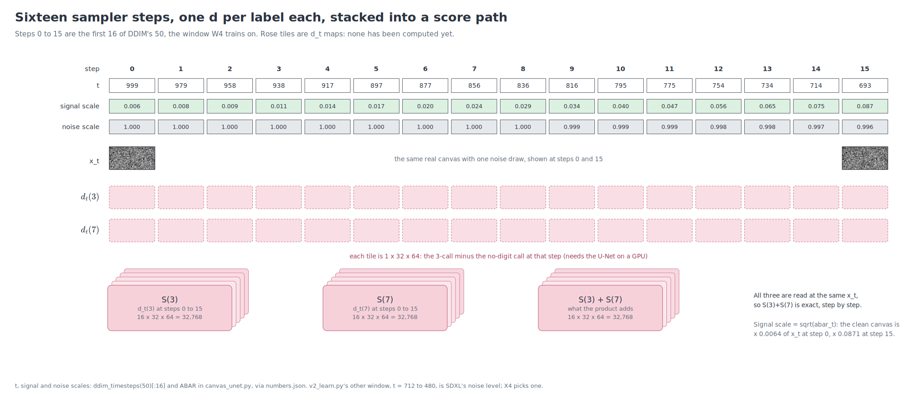

# 🌍 Context: the score path, the code it is built from

⬅️ Previous: [the miniature](03-the-miniature.md) | 📋 [The pages of this method](01-overview.md#the-pages-of-this-method) | Next: [the methods index](../00-INDEX.md) ➡️

This page reads the digit environment's own code block by block, in the order a score path would be built: the schedule and the no-digit label, how the label enters the U-Net, why a pair has no label, the product's three calls and two subtractions, the sixteen timesteps, the DDIM step, the one older place that keeps each label's difference apart, and the canvas and captions. It ends with the block Loop 10 wrote that built the signature in step X5. No code in the repository builds the score path in the ladder's form or a score-path encoder. The ladder's own [code walk](../../../artifacts/notes/progress/score-space/00-ladder/3-code/walk-the-digit-environment.md) quotes the first eight blocks at commit `2dcb2beb`, checked by its `check_quotes.py`; every line number below was read again in the working tree at commit `cbff8c0e`.

<a href="../../../artifacts/notes/progress/score-space/00-ladder/0.5-network-view/sp2-sixteen-steps-make-a-score-path.png"></a>

*What the code would fill. Columns are steps 0 to 15 of `ddim_timesteps(50)`; the rows give t (999 to 693, block 5), the signal scale √ᾱ_t and the noise scale √(1 − ᾱ_t) from `ABAR` (block 1), the noisy canvas at steps 0 and 15, and two rows of empty rose tiles, d_t(3) and d_t(7), each one call of `product_eps` minus its no-label call (block 4). The three stacks below are S(3), S(7) and S(3) + S(7), 16 × 32 × 64 = 32,768 numbers each. The footer names v2_learn's other window, t 712 to 480, "SDXL's noise level; X4 picks one".* ✅ *Read on the figure at full size. The figure's subtitle calls steps 0 to 15 "the window W4 trains on", which the current `w4_train.py` no longer does; see [block 5](#the-sixteen-steps).*

## Table of contents

- [Words this page uses](#words-this-page-uses)
- [The blocks and where they live](#the-blocks-and-where-they-live)
- [The schedule and the no-digit label](#the-schedule-and-the-no-digit-label)
- [How the step and the label enter](#how-the-step-and-the-label-enter)
- [Training: one label per call](#training-one-label-per-call)
- [The product: three calls and two subtractions](#the-product-three-calls-and-two-subtractions)
- [The sixteen steps](#the-sixteen-steps)
- [The DDIM step that moves the canvas](#the-ddim-step-that-moves-the-canvas)
- [Where d_t was already kept: Loop 8's maps](#where-d_t-was-already-kept-loop-8s-maps)
- [The canvas and the captions](#the-canvas-and-the-captions)
- [The block that built the signature](#the-block-that-built-the-signature)
- [How it fails and how you know it worked](#how-it-fails-and-how-you-know-it-worked)
- [Where this came from](#where-this-came-from)

## Words this page uses

Navigation: 📋 [TOC](#table-of-contents) | [Next](#the-blocks-and-where-they-live) ➡️

**`@torch.no_grad()`**: a decorator that tells PyTorch to keep no record of the arithmetic inside the function, so no gradient can flow back through it. Reading a score path needs no gradient, so it does no harm here.

**`.chunk(n)`**: splits a batch into n equal parts in order, so one forward pass over a stacked batch of three gives back three separate predictions.

**`avg_pool2d(d, k)`**: replaces each k × k block of a map with its mean, so a 32 × 64 map becomes 16 × 32 at k = 2 and 8 × 16 at k = 4.

**Batch dimension**: the first axis of a tensor, one entry per canvas.

## The blocks and where they live

Navigation: ⬅️ [Words this page uses](#words-this-page-uses) | 📋 [TOC](#table-of-contents) | [Next](#the-schedule-and-the-no-digit-label) ➡️

**Every block is this project's own code, read where it lives.** ✅

| Block | Where it lives | What it computes | Figure | The miniature's twin |
|---|---|---|---|---|
| 1. schedule and no-digit label | [the canvas U-Net script](../../../2-classifier-guidance/scripts/mnist/canvas_unet.py), lines 35 to 38 | ᾱ_t = ∏ (1 − β_s), and label 10 means no digit | [sixteen steps](02-the-network-view.md#sixteen-steps-make-a-path) | `U["null"] = V["null"] = 0`, so ε(x, ∅) = x |
| 2. step and label in | the same script, lines 44 to 48, 62 and 110 | emb = MLP(sincos₆₄(t)) + table[c], added in every ResBlock | [inside the U-Net](02-the-network-view.md#inside-the-digit-u-net) | one u and one v per label |
| 3. training | lines 140 to 144, 161, 293 to 294 | one label per call; a two-digit canvas enters once per digit | the U-Net's side card | none: the toy is not trained |
| 4. the product | `product_eps`, lines 171 to 177 | ε_∅ + g Σ (ε_c − ε_∅) | [one toy step](03-the-miniature.md) | `miniature.py` lines 46 to 49 |
| 5. the sixteen steps | `ddim_timesteps`, lines 167 to 168; [the V2 learning script](../../../2-classifier-guidance/scripts/abstract_checkers/v2_learn.py), line 46; [the W4 script](../../../2-classifier-guidance/scripts/noise_text_critic/w4_train.py), lines 49 to 51 | the timesteps a path is read at | the picture above | two toy steps |
| 6. the DDIM step | canvas U-Net script, lines 231 to 233 and 239 | the clean guess, then the next x_t | none | `x_next = x - poe`, line 51 |
| 7. Loop 8's maps | V2 learning script, `maps`, lines 85 to 98 | each asked label's \|d_t\|, scaled to add to 2,048 | [where d_t comes from](02-the-network-view.md#where-d_t-comes-from) | none |
| 8. canvas and captions | [the environment builder](../../../2-classifier-guidance/scripts/abstract_checkers/build_env.py), lines 65 to 69; W4 script, lines 52 and 58 | the test canvas; CLIP-L and τ = 0.07 | the overview picture | `CAPTIONS`, line 33 |
| 9. the signature | [the X5 script](../../../2-classifier-guidance/scripts/score_space/x5_signal.py), `noise_for` lines 59 to 62 and `step_features` lines 65 to 89 | all ten d_t on one x_t, signed and unnormalised | [two ways to define the path](01-overview.md#two-ways-to-define-the-path) | none: the toy asks two labels |

The miniature's file is [the ladder's miniature script](../../../artifacts/notes/progress/score-space/00-ladder/2-miniature/miniature.py). ✅

## The schedule and the no-digit label

Navigation: ⬅️ [The blocks and where they live](#the-blocks-and-where-they-live) | 📋 [TOC](#table-of-contents) | [Next](#how-the-step-and-the-label-enter) ➡️

**Four lines fix the noise at every timestep and give "no digit" its own label, 10.** ✅

```python
NULL = 10
T = 1000
BETAS = torch.linspace(1e-4, 0.02, T, dtype=torch.float64)
ABAR = torch.cumprod(1 - BETAS, 0).float()
```

The canvas U-Net script, lines 35 to 38. ᾱ_t is the share of the clean canvas's power left at t, and x_t = √ᾱ_t x₀ + √(1 − ᾱ_t) ε. ✅ Recomputed from these lines this session: √ᾱ is 0.0064 at t 999, 0.0871 at t 693, 0.308 at t 480 and 0.946 at t 100, where step X5 put its positive control.

## How the step and the label enter

Navigation: ⬅️ [The schedule and the no-digit label](#the-schedule-and-the-no-digit-label) | 📋 [TOC](#table-of-contents) | [Next](#training-one-label-per-call) ➡️

**The step becomes 64 sines and cosines, a small MLP lifts them to 256 numbers, and one row of an 11-row table is added for the label.** ✅

```python
def timestep_embedding(t, dim):
    half = dim // 2
    freqs = torch.exp(-math.log(10000) * torch.arange(half, device=t.device) / half)
    args = t.float()[:, None] * freqs[None]
    return torch.cat([torch.cos(args), torch.sin(args)], 1)
```

```python
        emb = self.temb(timestep_embedding(t, self.ch)) + self.cemb(y)
```

```python
        h = h + self.e(F.silu(emb))[:, :, None, None]
```

Lines 44 to 48, 110 and 62. `self.cemb` is the 11 × 256 label table (2,816 weights) and line 62 adds the sum inside each ResBlock after its first convolution. `y` holds one label per canvas, so ε_θ(x_t, t, c) takes a digit or no digit and never a pair. ✅

## Training: one label per call

Navigation: ⬅️ [How the step and the label enter](#how-the-step-and-the-label-enter) | 📋 [TOC](#table-of-contents) | [Next](#the-product-three-calls-and-two-subtractions) ➡️

**A canvas holding two digits enters training twice, once under each digit's label, so the model learns "a canvas with a 7 on it" and never "a 3 and a 7".** ✅

```python
        if rng.random() < share:
            a, b = SEEN[rng.integers(len(SEEN))]
            c = cv.two(a, b)
            xs += [c, c]
            ys += [a, b]
```

```python
        y[torch.from_numpy(rng.random(n) < 0.1)] = NULL
```

```python
            pred = model(a.sqrt() * x + (1 - a).sqrt() * noise, t, y)
        loss = F.mse_loss(pred.float(), noise)
```

Lines 140 to 144, 161 and 293 to 294. With `share` 0.01, one canvas in a hundred holds two digits from the 40 pairs not held out; with `share` 0.0, which step X5 used, none does. A tenth of labels are replaced by 10, which is how the no-digit guess is learned. ✅ The script's docstring, lines 3 to 5, says the same in words: "the expert for 7 means 'a canvas with a 7 on it, sometimes beside another digit'". This is why the joint path is dead on digits ✍️ ([the ideas page, C2a](../../../artifacts/notes/progress/score-space/03-ideas.md#c-the-two-arithmetic-tests)).

## The product: three calls and two subtractions

Navigation: ⬅️ [Training: one label per call](#training-one-label-per-call) | 📋 [TOC](#table-of-contents) | [Next](#the-sixteen-steps) ➡️

**The product already forms both differences, in one forward pass over a stacked batch, and adds them away inside its return line.** ✅

```python
@torch.no_grad()
def product_eps(model, x, t, labels, g=1.0):
    """eps_null + g * sum over labels of (eps_label - eps_null), one forward over the stacked batch."""
    b = x.shape[0]
    ys = [torch.full((b,), NULL, device=x.device)] + [torch.full((b,), l, device=x.device) for l in labels]
    out = model(x.repeat(len(ys), 1, 1, 1), t.repeat(len(ys)), torch.cat(ys)).chunk(len(ys))
    return out[0] + g * sum(e - out[0] for e in out[1:])
```

Lines 171 to 177. `out[0]` is ε_∅ and each `e - out[0]` is one d_t(c). At g = 1 this is ε_PoE = ε_∅ + d_t(a) + d_t(b). ✅

$$
\textcolor{#6b7a88}{\underbrace{\epsilon_{\mathrm{PoE}}}_{\texttt{return}}}
= \textcolor{#6b7a88}{\underbrace{\epsilon_\varnothing}_{\texttt{out[0]}}}
+ \underbrace{g}_{1.0}\,\Big(\textcolor{#c76b84}{\underbrace{d_t(a)}_{\texttt{out[1] - out[0]}}} + \textcolor{#c76b84}{\underbrace{d_t(b)}_{\texttt{out[2] - out[0]}}}\Big)
$$

On the miniature's step 0: ε_∅ = (1, −1, 2, 0), d(3) = (−1, −1, 0, 0), d(7) = (0, 0, −1, −2), so the return is (0, −2, 1, −2). At g = 2 it would be (1, −1, 2, 0) + 2 × (−1, −1, −1, −2) = (−1, −3, 0, −4): g scales only the label-added part. ✅ Computed from the answer key.

> [!IMPORTANT]
> A score path cannot be read off `product_eps`: it returns only the sum, and the two d_t terms are formed and added inside the return line and never kept. Code that reads a path has to make the three calls itself and keep `out[1] - out[0]` and `out[2] - out[0]`, as Loop 8's `maps` does with the same three calls. ✅ The code walk, section 4, and `ladder.json`, `open_for_x4`.

## The sixteen steps

Navigation: ⬅️ [The product: three calls and two subtractions](#the-product-three-calls-and-two-subtractions) | 📋 [TOC](#table-of-contents) | [Next](#the-ddim-step-that-moves-the-canvas) ➡️

**The ladder's window is the first 16 timesteps of the 50-step run; Loop 8 defined a second window matched to SDXL's noise, and W4 now trains over both.** ✅

```python
def ddim_timesteps(n=50):
    return torch.linspace(T - 1, 0, n).round().long()
```

```python
SDXL_MATCHED = torch.tensor([712, 696, 680, 664, 648, 632, 616, 601, 585, 570, 555, 539, 524, 510, 495, 480])
```

```python
STEPS = ddim_timesteps(50)[:26]
MATCHED = list(range(14, 26))
EARLY = list(range(16))
```

The canvas U-Net script, lines 167 to 168; the V2 learning script, line 46; the W4 script, lines 49 to 51. `ddim_timesteps(50)[:16]` is t = 999, 979, ..., 714, 693. ✅

| Window | Defined in | Timesteps | √ᾱ_t, first to last |
|---|---|---|---|
| early, the ladder's | `ddim_timesteps(50)[:16]` | 999 to 693 | 0.0064 to 0.0871 |
| SDXL-matched | `SDXL_MATCHED`, V2 line 46 | 712 to 480 | 0.0761 to 0.308 |
| W4's training range now | `STEPS`, W4 line 49 | 999 to 489 (sampler steps 0 to 25) | 0.0064 to 0.295 |

✅ Read in the three files; √ᾱ recomputed from block 1. The code walk quotes W4's window as `STEPS16 = ddim_timesteps(50)[:16]` at commit `2dcb2beb`; commit `c6bb5095` replaced it with the three lines above, judged on steps 14 to 25. The walk's `check_quotes.py` pins the old commit, so it still passes.

## The DDIM step that moves the canvas

Navigation: ⬅️ [The sixteen steps](#the-sixteen-steps) | 📋 [TOC](#table-of-contents) | [Next](#where-d_t-was-already-kept-loop-8s-maps) ➡️

**With eta 0 the run is fixed by its seed, so a path read along it evaluates each d_t at the product's own x_t.** ✅

```python
        a = abar[t]
        a_prev = abar[ts[i + 1]] if i + 1 < len(ts) else torch.tensor(1.0, device=device)
        x0 = (x - (1 - a).sqrt() * eps) / a.sqrt()
```

```python
            x = a_prev.sqrt() * x0 + (1 - a_prev).sqrt() * eps
```

Lines 231 to 233 and 239. The step is taken apart term by term on [the product-of-experts code page](../01-the-product-of-experts/04-the-code.md#the-sampler-step). ✅

🔤 **The name:** the product's own path
- **own**: belonging to this run. Each x_t is the one the previous step made, from the product's prediction.
- **path**: here the sequence of canvases x_{t₀}, x_{t₁}, ..., which a score path reads d_t along.
- **Consequence:** the miniature reads its two steps this way: x at step 1 is (1, 1, 1, 2) only because step 0 subtracted ε_PoE, and that move is what changed d(7) from (0, 0, −1, −2) to (0, 0, −1, 0). Read the same labels on a test canvas noised afresh at each step and d(7) at step 1 would be computed on a different canvas. Step X5 read that second form, one clean canvas noised at each timestep with one noise draw shared across the window ✍️ ([the finding's limits](../../../2-classifier-guidance/report/does-the-score-path-carry-which-digits-are-present.md#what-this-cannot-tell-you)), so no score path along a product run has been read.

## Where d_t was already kept: Loop 8's maps

Navigation: ⬅️ [The DDIM step that moves the canvas](#the-ddim-step-that-moves-the-canvas) | 📋 [TOC](#table-of-contents) | [Next](#the-canvas-and-the-captions) ➡️

**Before Loop 10, this was the only place in the repository that kept d_t(a) and d_t(b) apart, one step at a time, with sign and size divided out.** ✅

```python
def maps(model, xt, t, pair, variant):
    """The two maps of where each asked label changes the noise prediction, each adding to 1, then scaled by the pixel count."""
    n = xt.shape[0]
    y = torch.cat([torch.full((n,), NULL, device=xt.device), pair[:, 0], pair[:, 1]])
    e0, ea, eb = model(xt.repeat(3, 1, 1, 1), t.repeat(3), y).chunk(3)
    channels, totals = [], []
    for d in (ea - e0, eb - e0):
        total = d.abs().flatten(1).sum(1).clamp_min(1e-12)[:, None, None, None]
        channels.append((d if variant == "signed" else d.abs()) / total * PIXELS)
```

The V2 learning script, lines 85 to 93 of the block that runs to line 98. m_c = 2048 · |d_t(c)| / Σ |d_t(c)|. The block is read in full on [the digit-map checkers' code page](../03-the-digit-map-checkers/04-the-code.md#noising-a-canvas-and-making-the-two-maps). ✅ A score path in the ladder's form is sixteen of these kept together, raw or scaled; the ladder left that choice to step X4 ✍️ (`ladder.json`).

## The canvas and the captions

Navigation: ⬅️ [Where d_t was already kept: Loop 8's maps](#where-d_t-was-already-kept-loop-8s-maps) | 📋 [TOC](#table-of-contents) | [Next](#the-block-that-built-the-signature) ➡️

**The ladder's canvas is Loop 8's own `make_canvas` on MNIST's test images, and the text side is CLIP-L at W4's temperature.** ✅

```python
def make_canvas(kind, a, b, digits, source, rng):
    """One canvas of a kind for the asked pair (a, b). For apart and wrong, holds[0] is the left digit."""
    if kind == "apart":
        shown = (a, b) if rng.random() < 0.5 else (b, a)
        corners = [half_corner(rng, 0), half_corner(rng, 1)]
```

```python
TAU = 0.07
```

```python
TEXT_MODEL = "openai/clip-vit-large-patch14"
```

The environment builder, lines 65 to 69; the W4 script, lines 52 and 58. The ladder's canvas is `make_canvas("apart", 3, 7, ...)`, which put the 7 on the left (MNIST test indices 3730 and 6096). ✅ The ladder's `overview/canvas-3-7.json`. W4's captions name the lower digit first, so "the digit three and the digit seven, apart" says nothing about left and right; its bank holds 35 captions over digits 0 to 4, 5 single and 3 for each of 10 pairs. ✍️ The code walk, section 8; 5 + 3 × 10 = 35 ✅.

## The block that built the signature

Navigation: ⬅️ [The canvas and the captions](#the-canvas-and-the-captions) | 📋 [TOC](#table-of-contents) | [Next](#how-it-fails-and-how-you-know-it-worked) ➡️

**Step X5's script asks the model for no digit and all ten digits in one forward pass of 11 stacked copies, and keeps the ten differences signed and unnormalised.** ✅

```python
def noise_for(n, seed, dev):
    """One noise draw per canvas, the same at every step, so a window is one path."""
    g = torch.Generator().manual_seed(seed)
    return torch.randn(n, 1, 32, 64, generator=g).to(dev)


@torch.no_grad()
def step_features(model, x0, eps, t):
    """Everything one step gives, from one forward pass over the null label and the ten digit labels."""
    n = x0.shape[0]
    a = ABAR.to(x0.device)[t]
    xt = a.sqrt() * x0 + (1 - a).sqrt() * eps
    y = torch.cat([torch.full((n,), NULL, device=x0.device)] + [torch.full((n,), c, device=x0.device) for c in range(10)])
    tt = torch.full((11 * n,), t, device=x0.device, dtype=torch.long)
    out = model(xt.repeat(11, 1, 1, 1), tt, y).view(11, n, 1, 32, 64)
    e_null, e_c = out[0], out[1:].transpose(0, 1).squeeze(2)            # (n,1,32,64), (n,10,32,64)
    d = e_c - e_null                                                    # the signature, signed and unnormalised
    ...
        "path_length": d.pow(2).flatten(2).sum(2),                      # 10
        "signature_grid": F.avg_pool2d(d, 2),                           # 10 x 16 x 32, for the convolutional probe
```

The X5 script, lines 59 to 62 and 65 to 86; the dots stand for lines 76 to 84, which compute the error readout, the pooled canvas and the pooled noise for the comparison rows. The script was committed at `e1d17f7f` and is clean in the working tree. ✅

| What the block does | Compared with `product_eps` |
|---|---|
| 11 labels per canvas: 10 and the digits 0 to 9 | 3 labels: 10 and the asked pair |
| a clean canvas noised at t by `eps`, the same draw at every t | the product's own x_t, made by the previous step |
| keeps `d`, one map per digit | adds the maps into one prediction |
| the reader got `signature_grid`, 10 × 16 × 32 per step | |

✅ Read in the two blocks. The reader that `signature_grid` fed, and every number it produced, belong to [the score-path finding](../../../2-classifier-guidance/report/does-the-score-path-carry-which-digits-are-present.md#2-what-the-other-inputs-read).

🔤 **The name:** path length
- **path**: the d_t maps over the window, as above.
- **length**: how big a vector is, here measured as the sum of squares of all its numbers.
- **Formula, in those words:** `d.pow(2).flatten(2).sum(2)`, per label, ‖d_t(c)‖²; summed over the window it is the quantity Sampling Path Tells More ranks seeds by ✍️ ([the reading table](../../../artifacts/notes/progress/score-space/01-reading/reading-table.md)).
- **Consequence:** in the miniature, ‖d(3)‖² is 1 + 1 = 2 at both steps, so S(3)'s length is 4, and S(7)'s is (1 + 4) + 1 = 6. Length throws away where each label acts, so two paths with the same sizes and different layouts look the same to it; the design kept it as a baseline a trained reader had to beat ✍️ ([the design](../../../artifacts/notes/progress/score-space/04-design.md#run-group-1-step-x5-does-the-signature-carry-the-digits)). ✅ The miniature's lengths computed from the key.

## How it fails and how you know it worked

Navigation: ⬅️ [The block that built the signature](#the-block-that-built-the-signature) | 📋 [TOC](#table-of-contents) | [Next](#where-this-came-from) ➡️

**The bars sit in the source, and a positive control at t 100 had to pass before any miss at higher noise was believed.** ✅

```python
MIN_PRESENCE = 0.75          # presence accuracy on the signature at some step of a window
MIN_OVER_NOISE = 0.10        # and at least this much above the raw-noise probe at that step
```

The X5 script, lines 37 and 38, with `MIN_CONTROL = 0.90` at line 40 and `CONTROL_T = 100` at line 39. Line 294 says that in the full read only the canvas row gates the control, on board question 74. ✅ The script's docstring, line 11, still says the signature and the noisy canvas "must each reach presence accuracy 0.9"; the gate in the code is the canvas row alone.

**How you know a path was read.** The finding's reader on the noisy canvas reached 0.950 at t 100, so the pipeline reads digits when they are there to read. The signature then missed 0.75 in both windows, so the encoder steps did not run ✍️ ([the finding, section 3](../../../2-classifier-guidance/report/does-the-score-path-carry-which-digits-are-present.md#3-the-checks-that-the-reader-works)).

**How the ladder's quotes are checked.** `python3 check_quotes.py`, run from the ladder's `3-code/` folder, compares each of the walk's 16 quoted blocks with its file at commit `2dcb2beb` and prints the count of mismatches. It was not run for this page; the blocks above were read in the working tree instead.

## Where this came from

Navigation: ⬅️ [How it fails and how you know it worked](#how-it-fails-and-how-you-know-it-worked) | 📋 [TOC](#table-of-contents)

| What | How it was established | When |
|---|---|---|
| Blocks 1 to 8 and their line numbers | Read in the working tree at `cbff8c0e`; `git diff 2dcb2beb` shows `canvas_unet.py`, `v2_learn.py` and `build_env.py` unchanged since the walk's commit | 2026-11-24 |
| W4's window changed after the walk | `git diff 2dcb2beb` on `w4_train.py`, and `git log`: commit `c6bb5095` | 2026-11-24 |
| Block 9 and the bars | Read in `x5_signal.py`, last changed at `e1d17f7f`, clean in the working tree | 2026-11-24 |
| √ᾱ at t 999, 693, 712, 489, 480 and 100 | Recomputed from lines 35 to 38 with numpy | 2026-11-24 |
| The g = 2 product and the miniature's path lengths | Computed from the answer key | 2026-11-24 |
| The joint path being dead on digits | Stated by the ideas page, C2a | 2026-11-24 |
| The caption count 35 and its makeup | Stated by the code walk, section 8; the sum checked | 2026-11-24 |
| The control result and the verdict | Stated by the score-path finding | 2026-11-24 |

⬅️ Previous: [the miniature](03-the-miniature.md) | 📋 [The pages of this method](01-overview.md#the-pages-of-this-method) | Next: [the methods index](../00-INDEX.md) ➡️

<!-- built-to: PAGE_LOOK_FORMAT v1 -->
