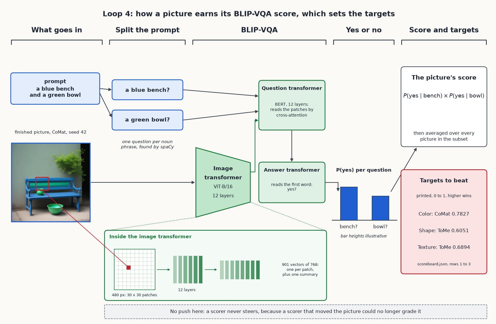

# 🌍 Context: the BLIP-VQA score, how one picture earns it

⬅️ Previous: [the methods index](../00-INDEX.md) | 📋 [The pages of this method](#the-pages-of-this-method) | Next: [how the question reads the picture](02-how-the-question-reads-the-picture.md) ➡️

The BLIP-VQA score is T2I-CompBench's number for whether a picture holds each coloured, shaped or textured thing its prompt names. The prompt is split into one question per noun phrase, a frozen question-answering model called BLIP answers each question with a probability of "yes", and the probabilities are multiplied into one score between 0 and 1. Loop 4 set Paper 2's Color, Shape and Texture targets from the BLIP-VQA numbers rival papers print, and Loop 5 reran rivals and scored their pictures with the same code. The one-paragraph definition lives in [the BLIP-VQA entry on the Attend-and-Excite finding](../../../1-lora-correction/report/against-other-methods/how-does-the-adapter-score-on-the-attend-and-excite-prompts.md#blip-vqa), and this folder does not repeat it. What it adds: the loops' two pictures of the scorer, every size read from the code, a worked case with numbers, and where the score stops being informative. Every picture comes from [the annotated overviews](../../../2-classifier-guidance/artifacts/scenes/annotated-overviews/README.md) or from a scored run's own folder.

*One scoring pass, read left to right. What goes in: the prompt "a blue bench and a green bowl" and a finished CoMat picture at seed 42, the top middle tile of [the CoMat trial sheet](../../../artifacts/notes/progress/reproductions/CoMat/comat-one-percent-seed42.png). Split the prompt: two questions, "a blue bench?" and "a green bowl?", one per noun phrase found by spaCy. BLIP-VQA: an image transformer (ViT-B/16, 12 layers) reads the picture; a question transformer (BERT, 12 layers) reads each question and looks at the picture's patches by cross-attention; an answer transformer reads the first word of its answer, yes or no. Yes or no: one bar per question, the probability of yes; the bar heights are illustrative. Score and targets: the picture's score is P(yes | bench) × P(yes | bowl), then averaged over every picture in the subset. The red box lists the rival numbers printed on 0 to 1, higher wins: Color, CoMat 0.7827; Shape, ToMe 0.6051; Texture, ToMe 0.6894, from rows 1 to 3 of the scoreboard. The inset opens the image transformer: a 480-pixel picture cut into 30 × 30 patches, 12 layers, 901 vectors of 768 numbers, one per patch plus one summary. The grey footer: no push here, because a scorer that moved the picture could no longer grade it.* ✅ read on the picture at full size; every size matches the code (see [how the question reads the picture](02-how-the-question-reads-the-picture.md)), and the three printed numbers match `scoreboard.json`.

## Table of contents

- [Words this page uses](#words-this-page-uses)
- [What one scoring pass does](#what-one-scoring-pass-does)
- [The names, taken apart](#the-names-taken-apart)
- [The score, by what moves](#the-score-by-what-moves)
- [How it fails and how you know it worked](#how-it-fails-and-how-you-know-it-worked)
- [What is measured where](#what-is-measured-where)
- [The pages of this method](#the-pages-of-this-method)
- [Where this came from](#where-this-came-from)
- [Read more](#read-more)

## Words this page uses

Navigation: 📋 [TOC](#table-of-contents) | [Next](#what-one-scoring-pass-does) ➡️

**Loop 4 and Loop 5**: two of the project's working loops. Loop 4 read the rival papers' printed numbers and set the targets on [the scoreboard](../../../artifacts/notes/progress/scoreboard.json); Loop 5 reran rival methods on the cluster, with renders under `/datasets/mmolefe/poe_repair_min/loop-5/renders/`.

**Paper 2**: the project's paper on restoring plurality, drawing two separate things, in one conditional model ([the rivals list](../../../artifacts/notes/progress/targets/rivals.md), line 4).

**CoMat and ToMe**: two rival methods on SDXL. CoMat is a LoRA, a small trained add-on to SDXL's U-Net, that teaches the model to attend to every concept in a prompt ([the CoMat design](../../../artifacts/notes/progress/reproductions/CoMat/design.md#what-this-asks), lines 5 to 6). ToMe, short for token merging, trains nothing and updates one composite token per object in the first 20% of the denoising steps (the protocol cell of the scoreboard's Shape row).

**Color, Shape, Texture**: three of T2I-CompBench's categories, each a fixed list of prompts that pair things with a colour ("a blue bench"), a shape ("an oblong cucumber") or a material ("a plastic toy"). These three are the ones scored by BLIP-VQA.

**Target**: the best rival number on a benchmark moved one step past it; for a 0 to 1 score the step is 0.01 ([the comparison protocol](../../../artifacts/notes/progress/targets/comparison-protocol.md#words-this-uses)).

**Frozen**: used as released, with no weight changed.

**Seed**: the number that fixes a render's starting noise, so the same prompt at seed 42 always gives the same picture and at ten seeds gives ten pictures.

**LoRA**, in CoMat's line above, is taught with textbook pages and videos on [the LoRA card](../../../../../Obsidian/Artificial%20Intelligence/Large%20Language%20Models/LoRA.md#where-to-learn-this).

## What one scoring pass does

Navigation: ⬅️ [Words this page uses](#words-this-page-uses) | 📋 [TOC](#table-of-contents) | [Next](#the-names-taken-apart) ➡️

**Each box of the picture is a few lines of T2I-CompBench's own evaluation code, which this project runs unchanged.** ✅ read in the T2I-CompBench clone at commit `4aa4042` under `~/PhD/replications/t2i-compbench/BLIPvqa_eval/`, the commit [the CoMat design](../../../artifacts/notes/progress/reproductions/CoMat/design.md#what-the-release-leaves-open) records as the scorer (line 66).

| Box | What it is | Where its numbers come from |
|---|---|---|
| prompt | read from the picture's file name, the text before the first underscore, so a file must be named `<prompt>_<n>.png` | ✅ [the scoring script](../../../../replications/t2i-compbench/BLIPvqa_eval/BLIP_vqa.py), lines 20 to 31 |
| split the prompt | spaCy's noun chunks, minus "top", "the side", "the left" and "the right"; question i is chunk i with a "?" added | ✅ the same file, lines 32 to 42 |
| image transformer | ViT-B/16 at 480 pixels: 12 layers, 768 numbers wide, 901 vectors out | ✅ `configs/vqa.yaml` lines 10 and 17; `create_vit` in `models/blip.py`, lines 197 to 200 |
| question transformer | BERT, 12 layers of width 768, each with cross-attention to the 901 picture vectors | ✅ `configs/med_config.json`; `BLIP_VQA`, `models/blip_vqa.py` lines 32 to 34 and 87 to 91 |
| answer transformer | the same BERT shape run as a decoder; only its first answer word is read | ✅ `vqa_prob`, `models/blip_vqa.py` lines 133 to 147 |
| P(yes) per question | p_yes / (p_yes + p_no), written as text to 4 decimal places | ✅ the same file, lines 124 to 127 and 145 to 147 |
| the picture's score | the product of its questions' P(yes); a question the prompt has no phrase for counts as 1 | ✅ `BLIP_vqa.py`, lines 102 to 110 |
| averaged over the subset | the mean of every picture's score in the folder, printed as `BLIP-VQA score` | ✅ the same file, lines 113 to 126 |
| targets to beat | rows 1 to 3 of the scoreboard, counting its CLEVR row as row 0 | ✅ read in `scoreboard.json` |

The script asks the questions in passes: pass i asks question i of every picture, and it runs 8 passes by default (`--np_num`, lines 66 to 70), reloading BLIP on each. ✅ This project's two drivers only stage the pictures under those file names and read the result back: [the benchmark driver](../../../scripts/review_bench_t2i.py) for the Color, Shape and Texture sets, and [the paper-review driver](../../../1-lora-correction/scripts/review_score_blipvqa.py) for any list of pictures and prompts. Both refuse a prompt that contains an underscore. ✅ lines 65 and 44 of each.

## The names, taken apart

Navigation: ⬅️ [What one scoring pass does](#what-one-scoring-pass-does) | 📋 [TOC](#table-of-contents) | [Next](#the-score-by-what-moves) ➡️

**Each word of the score's names points at one box of the picture above.** ✅

🔤 **The name:** BLIP-VQA

- **BLIP**: short for Bootstrapping Language-Image Pre-training (Li and colleagues, 2022, arXiv 2201.12086). *Language-image*: it reads a picture and a sentence together. *Pre-training*: it is first trained on a broad task over many web pictures and then fine-tuned for one job. *Bootstrapping*: lifting yourself by your own bootstraps; BLIP writes captions for noisy web pictures, filters them, and trains on its own cleaned captions. ✍️ [the scoring sources page](../../../../../goal-setting/learning/deep-learning/diffusion-models/12-scoring-and-rival-methods/sources/scoring-and-benchmarks/SOURCES.md#blip). On the picture, the three green boxes. The checkpoint used is `model_base_vqa_capfilt_large`, the base-size BLIP fine-tuned for answering questions ✅ `configs/vqa.yaml`, line 7.
- **VQA**: visual question answering, shown a picture and asked a question in words, answer in words. On the picture, the question and answer transformers.
- **Formula, in those words:** ask BLIP one question per thing the prompt names, read how strongly its answer starts with "yes", and multiply.
- **Consequence:** take away the yes reading and BLIP writes its answer as text. The same model class has a `generate` mode that returns words (`models/blip_vqa.py`, lines 93 to 113) ✅, which would give each question 0 or 1 and each picture 0 or 1. The probability is T2I-CompBench's reading of BLIP, not BLIP's own output ✍️ [the scoring sources page](../../../../../goal-setting/learning/deep-learning/diffusion-models/12-scoring-and-rival-methods/sources/scoring-and-benchmarks/SOURCES.md#blip).

Visual question answering is taught with textbook pages on [the visual question answering card](../../../../../Obsidian/Artificial%20Intelligence/Deep%20Learning/Visual%20Question%20Answering.md#where-to-learn-this), and the whole name on [the BLIP-VQA subject note](../../../../../Obsidian/Artificial%20Intelligence/Generative%20Modeling/Evaluating%20Text-To-Image%20Models/BLIP-VQA.md#words-the-name-uses).

🔤 **The name:** noun phrase

- **noun**: a word naming a thing, such as "bench".
- **phrase**: a few words that work as one unit. A noun phrase is the noun with the words that describe it: "a blue bench". On the picture, the two blue cards under "Split the prompt".
- **Found by spaCy**: spaCy is an English-parsing library; its `noun_chunks` returns the noun phrases of a sentence. The environment pins spaCy 3.5.3 with the `en_core_web_sm` 3.5.0 model ✅ [the scorer's install script](../../../1-lora-correction/scripts/review_install_t2icomp.sh), lines 9 and 10. That "a blue bench and a green bowl" splits into exactly "a blue bench" and "a green bowl" is ✍️ stated by the picture; the parser was not run for this page.
- **Consequence:** the colour rides inside the question, so "a green bowl?" asks about a green bowl and not about any bowl. A picture with the colours swapped is asked about two things it does not hold. On "a yellow bow and a pink bowl", CO3's render with the colours swapped scored 0.1899 where PoE's render with both drawn scored 0.9540 ✍️ [the Attend-and-Excite finding](../../../1-lora-correction/report/against-other-methods/how-does-the-adapter-score-on-the-attend-and-excite-prompts.md#what-a-high-and-a-low-cell-look-like); the finding marks the swap as the reason 🔍 inferred, because the per-question answers were not kept.

Noun phrases are taught with textbook pages on [the noun phrase card](../../../../../Obsidian/Artificial%20Intelligence/Noun%20Phrase.md#where-to-learn-this).

🔤 **The name:** yes-probability

- **yes**: the answer word that is read.
- **probability**: a share of belief between 0 and 1. On the picture, the blue bars under "P(yes) per question".
- **Formula, in those words:** of the belief the answer transformer puts on its first word being "yes" or "no", the share on "yes".
- **Consequence:** the answer transformer spreads its belief over 30,524 words, and every word except "yes" and "no" is thrown away before the share is taken. A model that gives "yes" 0.60 and "no" 0.15 and a model that gives them 0.06 and 0.015 both read 0.80. Worked on [the question page](02-how-the-question-reads-the-picture.md#the-answer-word-by-what-moves).

🔤 **The name:** T2I-CompBench

- **T2I**: text to image.
- **Comp**: compositional, prompts that put several described things together.
- **Bench**: benchmark, a fixed test that every method runs the same way so their numbers line up. On the picture, the red box with its Color, Shape and Texture rows.
- **Formula, in those words:** a category's number is the mean of the BLIP-VQA scores of every picture made for its prompts. The T2I-CompBench++ paper scores 300 test prompts per category at 10 images per prompt with a fixed seed ✍️ [the new-rival scan](../../../artifacts/notes/progress/targets/reads/new-rival-scan.csv), its T2I-CompBench++ rows.
- **Consequence:** fixed prompts do not fix the number. Plain SDXL on Color reads 0.5879 in CoMat's table and 0.6369 in ToMe's, so the two tables did not share a protocol ✍️ [the limits page](../../../artifacts/notes/progress/targets/limits.md#t2i-compbench), line 258. Our own rerun of plain SDXL through CoMat's sampler reads 0.6172 at seed 42 ✍️ [the CoMat review](../../../artifacts/notes/progress/reproductions/CoMat/review.md), line 35.

## The score, by what moves

Navigation: ⬅️ [The names, taken apart](#the-names-taken-apart) | 📋 [TOC](#table-of-contents) | [Next](#how-it-fails-and-how-you-know-it-worked) ➡️

**A picture's score is the product of its questions' yes-probabilities, and a category's number is the mean of its pictures' scores.** ✅ `BLIP_vqa.py`, lines 102 to 124. The colours are the picture's: blue for the per-question answers, red for the number the targets are read against.

$$
\underbrace{S_k}_{\text{picture } k\text{'s score}}
= \prod_{i=1}^{n_k} \textcolor{#1f5fd0}{\underbrace{P_{k,i}(\text{yes})}_{\text{question } i\text{'s yes-probability}}}
\qquad
\textcolor{#c0262d}{\underbrace{B}_{\text{the category's number}}}
= \frac{1}{N}\sum_{k=1}^{N} S_k
$$

| Symbol | What it is | Its value here | If it grew |
|---|---|---|---|
| n_k | how many noun phrases picture k's prompt has | 2 for "a blue bench and a green bowl"; the script asks 8 and scores the extra empty questions as 1 | one more factor of at most 1, so the score can only stay or fall |
| P_{k,i}(yes) | question i's yes-probability on picture k | between 0 and 1, kept to 4 decimal places | the score grows in proportion; one factor at 0 makes the picture 0 whatever the others are |
| S_k | picture k's score | between 0 and 1, kept to 4 decimal places | the category's number grows by 1/N of the rise |
| N | how many pictures the category was scored on | 2,880 for CoMat's Color rerun: 288 prompts at 10 seeds ✍️ | each picture's share of the mean shrinks |

**A worked case, on an ordinary toy first.** The prompt is "a yellow banana and a red apple", and three photos of a kitchen table are scored. The yes-probabilities are illustrative.

| Photo | "a yellow banana?" | "a red apple?" | Score, the product |
|---|---|---|---|
| 1: both, right colours | 0.95 | 0.90 | 0.855 |
| 2: a green banana and a red apple | 0.20 | 0.90 | 0.180 |
| 3: a yellow banana, no apple | 0.95 | 0.02 | 0.019 |
| the category's number, the mean | | | 1.054 / 3 = 0.3513 |

Ripen the banana in photo 2 so its question reads 0.90 and photo 2 scores 0.81; the mean rises from 0.3513 to 1.684 / 3 = 0.5613. ✅ arithmetic.

**Run back on the project's numbers.** No per-question answer was kept for any picture this page quotes, so only products are known. A product still bounds its factors: each factor is at most 1, so each is at least the product, and the smaller is at most its square root. On "a mug and a wine glass" at seed 11 the plain product's picture scored 0.0044 ✅ [the probe's BLIP-VQA file](../../../1-lora-correction/artifacts/results/measuring-composition/the-scorers/what-each-scorer-says-about-two-objects/probe_blipvqa.csv), so its weaker answer was at most √0.0044 = 0.066. At the category level, CoMat's 2,880 Color pictures average 0.7696 ✍️ [the CoMat review](../../../artifacts/notes/progress/reproductions/CoMat/review.md), line 32. The opening picture itself has no score on record: the CoMat trial rung that made it computed none ✍️ the same review, line 30.

🔤 **The name:** trial rung

- **rung**: one step of a ladder, which you stand on only after the one below holds. Loop 5's CoMat rerun climbs in rungs, each passing before the next starts: a control check, a smoke test of 2 Shape prompts at seed 42, then 1% of the data, 9 prompts at 10 seeds ✍️ [the CoMat review](../../../artifacts/notes/progress/reproductions/CoMat/review.md#runs), its runs table.
- **trial**: a small run made to look at before committing to the full one. The trial rung is the 1% rung, and its sheet at seed 42 is [the CoMat trial sheet](../../../artifacts/notes/progress/reproductions/CoMat/comat-one-percent-seed42.png), whose top middle tile opens this page.
- **Consequence:** the rung made 9 × 10 = 90 pictures and scored none of them, so the sheet's 9 tiles are checked by eye only; the full run after it, 288 prompts at 10 seeds, made the 2,880 pictures behind 0.7696. ✅ arithmetic.

## How it fails and how you know it worked

Navigation: ⬅️ [The score, by what moves](#the-score-by-what-moves) | 📋 [TOC](#table-of-contents) | [Next](#what-is-measured-where) ➡️

**The score falls sharply when a named thing is missing, and it cannot tell a separate mug from a mug fused into a goblet.** These two pictures come from a real run and their scores from its saved file.

<table><tr>
<td> Joint prompt: BLIP-VQA 0.3641</td>
<td> Plain product: BLIP-VQA 0.0044</td>
</tr></table>

*The prompt "a mug and a wine glass" at seed 11, scored by BLIP-VQA as two questions, "a mug?" and "a wine glass?". Left, SDXL given the one sentence naming both: a tall glass with a mug's handle on a goblet's stem and foot, beside a smaller wine glass; score 0.3641. Right, the plain product of two prompts, one per object: one wine glass and no mug; score 0.0044. The score is the product of the two yes-probabilities, on a 0 to 1 scale.* ✅ both pictures seen at full size; both scores read in [the probe's BLIP-VQA file](../../../1-lora-correction/artifacts/results/measuring-composition/the-scorers/what-each-scorer-says-about-two-objects/probe_blipvqa.csv); what each picture holds matches [the scorer probe finding](../../../1-lora-correction/report/measuring-composition/what-each-scorer-says-about-two-objects.md#the-two-images-and-their-four-scores).

The missing mug drops the score by a factor of 0.3641 / 0.0044 = 83, and both of the joint picture's answers were at least 0.3641. ✅ arithmetic. The left object has a mug's handle and a goblet's stem, and nothing in the score says whether the "mug" BLIP answered yes to is a mug standing apart from the glass. 🔍 inferred from the questions being asked one at a time; [the scorer probe finding](../../../1-lora-correction/report/measuring-composition/what-each-scorer-says-about-two-objects.md#what-this-cannot-tell-you) records the same kind of blind spot for GenEval's detector.

💥 **Broken run (mean in place of product):** the toy's photo 3, a yellow banana and no apple, scored by averaging its two answers.

- **Predict:** does the missing apple still pull the photo near 0?
- **Wrong:** no. The mean of 0.95 and 0.02 is 0.485, about half marks for a photo missing half the prompt.
- **Right**, with the product: 0.95 × 0.02 = 0.019.

> [!NOTE]
> A pass you can check by eye: a picture holding every named thing with the right colour, shape or material scores near 1, and one missing a thing scores near 0. In the scored Attend-and-Excite tiles, a backpack and bow render with no backpack scored 0.0078, and one with both drawn scored 0.9098 ✍️ [the Attend-and-Excite finding](../../../1-lora-correction/report/against-other-methods/how-does-the-adapter-score-on-the-attend-and-excite-prompts.md#what-a-high-and-a-low-cell-look-like).

## What is measured where

Navigation: ⬅️ [How it fails and how you know it worked](#how-it-fails-and-how-you-know-it-worked) | 📋 [TOC](#table-of-contents) | [Next](#the-pages-of-this-method) ➡️

**The sizes and the arithmetic are read from code; every score of a real picture or category is quoted from the file or finding that measured it.**

| Statement | Measured on | Mark and source |
|---|---|---|
| the image, question and answer transformers' sizes | the code | ✅ [how the question reads the picture](02-how-the-question-reads-the-picture.md) |
| the product over questions and the mean over pictures | the code | ✅ `BLIP_vqa.py`, lines 102 to 124 |
| 0.3641 and 0.0044 for the mug and wine glass pair | SDXL, one prompt, seed 11 | ✅ the probe's score file |
| CoMat 0.7696 on Color, against its printed 0.7827 | 288 allowed prompts, 10 seeds | ✍️ the CoMat review, line 32, which answers "reproduce" with yes; its line 3 still says no verdict, listed on [the third page](03-from-answers-to-a-target.md#where-the-sources-disagree) |
| the toy's banana and apple numbers | nothing; illustrative | invented for this page |
| the opening picture's own score | not measured | none on record |

## The pages of this method

Navigation: ⬅️ [What is measured where](#what-is-measured-where) | 📋 [TOC](#table-of-contents) | [Next](#where-this-came-from) ➡️

**Three pages, following the loops' two figures and then what the targets folder adds.**

1. This page: one scoring pass, the names, and the score's equation.
2. [How the question reads the picture](02-how-the-question-reads-the-picture.md): the picture as 901 vectors, the question as tokens, one question layer and its cross-attention, and how the answer word becomes a yes-probability, with the code.
3. [From answers to a target](03-from-answers-to-a-target.md): how the per-question answers become a picture's score and a category's number, how a printed number becomes a target, and what the number can and cannot tell you.

The split follows the sources. The loops drew two figures for this scorer, the overview and the question deep dive, so each opens one page. The targets folder holds enough about averaging, targets and their limits to fill a third. No source draws a network view or a toy miniature beyond the deep dive, so those rungs are left out. The code that matters is about 40 lines, so each excerpt sits on the page whose part it computes and there is no separate code page.

## Where this came from

Navigation: ⬅️ [The pages of this method](#the-pages-of-this-method) | 📋 [TOC](#table-of-contents) | [Next](#read-more) ➡️

| What | How it was established | When |
|---|---|---|
| Every label and number on the opening picture | Read on `loop-4.png` at full size; the sizes match `loop_4` in `make_overviews.py`, lines 236 to 305 | 2026-11-24 |
| The scoring pass, box by box | Read in `BLIP_vqa.py`, `models/blip_vqa.py`, `models/blip.py`, `configs/vqa.yaml` and `configs/med_config.json` of the T2I-CompBench clone at commit `4aa4042`, clean | 2026-11-24 |
| The two drivers and the install pins | Read in `scripts/review_bench_t2i.py`, `1-lora-correction/scripts/review_score_blipvqa.py` and `review_install_t2icomp.sh` at commit `21431cff`, all unmodified | 2026-11-24 |
| The three printed numbers | Read in `scoreboard.json`, rows 1 to 3 | 2026-11-24 |
| The mug and wine glass scores | Read in `probe_blipvqa.csv`; both pictures seen at full size; paths and captions passed `is_showable` and are absent from [the held-pictures list](../../../artifacts/notes/progress/held-pictures.md) | 2026-11-24 |
| The opening picture's path and labels | Passed `is_showable`; absent from the held-pictures list | 2026-11-24 |
| CoMat's rerun, plain SDXL's numbers, the swapped-colour case | Quoted from the CoMat review, the limits page and the Attend-and-Excite finding, not recomputed | 2026-11-24 |
| That a fused mug can pass the "a mug?" question | Inferred from the questions being asked one at a time; no run checked it | 2026-11-24 |

## Read more

Navigation: ⬅️ [Where this came from](#where-this-came-from) | 📋 [TOC](#table-of-contents)

| What | Where |
|---|---|
| Running BLIP-VQA once on a toy and reading its yes score | [the BLIP-VQA walk](../../../../../goal-setting/learning/deep-learning/diffusion-models/12-scoring-and-rival-methods/plans/03-blip-vqa-asking-a-question-per-phrase.md) |
| T2I-CompBench's categories and the metric each one uses | [the T2I-CompBench walk](../../../../../goal-setting/learning/deep-learning/diffusion-models/12-scoring-and-rival-methods/plans/04-t2i-compbench-a-fixed-prompt-set-per-category.md) and [the T2I-CompBench++ entry on the scoring sources page](../../../../../goal-setting/learning/deep-learning/diffusion-models/12-scoring-and-rival-methods/sources/scoring-and-benchmarks/SOURCES.md#t2i-compbench) |
| The scorer as a vault note | [the BLIP-VQA note](../../../../../Obsidian/deep-learning/12-scoring-and-rival-methods/tables/blip-vqa.md) and [the T2I-CompBench note](../../../../../Obsidian/deep-learning/12-scoring-and-rival-methods/tables/t2i-compbench.md) |
| The figures these pages are built from | [the annotated overviews](../../../2-classifier-guidance/artifacts/scenes/annotated-overviews/README.md) |

⬅️ Previous: [the methods index](../00-INDEX.md) | 📋 [The pages of this method](#the-pages-of-this-method) | Next: [how the question reads the picture](02-how-the-question-reads-the-picture.md) ➡️

## Cross-references

- The mention of **BLIP-VQA** in [the report page "How the adapter scores against other methods on the 276 Attend-and-Excite prompts", section "The scores by method and prompt set"](../../../1-lora-correction/report/against-other-methods/how-does-the-adapter-score-on-the-attend-and-excite-prompts.md#the-scores-by-method-and-prompt-set).
- The mention of **BLIP-VQA** in [the report page "Captions for the appendix render grids"](../../../1-lora-correction/report/paper-review/captions-showcase-grids.md).
- The mention of **BLIP-VQA** in [the report page "PRZE-3b: a held-out set big enough for rates", section "Outcomes"](../../../1-lora-correction/report/paper-review/prze-3b-held-out-set.md#outcomes).
- The mention of **BLIP-VQA** in [the report page "The comparison protocol for the review response", section "What each rule means in practice"](../../../1-lora-correction/report/paper-review/protocol.md#what-each-rule-means-in-practice).
- The mention of **BLIP-VQA** in [the report index, section "Project 1: the LoRA correction"](../../../report/00-INDEX.md#project-1-the-lora-correction).

<!-- built-to: PAGE_LOOK_FORMAT v1 -->
