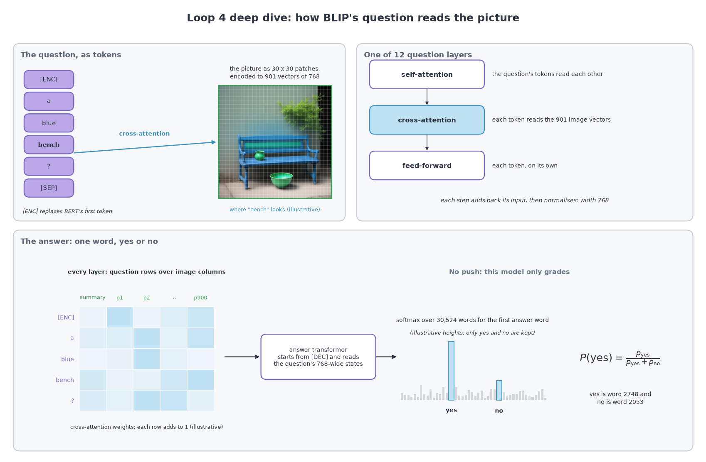

# 🌍 Context: the BLIP-VQA score, how the question reads the picture

⬅️ Previous: [one scoring pass](01-overview.md) | 📋 [The pages of this method](01-overview.md#the-pages-of-this-method) | Next: [from answers to a target](03-from-answers-to-a-target.md) ➡️

This page opens the three green boxes of [the overview's picture](01-overview.md): how BLIP turns a picture into 901 vectors, how one question becomes a short row of tokens, how each question layer lets those tokens look at the picture, and how the first word of the answer becomes one yes-probability. Every size is read from [T2I-CompBench](../../../../../goal-setting/learning/deep-learning/diffusion-models/12-scoring-and-rival-methods/plans/04-t2i-compbench-a-fixed-prompt-set-per-category.md)'s copy of BLIP at commit `4aa4042`, and every attention weight or word bar drawn on the picture is illustrative, because no run saved them.

<a href="../../../2-classifier-guidance/artifacts/scenes/annotated-overviews/loop-4-question-transformer.png"></a>

*Top left, the question as tokens: [ENC], a, blue, bench, ?, [SEP] (lilac), with a note that [ENC] replaces BERT's first token. The token "bench" sends a cross-attention arrow to the CoMat picture of a blue bench and a green bowl, cut into 30 × 30 patches and encoded to 901 vectors of 768 numbers; a pale blue patch marks where "bench" looks, illustrative. Top right, one of the 12 question layers: self-attention, the question's tokens read each other; cross-attention (pale blue), each token reads the 901 image vectors; feed-forward, each token on its own; each step adds back its input and then normalises, at a width of 768. Bottom, the answer, one word: a grid of cross-attention weights with the question's tokens down the side and the picture's vectors (summary, p1, p2, up to p900) across the top, each row adding to 1, illustrative; the answer transformer, which starts from [DEC] and reads the question's 768-wide states; a softmax over 30,524 words for the first answer word, of which only yes (word 2748) and no (word 2053) are kept, with illustrative heights; and P(yes) = p_yes / (p_yes + p_no). The grey line reads "No push: this model only grades".* ✅ read on the picture at full size; every size and word number matches the code cited below.

## Table of contents

- [Words this page uses](#words-this-page-uses)
- [The picture, as 901 vectors](#the-picture-as-901-vectors)
- [The question, as tokens](#the-question-as-tokens)
- [One question layer](#one-question-layer)
- [Cross-attention, by what moves](#cross-attention-by-what-moves)
- [The answer word, by what moves](#the-answer-word-by-what-moves)
- [The code](#the-code)
- [How it fails and how you know it worked](#how-it-fails-and-how-you-know-it-worked)
- [Where this came from](#where-this-came-from)
- [Read more](#read-more)

## Words this page uses

Navigation: 📋 [TOC](#table-of-contents) | [Next](#the-picture-as-901-vectors) ➡️

**Vector**: a list of numbers treated as one item; here each is 768 numbers long.

**Transformer**: a network built from repeated layers in which every item in a list can look at every other item and mix in what it finds.

**Patch**: one square tile of the picture, 16 × 16 pixels here.

**Token**: one word or word piece of the question, turned into a vector.

**Logit**: a raw score a network gives each possible answer before any squashing into probabilities. A larger logit means a likelier answer.

**BERT**: Bidirectional Encoder Representations from Transformers, a widely used text transformer from 2018. *Bidirectional*: each word reads the words on both sides of it. BLIP's question and answer transformers have BERT's shape and vocabulary.

The transformer and the logit are taught with textbook pages and videos on [the transformer card](../../../../../Obsidian/Artificial%20Intelligence/Deep%20Learning/Transformer.md#where-to-learn-this) and [the logit card](../../../../../Obsidian/Artificial%20Intelligence/Deep%20Learning/Logit.md#where-to-learn-this).

## The picture, as 901 vectors

Navigation: ⬅️ [Words this page uses](#words-this-page-uses) | 📋 [TOC](#table-of-contents) | [Next](#the-question-as-tokens) ➡️

**The picture is squeezed to 480 × 480 pixels, cut into 900 patches of 16 × 16, and each patch plus one summary slot comes out of 12 layers as a vector of 768 numbers.** ✅

| Step | Size after it | Where it is set |
|---|---|---|
| resize, bicubic, to a square | 3 × 480 × 480 | `transform_test`, `data/__init__.py` lines 23 to 27; `image_size: 480`, `configs/vqa.yaml` line 17 |
| normalise each colour channel | the same | the same lines, with CLIP's channel means and spreads |
| cut into patches of 16 and project each to 768 | 900 vectors of 768 | `create_vit`, `models/blip.py` lines 197 to 200: `patch_size=16, embed_dim=768` |
| put one summary vector in front | 901 vectors of 768 | `cls_token`, `models/vit.py` lines 149 and 184 to 185 |
| 12 transformer layers, 12 attention heads each | 901 vectors of 768 | `depth=12, num_heads=12`, `models/blip.py` lines 199 to 200 |

The arithmetic: 480 / 16 = 30 patches per side, 30 × 30 = 900, and one summary makes 901. A patch holds 16 × 16 pixels × 3 colours = 768 numbers, the same as the vector width. ✅ arithmetic. The renders this project scores are 1,024 pixels across, so each 16-pixel patch covers about 1,024 / 480 × 16 = 34 pixels of the original. ✅ arithmetic; the 1,024 size is ✍️ [the CoMat design](../../../artifacts/notes/progress/reproductions/CoMat/design.md#what-the-release-leaves-open), line 61.

🔤 **The name:** ViT-B/16

- **ViT**: Vision Transformer, a transformer that treats a picture as a list of patches the way a text transformer treats a sentence as a list of words. On the picture, the green trapezoid and the inset's 30 × 30 grid.
- **B**: base, the smaller of the two sizes the code allows: 12 layers of width 768. The other, large, has 24 layers of width 1,024 (`models/blip.py`, lines 203 to 206).
- **/16**: the patch side in pixels.
- **Consequence:** halve the patch to 8 pixels and the same 480-pixel picture becomes 60 × 60 = 3,600 patches, four times as many vectors for every question token to look over. ✅ arithmetic; no such model is used here.

The vision transformer is taught with textbook pages and videos on [the vision transformer card](../../../../../Obsidian/Artificial%20Intelligence/Deep%20Learning/Vision%20Transformer.md#where-to-learn-this).

## The question, as tokens

Navigation: ⬅️ [The picture, as 901 vectors](#the-picture-as-901-vectors) | 📋 [TOC](#table-of-contents) | [Next](#one-question-layer) ➡️

**"a blue bench?" becomes six tokens: a start marker, the four word pieces, and an end marker.** ✍️ the six tokens are stated by the picture; the tokenizer was not run for this page.

| Step | What it does | Where |
|---|---|---|
| clean the text | lower-cases it and drops `. ! " ( ) * # : ; ~`, keeping the question mark | `pre_question`, `data/utils.py` lines 31 to 44 ✅ |
| split into word pieces | BERT's uncased word list of 30,522 entries, plus two added markers: `[DEC]` and `[ENC]`, making 30,524 | `init_tokenizer`, `models/blip.py` lines 186 to 191; `vocab_size: 30524` in `configs/med_config.json` ✅ |
| cap the length | at most 35 tokens | `models/blip_vqa.py`, lines 44 to 45 ✅ |
| swap the start marker | BERT's usual first token is replaced by `[ENC]`, which tells the network it is reading a question about a picture | line 46 ✅ |

That `[DEC]` is word 30522 is ✅ read in the code, which starts the answer from that number (line 136). That `[ENC]` is word 30523 is 🔍 inferred from the order the two markers are added.

## One question layer

Navigation: ⬅️ [The question, as tokens](#the-question-as-tokens) | 📋 [TOC](#table-of-contents) | [Next](#cross-attention-by-what-moves) ➡️

**Each of the 12 question layers lets the tokens read each other, then read the picture, then work on their own, and every step adds its input back before normalising.** ✅ `BertLayer`, `models/med.py` lines 320 to 375; the adding back is `LayerNorm(hidden_states + input_tensor)`, line 238.

| Sub-step | What reads what | Size |
|---|---|---|
| self-attention | each question token reads every question token | 6 tokens of 768, 12 heads of 64 |
| cross-attention | each question token reads all 901 picture vectors | 6 tokens of 768 in; 901 picture vectors read |
| feed-forward | each token alone, widened to 3,072 numbers and back to 768 | `intermediate_size: 3072` |

✅ the sizes are `hidden_size: 768`, `num_hidden_layers: 12`, `num_attention_heads: 12` and `add_cross_attention: true` in `configs/med_config.json`; 768 / 12 = 64 numbers per head is arithmetic. Cross-attention runs in every layer because the layer's `mode` defaults to `multimodal` (lines 357 to 368, defaults at lines 405 and 686).

🔤 **The name:** adds its input back, then normalises (`LayerNorm(hidden_states + input_tensor)`)

- **adds its input back**: the token's vector coming into a sub-step is added to what the sub-step computed, so the sub-step only has to supply a change and the token keeps what it already carried. The usual name is a residual connection, *residual* meaning what is left to add.
- **normalises**: shifts and stretches the token's numbers so they average 0 with a spread of 1, before a learned scale and shift. *Layer* in LayerNorm says it is done across one token's own numbers, here all 768 of them.
- **Where it sits:** on the picture's question layer, the step after each of self-attention, cross-attention and feed-forward.

$$
\text{out} = \mathrm{LayerNorm}\big(
\textcolor{#7d68c2}{\underbrace{x}_{\text{the token coming in}}}
+ \underbrace{f(x)}_{\text{what the sub-step computed}}
\big)
$$

A toy token of 4 numbers in place of 768, ✅ computed this session by a short script (before the learned scale and shift):

| | The 4 numbers | After normalising |
|---|---|---|
| x, the token coming in | 1, 2, 3, 4 | |
| f(x), what the sub-step computed | 0.5, −1, 0, 2.5 | |
| x + f(x), added back | 1.5, 1, 3, 6.5 | −0.697, −0.930, 0, 1.627 |
| f(x) alone, with no adding back | 0.5, −1, 0, 2.5 | 0, −1.177, −0.392, 1.569 |
| x + f(x) with every number times 10 | 15, 10, 30, 65 | −0.697, −0.930, 0, 1.627 |

**The moves.** Drop the adding back and the output is the sub-step's own pattern, so the token's third number goes from 0 to −0.392 and nothing of x is left. Multiply the sum by 10 and the normalised token does not change at all, which keeps 12 stacked layers from growing their numbers without bound 🔍 inferred, not checked on BLIP. Taught with textbook pages on [the layer normalisation card](../../../../../Obsidian/Artificial%20Intelligence/Deep%20Learning/Layer%20Normalization.md#where-to-learn-this) and in [the residual connection plan](../../../../../goal-setting/learning/deep-learning/transformers/plans/38-show-why-a-residual-connection-keeps-gradients.md).

## Cross-attention, by what moves

Navigation: ⬅️ [One question layer](#one-question-layer) | 📋 [TOC](#table-of-contents) | [Next](#the-answer-word-by-what-moves) ➡️

**A question token asks a question vector; each picture vector offers a key; the matches become weights that add to 1; the token takes the weighted average of the picture vectors' values.** The colours are the picture's: lilac for the question's tokens, green for the picture's vectors, pale blue for the match.

$$
\underbrace{o}_{\text{what the token takes from the picture}}
= \sum_{j=1}^{901}
\textcolor{#3d93bf}{\underbrace{\frac{e^{\,\textcolor{#7d68c2}{q}\cdot \textcolor{#3e9a5a}{K_j}/\sqrt{64}}}{\sum_{m} e^{\,\textcolor{#7d68c2}{q}\cdot \textcolor{#3e9a5a}{K_m}/\sqrt{64}}}}_{\text{weight on picture vector } j}}\;
\textcolor{#3e9a5a}{\underbrace{V_j}_{\text{picture vector } j\text{'s value}}}
$$

This is one head; the 768 numbers are split into 12 heads of 64, each head does the above with its own learned maps, and the 12 results are joined.

| Symbol | What it is | If it grew |
|---|---|---|
| q | the question token's query, "bench" times a learned matrix | a larger match with one patch's key puts more weight on that patch |
| K_j | picture vector j's key: what that patch offers to be matched on | that patch pulls more of the average toward its value |
| V_j | picture vector j's value: what the patch hands over if chosen | the token's output moves toward it in proportion to its weight |
| √64 | the scale for a head of 64 numbers | without it, sums of 64 products grow large and the weights collapse onto one patch |

**A worked case, with illustrative numbers and three patches in place of 901.** The token "bench" scores three patches, the bench's seat, the bench's leg and the bare wall, at q · K / 8 of 1, 1 and −1. The weights are e¹ / (e¹ + e¹ + e⁻¹) = 2.718 / 5.804 = 0.468 for each bench patch and 0.368 / 5.804 = 0.063 for the wall. Raise the wall's score from −1 to 1 and the three weights become 1/3 each, so the wall now supplies a third of what "bench" takes from the picture. ✅ arithmetic.

🔤 **The name:** cross-attention

- **cross**: across from one list to another. On the picture, the pale blue arrow from the lilac token "bench" across to the green picture.
- **attention**: where one looks, given one cannot look everywhere equally. On the picture, the pale blue patch on the bench and the grid of weights in the bottom panel, each row adding to 1.
- **Formula, in those words:** each question token's new vector is a weighted average of the picture's vectors, weighted by how well each one answers that token.
- **Consequence:** without cross-attention the question layers never see the picture, and every picture would get the same answer to "a blue bench?". 🔍 inferred from the layer's code, where the picture enters only through `encoder_hidden_states` in the cross-attention call (lines 361 to 368).

Cross-attention is taught with textbook pages, videos and a worked SDXL notebook frame on [the cross-attention card](../../../../../Obsidian/Artificial%20Intelligence/Deep%20Learning/Cross-Attention.md#where-to-learn-this).

## The answer word, by what moves

Navigation: ⬅️ [Cross-attention, by what moves](#cross-attention-by-what-moves) | 📋 [TOC](#table-of-contents) | [Next](#the-code) ➡️

**The answer transformer starts from `[DEC]`, reads the question's final states, and gives one logit to each of 30,524 words for the first answer word; only "yes" and "no" are kept, and P(yes) is yes's share of the two.** ✅ `vqa_prob`, `models/blip_vqa.py` lines 133 to 147.

$$
P(\text{yes})
= \frac{\textcolor{#3d93bf}{p_{\text{yes}}}}{\textcolor{#3d93bf}{p_{\text{yes}}} + \textcolor{#3d93bf}{p_{\text{no}}}}
= \frac{1}{1 + e^{-(\textcolor{#3d93bf}{z_{\text{yes}}} - \textcolor{#3d93bf}{z_{\text{no}}})}}
$$

The first form is what the code computes: p_yes and p_no are entries 2748 and 2053 of the softmax over all 30,524 words. The second form follows from the softmax: p_yes and p_no share one bottom line, the softmax total over all 30,524 words, and that shared total cancels in their ratio, so P(yes) depends only on the gap between the yes logit z_yes and the no logit z_no. ✅ algebra on the code's formula.

| Symbol | What it is | If it grew |
|---|---|---|
| z_yes | the answer transformer's logit for "yes" as its first word | P(yes) rises toward 1 |
| z_no | its logit for "no" | P(yes) falls toward 0 |
| every other word's logit | 30,522 more logits, for "two", "blue", "bench" and the rest | p_yes and p_no both shrink in step, and P(yes) does not move |

**A worked case, with illustrative logits for three words.** Logits of 2.0 for "yes", 0.6 for "no" and 0.9 for "blue" give e^2.0 = 7.389, e^0.6 = 1.822 and e^0.9 = 2.460, summing to 11.671. The softmax shares are 0.633, 0.156 and 0.211, and P(yes) = 0.633 / (0.633 + 0.156) = 0.802. The second form gives the same: 1 / (1 + e^−1.4) = 1 / 1.247 = 0.802. Raise the "blue" logit to 5.0 and its share swallows most of the softmax (e^5.0 = 148.4, so p_yes 0.047 and p_no 0.012), and P(yes) is still 0.802. ✅ arithmetic.

🔤 **The name:** softmax

- **soft**: not all or nothing; every word keeps some share.
- **max**: the largest logit takes the largest share. On the picture, the grey bars with the two pale blue ones, yes and no, standing out.
- **Formula, in those words:** raise e to each word's logit and divide by the total, so the shares add to 1.
- **Consequence:** the scorer's renormalisation over yes and no hides how sure BLIP was that the answer is a yes or a no at all. A question the model would rather answer "blue" still gets a confident-looking 0.80, as the worked case shows.

The softmax is taught with textbook pages and videos on [the softmax card](../../../../../Obsidian/Artificial%20Intelligence/Deep%20Learning/Softmax.md#where-to-learn-this).

## The code

Navigation: ⬅️ [The answer word, by what moves](#the-answer-word-by-what-moves) | 📋 [TOC](#table-of-contents) | [Next](#how-it-fails-and-how-you-know-it-worked) ➡️

**The whole reading of one question is two calls in `BLIP_VQA.forward` and the 15 lines of `vqa_prob`.** ✅ [the BLIP-VQA model file](../../../../replications/t2i-compbench/BLIPvqa_eval/models/blip_vqa.py) at commit `4aa4042`, unmodified.

```python
        image_embeds = self.visual_encoder(image)                     # 901 vectors of 768
        image_atts = torch.ones(image_embeds.size()[:-1], dtype=torch.long).to(image.device)

        question = self.tokenizer(question, padding='longest', truncation=True, max_length=35,
                                  return_tensors="pt").to(image.device)
        question.input_ids[:, 0] = self.tokenizer.enc_token_id        # [ENC] in place of BERT's first token
        ...
            question_output = self.text_encoder(question.input_ids,
                                                attention_mask=question.attention_mask,
                                                encoder_hidden_states=image_embeds,
                                                encoder_attention_mask=image_atts,
                                                return_dict=True)
```

The comments are added here. Lines 41 to 46 and 87 to 91; the dots skip the training branch.

```python
    def vqa_prob(self, question_states, question_atts):

        num_ques = question_states.size(0)
        start_ids = torch.tensor(30522).to(device=question_states.device).repeat(num_ques, 1)  # bos token

        start_output = self.text_decoder(start_ids,
                                         encoder_hidden_states=question_states,
                                         encoder_attention_mask=question_atts,
                                         return_dict=True,
                                         reduction='none')
        logits = start_output.logits[:, 0, :]  # first token's logit
        prob = torch.softmax(logits, dim=1)  # (batchsize,30524)
        prob_yes = prob[:, 2748]
        prob_no = prob[:, 2053]
        return prob_yes / (prob_yes + prob_no)  # tensor(batch_size,)
```

| Line | Box or symbol |
|---|---|
| `start_ids = torch.tensor(30522)...` | the answer transformer "starts from [DEC]" |
| `encoder_hidden_states=question_states` | it reads the question's 768-wide states, never the picture directly |
| `logits = start_output.logits[:, 0, :]` | one logit per word, z for each of 30,524 |
| `prob = torch.softmax(logits, dim=1)` | the softmax over 30,524 words |
| `prob_yes / (prob_yes + prob_no)` | P(yes) |

The caller writes each value as text to 4 decimal places (lines 124 to 127), so a yes-probability below 0.00005 is stored as 0.0000. ✅

## How it fails and how you know it worked

Navigation: ⬅️ [The code](#the-code) | 📋 [TOC](#table-of-contents) | [Next](#where-this-came-from) ➡️

**No per-question answer of a scored picture is kept in this repository, so the inside of a real score can only be bounded, never read.** ✅ the score files the findings cite hold one product per picture: [the probe's BLIP-VQA file](../../../1-lora-correction/artifacts/results/measuring-composition/the-scorers/what-each-scorer-says-about-two-objects/probe_blipvqa.csv) has the columns `image`, `prompt`, `blip_vqa`.

The scoring script does write each pass's answers, one file per question number, to `annotation<i>_blip/VQA/result/vqa_result.json` in the work folder (`BLIP_vqa.py`, line 98). ✅ Whether those work folders still exist on the cluster was not checked. 🔍

| What goes wrong | What you see |
|---|---|
| a prompt with an underscore | the scoring script cuts the prompt at the underscore and asks the wrong questions; both of this project's drivers refuse such a prompt (`assert "_" not in ...`) ✅ |
| a picture of any shape other than square | it is stretched to 480 × 480 before reading, since the resize takes both sides ✅ `data/__init__.py`, line 24 |
| a yes-probability below 0.00005 | it is stored as 0.0000, and the picture's product becomes 0 whatever its other answers were ✅ lines 124 to 127 |

🔨 **Build:** check the two answer words on a machine with the scorer's environment: `python -c "from transformers import BertTokenizer as T; t = T.from_pretrained('bert-base-uncased'); print(t.convert_tokens_to_ids(['yes', 'no']))"`. It must print `[2748, 2053]`. Any other pair means the scorer reads the wrong two words.

> [!WARNING]
> That command downloads BERT's word list the first time. It was not run for this page; the two numbers are read from `vqa_prob` and from the picture, and that they are "yes" and "no" in BERT's uncased word list is 🔍 not checked here.

## Where this came from

Navigation: ⬅️ [How it fails and how you know it worked](#how-it-fails-and-how-you-know-it-worked) | 📋 [TOC](#table-of-contents) | [Next](#read-more) ➡️

| What | How it was established | When |
|---|---|---|
| Every label on the opening picture | Read on `loop-4-question-transformer.png` at full size; matches `question_transformer` in `make_deep_dives.py`, lines 136 to 204; path and labels passed `is_showable` and are absent from the held-pictures list | 2026-11-24 |
| The image transformer's sizes | Read in `configs/vqa.yaml`, `models/blip.py` lines 194 to 209, `models/vit.py` lines 147 to 185 and `data/__init__.py` lines 23 to 27, T2I-CompBench clone at `4aa4042`, clean | 2026-11-24 |
| The question's cleaning, tokens and length cap | Read in `data/utils.py` lines 31 to 44, `models/blip.py` lines 186 to 191 and `models/blip_vqa.py` lines 44 to 46 | 2026-11-24 |
| The question layer and its cross-attention | Read in `models/med.py` lines 236 to 238 and 320 to 405, and `configs/med_config.json` | 2026-11-24 |
| The answer word and P(yes) | Read in `models/blip_vqa.py`, lines 120 to 147 | 2026-11-24 |
| The six tokens of "a blue bench?" and the ids of yes and no | Stated by the picture and the code; the tokenizer was not run | 2026-11-24 |
| The attention and softmax worked cases | Illustrative numbers, arithmetic done here | 2026-11-24 |

## Read more

Navigation: ⬅️ [Where this came from](#where-this-came-from) | 📋 [TOC](#table-of-contents)

| What | Where |
|---|---|
| BLIP's own paper on the shelf, and what it does and does not give | [the BLIP entry on the scoring sources page](../../../../../goal-setting/learning/deep-learning/diffusion-models/12-scoring-and-rival-methods/sources/scoring-and-benchmarks/SOURCES.md#blip) |
| The same scorer run once on a toy | [the BLIP-VQA walk](../../../../../goal-setting/learning/deep-learning/diffusion-models/12-scoring-and-rival-methods/plans/03-blip-vqa-asking-a-question-per-phrase.md) |
| An attention pool worked with numbers on a smaller network | [inside the kept checker](../02-the-readout-checker/02-inside-the-kept-checker.md#the-attention-pool-by-what-moves) |

⬅️ Previous: [one scoring pass](01-overview.md) | 📋 [The pages of this method](01-overview.md#the-pages-of-this-method) | Next: [from answers to a target](03-from-answers-to-a-target.md) ➡️

<!-- built-to: PAGE_LOOK_FORMAT v1 -->
