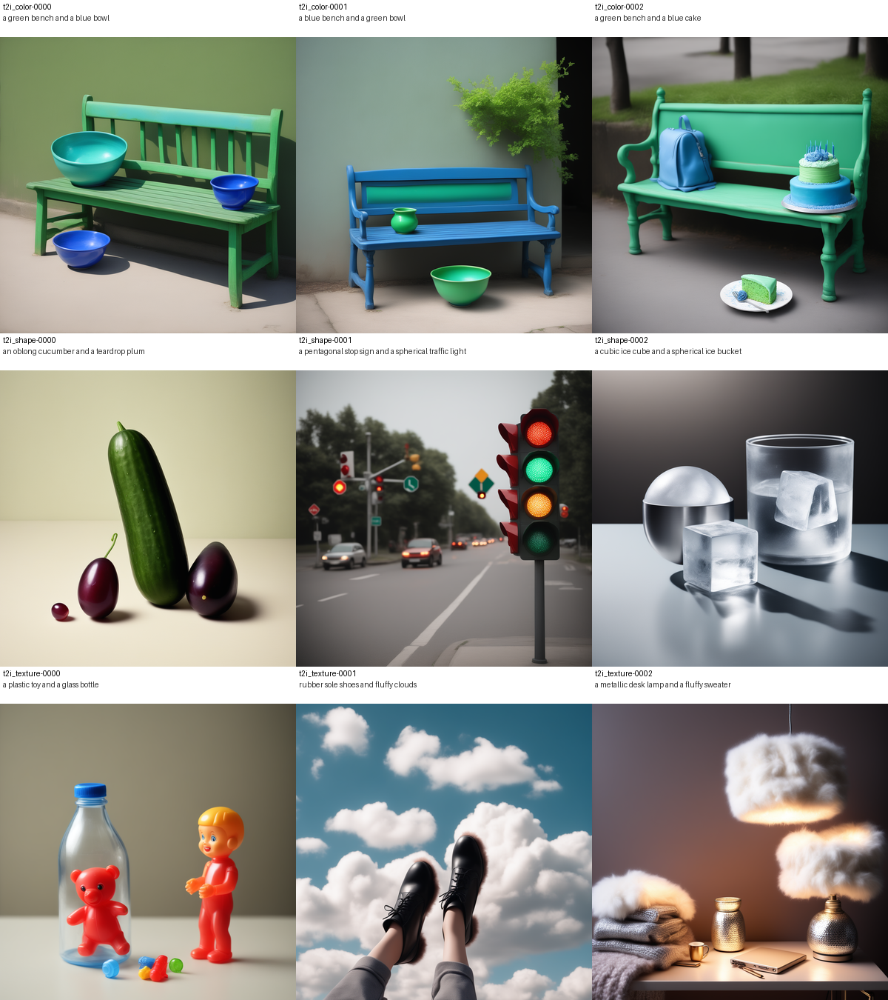
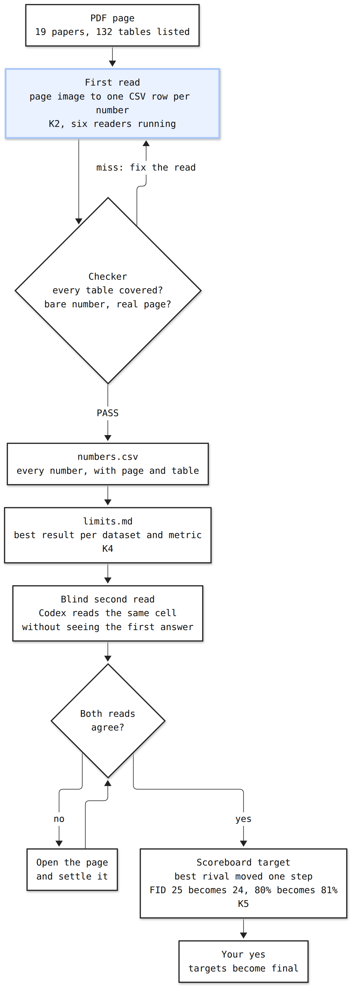

# 🌍 Context: the BLIP-VQA score, from answers to a target

⬅️ Previous: [how the question reads the picture](02-how-the-question-reads-the-picture.md) | 📋 [The pages of this method](01-overview.md#the-pages-of-this-method) | Next: [the methods index](../00-INDEX.md) ➡️

This page follows the yes-probabilities out of BLIP: how they become one picture's score, how the pictures' scores become a category's number, how a rival's printed number becomes Paper 2's target, and what that number can and cannot tell you. The code is T2I-CompBench's own scoring script at commit `4aa4042`; the rules for targets are Loop 4's, in [the targets folder](../../../artifacts/notes/progress/targets/comparison-protocol.md).

<a href="../../../artifacts/notes/progress/reproductions/CoMat/comat-one-percent-seed42.png"></a>

*Nine T2I-CompBench prompts rendered by CoMat at seed 42, from the trial rung of Loop 5's CoMat rerun, one row per category. Color: "a green bench and a blue bowl", "a blue bench and a green bowl" (the tile the overview's picture is cut from), "a green bench and a blue cake". Shape: "an oblong cucumber and a teardrop plum", "a pentagonal stop sign and a spherical traffic light", "a cubic ice cube and a spherical ice bucket". Texture: "a plastic toy and a glass bottle", "rubber sole shoes and fluffy clouds", "a metallic desk lamp and a fluffy sweater". Each label above a tile is its benchmark id and prompt.* ✅ read at full size. *The rung computed no score for these pictures, and the review notes the stop sign drawn as a small diamond sign beside a traffic light* ✍️ [the CoMat review](../../../artifacts/notes/progress/reproductions/CoMat/review.md), lines 28 to 30. *What a reader can check by eye: the left Color tile, "a green bench and a blue bowl", shows a green bench holding a teal bowl and a blue bowl, with a second blue bowl on the ground, so "a blue bowl?" has more than one object it could answer from.* ✅ seen.

## Table of contents

- [Words this page uses](#words-this-page-uses)
- [From answers to one picture's score](#from-answers-to-one-pictures-score)
- [From pictures to a category's number](#from-pictures-to-a-categorys-number)
- [From a printed number to a target](#from-a-printed-number-to-a-target)
- [What the number can and cannot tell you](#what-the-number-can-and-cannot-tell-you)
- [Where the sources disagree](#where-the-sources-disagree)
- [Where this came from](#where-this-came-from)

## Words this page uses

Navigation: 📋 [TOC](#table-of-contents) | [Next](#from-answers-to-one-pictures-score) ➡️

**Pass**: one run of BLIP over every picture in the folder, asking each picture its question number i.

**Seed**: the number that fixes a render's starting noise; the same prompt at ten seeds gives ten pictures.

**Printed number**: a score as a rival's paper prints it in a table. **Rerun**: our own run of the rival's released code, scored with the same scorer.

**Standard error**: how far a mean would typically move if the prompts were drawn again; here it comes from resampling prompts 10,000 times.

**Subject guard**: [the project's list of subjects that are never rendered](../../../scripts/shared/disallowed_subjects.py); it keeps 12 of 300 Color prompts and 7 of 300 Shape prompts out of every run.

**Two-subject prompts**: [a fixed list](../../../artifacts/notes/progress/reproductions/two-subject-prompts.json) of the prompts that two parsers both read as naming exactly two things, set before any of Paper 2's renders are scored.

## From answers to one picture's score

Navigation: ⬅️ [Words this page uses](#words-this-page-uses) | 📋 [TOC](#table-of-contents) | [Next](#from-pictures-to-a-categorys-number) ➡️

**Each pass fills one column of a table with one row per picture; a question the prompt has no phrase for scores 1; the picture's score is the product along its row.** ✅ [the scoring script](../../../../replications/t2i-compbench/BLIPvqa_eval/BLIP_vqa.py), lines 78 to 110.

```python
    reward = torch.zeros((sample_num, np_index)).to(device='cuda')
    ...
    for i in tqdm(range(np_index)):
        ...
        for k in range(len(r)):
            if(r_tmp[k]['question']!=''):
                reward[k][i] = float(r[k]["answer"])
            else:
                reward[k][i] = 1
    reward_final = reward[:,0]
    for i in range(1,np_index):
        reward_final *= reward[:,i]
```

Lines 80, 85 and 102 to 110; the dots skip writing the questions and running BLIP. `np_index` is the number of passes, 8 by default, and a prompt with fewer noun phrases than 8 gets an empty question on the remaining passes (lines 38 to 42). So the number of passes changes no score once it covers the longest prompt: the paper-review driver keeps the default of 8 and notes that 3 passes give the same scores on its prompts, of which 323 have 2 noun phrases, one has 1 and one has 3 ✅ [the paper-review driver](../../../1-lora-correction/scripts/review_score_blipvqa.py), lines 9 to 10 and 34.

| Picture's row | pass 1 | pass 2 | passes 3 to 8 | Score |
|---|---|---|---|---|
| "a blue bench and a green bowl", illustrative answers | "a blue bench?" 0.97 | "a green bowl?" 0.88 | no question: 1 each | 0.97 × 0.88 = 0.8536 |
| the same picture with the bowl recoloured red, illustrative | 0.97 | 0.05 | 1 each | 0.0485 |

✅ arithmetic on illustrative answers. **Rounding.** Each answer is stored as text to 4 decimal places before the product, and the product is written to 4 places before the mean (lines 117 to 118), so the category's number is a mean of rounded products. ✅

## From pictures to a category's number

Navigation: ⬅️ [From answers to one picture's score](#from-answers-to-one-pictures-score) | 📋 [TOC](#table-of-contents) | [Next](#from-a-printed-number-to-a-target) ➡️

**The category's number is the plain mean of every picture's score in the folder, so a prompt with ten pictures counts ten times.** ✅ `BLIP_vqa.py`, lines 113 to 126: the scores are summed into `reward_after` and divided by the count of pictures.

| Run | Prompts | Pictures | Number | Source |
|---|---|---|---|---|
| CoMat on Color, Loop 5 rerun | 288 allowed | 2,880, at seeds 42 to 51 | 0.7696 | ✍️ [the CoMat review](../../../artifacts/notes/progress/reproductions/CoMat/review.md), line 32 |
| plain SDXL through CoMat's sampler on Color | 288 allowed | 288, at seed 42 | 0.6172 | ✍️ the same, line 35 |
| CoMat on Color, two-subject prompts | 233 | 2,330 | 0.8018 | ✍️ the same, line 44 |
| the adapter on T2I-CompBench colour | 100 | 200, at seeds 9 and 10 | 0.5778 | ✍️ [the standard benchmarks finding](../../../1-lora-correction/report/against-other-methods/how-does-the-adapter-score-on-the-standard-benchmarks.md#the-scores-by-method-and-benchmark) |

The picture counts in the third and fourth rows are 🔍 computed here from the prompt counts and seeds; the 100 prompts per set are ✍️ [the benchmark driver](../../../scripts/review_bench_t2i.py), lines 3 to 4.

🔤 **The name:** the category's number, a mean

- **mean**: the total shared out evenly. On the overview's picture, "then averaged over every picture in the subset" under the score box.
- **Formula, in those words:** add every picture's score and divide by how many pictures there are.
- **Consequence:** a prompt that fails at every seed costs its share many times over. If 1 of CoMat's 288 Color prompts scored 0 at all 10 seeds where it had scored 0.77, the number would fall by 10 × 0.77 / 2,880 = 0.0027. 🔍 illustrative scores; ✅ arithmetic.

## From a printed number to a target

Navigation: ⬅️ [From pictures to a category's number](#from-pictures-to-a-categorys-number) | 📋 [TOC](#table-of-contents) | [Next](#what-the-number-can-and-cannot-tell-you) ➡️

**A target is the best rival number moved one step past it, 0.01 on a 0 to 1 score; a win is judged against our rerun of the best rival on the same prompts and seeds, by a margin set from that rerun's noise.** ✍️ [the comparison protocol](../../../artifacts/notes/progress/targets/comparison-protocol.md#numbers), lines 9 to 10 and 22 to 23.

<a href="../../../artifacts/notes/progress/targets/reads/how-a-number-becomes-a-target.png"></a>

*Top to bottom: a PDF page (19 papers, 132 tables listed); a first read that turns each page image into one CSV row per number, step K2 on the progress board ("Read every number from the papers"), drawn highlighted as the step then running; a checker that sends a miss back; `numbers.csv`, every number with its page and table; `limits.md`, the best result per dataset and metric, step K4 ("Find where each method breaks"); a blind second read of the same cell; if the two reads disagree, open the page and settle it; if they agree, the scoreboard target, the best rival moved one step (its examples: FID 25 becomes 24, 80% becomes 81%), step K5 ("Set targets on the scoreboard"); then the owner's yes, and the targets become final.* ✅ read at full size; the three step names are read in [the progress board](../../../artifacts/notes/progress/board.json).

| Category | Printed number | Holder and page | Target, one step past | Best finished rerun on the two-subject prompts |
|---|---|---|---|---|
| Color | 0.7827 | CoMat, Table 1, p7 | 0.7927 | CoMat, 0.8018 at 10 seeds, 233 of 288 prompts |
| Shape | 0.6051 | ToMe, Table 1, p8 | 0.6151 | ToMe, 0.6620, 209 of 293 prompts |
| Texture | 0.6894 | ToMe, Table 1, p8 | 0.6994 | ToMe, 0.7535, 234 of 300 prompts |

✍️ printed numbers from `scoreboard.json` rows 1 to 3 and [the limits page](../../../artifacts/notes/progress/targets/limits.md#t2i-compbench); reruns from [the comparison protocol](../../../artifacts/notes/progress/targets/comparison-protocol.md#numbers), lines 27 to 29. The targets are ✅ the printed number plus 0.01, and match the protocol's "printed bar" column.

**Three rules decide which number is the bar.** A number counts only when the run matches the rival's protocol. A number the papers dispute cannot set a target: ToMe quotes CoMat's Color score as 0.7774, CoMat's own page prints 0.7827, and the target uses CoMat's own page. A win must beat the best finished rerun by more than 1.96 standard errors of the matched difference, same prompt and seed for both methods, with prompts resampled. ✍️ the protocol, lines 18, 58 to 62 and 87 to 89.

🔤 **The name:** one step past

- **step**: the smallest move the table is read in; 0.01 for a score printed between 0 and 1. On the flow picture, "best rival moved one step".
- **past**: on the better side, here higher.
- **Formula, in those words:** target = printed number + 0.01.
- **Consequence:** a step of 0.01 sits well inside a rerun's noise. On Color's two-subject prompts, CoMat's gain over plain SDXL carries a standard error of 0.0212, so 1.96 standard errors of a difference that size is 1.96 × 0.0212 = 0.0416, four times the step ✍️ [the CoMat review](../../../artifacts/notes/progress/reproductions/CoMat/review.md), line 44; ✅ arithmetic. The fairness audit makes the same point with the Complex margin of about 0.03 ✍️ [the fairness audit](../../../artifacts/notes/progress/targets/fairness-audit.md#the-16-judging-rules). That is why the win is read against the rerun's margin and the printed bar is reported beside it as reached or not.

## What the number can and cannot tell you

Navigation: ⬅️ [From a printed number to a target](#from-a-printed-number-to-a-target) | 📋 [TOC](#table-of-contents) | [Next](#where-the-sources-disagree) ➡️

**The score says whether BLIP answers yes to each named thing with its colour, shape or material; it does not say the things are separate, that each yes came from a different object, or that two papers' numbers were made the same way.**

**What it catches.** A missing or wrongly coloured thing drives the product toward 0: a render of "a black backpack and a green bow" with no backpack scored 0.0078, and the plain product's "a mug and a wine glass" with no mug scored 0.0044 ✍️ [the Attend-and-Excite finding](../../../1-lora-correction/report/against-other-methods/how-does-the-adapter-score-on-the-attend-and-excite-prompts.md#what-a-high-and-a-low-cell-look-like) and ✅ [the probe's score file](../../../1-lora-correction/artifacts/results/measuring-composition/the-scorers/what-each-scorer-says-about-two-objects/probe_blipvqa.csv).

**Fusion.** Each question is asked of the whole picture on its own, so a mug fused into a goblet can still be the thing "a mug?" answers yes to. The fused mug and wine glass picture on [the overview](01-overview.md#how-it-fails-and-how-you-know-it-worked) scored 0.3641. 🔍 inferred; no per-question answer was kept.

**Which object answered.** In the opening sheet, the blue bench tile holds a small green pot on the bench and a green bowl on the ground. Nothing ties "a green bowl?" to the bowl rather than the pot. 🔍 inferred from the questions being independent.

**Comparisons across papers.** Plain SDXL on Color reads 0.5879 in CoMat's table and 0.6369 in ToMe's, with Shape at 0.4687 and 0.5408 and Texture at 0.5299 and 0.5637, so the papers did not share a protocol ✍️ [the limits page](../../../artifacts/notes/progress/targets/limits.md#t2i-compbench), line 258. CoMat's paper says the benchmark's evaluation code has changed over time, so every number here records the scorer's commit ✍️ [the CoMat design](../../../artifacts/notes/progress/reproductions/CoMat/design.md#what-the-release-leaves-open), line 68.

**Small gaps.** The adapter reads 0.4631 on T2I-CompBench shape and CO3 0.4616, a gap of 0.0015 with no interval on either ✍️ [the standard benchmarks finding](../../../1-lora-correction/report/against-other-methods/how-does-the-adapter-score-on-the-standard-benchmarks.md#what-this-cannot-tell-you). A gap that size cannot be read as a difference.

**Other categories.** T2I-CompBench Complex, the fourth Paper 2 row, is scored by ImageReward, not BLIP-VQA ✍️ [the fairness audit](../../../artifacts/notes/progress/targets/fairness-audit.md#what-each-benchmark-actually-is), line 87; [the reproduction finding](../../../1-lora-correction/report/against-other-methods/do-the-rivals-reproduce-their-printed-scores.md) covers that score.

> [!IMPORTANT]
> Paper 2's checker has outputs for two subjects, so its headline is the two-subject prompts and the full allowed set is reported beside it. The papers print no two-subject number, so the printed bar is read on the full set. ✍️ [the comparison protocol](../../../artifacts/notes/progress/targets/comparison-protocol.md#numbers), lines 33 to 36.

## Where the sources disagree

Navigation: ⬅️ [What the number can and cannot tell you](#what-the-number-can-and-cannot-tell-you) | 📋 [TOC](#table-of-contents) | [Next](#where-this-came-from) ➡️

**Five places where two records say different things. This page quotes both and resolves none.**

| What | One source | The other source |
|---|---|---|
| how many prompts name two subjects | [the comparison protocol](../../../artifacts/notes/progress/targets/comparison-protocol.md#numbers), lines 27 to 29: "233 of 288", "209 of 293", "234 of 300" for Color, Shape and Texture | [the fairness audit](../../../artifacts/notes/progress/targets/fairness-audit.md#what-each-benchmark-actually-is), line 86: "On 261 of 288, 261 of 293 and 240 of 300 prompts, those with two subjects" |
| which metric the Color target is | the overview's picture and the protocol read it as BLIP-VQA; [the CoMat design](../../../artifacts/notes/progress/reproductions/CoMat/design.md#what-the-release-leaves-open), line 66, scores CoMat's rerun with BLIP-VQA | `scoreboard.json` row 1 and [the limits page](../../../artifacts/notes/progress/targets/limits.md#t2i-compbench), line 253, name the metric "T2I-CompBench result", and the CoMat design says the paper's scorer is "unnamed" |
| whether CoMat has a verdict | [the CoMat review](../../../artifacts/notes/progress/reproductions/CoMat/review.md), line 32: "Does CoMat reproduce its published Color score? ✅ Yes" | the same review, line 3: "CoMat has no verdict yet"; [the reproduction finding](../../../1-lora-correction/report/against-other-methods/do-the-rivals-reproduce-their-printed-scores.md#still-open), line 189: "CoMat: no verdict yet" |
| what the red box on the overview lists | the picture's heading reads "Targets to beat" | the three numbers under it, 0.7827, 0.6051 and 0.6894, are the printed rival numbers; the protocol's targets are 0.7927, 0.6151 and 0.6994 |
| whether BLIP-VQA has a question for an animal pair | [the scoring sources page](../../../../../goal-setting/learning/deep-learning/diffusion-models/12-scoring-and-rival-methods/sources/scoring-and-benchmarks/SOURCES.md#t2i-compbench), line 68: "our animal pairs have no attribute, so the attribute metric has no ready question for 'a cat and a dog'" | [the Attend-and-Excite finding](../../../1-lora-correction/report/against-other-methods/how-does-the-adapter-score-on-the-attend-and-excite-prompts.md#the-scores-by-method-and-prompt-set), lines 31 to 38, reports BLIP-VQA on its 66 animal prompts, for example 0.5031 for the adapter |

## Where this came from

Navigation: ⬅️ [Where the sources disagree](#where-the-sources-disagree) | 📋 [TOC](#table-of-contents)

| What | How it was established | When |
|---|---|---|
| The product, the empty question and the mean | Read in `BLIP_vqa.py` lines 16 to 126, T2I-CompBench clone at `4aa4042`, clean | 2026-11-24 |
| The paper-review driver's passes and noun-phrase counts | Read in `1-lora-correction/scripts/review_score_blipvqa.py`, lines 9 to 10, at commit `21431cff`, unmodified | 2026-11-24 |
| The opening sheet's prompts and what it shows | Read at full size; path and all nine prompt labels passed `is_showable` and are absent from the held-pictures list | 2026-11-24 |
| The flow picture's boxes and the step names | Read at full size and against its source `how-a-number-becomes-a-target.mmd`; step names read in `board.json`; path and labels passed `is_showable` and are absent from the held-pictures list | 2026-11-24 |
| The printed numbers | Read in `scoreboard.json` rows 1 to 3 | 2026-11-24 |
| The target rule, the rerun bars and the two-subject headline | Stated by the comparison protocol, lines 9 to 36 and 58 to 62 | 2026-11-24 |
| CoMat's and plain SDXL's rerun numbers and standard errors | Stated by the CoMat review, lines 32 to 45, not recomputed | 2026-11-24 |
| The cross-paper plain SDXL numbers | Stated by the limits page, line 258 | 2026-11-24 |
| The illustrative rows and the step-against-noise arithmetic | Computed here | 2026-11-24 |
| That a fused or neighbouring object can answer a question | Inferred from the questions being asked one at a time; no run checked it | 2026-11-24 |

⬅️ Previous: [how the question reads the picture](02-how-the-question-reads-the-picture.md) | 📋 [The pages of this method](01-overview.md#the-pages-of-this-method) | Next: [the methods index](../00-INDEX.md) ➡️

<!-- built-to: PAGE_LOOK_FORMAT v1 -->
