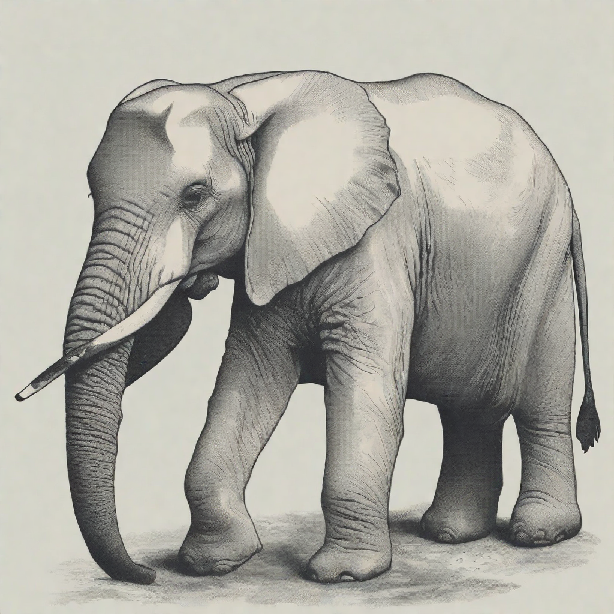

# 🌍 What would count as this project working

## Table of contents

- [The test](#the-test)
- [What a good result looks like](#what-a-good-result-looks-like)
- [What a bad result looks like](#what-a-bad-result-looks-like)
- [What this cannot tell you](#what-this-cannot-tell-you)
- [Where this came from](#where-this-came-from)
- [🖼️ In pictures, code and further reading](#in-pictures-code-and-further-reading)

## The test

Navigation: 📋 [TOC](#table-of-contents) | [Next](#what-a-good-result-looks-like) ➡️

**Does a LoRA trained to predict the interaction term make PoE compose like Mono, and does that
fix carry to pairs and seeds it never trained on?** ✅

Quoted directly from `MASTER_PLAN.md`'s Mission. The five objectives it lists are a ladder, each
widening the held-out set: overfit one pair and seed, survive new seeds of the same pair, transfer
to a sibling pair, generalise within a group of similar pairs, and finally span the whole studied
set of pairs held out on both pair and seed at once. The project succeeds at whichever step of that
ladder it reaches, per its own Expected Outcome: "at minimum a per-pair/per-group catalogue backed
by evidence, at most a single taxonomy-spanning LoRA." ✅

> Held-out means kept aside and never trained on, so a result on those pairs or seeds says how the
> corrector does on cases it has not seen before.

## What a good result looks like

Navigation: ⬅️ [The test](#the-test) | 📋 [TOC](#table-of-contents) | [Next](#what-a-bad-result-looks-like) ➡️

**More correction, more composition, with the controls flat.** ✅

`MASTER_PLAN.md` step 4 (`hypothesis-02-more-correction-more-composition`) names this the
headline claim and marks it done. The falsification shape, from `1-lora-correction/report/experiments-log.md`'s design
convention: a curve where compose rate rises as the interaction term's strength (λ)
rises, while a control that injects a random vector of the same size stays flat. ✍️

**A held-out check landing above a threshold fixed before the run.** ✅

The thresholds read in `MASTER_PLAN.md`'s Goals, one per objective:

| Objective | Held-out set | Threshold |
|---|---|---|
| 2 | held-out seeds, representative pair, per group | composing on at least 3 of 4 held-out seeds |
| 3 | a held-out sibling pair | composing on at least 2 of 4 held-out seeds |

Thresholds are fixed in the plan file before the run, per this
project's convention that a threshold not visible in a diff can be adjusted after seeing the
answer.

## What a bad result looks like

Navigation: ⬅️ [What a good result looks like](#what-a-good-result-looks-like) | 📋 [TOC](#table-of-contents) | [Next](#what-this-cannot-tell-you) ➡️

**A compose rate that does not clear the scorer's own uncertainty.** ✅

`1-lora-correction/artifacts/results/measuring-composition/the-scorers/can-we-trust-the-compose-score/do-the-successful-cells-contain-both-animals/README.md`: a headline of 94% at full correction strength has a true
rate bounded around 87% to 94%, once the 32 runs behind it are opened by eye. A result that
depends on reading the difference between, say, 90% and 94% as a real effect is not trustworthy on
this scorer without a tighter check.

**Failing runs that fit none of the project's own failure modes.** ✍️

`1-lora-correction/report/experiments-log.md` EXP-05 pre-registers two remaining explanations for adapter failure (aiming
wrong, delivering too little) and states its own null: fewer than 40% of failing runs landing in
either mode would mean the two-mode decomposition is wrong, and a large group fitting neither
would mean the corrector emits a fine correction and the run still fails for an unexplained reason.

> A null here is the outcome where the split explains nothing: the failing runs would land in the
> two modes about as often as they would if each run had been assigned a mode at random.

## What this cannot tell you

Navigation: ⬅️ [What a bad result looks like](#what-a-bad-result-looks-like) | 📋 [TOC](#table-of-contents) | [Next](#where-this-came-from) ➡️

**Whether the two right concepts are present, only whether two instances of some concept are.** ✅

The validated scorer counts distinct "animal" instances; it cannot tell a cat-and-dog image from a
two-dog image by construction. See
[world/compose-rate.md § What people get wrong](../world/compose-rate.md#what-people-get-wrong).
`1-lora-correction/artifacts/results/measuring-composition/the-scorers/can-we-trust-the-compose-score/do-the-successful-cells-contain-both-animals/02-two-of-one/` is the one confirmed case of this in the current
32-run audit.

**Anything about pairs outside the animal-pair pool.** ✍️

Per `plans/standing/retrofit-poe-repair-min.md`'s "Words this uses": the animal pairs are the current
scope; the seven non-animal pairs from an earlier cross-taxonomy era and the six-group taxonomy
they came from (see [world/animal-pair.md § What people get wrong](../world/animal-pair.md#what-people-get-wrong))
are not part of the live claim.

**Whether the fix generalises past SDXL, or past this one detector-based scorer.** ✍️

`MASTER_PLAN.md`'s background-experiment table lists a second model and sampler, and a check of
whether any published metric agrees with human judgement better than this one, as not started.

## Where this came from

Navigation: ⬅️ [What this cannot tell you](#what-this-cannot-tell-you) | 📋 [TOC](#table-of-contents) | [Next](#in-pictures-code-and-further-reading) ➡️

| What | How it was established | When |
|---|---|---|
| The mission statement and the five-step ladder | Read in `MASTER_PLAN.md`, Mission and Objectives | 2026-08-24 |
| The more-correction-more-composition claim and the held-out-seed thresholds | Read in `MASTER_PLAN.md`, Goals, and `1-lora-correction/report/experiments-log.md` | 2026-08-24 |
| The scorer's true-rate bound at λ=1 | Read in `1-lora-correction/artifacts/results/measuring-composition/the-scorers/can-we-trust-the-compose-score/do-the-successful-cells-contain-both-animals/README.md` | 2026-08-24 |
| The two-mode failure classification and its null | Read in `1-lora-correction/report/experiments-log.md`, EXP-05 | 2026-08-24 |
| The animal-pair scope boundary | Read in `plans/standing/retrofit-poe-repair-min.md`, "Words this uses" | 2026-08-24 |

<!-- related:start (drain) -->
<a id="in-pictures-code-and-further-reading"></a>

## 🖼️ In pictures, code and further reading

Navigation: ⬅️ [Previous](#where-this-came-from) | 📋 [TOC](#table-of-contents)

This page says what would count as working. The pictures below show what a good result and a limit on it look like, and the code shows how a bar sits in the source, where any later change to it shows in a diff.

### How it fits together

*Picture held back.* `1-lora-correction/artifacts/results/measuring-composition/the-grids/how-big-the-strength-grid-should-be/strength-grid-six-columns.png` has a tile with a shape that could not be identified at full size, so it is named here and not shown.

The shape of a good result: cat and dog, seed 9, strength of the correction (λ) across the top (0, 0.5, 0.6, 0.65, 0.75, 1). The top row, the real correction, goes from one fused face at λ=0 to a cat beside a dog at λ=1, and the three control rows (wrong pair, wrong seed, wrong order) stay single fused animals in every column `verified` (opened and read; the card reads it the same way `stated`). The card also says the real correction reaches about 94% compose rate at λ=1 while the three controls stay near zero across the axis `stated` (card, for the version with the curve; the curve is not in this picture).

### The code behind it

A bar lives in the source as a constant, written before the sweep runs. The project's `CLAUDE.md` names these two constants in the mechanism re-probe scorer as the pattern to copy. Excerpt from `1-lora-correction/scripts/mechanism_study/reprobe_table.py` (lines 38 to 42):

```python
# Pre-registered before the sweep ran, so the bar is not moved to fit the data.
# Support needs the effect present in most cells AND a clear median, not one
# strong pair carrying a weak average.
MIN_MEDIAN_RATIO = 1.2
MIN_FRACTION_ABOVE_ONE = 0.75
```

- `MIN_MEDIAN_RATIO` and `MIN_FRACTION_ABOVE_ONE` are the two numbers a result has to clear, and a change to either shows in a diff.
- This is the mechanism re-probe's bar, not the compose-rate thresholds in the table above; those sit in plan files.

### What comes out

*Picture held back.* `1-lora-correction/artifacts/results/measuring-composition/the-scorers/can-we-trust-the-compose-score/do-the-successful-cells-contain-both-animals/contact-sheet.png` holds a frog and toad row, which the [pair ledger](../../artifacts/_shared/cross_pair_pool_configs/pair_ledger.md) keeps off every sheet, so it is named here and not shown.

The 32 renders behind the 94% headline, each titled with pair, seed and the detector's count. 30 titles read 2 or more and 2 read `n=1` `verified` (counted on the picture; matches the card). Opened by eye the card sorts them into 12 clearly both, 1 two of the same animal, 5 undecidable, 12 renders of three look-alike pairs (cow and buffalo, frog and toad, leopard and jaguar) and 2 scored as a failure `stated` (card and `calls.json`). The card says both failures were scored correctly `stated`, while the seal and walrus image at seed 9, counted `n=1`, shows two separate animals `verified` (opened and read).

### Further illustrations

**Evidence**

<a href="../../1-lora-correction/artifacts/results/measuring-composition/the-scorers/can-we-trust-the-compose-score/do-the-successful-cells-contain-both-animals/two-of-the-same-animal/a_cat__x__a_dog_seed10_n2.png"></a>
<a href="../../1-lora-correction/artifacts/results/measuring-composition/the-scorers/can-we-trust-the-compose-score/do-the-successful-cells-contain-both-animals/scored-as-a-failure/an_elephant__x__a_penguin_seed9_n1.png"></a>

Left, cat and dog seed 10 at full correction: two dogs and no cat, counted as two animals and so scored `compose` `verified` (opened and read; the card calls it the one confirmed error). Right, elephant and penguin seed 9: one elephant and no penguin, titled `n=1` and scored as a failure `verified`. The card describes this image as two elephants and no penguin, merged into one box by the detector `stated` (card); the picture shows one elephant, so the two readings differ and neither is changed.

### Go deeper

| What | Link |
|---|---|
| The audit card | do the successful cells contain both animals, at `1-lora-correction/artifacts/results/measuring-composition/the-scorers/can-we-trust-the-compose-score/do-the-successful-cells-contain-both-animals/README.md` (not linked, because the folder holds the held-back pair) |
| The strength grid card | [how big the strength grid should be](../../1-lora-correction/artifacts/results/measuring-composition/the-grids/how-big-the-strength-grid-should-be/README.md) |
| What a compose rate is | [compose rate](../world/compose-rate.md) |
| What the interaction term is | [interaction term](../world/interaction-term.md) |
| The problem this test answers | [the problem](01-the-problem.md) |
| What the project produces | [what we produce](02-what-we-produce.md) |

### Still open

- The page links the audit's `02-two-of-one/` folder; RENAMES.md maps it to `two-of-the-same-animal/`, which is what the pictures above use. The page's own text is left as written.
- The audit card's review file carries an open task to change the printed band from 87%-94% to 75%-94% after a later labelling pass; the page keeps 87% to 94%. Neither is changed here.
- No picture shows the two-mode failure split (aiming wrong, delivering too little) or the pre-registered null of the experiments log; none was found.
<!-- related:end -->

<!-- built-to: PAGE_LOOK_FORMAT v1 -->
