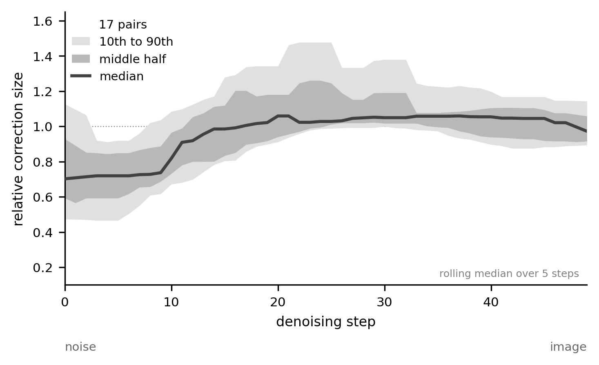

# 🌍 Research guidelines: how this research gets done here

**The practice itself is in [`~/.claude/RESEARCH_PRACTICE.md`](/home/molef/.claude/RESEARCH_PRACTICE.md)
and applies to every project.** Read it: write the results section before running the
experiments, name a run's cost and what it buys before it starts, look at the data before
designing on top of it, which visual skill to pick by what you are pointing at, the seven kinds
of result and what each may do to the paper, the six-step diagnosis procedure, attack the work
before a reviewer does, and kill work that is bleeding rather than only work that failed.

The mechanics are elsewhere and not repeated in either place: `~/.claude/EXPERIMENT_CONVENTIONS.md`
for what a run may change, and `~/.claude/skills/WORKFLOWS.md` for the end-to-end skill chains
with their handoff files marked.

This file holds only what is true of **this** project: where each general rule lands here, and
the specific mistakes this project has already made. Read it with the root
[MASTER_PLAN.md](../MASTER_PLAN.md), whose four lists say what is happening now, what is
happening in the background, and what to do next.

## Table of contents

- [Where the general rules land in this repo](#where-the-general-rules-land-in-this-repo)
- [The mistakes this project has already made](#the-mistakes-this-project-has-already-made)
- [The deadline](#the-deadline)
- [Where this came from](#where-this-came-from)
- [🖼️ In pictures, code and further reading](#in-pictures-code-and-further-reading)

## Where the general rules land in this repo

Navigation: 📋 [TOC](#table-of-contents) | [Next](#the-mistakes-this-project-has-already-made) ➡️

| The rule | Here, concretely |
|---|---|
| Write the results section first | `1-lora-correction/plans/07-writing-the-paper/plans/writing/05-the-results-skeleton.md` |
| Every run names its cost and what it buys | Two lines in the design plan. Worked example: `480 runs at 50s, about 6h. Answers question 1, feeds figure F2.` The constraint here is GPU-days |
| The reason a figure exists goes in its own document | [figures/what-each-figure-argues.md](../writing/iclr/what-each-figure-argues.md) is the worked example: seven checkboxes in the plan, seven reasons in the document |
| A figure serves its reader | Same document, and it is held to the same one-pass standard as the figures it describes. Here that means: x is the denoising step 0 to 50 with "noise" and "image" labelled at the ends, not log-SNR, because only DDIM is used; four or five named pairs drawn in front with the remaining pairs behind as a band; a strip of decoded frames above the curve, which costs no sampling because every run already saved `latent_trajectory.pt`; spreads and percentages held back to the appendix table |
| Every read lands in the register | `plans/standing/literature/plans/01-reading-register.md` |
| Suspiciously-good results are contamination until cleared | The check that must pass here before anything else is believed is the λ=0 check: injecting nothing must reproduce plain PoE to under 1e-5 |
| Organise on the way out | `python3 scripts/plan_pulse.py`, report-only, four checks, about 7 seconds over the whole tree |
| Keep the handoff on disk | [ENVIRONMENT.md](../environment/overview.md) is why the cluster has never had to be re-explained |

## The mistakes this project has already made

Navigation: ⬅️ [Previous](#where-the-general-rules-land-in-this-repo) | 📋 [TOC](#table-of-contents) | [Next](#the-deadline) ➡️

Each of these is why a general rule exists. They are recorded here so the same one does not get
made twice in this repo.

- **The scorer read three instances on an image of two cats.** A threshold chosen from a number
  and never checked against a picture fails silently. It also counted a 162px limb as a third
  animal. This is why `/visualize-data-samples` runs before any scorer, and why step 2 of the
  diagnosis procedure (score five runs by eye, compare with the scorer) exists.
- **A figure plan became unreadable to its own author.** Lines like "three spaces one dial" and "the
  fork elbow as a vertical band" named nothing to anyone who had not been in the conversation.
  The fix is in the writing-style section of `~/.claude/CLAUDE.md`: no private labels, a figure
  line names its axes and its data, and every number carries its unit and its meaning.
- **A figure was designed correct and unreadable.** The size-follows-noise figure was specified
  as seventeen thin lines against log-SNR from -5.15 to 6.37, with a spread of 19.7% annotated on
  the plot. Every part of that is defensible and none of it lands: the axis names a quantity the
  reader has to convert, the lines read as texture, and the number cannot be acted on while
  looking at it. The redesign changed the axis to the denoising step, cut to five named pairs
  over a band holding the other twelve, added decoded frames along the top, and moved the number
  to the appendix. The reason the first version happened is that it was designed against the
  data on disk rather than against a reader.
- **The disk guard checked a filesystem the script was not writing to.** A guard has to look at
  the filesystem the output actually lands on. `/home-mscluster` hit 100% once and silently
  killed checkpointing.
- **A full-strength shortcut would have made every control row reproduce the real one.** At λ=1
  the sampler could skip the arithmetic and use the joined-prompt prediction directly, which
  would have ignored the injected fake entirely and made all three curves look equally good.
  Switching it off during control runs is a decision recorded in the design plan, not a finding.
- **The obvious measure gave the opposite answer, because of how the measurement was built.** In
  the mechanism test, comparing raw norms said attention moved 1.70× more than painted content,
  because the two maps are not on the same footing and the adapter dims attention by 25%
  overall. The argument for the scale-free measure is in
  [1-lora-correction/artifacts/results/what-the-correction-is/what-it-looks-like/residual-dynamics/content-change-relative-to-attention-change/measure-fairness.md](../1-lora-correction/artifacts/results/what-the-correction-is/what-it-looks-like/residual-dynamics/content-change-relative-to-attention-change/measure-fairness.md).
- **A guiding classifier trained with no "neither" pile said "cat" to a fridge.** Plan 20's
  cat-present and dog-present classifier was fine-tuned on 550 images that all held a cat, a dog or
  both. The table lists what it said on held-out photos and on the sampler's own draws.

  | What was asked | Plan 20 classifier | Released ImageNet classifier |
  |---|---|---|
  | Score on held-out photos | 0.93 and 0.95 | not stated |
  | Draws of the unconditional model (fridges, desserts, limes), 184 of them: said cat | 184 | 3 |
  | The same 184 draws: said dog | 182 | 24 |

  At 97% sure its log-probability gradient is near zero, so its push steered nothing, and raising
  the scale to 30 and 100 only broke the pictures into texture. Held-out accuracy on the training
  kind of image says nothing about guidance: a guiding classifier's negatives must include what the
  sampler actually draws, pictures with neither subject among them, and it is checked by asking it
  about a picture with neither subject before it guides anything. The evidence is in
  [the plan 20 card's folder](../2-classifier-guidance/artifacts/results/does-a-pair-aware-push-compose-our-photos/).

## The deadline

Navigation: ⬅️ [Previous](#the-mistakes-this-project-has-already-made) | 📋 [TOC](#table-of-contents) | [Next](#where-this-came-from) ➡️

Put the submission date at the top of the paper list and count backwards from it once a week. The
tree gives an order and cannot tell you whether the remainder fits.

## Where this came from

Navigation: ⬅️ [The deadline](#the-deadline) | 📋 [TOC](#table-of-contents) | [Next](#in-pictures-code-and-further-reading) ➡️

| What | How it was established | When |
|---|---|---|
| The general practice this page applies | Read in `~/.claude/RESEARCH_PRACTICE.md` | 2026-11-22 |
| Where each rule lands here, and the mistakes recorded | Written with this page in commit `34681f58` and extended by later commits | 2026-08-10 onward |

<!-- related:start (drain) -->
<a id="in-pictures-code-and-further-reading"></a>

## 🖼️ In pictures, code and further reading

Navigation: ⬅️ [Previous](#where-this-came-from) | 📋 [TOC](#table-of-contents)

### How it fits together

The redesigned size-follows-noise figure, as it was built: the correction's size against the denoising step, for the 17 pool pairs.

<a href="../writing/iclr/figures/correction-size-over-the-denoising-run-across-17-pairs.png"></a>

Relative correction size (y) against the denoising step (x, 0 to 49, "noise" at the left end and "image" at the right), as a 10th to 90th band, a middle-half band and a median line over 17 pairs, each curve smoothed by a rolling median over 5 steps `verified` (counted on the picture; matches [the figure card](../writing/iclr/what-each-figure-argues.md)). Each curve is divided by its own median, so 1.0 is "this pair at its own typical correction" and says nothing about which pair needs more `stated` (the sidecar `.json` and the card).

**Disagreement between sources, not resolved.** The mistake above says the redesign drew five named pairs over a band holding the other twelve. The card describes two named coloured pairs (cat × dog and elephant × penguin, neither in the pool) over the pool band, and the picture shows only the band and the median, with no coloured line and no strip of decoded frames.

### The code behind it

The disk-guard mistake: a guard has to look at the filesystem the output lands on. This is the guard in the clean-tail sweep script, `scripts/shared/clean_tail_k_sweep.py`, lines 156 to 165.

```python
def _disk_guard(root: Path) -> None:
    """Guard the filesystem this script actually writes to, not some other mount."""
    p = root
    while not p.exists():
        p = p.parent
    st = os.statvfs(str(p))
    used = 1.0 - st.f_bavail / max(st.f_blocks, 1)
    if used >= 0.90:
        raise SystemExit(f"disk guard: {root} filesystem at {used:.0%}, refusing to write")
    print(f"disk guard: {p} at {used:.0%}", flush=True)
```

It walks up from the output folder to the nearest folder that exists, so the check reads the mount the files will land on, and it refuses at 90% used. `stated` (the page's own account of the mistake; the code is copied from the file).

### What goes in

The plan 20 training set was 550 images: 200 cat, 200 dog and 150 both `stated` (`photo-set-counts.json` in the plan 20 results folder). One cat, one dog and two both-animal examples, each at 256 px and shrunk to 64 px, are below. Every training image holds a cat, a dog or both, so no picture of neither subject is among them `stated` (the page's account and the three labels in the counts file; the picture shows 4 of the 550). Of the "both" images in this set, 38 come from `coco` and 112 from `sd35` `stated` (`per_label_source` in `photo-set-counts.json`).

*Picture held back.* `/datasets/mmolefe/poe_repair_min/artifacts-archive/2-classifier-guidance/artifacts/results/does-a-pair-aware-push-compose-our-photos/example-one-per-label.png` is named here and not shown, because it holds COCO photographs fetched from the web. It shows one image per label at 256 px above and the same image at 64 px below.

The picture shows four examples: a cat, a dog and two with both animals `verified`.

### Go deeper

| What | Where |
|---|---|
| The practice this page localises | [research practice](/home/molef/.claude/RESEARCH_PRACTICE.md) |
| The reasons behind each figure | [what each figure argues](../writing/iclr/what-each-figure-argues.md) |
| The measure-fairness argument | [measure fairness](../1-lora-correction/artifacts/results/what-the-correction-is/what-it-looks-like/residual-dynamics/content-change-relative-to-attention-change/measure-fairness.md) |
| Plan 20 | [our photos both ways](../2-classifier-guidance/plans/20-our-photos-both-ways.md) |

### Still open

No picture in the plan 20 folder shows the 184 unconditional draws and the classifier's answers on them, and the folder has no card. The scorer-on-two-cats picture and the λ=0 check have no figure either.
<!-- related:end -->

<!-- built-to: PAGE_LOOK_FORMAT v1 -->
