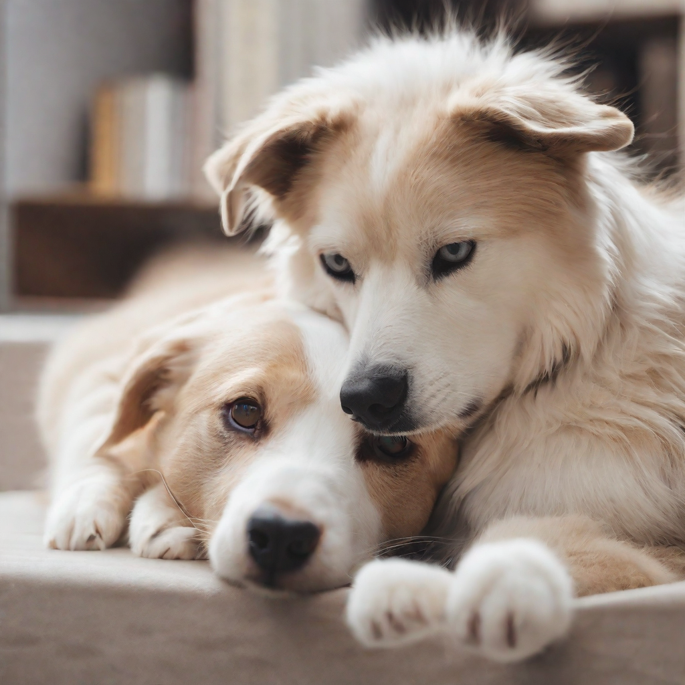
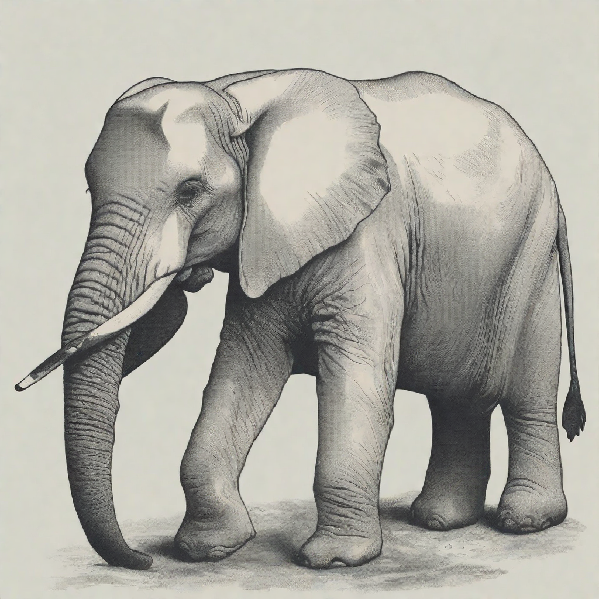

# 🌍 Compose rate (and the scorer behind it)

A compose rate is the fraction of seeds, for one pair, that the validated scorer calls a success
("compose") rather than a failure ("blend", see [chimera.md](chimera.md)). The scorer behind it is
a specific, validated detector rule, not a general judgement of whether the picture "looks right".


*Both animals are visible and separated. The detector found two distinct "animal" boxes here, which
is the whole rule.*

A detector here is an object detector: a network that draws a box round each thing it recognises and gives each box a confidence `stated` (see the [object detector card](../../../../Obsidian/Artificial%20Intelligence/Deep%20Learning/Object%20Detector.md#where-to-learn-this)).

## Table of contents

- [Words this file uses](#words-this-file-uses)
- [What a compose rate is](#what-a-compose-rate-is)
- [What it looks like](#what-it-looks-like)
- [Why the project cares](#why-the-project-cares)
- [How it shows up in the data](#how-it-shows-up-in-the-data)
- [What people get wrong](#what-people-get-wrong)
- [Where this came from](#where-this-came-from)
- [🖼️ In pictures, code and further reading](#in-pictures-code-and-further-reading)
- [Cross-references](#cross-references)

## Words this file uses

Navigation: 📋 [TOC](#table-of-contents) | [Next](#what-a-compose-rate-is) ➡️

- **Instance count**: the validated method. The scorer runs an object detector for the class
  "animal" and counts distinct, non-overlapping instances.
- **Fail rate**: the complement of compose rate for a pair under plain PoE, used when the pool is
  selected precisely because it fails (see [animal-pair.md](animal-pair.md)).
- **NMS (non-max suppression)**: the step that merges overlapping detector boxes so the same
  animal is not counted twice.

**IoU, the overlap number NMS looks at, on two boxes.** IoU (intersection over union) is the area two boxes share divided by the area they cover together `stated` (the usual definition). Two boxes of 10 by 10, with the numbers invented for the toy:

| Case | Shared area | Combined area | IoU | Above 0.5? | Count |
|---|---|---|---|---|---|
| both boxes on one dog, 2 apart | 80 | 120 | 0.67 | yes, merged | 1 animal |
| one box on each of two animals, 8 apart | 20 | 180 | 0.11 | no, both kept | 2 animals |

The raw detector count is 2 in both rows and the scored count is 1 in the first, which is why the rule reads the count after NMS.

## What a compose rate is

Navigation: ⬅️ [Words this file uses](#words-this-file-uses) | 📋 [TOC](#table-of-contents) | [Next](#what-it-looks-like) ➡️

**The fraction of a pair's seeds where a detector finds at least two distinct animal instances in
the rendered image.** ✅

`1-lora-correction/artifacts/results/measuring-composition/the-scorers/can-we-trust-the-compose-score/compose-scorer-validation/scorer_validated.json`, read directly: `"compose_rule": "COMPOSE iff
distinct-instance-count('animal', NMS iou<0.5, conf>=0.30) >= 2"`, using detector
`IDEA-Research/grounding-dino-tiny`. `"pass": true` and `"separates_hard_pair_both_ways": true`
mark this rule as the validated one, chosen over two rejected alternatives (a whole-image DINOv2 /
CLIP embedding read, and a per-query box-IoU read), both of which failed to separate a known hard
pair (wolf × husky) correctly. ✅

**It is a per-pair rate over several seeds, not a per-image score.** ✅

`1-lora-correction/artifacts/results/does-it-reach-unseen-pairs/the-transfer/does-the-fix-reach-unseen-pairs/fail_rate.md` reports it as, e.g., `1.00 (8/8)`: the pair failed
under plain PoE on all 8 tested seeds. A compose rate is the same fraction read the other way
round, under whichever render method (plain PoE, corrected PoE, or the LoRA) is being evaluated.

## What it looks like

Navigation: ⬅️ [What a compose rate is](#what-a-compose-rate-is) | 📋 [TOC](#table-of-contents) | [Next](#why-the-project-cares) ➡️


*The detector correctly counted two animal instances and was scored a success. Both instances are
the same dog. This is the one confirmed error the F2 audit found in the strongest-correction
population; see [What people get wrong](#what-people-get-wrong).*

## Why the project cares

Navigation: ⬅️ [What it looks like](#what-it-looks-like) | 📋 [TOC](#table-of-contents) | [Next](#how-it-shows-up-in-the-data) ➡️

**Every headline number the paper prints about whether the fix works is this rate.** ✅

The claim that more correction gives more composition, the held-out-seed and held-out-pair
thresholds, and the group-pooling verdicts in `MASTER_PLAN.md`'s Goals are all compose rates
computed by this scorer. A weakness in the scorer is a weakness in every one of those claims, which
is why the project runs a standing effort (`can-we-trust-the-compose-rate` in `MASTER_PLAN.md`'s
background experiment table) specifically to bound the scorer's own error before trusting it
further.

> Held-out means the seeds or pairs were kept aside and never trained on, so the rate measured on
> them says how the fix does on cases it has not seen.

## How it shows up in the data

Navigation: ⬅️ [Why the project cares](#why-the-project-cares) | 📋 [TOC](#table-of-contents) | [Next](#what-people-get-wrong) ➡️

| Column | Stands for | Example | Entry |
|---|---|---|---|
| `n_instances` | the detector's raw count for one image | `2` (example) | [Dictionary § n_instances](../data/02-dictionary.md#n_instances) |
| `label` | the scorer's compose/blend call for one image | `compose` (example) | [Dictionary § label](../data/02-dictionary.md#label--truth) |
| `truth` | the human-assigned ground truth used to validate the scorer, only present in the validation set | `compose` (example) | [Dictionary § label](../data/02-dictionary.md#label--truth) |
| `fail_rate` / `compose_rate` | the fraction of a pair's seeds scored one way | `0.94` (example, the λ=1 headline before the audit's bound) | [Dictionary § fail_rate / compose_rate](../data/02-dictionary.md#fail_rate--compose_rate) |

λ is the share of the interaction term added back at render time, 0 for plain PoE and 1 for the full correction `stated` (the word list in [the interaction term page](interaction-term.md#words-this-file-uses)).

## What people get wrong

Navigation: ⬅️ [How it shows up in the data](#how-it-shows-up-in-the-data) | 📋 [TOC](#table-of-contents) | [Next](#where-this-came-from) ➡️

**The scorer counts animals, it does not identify them.** ⚠️ ✅

The audit in `1-lora-correction/artifacts/results/measuring-composition/the-scorers/can-we-trust-the-compose-score/do-the-successful-cells-contain-both-animals/README.md` went through the 32 runs behind a 94% headline compose rate at full correction strength, and the table gives what it found beyond the cleanly correct ones.

| Runs | What the audit calls them | Why it matters |
|---|---|---|
| 1 | a confirmed error: two of the same animal, called a success | the scorer counted two animals and was right about the count |
| 5 | "cannot be called" confidently by eye (mostly waterfowl and raptor pairs that look alike even to a person) | a person cannot settle them either |
| 12 | pairs chosen *because* they look alike (leopard/jaguar, cow/buffalo, frog/toad) | the audit states no better detector can resolve them from the image alone |

Its conclusion, quoted directly: "the true rate at λ=1 sits somewhere around 87% to 94%
rather than anywhere near 60%, and the paper should say 94% is an upper bound of about that size
rather than hedging vaguely." ✅

**Querying the detector once per concept would not fix this.** ✍️

The same card tested this idea against itself: asking the detector for "cat" and separately for
"dog" would still fail to resolve the 5 "cannot call" runs and would do no better than guessing on
the 12 look-alike-by-design runs, so it is recorded as considered and not worth building.

## Where this came from

Navigation: ⬅️ [What people get wrong](#what-people-get-wrong) | 📋 [TOC](#table-of-contents) | [Next](#in-pictures-code-and-further-reading) ➡️

| What | How it was established | When |
|---|---|---|
| The validated compose rule and its detector | Read in `1-lora-correction/artifacts/results/measuring-composition/the-scorers/can-we-trust-the-compose-score/compose-scorer-validation/scorer_validated.json` | 2026-08-24 |
| Fail-rate as the same fraction under plain PoE | Read in `1-lora-correction/artifacts/results/does-it-reach-unseen-pairs/the-transfer/does-the-fix-reach-unseen-pairs/fail_rate.md` | 2026-08-24 |
| The scorer's true-error bound at λ=1 | Read in `1-lora-correction/artifacts/results/measuring-composition/the-scorers/can-we-trust-the-compose-score/do-the-successful-cells-contain-both-animals/README.md` | 2026-08-24 |
| The two example images | Read directly, `1-lora-correction/artifacts/results/measuring-composition/the-scorers/can-we-trust-the-compose-score/do-the-successful-cells-contain-both-animals/{01-both-there,02-two-of-one}/` | 2026-08-24 |
| The scorer-trust standing effort | Read in `MASTER_PLAN.md`, background experiment table | 2026-08-24 |
| The audit's breakdown of the 32 runs (12 both, 1 two of the same, 5 undecided, 12 look-alike, 2 failures) | Read in `1-lora-correction/artifacts/results/measuring-composition/the-scorers/can-we-trust-the-compose-score/do-the-successful-cells-contain-both-animals/README.md` | 2026-11-22 |

<!-- related:start (drain) -->
<a id="in-pictures-code-and-further-reading"></a>

## 🖼️ In pictures, code and further reading

Navigation: ⬅️ [Previous](#where-this-came-from) | 📋 [TOC](#table-of-contents) | [Next](#cross-references) ➡️

The compose rate comes from counting animals in each render, so the pictures below are the 32 renders the audit counted, and the code is the counting rule.

### How it fits together

*Picture held back.* `1-lora-correction/artifacts/results/measuring-composition/the-scorers/can-we-trust-the-compose-score/do-the-successful-cells-contain-both-animals/contact-sheet.png` holds a frog and toad row, which the [pair ledger](../../artifacts/_shared/cross_pair_pool_configs/pair_ledger.md) keeps off every sheet, so it is named here and not shown.

All 32 cells behind the 94% headline at λ=1: 8 pairs, 4 seeds each (9 to 12), each tile titled with the detector's count `n`. Counts of 2 appear on 27 tiles, 3 on three tiles (cow and buffalo seed 10, goose and swan seed 10, leopard and jaguar seed 9) and 1 on two tiles (seal and walrus seed 9, elephant and penguin seed 9) `verified` (read from the tile titles). The card says 30 of the 32 were scored `compose`, which matches the 27 plus 3 `stated` (the folder's card).

**A rate on this sheet.** The rate is one pair's fraction of seeds scored `compose`. Seal and walrus has counts 1, 2, 2, 2 over its four seeds on this sheet, so 3 of 4 compose, 0.75, and cat and dog has 2, 2, 2, 2, so 4 of 4, 1.00 `verified` (counted on the sheet; the sheet holds 4 of a pair's seeds, and the page's rates use 8).

### The code behind it

The rule is a filter and a greedy merge. Excerpt from `poe_repair/experiments/compose_scorer_validation/detection_scorer.py` (lines 74 to 81):

```python
    ds = [d for d in dets if d["confidence"] >= conf]
    ds = [d for d in ds if _box_side(d["box"]) >= min_side]
    ds.sort(key=lambda d: -d["confidence"])
    keep: list[dict] = []
    for d in ds:
        if all(vmetrics.box_iou(d["box"], k["box"]) < nms_iou for k in keep):
            keep.append(d)
    return len(keep), keep
```

- Line 74 drops detections under the confidence floor, 0.30 by default (line 56 of the same file).
- Line 75 drops boxes whose longer side is under a minimum share of the image's longer side, `MIN_BOX_FRACTION`. The page's rule string does not mention this filter.
- Lines 76 to 80 are non-max suppression (NMS): boxes are taken from most to least confident, and one is kept only if its overlap with every box already kept (IoU, the shared area over the joint area) is under `nms_iou`, 0.5 by default (line 57). Two boxes on the same animal count once when their IoU reaches that value. A box that overlaps less survives: the note on the instance count, linked below, traces the count of 3 on leopard and jaguar seed 9 to a narrow third box, almost certainly a limb or tail `stated`.
- The returned length is `n_instances`, and the label rule that turns it into `compose` or `blend` is quoted in [chimera](chimera.md).

A small invented example, not from a run: boxes of confidence 0.7, 0.6 and 0.4, where the 0.6 box overlaps the 0.7 box at IoU 0.8 and nothing else overlaps. The 0.7 box is kept, the 0.6 box is dropped as the same animal, the 0.4 box is kept, so the count is 2 and the label is `compose`.

### What comes out

<a href="../../1-lora-correction/artifacts/results/measuring-composition/the-scorers/can-we-trust-the-compose-score/do-the-successful-cells-contain-both-animals/two-of-the-same-animal/a_cat__x__a_dog_seed10_n2.png"></a>

The one confirmed error: cat and dog, seed 10, count 2. The picture shows two dogs with black noses and no cat `verified` (opened and read by eye; matches the card).

<a href="../../1-lora-correction/artifacts/results/measuring-composition/the-scorers/can-we-trust-the-compose-score/do-the-successful-cells-contain-both-animals/scored-as-a-failure/an_elephant__x__a_penguin_seed9_n1.png"></a>

Elephant and penguin, seed 9, count 1, scored `blend`. The picture shows one elephant and no second animal and no penguin `verified` (opened). The card describes it as two elephants and no penguin merged into one box `stated`, so the picture and the card disagree on whether there is a second elephant; both are given and neither is chosen.

### Go deeper

| What | Link |
|---|---|
| The label that this count feeds | [chimera](chimera.md#the-code-behind-it) |
| The pairs the rate is taken over | [animal pair](animal-pair.md) |
| The audit card for all 32 cells | do the successful cells contain both animals, at `1-lora-correction/artifacts/results/measuring-composition/the-scorers/can-we-trust-the-compose-score/do-the-successful-cells-contain-both-animals/README.md` (not linked, because the folder holds the held-back pair) |
| A case where the count is wrong as a count | [the scorer's instance count is not a count](../../1-lora-correction/artifacts/results/measuring-composition/the-scorers/can-we-trust-the-compose-score/the-scorers-instance-count-is-not-a-count.md) |
| What each scorer says about two objects | [the scorers](../../1-lora-correction/artifacts/results/measuring-composition/the-scorers/README.md) |

### Still open

- `fail_rate.md` and `scorer_validated.json`, cited on this page, exist only in the cluster checkout (checked 2026-11-22), because their `results/` folders are git-ignored.
**The printed band differs between sources.** The page and the audit card give the true rate at λ=1 as about 87% to 94%. The card's closing note says a review file carries an open task to correct that band to 75% to 94% once a labelling pass runs. Both are left as written `stated` (the audit card).

- `scorer_validated.json`, which the page reads for the rule string and `"pass": true`, is not at `.../can-we-trust-the-compose-score/compose-scorer-validation/` now and no copy was found under the project. `RENAMES.md` mentions it once, saying scopes 03 and 04 still read it, with the completed compose-scorer plan now under `artifacts/plans/completed/compose-scorer/`. The rule above was read from the code instead, and the claims drawn from the JSON are untouched.
- The page's source note names the folders `01-both-there` and `02-two-of-one`. `RENAMES.md` maps them to `both-animals-there` and `two-of-the-same-animal` under the audit folder, whose pictures are placed above.
<!-- related:end -->

## Cross-references

Navigation: ⬅️ [Previous](#in-pictures-code-and-further-reading) | 📋 [TOC](#table-of-contents)

- The mention of **compose rate** in [the finding "does a corrector alone produce two animals"](../../1-lora-correction/report/is-the-gap-the-samplers-or-the-models/does-a-corrector-alone-produce-two-animals.md).
- The mention of **the compose scorer** in [the finding "can a corrector or a clean tail sharpen the adapter's renders"](../../1-lora-correction/report/is-the-gap-the-samplers-or-the-models/can-a-corrector-or-a-clean-tail-sharpen-the-adapters-renders.md), whose primary read is a distance in that scorer's own embedding.
- The mention of **the instance counter**, and that it cannot tell a cat from a second dog, in [how a render fails](how-a-render-fails.md#where-this-came-from).
- The mention of **the instance counter**, and that it cannot tell a dog from a horse, in [the finding "does the adapter return two when both prompts name the same concept"](../../1-lora-correction/report/is-the-adapter-just-copying-the-joint-prompt/does-the-adapter-return-two-when-both-prompts-name-the-same-concept.md).
- The mention of **the instance-count scorer**, as the read that was not run over the fidelity harness's tiles, in [the finding "can any render-time fix recover the picture quality the adapter costs"](../../1-lora-correction/report/is-the-gap-the-samplers-or-the-models/does-any-render-time-fix-recover-picture-quality.md).
- The mention of **compose rate** (the metric reading 0.0 through training while the correction is active) in [the known failure "compose rate stuck at 0.0 even though the fix is active"](../../environment/known-failures.md#entry-id-poe-score-002).
- The mention of **instance count**, which does not flag a person drawn beside one animal, in [the failure catalog entry poe-lora-005](../../environment/known-failures.md#entry-id-poe-lora-005).
- The mention of **the instance-count scorer**, as the bar written before the reward fine-tune runs, in [the plan that fits a learned "and" token](../../3-understanding-compositionality/plans/10-what-poe-loses-when-it-composes/today-a-learned-and-token.md).
- The mention of **compose rate** in [the scope "do inclusive captions help PoE compose"](../../4-inclusive-captions/plans/11-do-inclusive-captions-help-poe-compose/MASTER_PLAN.md), whose criterion is a difference between two of these rates.
- The mention of **compose rate** in [the plan "the inclusive captions pilot"](../../4-inclusive-captions/plans/11-do-inclusive-captions-help-poe-compose/plans/01-the-inclusive-captions-pilot.md), which reads one rate per training run off 128 shared seeds.
- The mention of **compose rate** in [the review "does captioning widen the cat condition"](../../4-inclusive-captions/plans/11-do-inclusive-captions-help-poe-compose/review/01-does-captioning-widen-the-cat-condition.md), which restates the rate for its own instrument before either run starts.
- The mention of **the instance-count scorer**, as the reason no automatic scorer was used, in [the finding "can a text-space third expert restore composition"](../../5-text-embedding-third-expert/report/can-a-text-space-third-expert-restore-composition.md#what-this-cannot-say), where the calls are cat against dog and the counter cannot name either.

<!-- built-to: PAGE_LOOK_FORMAT v1 -->
