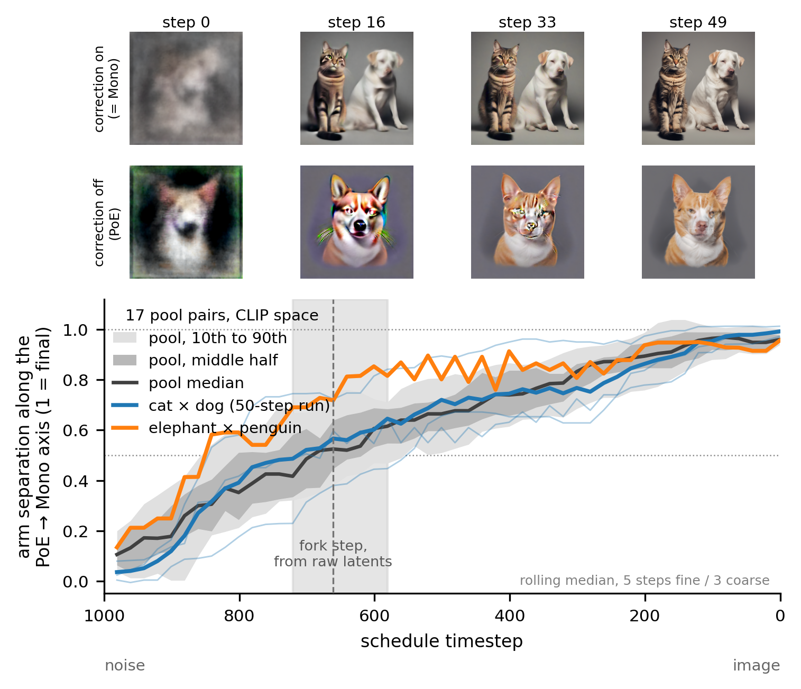

# 🌍 The interaction term (r_t)

The interaction term is the paper's central object: the per-step gap between what SDXL would
predict if it saw the literal joint prompt (Mono) and what it actually predicts under PoE
composition. The project's claim is that this gap is what PoE composition drops, and that adding
it back in fixes the chimera failure. [lora-corrector.md](lora-corrector.md) is the trained
stand-in for this term that never sees the joint prompt.

> 🖼️ **Diagram wanted**: the process-lane piece "how the interaction term is computed and injected
> back in", per [diagram-prompts.md](../diagram-prompts.md). Not yet rendered.

## Table of contents

- [Words this file uses](#words-this-file-uses)
- [What the interaction term is](#what-the-interaction-term-is)
- [What it looks like](#what-it-looks-like)
- [Why the project cares](#why-the-project-cares)
- [How it shows up in the data](#how-it-shows-up-in-the-data)
- [What people get wrong](#what-people-get-wrong)
- [Where this came from](#where-this-came-from)
- [🖼️ In pictures, code and further reading](#in-pictures-code-and-further-reading)
- [Cross-references](#cross-references)

## Words this file uses

Navigation: 📋 [TOC](#table-of-contents) | [Next](#what-the-interaction-term-is) ➡️

- **r_t (also Δ_t, "the residual")**: the same quantity as "the interaction term", written as
  a symbol in code and plan files. `r_t = ε̃_Mono − ε̃_PoE` (some earlier documents write the
  Mono-minus-PoE order as `ε̃_J − ε̃_PoE`; both name the same gap, see
  [What people get wrong](#what-people-get-wrong)).
  Some plan files call this same quantity "the oracle" when describing it as the target a trained
  corrector imitates. It means the correction computed from the joint prompt, which is what this
  file calls the interaction term, per the word list in
  `plans/standing/retrofit-poe-repair-min.md`.
- **λ (lambda)**: the multiplier on how much of the interaction term is added back at inference,
  from 0 (plain PoE) to 1 (the full correction).
- **Window**: the span of denoising steps over which the correction is injected. It does not have
  to cover the whole run.
- **Commitment step**: the step after which a run's outcome stops changing, measured separately
  per pair (see [How it shows up in the data](#how-it-shows-up-in-the-data)).

**r_t and λ on one number.** ε̃ is the model's guided noise prediction at one step, so r_t is the Mono prediction minus the PoE prediction `verified` (`eps_j` is the guided joint-prompt prediction in the code lines quoted under [What people get wrong](#what-people-get-wrong)). The real ε̃ is an array the size of the image's latent, and one number stands in for it here, with every value invented. Take Mono 0.8 and PoE 0.5, so r_t = 0.8 − 0.5 = 0.3:

| λ | Prediction used, PoE + λ · r_t |
|---|---|
| 0 (plain PoE) | 0.50 |
| 0.5 | 0.65 |
| 1 (full correction) | 0.80, the Mono value |

Raising λ walks the prediction from PoE toward Mono, and 1 lands on it. The [plan on noise prediction](../../../../goal-setting/learning/deep-learning/diffusion-models/02-sampler-correctors-for-composition/plans/08-noise-prediction-is-the-score.md) takes ε̃ apart.

## What the interaction term is

Navigation: ⬅️ [Words this file uses](#words-this-file-uses) | 📋 [TOC](#table-of-contents) | [Next](#what-it-looks-like) ➡️

**The step-by-step difference between the Mono prediction and the PoE prediction, made explicit as
the signal linear score composition omits.** ✅

Quoted from the paper's abstract (`writing/iclr/iclr2027_conference.tex`): "the interaction term:
the per-step residual between the model's joint-prompt prediction and its product-of-experts
prediction, which makes explicit the signal omitted by linear score composition." ✅

**It is measured directly in the pipeline's cached output, not estimated indirectly.** ✅

A pilot run's `summary.json` carries `d_t_poe_vs_mono`, a per-step magnitude array (50 values,
step 0 near 0.0 rising to about 0.246 by the final step for `a_cat__x__a_dog` seed 42), and
`d_T_poe_vs_mono`, the same quantity's final value. Read directly,
`data/pilot/seed_42/a_cat__x__a_dog/summary.json`. ✅

**It grows through the run rather than being a fixed offset**, and how far into the run it needs
to be added (the window) is a separate, measured question from how big it is (the strength, λ).
`1-lora-correction/report/experiments-log.md`'s EXP-04 found the best window centred at steps 0-10 for every one of 8 tested
pairs, regardless of how late that pair's own outcome settles (its "commitment step", which ranges
from step 18 to step 36 across pairs). ✅

## What it looks like

Navigation: ⬅️ [What the interaction term is](#what-the-interaction-term-is) | 📋 [TOC](#table-of-contents) | [Next](#why-the-project-cares) ➡️

There is no single picture of the interaction term itself: it is a per-step vector in the model's
noise-prediction space, not a rendered image. The two images in
[poe-composition.md](poe-composition.md#what-it-looks-like) are its endpoints (the Mono target and
the PoE render it is measured against). A rendered picture of the term's own trajectory is what the
diagram wanted at the top of this file would show.

Why a seed's radius carries nothing and only its direction matters, with the window and
commitment numbers on a step ruler, is drawn in
[the noise-shell scene](../../1-lora-correction/artifacts/scenes/noise-shell-and-basins/index.html).

## Why the project cares

Navigation: ⬅️ [What it looks like](#what-it-looks-like) | 📋 [TOC](#table-of-contents) | [Next](#how-it-shows-up-in-the-data) ➡️

**It is the whole causal claim.** ✅ If adding this term back in (at increasing λ) reliably raises
the compose rate while a same-sized random vector does not, the project has evidence the term is
what PoE composition is missing, not just a correlate. `MASTER_PLAN.md` step 4 records this
result as done.

## How it shows up in the data

Navigation: ⬅️ [Why the project cares](#why-the-project-cares) | 📋 [TOC](#table-of-contents) | [Next](#what-people-get-wrong) ➡️

| Column | Stands for | Example | Entry |
|---|---|---|---|
| `d_T_poe_vs_mono` | the interaction term's final-step size for one run | `0.246` (example, `a_cat__x__a_dog` seed 42) | [Dictionary § d_T / d_t](../data/02-dictionary.md#d_t--d_t) |
| `d_t_poe_vs_mono` | the same quantity at every one of the 50 steps | array of 50 floats, `0.0` to `0.246` (example) | [Dictionary § d_T / d_t](../data/02-dictionary.md#d_t--d_t) |
| `lambda` | how much of the term is injected at inference | `1.0` (example, full strength) | [Dictionary § lambda](../data/02-dictionary.md#lambda) |
| `step` | which of the 50 denoising steps a value belongs to | `10` (example) | [Dictionary § step](../data/02-dictionary.md#step) |

## What people get wrong

Navigation: ⬅️ [How it shows up in the data](#how-it-shows-up-in-the-data) | 📋 [TOC](#table-of-contents) | [Next](#where-this-came-from) ➡️

**The window that works is not the window where the run visibly commits.** ⚠️ ✅

`1-lora-correction/report/experiments-log.md` EXP-01 and EXP-04 together found something the project itself calls
counter-intuitive: every studied pair's outcome settles (commitment step) well after the window
where the correction actually works (steps 0-10 for all 8 tested pairs, whose settling steps run
from 23 to 36; across every pair EXP-01 measured, the per-pair medians run from 18 to 36). The correction stops mattering 8 to 26 steps before the picture "looks
decided" by the running-estimate measure. Either the decision happens earlier than that measure
can see, or the measure tracks the wrong event; `1-lora-correction/report/experiments-log.md` records this as unresolved and
not the registered finding.

**The sign convention is written two ways across the repo's own documents, and both name the same quantity.** ✅

`MASTER_PLAN.md`'s glossary writes `r_t = ε̃_J − ε̃_PoE`; the memory note titled
"correction-shared-early-part" is recorded by the maintainer as using `r_t = ε̃_Mono − ε̃_PoE`.
`poe_repair/methods/_sampling.py` stacks the prompts as A, B, joint, empty (line 445), makes
`eps_j` the guided joint-prompt prediction (line 514) and computes `delta = eps_j - eps_poe`
(line 516), so `ε̃_J` and `ε̃_Mono` name the same joint-prompt prediction.

## Where this came from

Navigation: ⬅️ [What people get wrong](#what-people-get-wrong) | 📋 [TOC](#table-of-contents) | [Next](#in-pictures-code-and-further-reading) ➡️

| What | How it was established | When |
|---|---|---|
| The interaction term's definition | Read in `writing/iclr/iclr2027_conference.tex`, abstract | 2026-08-24 |
| Its measured per-step and final values for one run | Read directly, `data/pilot/seed_42/a_cat__x__a_dog/summary.json` | 2026-08-24 |
| The window-vs-commitment-step finding | Read in `1-lora-correction/report/experiments-log.md`, EXP-01 and EXP-04 | 2026-11-22 |
| The word "oracle" in older plan files, and what it names here | Read in `plans/standing/retrofit-poe-repair-min.md`, "Words this uses" | 2026-08-24 |

<!-- related:start (drain) -->
<a id="in-pictures-code-and-further-reading"></a>

## 🖼️ In pictures, code and further reading

Navigation: ⬅️ [Previous](#where-this-came-from) | 📋 [TOC](#table-of-contents) | [Next](#cross-references) ➡️

The page notes that no single picture of the interaction term exists. These pictures show where it sits in the frame and when the two runs separate, and the excerpt below is the six lines of code that compute it.

### How it fits together

<a href="../../1-lora-correction/artifacts/results/what-the-correction-is/what-it-looks-like/where-the-correction-lives-in-the-frame/cat-x-dog-rt-spatial-map.png"></a>

Fifteen panels for cat and dog, one column per denoising step (0, 5, 10, 20, 30), brighter meaning a larger |r_t| in that 128 by 128 latent cell. Top row: the mean over 8 seeds. Middle row: seed 42 alone. Bottom row: the mean magnitude of the product's own prediction over the same 8 seeds, as the reference. From step 5 on, the top row shows one centred animal face lit around eyes and muzzle and the bottom row shows only static `verified` (opened and read by eye). The card gives seeds 42 to 49 and says one pair and eight seeds are all there is, so whether the face pattern holds for other pairs is unmeasured `stated` (the folder's card).

### The code behind it

The term is a subtraction taken inside the sampler. Excerpt from `poe_repair/methods/_sampling.py` (lines 511 to 516), then the λ switch (lines 590 to 598):

```python
        eps_a_raw, eps_b_raw, eps_j_raw, eps_uncond = noise.chunk(4)
        eps_a = guided_eps(eps_a_raw, eps_uncond, guidance_scale)
        eps_b = guided_eps(eps_b_raw, eps_uncond, guidance_scale)
        eps_j = guided_eps(eps_j_raw, eps_uncond, guidance_scale)
        eps_poe = poe_eps(eps_a, eps_b, eps_uncond)
        delta = eps_j - eps_poe
```

```python
        if lam == 0.0:
            eps_t = eps_poe
        elif lam == 1.0 and delta_substitute is None:
            # Shortcut: with the true delta, eps_poe + 1.0*delta IS eps_j.
            # It is NOT with a substitute, so the shortcut must not fire then
            # or the control row would silently reproduce the oracle row.
            eps_t = eps_j
        else:
            eps_t = eps_poe + float(lam) * delta_used
```

- Line 445 of the same file stacks the four prompts in the order A, B, joint, empty, so `eps_j` is the guided prediction on the joint prompt.
- `delta = eps_j - eps_poe` is the interaction term at that step, joint minus product, which is the order the page's definition uses `verified` (read in the code).
- `lam` is λ: 0 gives plain PoE, 1 gives the joint prediction exactly, and anything between adds that share of `delta`.
- The comment on lines 593 to 595 says the shortcut at λ 1 must not fire when a substitute vector replaces the real one, so that a control row cannot copy the real row.

A small invented example, not from a run: product 0.6, joint 1.0 for one number in the prediction. `delta` is 1.0 − 0.6 = 0.4. At λ 0.5 the step uses 0.6 + 0.5 × 0.4 = 0.8, halfway between the product and the joint.

### What comes out

The card's table for the maps above, trimmed to four steps. CV is the spatial coefficient of variation of the magnitude map, meaned over the 8 seeds, and the last two columns are the mean correlation between different seeds' magnitude maps:

| Step | CV of r_t | CV of the product's prediction | Cross-seed r, r_t | Cross-seed r, product |
|---|---|---|---|---|
| 0 | 0.358 | 0.362 | 0.074 | −0.000 |
| 10 | 1.012 | 0.363 | 0.241 | −0.000 |
| 30 | 1.564 | 0.367 | 0.271 | 0.001 |
| 49 | 0.528 | 0.414 | 0.017 | 0.068 |

`stated` (the card; computed on cat and dog, seeds 42 to 49, 50 DDIM steps, guidance 7.5).

<a href="../../1-lora-correction/artifacts/results/what-the-correction-is/does-it-cause-composition/how-far-the-corrected-run-separates-from-the-uncorrected-one/F5b-gradual-commitment.png"></a>

Two arms of one cat and dog run, decoded at steps 0, 16, 33 and 49. With the correction on (the Mono prediction) the tiles show a cat and a dog from step 16. With it off (plain PoE) they show one animal, a dog face at step 16 and a cat-like face at steps 33 and 49 `verified` (read by eye). Below is how far the two arms have separated along the product-to-joint direction in CLIP space, 0 to 1, against the schedule timestep from noise (1000) to image (0), with the fork step drawn near timestep 660. The pool is two grey bands and a median line, cat and dog and elephant and penguin have a bold line each, and the thin blue lines are cat and dog's three seeds `stated` (the figure's script). The pool median rises smoothly from about 0.1 and sits near 0.5 at the fork line `verified` (read from the curves), which agrees with the card's reading that separation is gradual and about half done by the fork band `stated` (the card).

**The legend's 17 and the card's 19 count the same pool.** The legend says "17 pool pairs". The card's 20-step dose read covers 19 pairs, and the figure's script (`scripts/run_separation_over_time.py`, line 50) takes out cat and dog and elephant and penguin to draw them on their own, which leaves 17 `verified` (counted in `dose_divergence.json`). The card's 50-step read covers 9 cells (cat and dog, frog and toad, leopard and jaguar, seeds 9 to 11), and the figure uses only the three cat and dog cells. The card does not name this figure.

### Further illustrations

**Evidence**

<a href="../../1-lora-correction/artifacts/results/what-the-correction-is/what-it-looks-like/where-the-correction-lives-in-the-frame/is-the-face-just-where-the-subject-sits.png"></a>

The control for the map above: the difference (joint minus product) on top, the joint prompt's own prediction in the middle and the product's own prediction below, all averaged over the same 8 seeds. Only the top row has a face in it `verified`. The card concludes the face is not just where the model centres its subject, since centring would put a face in all three rows `stated`.

**Scene**

[The noise shell and its basins](../../1-lora-correction/artifacts/scenes/noise-shell-and-basins/index.html), published as a private artifact at [claude.ai](https://claude.ai/code/artifact/5cc908b7-59b9-4929-ad6b-3309bec51690) (link as the scene card gives it). It draws why a seed's direction matters and the measured nudge window (steps 0 to 10) and commit window (steps 18 to 36). No still of it exists, so none is shown.

### Go deeper

| What | Link |
|---|---|
| The sampler that PoE adds back into | [PoE composition](poe-composition.md) |
| The trained stand-in for this term | [LoRA corrector](lora-corrector.md) |
| The scene card | [the noise shell scene card](../../1-lora-correction/artifacts/scenes/noise-shell-and-basins/README.md) |
| The frame-location card | [where the correction lives in the frame](../../1-lora-correction/artifacts/results/what-the-correction-is/what-it-looks-like/where-the-correction-lives-in-the-frame/README.md) |
| The separation card | [when the Mono and PoE paths part company](../../1-lora-correction/artifacts/results/what-the-correction-is/does-it-cause-composition/how-far-the-corrected-run-separates-from-the-uncorrected-one/README.md) |
| The experiments log the page cites | [experiments log](../../1-lora-correction/report/experiments-log.md) |

### Still open

- The "Diagram wanted" at the top of the page (how the term is computed and injected) has no rendered picture; the code above is the nearest thing recorded.
- The maps cover one pair, and the card says no second pair's tensors were saved, so no picture here shows where the term sits in the frame for any other pair.
<!-- related:end -->

## Cross-references

Navigation: ⬅️ [Previous](#in-pictures-code-and-further-reading) | 📋 [TOC](#table-of-contents)

- The mention of **a sum of scores** (the log-space identity behind linear score composition) in [the scene map for the Gaussian score's base case](../../../../goal-setting/learning/deep-learning/diffusion-models/05-poe-composition-diffusion/artifacts/drips/gaussian-score-base-case/SCENE_MAP.md) (relevance match).
- The mention of **the correction** in [the finding "does a Langevin corrector remove part of the correction"](../../1-lora-correction/report/is-the-gap-the-samplers-or-the-models/does-a-langevin-corrector-remove-part-of-the-correction.md), which measures its size at the point a Markov chain settled to.
- The mention of **the window** that decides the outcome (the early steps, where the sampler's error is worst) in [the whole corrector design](../../1-lora-correction/plans/06-is-the-gap-the-samplers-or-the-models/source/the-whole-corrector-design.md#quick-context-where-you-are).
- The mention of **the interaction term**, the gradient the product drops that a pair-aware classifier would supply, in [the route for classifier-guided PoE](../../2-classifier-guidance/plans/route-classifier-guided-poe-from-toy-to-animals.md#quick-context-where-you-are).
- The mention of **the interaction term** in [the plan "The dropped term, on four rows"](../../../../goal-setting/learning/deep-learning/diffusion-models/13-classifier-guidance-by-hand/plans/07-the-dropped-term-table.md#description).
- The mention of **the interaction term** in [the plan "The account you could defend"](../../../../goal-setting/learning/deep-learning/diffusion-models/13-classifier-guidance-by-hand/plans/09-the-account-you-could-defend.md#tasks).
- The mention of **the interaction term** in [the master plan of the classifier-guidance journey](../../../../goal-setting/learning/deep-learning/diffusion-models/13-classifier-guidance-by-hand/MASTER_PLAN.md#what-other-journeys-own).

<!-- built-to: PAGE_LOOK_FORMAT v1 -->
