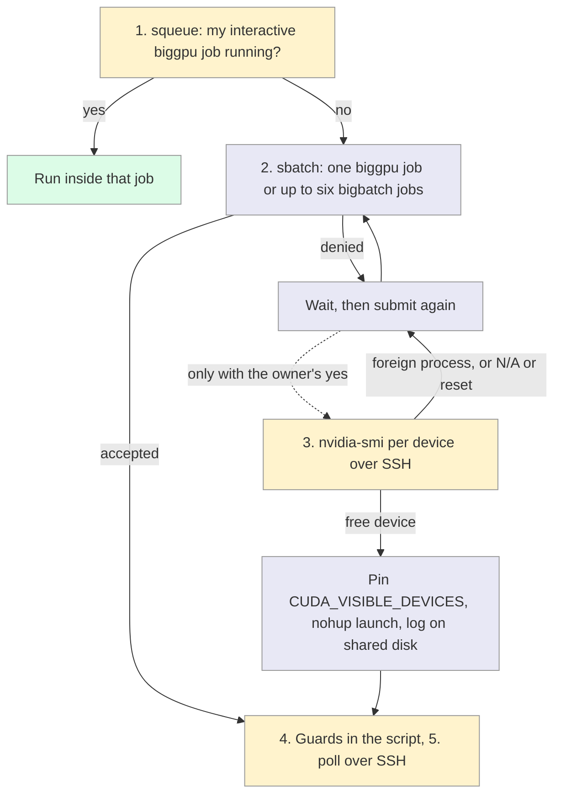

# 🗺️ Environment: how a run gets launched on the cluster

Navigation: ⬅️ [Nodes](nodes.md) | 📋 [Index](../00-INDEX.md) | [Overview](../overview.md#execution-model)

GPU work launches through `sbatch`, inside the administrator's caps of one `biggpu` job and six
`bigbatch` jobs per user, and waits when `sbatch` is denied. This is the section a plan is most
likely to silently get wrong, because "submit a job" reads as one action and is actually a
several-step decision.

## Table of contents

- [The six steps](#the-six-steps)
- [Skill wiring](#skill-wiring)
- [🖼️ In pictures, code and further reading](#in-pictures-code-and-further-reading)
- [Cross-references](#cross-references)

## The six steps

Navigation: 📋 [TOC](#table-of-contents) | [Next](#skill-wiring) ➡️

1. **Check for an already-allocated interactive node.** `squeue -u mmolefe` (from the laptop, `scripts/cluster.sh sh "squeue -u mmolefe"`): if your own
   interactive job already holds a `biggpu` node, run inside that job, with no new `sbatch`.
2. **Submit through `sbatch`.** Else `sinfo -p biggpu` (from the laptop, `scripts/cluster.sh sh "sinfo -p biggpu"`): if a `biggpu` node is idle and your one
   `biggpu` job slot is free, target `biggpu`. Otherwise submit to `bigbatch`, up to six jobs per
   user. If `sbatch` is denied, wait and submit again. **`sinfo`'s `idle` is not proof the GPU is
   free**: work launched over SSH with `nohup` (the shared-device path below) is invisible to
   Slurm, so a node can read `idle` while a training saturates its GPU (2026-09-03: mscluster112
   showed `idle` with a rank-8 LoRA run at 94% on it). Always confirm with the per-device
   `nvidia-smi` read in step 3 before pinning a device, whatever `sinfo` says.
3. **The shared-device path needs the owner's yes.** A `nohup` launch over SSH, outside this
   session's own Slurm job, runs only after the owner approves it through
   `python3 scripts/progress_board.py ask`. The rest of this step applies to an approved run.
   An `alloc` `biggpu` node is often only half used, because Slurm
   here allocates whole nodes while knowing nothing about GPUs (GRES is `(null)`, see
   `nodes.md`) and most users run on one device. SSH in and read per-device state:
   `ssh <node> nvidia-smi --query-gpu=index,memory.used,utilization.gpu,temperature.gpu --format=csv`.
   A device at roughly 0MiB used and 0% utilisation is free. Two readings that look wrong and
   are not: a device at under 100 MiB can read 100% utilisation for a minute or so after a
   process on it was killed, because `nvidia-smi`'s utilisation is a windowed sample and its
   memory column is not (2026-09-03, mscluster112), so under 100 MiB the memory column alone
   decides; and a device holding a few GB at 0% utilisation for hours is another user's idle
   allocation, which this project has shared safely (mscluster109 device 0, 2.9 GB, all of
   2026-09-03), the rule being no *active* foreign process rather than no foreign memory.
   `scripts/launch_sdlora.sh`'s guard encodes both. **A device reading `[N/A]` or
   `[GPU requires reset]` in the utilisation or temperature column is hardware-faulted and is
   not free**, and a memory-only check passes it just as readily as a healthy idle
   device. A launch onto a faulted device hangs producing zero progress with no error
   (`poe-launch-002`); the only recovery is `kill -9` and relaunch elsewhere, since the fault
   needs an administrator or node reboot to clear. An approved run goes onto a free device
   directly: SSH in, pin `CUDA_VISIBLE_DEVICES=<free index>`, launch with `nohup`, tee to a log
   the session node can read.

   **Every path on the SSH launch line must be absolute** (the script path and the log
   redirect): a non-interactive SSH command starts in `$HOME`, not the repo, and a `cd <repo>
   &&` prefix is not reliable either, because Claude Code's permission layer can strip or block
   `cd` inside compound Bash commands. This produced three identical silent failures in a row
   on 2026-08-19 (`known-failures.md`, entry `poe-launch-001`). The launch script does
   `cd "$REPO"` internally, so the caller needs no working directory at all:
   ```bash
   timeout 30 ssh <node> 'GPU=<idx> nohup bash /abs/path/to/launch.sh > /abs/path/to/logs/<name>.log 2>&1 < /dev/null & disown'
   ```
   Verify the launch in the same SSH call: `sleep 5; pgrep -af "train"` plus `tail` of the
   absolute log path.

   **The script itself must live on a shared filesystem** (`/datasets` or `/home-mscluster`),
   never in this session's `/tmp` scratchpad: `/tmp` is node-local, so a script written there
   does not exist on the launch node. The symptom is an SSH launch returning exit code 2 with
   no log file at all, because python never found the file to run (2026-09-03, mscluster109).
   Copy the script under the run's output root on `/datasets` first, and launch that path.

   **Safety rules for the shared-device path, all mandatory:**
   - Never start on a device carrying a foreign process.
   - Re-check the device inside the launch script itself (a guard that aborts if the chosen
     device has more than 1GB in use), not only in the check run minutes earlier before the
     launch: state can change between the check and the launch.
   - Keep VRAM usage within the free device only.
   - Record node, device index, and PID in the log header.
   - These runs are invisible to `squeue` (Slurm does not know about them), so harvesting a
     shared-device run means running `pgrep -af 'sweep|train'` on the node; `squeue` will never
     show it.

   **A denied `sbatch` means wait.** `biggpu` carries an administrator cap on how many nodes a
   user may hold at once, separate from the one-job rule. When `sbatch` is denied by that cap
   even though idle nodes exist, wait and submit again. On an approved shared-device run, device
   1 has been the free device in practice (provenance below), so prefer it, but still verify
   with `nvidia-smi` before pinning `CUDA_VISIBLE_DEVICES`; the safety rules above stay
   mandatory.

4. **Every job script opens with a block of checks that must pass before the work starts:** a `df` disk guard on the checkpoint target
   (abort at 90% full; must check the filesystem the script actually writes to, see
   `storage.md`), a `co3` python path check, and an `nvidia-smi` guard that aborts in seconds if
   no GPU is visible.
5. **Submit, then poll.** `squeue`/`sacct` for a normal Slurm job, or tail the `nohup` log and
   `pgrep` on the node for a shared-device run. **Read the log and count the outputs on the
   launch node, over SSH, not from the session node**: the session node's NFS view of
   `/datasets` (and of `/home-mscluster`) can lag the launch node's writes by minutes, so a
   `grep -c` or an `ls` run locally undercounts, and a figure assembled locally from those files
   draws finished cells as missing (2026-09-03: 32 renders present on mscluster109, absent from
   mscluster85's view for over ten minutes). Assemble figures on the launch node for the same
   reason, and copy them into the repo from there. On failure, read the log and classify: OOM
   (reduce batch size or resolution, or move to `biggpu`), wrong environment (fix the path),
   missing GPU or bad `#SBATCH` directives (fix and resubmit), node failure (resubmit
   elsewhere). Retries are bounded; never silently loop.
6. **In-session tier.** Cache-only analyses (SVD, SNR curves, language-space tests, scoring cached
   PNGs) and light GPU inference run directly on a cluster session node (`mscluster85` when last
   checked, RTX 3090 24GB), no queue, while bigger jobs wait. Reference point: `phase1_r8_100k` TRAINING
   peaked at 22.95GB VRAM, so training-scale work goes to `biggpu`; SDXL inference-only runs
   across many settings generally fit the 3090, but check `nvidia-smi` for co-tenants before
   launching.

## Skill wiring

Navigation: ⬅️ [Previous](#the-six-steps) | 📋 [TOC](#table-of-contents) | [Next](#in-pictures-code-and-further-reading) ➡️

`/run-experiment` drives GPU tasks. Every experiment logs to W&B, including the qualitative
Mono vs PoE vs LoRA triptych panels, so `/analyze-run` can go back over runs later. `/drip-execute-plan --auto`
may run tasks unattended, using each plan's pre-registered falsification rules and
`/demonstrate` checkpoints as its stop conditions.

**Provenance.** This protocol, the shared-device path, and the launch-failure pattern were
established live over SSH on 2026-08-19 on `mscluster106`: GPU 1 sat at 1MiB/0% while GPU 0
carried another user's 8GB process, and a torch matmul from `co3_bw` on GPU 1 succeeded
without touching GPU 0.

<!-- related:start (drain) -->
<a id="in-pictures-code-and-further-reading"></a>

## 🖼️ In pictures, code and further reading

Navigation: ⬅️ [Previous](#skill-wiring) | 📋 [TOC](#table-of-contents) | [Next](#cross-references) ➡️

No picture of this decision exists under `artifacts/`; the flow below is drawn from the six steps above, and the code is the guard a launcher runs.

### How it fits together



*Key: yellow boxes are checks, purple boxes are where the run goes, green is the quick path.* Read it top to bottom: `sbatch` is the route, a denied submission waits, and the dashed edge to an SSH launch opens only with the owner's yes.

### The code behind it

The guard that step 3 describes sits in `scripts/launch_sdlora.sh` (lines 33 to 40, named here, not linked). It reads memory and utilisation for the pinned device, accepts a card under 100 MiB or a card under 4096 MiB at 0% utilisation, and refuses the rest.

```bash
mem=$(nvidia-smi --query-gpu=memory.used --format=csv,noheader,nounits -i "$GPU" | head -1)
util=$(nvidia-smi --query-gpu=utilization.gpu --format=csv,noheader,nounits -i "$GPU" | head -1)
# nvidia-smi's utilisation is a windowed sample and can read 100% for a minute after a
# process is killed while memory already reads ~0; under 100 MiB nothing can be running, so
# memory alone decides there.
if [ "${mem:-0}" -lt 100 ]; then :;
elif [ "${mem:-0}" -lt 4096 ] && [ "${util:-100}" -eq 0 ]; then :;
else echo "ERROR: device $GPU has ${mem} MiB in use at ${util}% utilisation, refusing to share"; exit 2; fi
```

- Under 100 MiB used: free, whatever utilisation says (first branch).
- Under 4096 MiB and 0% utilisation: another user's idle allocation, shared (second branch).
- Anything else exits with code 2 (third branch).

The same file's lines 25 to 28 are the step 4 checks: the 90% disk guard, the `co3` python path and the `nvidia-smi` GPU check.

**Two sources to read together.** The page says a `[N/A]` or `[GPU requires reset]` reading marks a faulted device that a memory-only check passes. The excerpt above is memory and utilisation only; in it a card under 100 MiB passes whatever utilisation reads. The probe script `scripts/gpu_probe.sh` (named) prints `[N/A]` for a faulted card, and [the nodes page](nodes.md#python-environments) says the shared-device launch script refuses it. `scripts/launch_sdlora.sh` refuses `[N/A]` only at 100 MiB or more, so a faulted card reading 2 MiB passes it, while other shared-device launchers refuse `N/A` outright, for example `1-lora-correction/scripts/showcase/correct_early_then_clean_up_shared_device.sh` (line 27). The safety rules above name a 1GB limit for the launch-script guard, and this guard allows up to 4096 MiB at 0% utilisation (its comment at lines 29 to 32 gives the reason).

### Go deeper

| What | Link |
|---|---|
| Nodes, partitions and which card is where | [the HPC nodes fact](nodes.md#partitions) |
| How long a training run takes on each card | [training run timings](throughput.md) |
| The silent launch failure and the hardware fault | [poe-launch-002](../known-failures.md#entry-id-poe-launch-002) |
| Disk guard target and filesystems | [storage](../storage.md) |
| The recipe that launches and harvests a run | [launching and harvesting a run](../../runbook/running-things-on-the-cluster/launching-and-harvesting-a-run.md) |

### Still open

No recorded `nvidia-smi` listing from the 2026-09-03 or 2026-08-19 sessions is filed as a picture, so the readings in steps 2 and 3 have no screenshot.
<!-- related:end -->

## Cross-references

Navigation: ⬅️ [Previous](#in-pictures-code-and-further-reading) | 📋 [TOC](#table-of-contents)

- The mention of **launching outside Slurm and harvesting by process** in [does a Langevin corrector remove part of the correction](../../1-lora-correction/report/is-the-gap-the-samplers-or-the-models/does-a-langevin-corrector-remove-part-of-the-correction.md) and [does a corrector alone produce two animals](../../1-lora-correction/report/is-the-gap-the-samplers-or-the-models/does-a-corrector-alone-produce-two-animals.md), whose grids ran this way on three nodes.
- The mention of **a device taken between the check and the launch**, which this protocol's guard refused twice on 2026-09-05, in [running the Langevin corrector](../../runbook/running-things-on-the-cluster/running-the-langevin-corrector.md).
- The mention of **the GPU guard**, which aborts a job landing on a hardware-faulted `bigbatch` card in under a second, in [the HPC nodes fact, under Partitions](nodes.md#partitions).

<!-- built-to: PAGE_LOOK_FORMAT v1 -->
