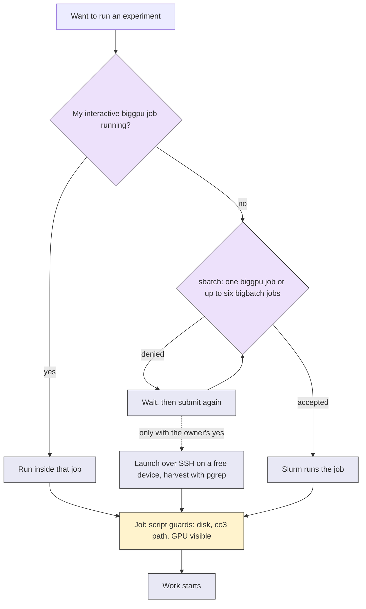

# 🗺️ Environment: the system this project runs on

HPC cluster, Slurm-scheduled, two separate filesystems with no automatic mirroring between
them, and a paper build that needs one specific LaTeX engine because nothing else is installed.
The thing a plan gets wrong most often here is treating "submit a job" as one action: it means
choosing `biggpu` or `bigbatch` inside the administrator's job caps, waiting when `sbatch` is denied,
and writing a disk guard that checks the filesystem the script actually writes to, not an assumed one.

## Table of contents

- [Compute / runtime](#compute--runtime)
- [Access paths](#access-paths)
- [Auth](#auth)
- [Execution model](#execution-model)
- [Known gaps / non-obvious constraints](#known-gaps--non-obvious-constraints)
- [Provenance](#provenance)
- [Paper: LaTeX build](#paper-latex-build)
- [🖼️ In pictures, code and further reading](#in-pictures-code-and-further-reading)
- [Cross-references](#cross-references)

## Compute / runtime

Navigation: 📋 [TOC](#table-of-contents) | [Next](#access-paths) ➡️

Code is written on the laptop checkout, which has no Slurm commands and reaches the cluster through
`scripts/cluster.sh`. A session on the cluster (VS Code + Claude) runs ON a compute node, `mscluster85`
when last checked (`bigbatch`: RTX 3090 24GB VRAM, 123GB RAM, 28 cores). The login node is never used for work.
Python is the `co3` mamba environment at
`/home-mscluster/mmolefe/miniforge3/envs/co3/bin/python`; every job script must use this
absolute path, never a bare `python`.

Full partition table, per-node GPU models, and the environment list are in
[hpc/nodes.md](hpc/nodes.md).

## Access paths

Navigation: ⬅️ [Compute / runtime](#compute--runtime) | 📋 [TOC](#table-of-contents) | [Next](#auth) ➡️

Repo and code on `/home-mscluster`; every checkpoint, every cache, and everything a run across
many settings writes goes to
`/datasets/mmolefe/poe_repair_min/`, a separate filesystem with its own quota and no automatic
mirroring to the repo side. W&B project: `prime_lab/poe-repair-animals-compose`.

Full paths, current `df` sizes, and the disk-guard rule that a script's guard must check the
filesystem it actually writes to are in [storage.md](storage.md).

## Auth

Navigation: ⬅️ [Access paths](#access-paths) | 📋 [TOC](#table-of-contents) | [Next](#execution-model) ➡️

- Cluster access: SSH, already established in-session; no per-job auth.
- W&B: API key present in `~/.netrc` (confirmed present, not read, live 2026-08-24) and
  `WANDB_API_KEY` (confirmed set in this session's shell, 2026-08-24); no human step needed.
- Hugging Face model downloads (SDXL, SD 1.5/2.1): anonymous pulls have sufficed; if a model
  ever requires accepting its licence on the Hugging Face website first, that is a human browser
  step.

## Execution model

Navigation: ⬅️ [Auth](#auth) | 📋 [TOC](#table-of-contents) | [Next](#known-gaps--non-obvious-constraints) ➡️

GPU work runs inside an interactive job this user already holds, or launches through `sbatch`
inside the administrator's caps of one `biggpu` job and six `bigbatch` jobs per user. A denied
`sbatch` waits. A `nohup` launch over SSH outside the session's own Slurm job needs the owner's
yes through `python3 scripts/progress_board.py ask`; such a run is invisible to `squeue` and is
harvested with `pgrep`. Every job script begins with checks that must pass before any work
starts: the disk guard, the `co3` path check, and a GPU-visibility guard.

The full six-step protocol, the shared-device safety rules, and the SSH absolute-path rule
(the fix for a launch failure that recurred three times on 2026-08-19) are in
[hpc/execution-protocol.md](hpc/execution-protocol.md).

## Known gaps / non-obvious constraints

Navigation: ⬅️ [Execution model](#execution-model) | 📋 [TOC](#table-of-contents) | [Next](#provenance) ➡️

- `/home-mscluster` hit 100% once and silently killed checkpointing mid-run. Checkpoints go to
  `/datasets/...` only, and every job keeps the `df` guard (detail: [storage.md](storage.md)).
- The `hippo` single box takes a sequential or GNU-parallel loop over configs, NOT a Slurm
  array. Confirm partition and QOS before emitting any array.
- `sinfo` does not expose GPU GRES/VRAM on this cluster (reads `(null)`, reconfirmed live
  2026-08-24); node capability knowledge is tribal and recorded in
  [hpc/nodes.md](hpc/nodes.md), not queryable.
- Many nodes show down or drain at any given time; an idle-looking partition can still queue
  you. Check node STATE, not just partition availability (detail: [hpc/nodes.md](hpc/nodes.md)).
- fp16 end-to-end: cached eps tensors are float16; analyses that stack many of them (the SVD)
  should upcast to float32 before accumulating.
  - Float16 keeps about three decimal digits, so past 2,048 it can no longer add 1. Toy (numbers
    invented, computed): adding 1 to a running total 4,096 times gives 2,048 in float16 and 4,096
    in float32. Stacking many cached tensors for the [SVD](../../../Obsidian/Mathematics/Linear%20Algebra/Singular%20Value%20Decomposition.md#where-to-learn-this) loses small contributions the same way.
- No system LaTeX on the cluster: `pdflatex`, `xelatex`, `latexmk`, and `bibtex` are absent from
  PATH (reconfirmed live 2026-11-22). Every LaTeX recipe there except `tectonic` fails, including the
  extension's default. The laptop has `pdflatex`, `xelatex` and `bibtex`, and has no `latexmk` or
  `tectonic` (checked 2026-11-22). Detail, and an open question about whether a newly-added
  `.vscode/settings.json` changes this: [paper.md](paper.md).
- `tectonic`'s first build on a node downloads packages, so it needs network access. A node
  without it fails on the download, not on the document.

## Provenance

Navigation: ⬅️ [Known gaps](#known-gaps--non-obvious-constraints) | 📋 [TOC](#table-of-contents) | [Next](#paper-latex-build) ➡️

When and how these facts were established: live verification, a specific source read, or a
person who confirmed it. The table is in [provenance.md](provenance.md); it is not duplicated
here because it grows one row per verification and nobody reads it while planning.

## Paper: LaTeX build

Navigation: ⬅️ [Provenance](#provenance) | 📋 [TOC](#table-of-contents) | [Next](#in-pictures-code-and-further-reading) ➡️

The manuscript is `writing/iclr/iclr2027_conference.tex`, built with `tectonic` (the only LaTeX
engine on this cluster) either from the terminal or through VS Code's LaTeX Workshop extension
with the recipe manually set to `tectonic`. A `.vscode/settings.json` was added to the repo on
2026-08-18 defining a custom `tectonic` recipe; whether that makes the plain "Build LaTeX
project" command work without manually picking the recipe is unverified (see "Still open" in
[00-INDEX.md](00-INDEX.md)).

Full build commands, the extension's recipe list, and the git-blame on `.vscode/settings.json`
are in [paper.md](paper.md).

<!-- related:start (drain) -->
<a id="in-pictures-code-and-further-reading"></a>

## 🖼️ In pictures, code and further reading

Navigation: ⬅️ [Previous](#paper-latex-build) | 📋 [TOC](#table-of-contents) | [Next](#cross-references) ➡️

No picture of the cluster itself exists in any `artifacts/` folder, so this block holds a flowchart drawn from this page's own "Execution model" text and the real guard a job script runs before it starts.

### How it fits together



*Purple boxes are the choices, yellow is the set of guards, grey boxes are where the run goes.*

Read it top to bottom: `sbatch` is the route, a denied submission waits, and the dashed edge to an SSH launch opens only with the owner's yes. The guards run for every route `stated` (this page; the six-step protocol is in the [execution protocol](hpc/execution-protocol.md)).

### The code behind it

One real job script shows the disk and GPU guards the page names. Excerpt from `scripts/review_bench_co3.sbatch` (lines 26 to 31):

```bash
[ -d "$OUT" ] || { echo "ABORT: $OUT not visible from this node" >&2; exit 3; }
USE=$(df --output=pcent "$OUT" | tail -1 | tr -dc '0-9')
[ -n "$USE" ] && [ "$USE" -lt 90 ] || { echo "ABORT: $OUT is ${USE:-unknown}% full" >&2; exit 3; }
read -r USED UTIL < <(nvidia-smi --query-gpu=memory.used,utilization.gpu --format=csv,noheader,nounits | head -1 | tr -d ',')
case "$UTIL" in ''|*[!0-9]*) echo "ABORT: gpu faulted ($UTIL)" >&2; exit 4;; esac
"$PY" -c "import torch, sys; sys.exit(0 if torch.cuda.is_available() else 6)" || { echo "ABORT: torch sees no CUDA" >&2; exit 6; }
```

- Lines 26 to 28 are the disk guard: `df` reads the `$OUT` folder the script writes to (on `/datasets`) and aborts at 90% full or when the folder is not visible.
- Lines 29 and 30 are the GPU guard: a faulted card prints `[N/A]` for utilization, which is not a number, so the script aborts with exit 4.
- Line 31 asks torch whether it sees CUDA, which catches a job that would silently run on the CPU.
- The `PY` variable in this script defaults to the `co3` absolute python path the page names. The page says every job script checks that path, and this script has no separate check: a missing interpreter fails at line 31 with the message that torch sees no CUDA.

### Go deeper

| What | Link |
|---|---|
| Partition table, per-node GPU models, environments | [HPC nodes](hpc/nodes.md) |
| The six-step launch protocol and shared-device rules | [execution protocol](hpc/execution-protocol.md) |
| Paths, `df` sizes, the disk guard rule | [storage](storage.md) |
| Failures seen on launches, disks and nodes | [known failures](known-failures.md) |
| How each fact was established | [provenance](provenance.md) |
| The LaTeX build | [paper build](paper.md) |
| Launching and harvesting by hand | [the launch and harvest recipe](../runbook/running-things-on-the-cluster/launching-and-harvesting-a-run.md) |

### Still open

- No screenshot or recorded terminal output of the guards running exists in `artifacts/`; the excerpt is the source only.

<!-- related:end -->

## Cross-references

Navigation: ⬅️ [Previous](#in-pictures-code-and-further-reading) | 📋 [TOC](#table-of-contents)

- The mention of **execution model** in [the HPC nodes fact, under Python environments](hpc/nodes.md#python-environments), where every job script must name the `co3` python by its absolute path because nothing activates an environment implicitly.

<!-- built-to: PAGE_LOOK_FORMAT v1 -->
