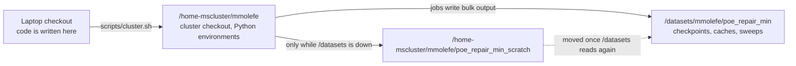

# 🗄️ Environment: where data and outputs live on the cluster

Navigation: 📋 [Index](00-INDEX.md) | [Overview](overview.md#access-paths)

## Table of contents

- [The storage map](#the-storage-map)
- [Access paths](#access-paths)
- [Size, retention, and the quota gap](#size-retention-and-the-quota-gap)
- [The disk guard rule, and the failure that motivates it](#the-disk-guard-rule-and-the-failure-that-motivates-it)
- [When `/datasets` is down](#when-datasets-is-down)
- [Version control](#version-control)
- [🖼️ In pictures, code and further reading](#in-pictures-code-and-further-reading)
- [Cross-references](#cross-references)

## The storage map

Navigation: 📋 [TOC](#table-of-contents) | [Next](#access-paths) ➡️

**Bulk output belongs under `/datasets/mmolefe`, and code and Python environments belong under
`/home-mscluster/mmolefe`.** The two tables below list every top-level folder this project's code
names on each mount, so you can see what a move or a cleanup would break.

> [!NOTE]
> Read live through `mscluster84` on 2026-11-21. Listings come from `ls`, and sizes from `du -sk`
> capped at 60 seconds per folder at the lowest CPU priority. "Not measured" means the folder hit
> that cap. `du` does not follow links, so a very small size can be a folder of links. 1 GB here
> is 1,024³ bytes.



*Solid arrows are the normal path. The dashed arrow is a manual move.*

**On `/datasets/mmolefe`: 9 real folders**

| Folder | What it holds | Size | Times named in code |
|---|---|---|---|
| `poe_repair_min/` | this project's bulk and `MOUNT_ROOT` in `poe_repair/paths.py`: mainly `outputs/` (377 mentions) and `artifacts/` (53) | at least 114.1 GB (`outputs/` and `artifacts/` not measured) | 444 |
| `raw/` | 14 raw dataset folders and one 141.5 GB zip, including `mnist/`, `celeba/`, `coco2017/` and `relaion2b-en/` | at least 764.1 GB (`coco2017/` not measured) | 14 (1 direct, 9 through the `relaion2b-en` link, 4 through the `coco2017` link) |
| `repos/` | outside code: `geneval`, `geneval_models`, `T2I-CompBench`, `mmdetection`, `Divide-and-Bind`, `Linguistic-Binding-in-Diffusion-Models` | 1.0 GB | 17 |
| `envs/` | Python environments, including `t2icomp`, `syngen`, `sd15-aae` | not measured | 10 |
| `offload/` | `logs/`, named by `1-lora-correction/scripts/storage/offload_home.sbatch` | 24 KB | 3 |
| `.cache/` | `huggingface/` | 12.9 GB | 2 |
| `projects/` | 5 projects' outputs, including a link to `poe_repair_min/` | at least 103.6 GB (`Paper3/` not measured) | 0 |
| `_archive/` | 6 archived folders | at least 23.2 GB (`backup/` and `eccv2026/` not measured) | 0 |
| `conda-pkgs/` | conda's package cache | 1.1 GB | 0 |

The other top-level names are 29 links into `raw/`, `projects/` and `_archive/`, so
`/datasets/mmolefe/celeba` and similar old paths still resolve.

**On `/home-mscluster/mmolefe`: the folders this project uses, out of 57**

| Folder | What it holds | Size | Times named in code |
|---|---|---|---|
| `Playground/PhD/` | the cluster checkout of this repository | not measured | 212 |
| `miniforge3/` | conda and its environments, including `co3` | not measured | 186 |
| `poe_repair_min_scratch/` | the fallback while `/datasets` is down: `mnist-canvas/`, `mnist-share/`, `outputs/` | 70.2 GB | 43 |
| `.cache/` | `huggingface/` | not measured | 3 |
| `.local/` | `bin/` | not measured | 1 |
| `.claude/` | `plans/` | not measured | 1 |

"Times named in code" counts each occurrence of the path in `.py`, `.sh`, `.sbatch`, `.yaml` and
`.yml` files under `poe_repair/`, `scripts/`, `composition/` and each project's `scripts/` folder,
searched on 2026-11-21. A count of 0 means only that no script spells the path.

## Access paths

Navigation: ⬅️ [The storage map](#the-storage-map) | 📋 [TOC](#table-of-contents) | [Next](#size-retention-and-the-quota-gap) ➡️

- **Repo and code:** `/home-mscluster/mmolefe/Playground/PhD/concept-composition`.
- **Large artifacts** (checkpoints, caches, and what a run across many settings writes out):
  `/datasets/mmolefe/poe_repair_min/`.
  These are separate filesystems with different quotas; there is no automatic mirroring between
  them, so a path that exists on one is not implied to exist on the other.
- **Cached residual trajectories** (the r_t training targets, all four eps branches per step):
  `/datasets/mmolefe/poe_repair_min/outputs/training_cache/` (18 train + 58 heldout pairs, ~12
  seeds, 50 steps each; contents verified by direct filesystem inspection and a loaded residual
  file on 2026-08-04). Here r_t is the per-step gap between the joint-prompt prediction and the
  product-of-experts prediction; see [the interaction term](../context/world/interaction-term.md#what-the-interaction-term-is).
- **W&B project for the animals program:** `prime_lab/poe-repair-animals-compose`.
- **CelebA** (aligned faces, identity and all 40 attributes, parquet, 11 GB):
  `/datasets/mmolefe/celeba/flwrlabs-celeba/img_align+identity+attr/`, 19 train, valid and 3 test
  shards. Pulled anonymously from Hugging Face `flwrlabs/celeba` on `mscluster84`, a `bigbatch` compute node,
  with the `co3` python's `huggingface_hub` on 2026-11-04. Counted from its `Male` and
  `Blond_Hair` columns: train 162,770 faces, 1,387 of them blond men (0.852%); valid 19,867 with
  182; test 19,962 with 180.
- **MNIST** (the four uncompressed raw files the MNIST stages read): `/datasets/mmolefe/raw/mnist/`,
  copied from the laptop's `/home/molef/PhD/replications/original-superdiff/data/MNIST/raw/` on
  2026-11-19 with matching sha256 on all four. `canvases.py` reads it when `MNIST_RAW` points there;
  the laptop's path is its default. The MNIST share run writes to
  `/datasets/mmolefe/poe_repair_min/outputs/mnist-share/` (checkpoints, samples, logs).
- **Laptop to `/datasets`** (`scripts/cluster.sh` only pulls): `rsync -az <laptop folder>/
  mscluster84:/datasets/mmolefe/...` in the push direction, through `mscluster84`. `verified`
  2026-11-26: Paper 2's 192 joint-prompt pictures (281 MB, 27 seconds) went from
  `outputs/loop-6/m14/blind/pictures/` to `/datasets/mmolefe/poe_repair_min/paper2/paper2-upload-joint/`
  with `2-classifier-guidance/scripts/paper2/paper2_upload_joint.sh --go`, which checks the remote disk
  first and opens every picture at 1024 by 1024 after copying.

- **How `/datasets/mmolefe` is laid out** (since 2026-11-13): raw datasets in `raw/`, other
  projects' outputs in `projects/<project>/`, archived work in `_archive/`, each moved folder with
  a symlink at its old name, so `/datasets/mmolefe/celeba/...` above still resolves to
  `raw/celeba/`. This project's `poe_repair_min/` did not move, because `poe_repair/paths.py`
  names it; `projects/concept-composition/poe_repair_min` points to it. The rules and the move log
  are in `/datasets/mmolefe/README.md`.

> The heldout pairs are the animal pairs kept out of training on purpose, so a result measured on
> them says whether the fix reaches pairs the model never trained on.

## Size, retention, and the quota gap

Navigation: ⬅️ [Access paths](#access-paths) | 📋 [TOC](#table-of-contents) | [Next](#the-disk-guard-rule-and-the-failure-that-motivates-it) ➡️

Both filesystems are NFS mounts shared with other users. Verified live via
`df -h /datasets /home-mscluster` on 2026-11-21:

| Mount | Size | Used | Free | What belongs there |
|---|---|---|---|---|
| `/datasets` | 377T | 200T (54%) | 177T | Every checkpoint, every cache, and every file a run across many settings writes. |
| `/home-mscluster` | 73T | 42T (58%) | 32T | The repo, the conda envs, small results and logs. |

Usage moves quickly, so re-check it before a large run:

| Read on | `/datasets` size, used, free | `/home-mscluster` size, used, free |
|---|---|---|
| 2026-08-09 | 201T, 24T (12%), not recorded | 73T, 26T (35%), not recorded |
| 2026-08-24 | 377T, 30T (8%), 348T | 73T, 29T (39%), 45T |
| 2026-11-21 | 377T, 200T (54%), 177T | 73T, 42T (58%), 32T |

**There is no per-user `quota` command on these nodes** (confirmed absent from PATH live,
2026-08-24), so a user's own share of either mount is not queryable. The only guard available is
the `df` check every job script runs before writing.

## The disk guard rule, and the failure that motivates it

Navigation: ⬅️ [Size](#size-retention-and-the-quota-gap) | 📋 [TOC](#table-of-contents) | [Next](#when-datasets-is-down) ➡️

**`/home-mscluster` hit 100% once and silently killed checkpointing mid-run.** Checkpoints go to
`/datasets/...` only, and every job script keeps a `df` guard that aborts before writing if the
target filesystem is too full (see `hpc/execution-protocol.md` step 4).

**The guard must check the filesystem the script actually writes to, not an assumed one.**
`1-lora-correction/scripts/mechanism_study/run_dose_sweep.sh` set its output root under the repo on
`/home-mscluster` while its disk guard read `df /datasets/mmolefe`, so 3.4GB of that run's
per-setting output landed on the wrong mount with the guard reporting healthy the whole time. This is logged as
`poe-disk-001` in `known-failures.md`. A recent series of commits (`54b4b79`, `8522459`,
`c3f8bb4`, `f293bdf`) routed output paths in roughly 100 files through a shared
`paths.resolve()` helper specifically to stop this class of drift between "where output is
configured to land" and "where the guard checks"; whether every script's guard now reads the
same resolved root as its output root has not been re-audited this sitting.

## When `/datasets` is down

Navigation: ⬅️ [The disk guard](#the-disk-guard-rule-and-the-failure-that-motivates-it) | 📋 [TOC](#table-of-contents) | [Next](#version-control) ➡️

`/datasets` returned `Input/output error` on every node tried from about 13:10 UTC on 2026-11-17
(`ls /datasets/mmolefe` and `df -h /datasets` both failed, verified over `scripts/cluster.sh sh`).
It was still failing at 05:40 UTC on 2026-11-18 and read normally on 2026-11-21. While it is down,
the user's standing exception is `/home-mscluster/mmolefe/poe_repair_min_scratch/`, with the disk
guard pointed at `/home-mscluster` (57% used on 2026-11-18). Outputs written there move to
`/datasets` once it reads again. Probe it before a launch: `ls /datasets/mmolefe` must list
folders.

## Version control

Navigation: ⬅️ [When `/datasets` is down](#when-datasets-is-down) | 📋 [TOC](#table-of-contents) | [Next](#in-pictures-code-and-further-reading) ➡️

Neither filesystem is under version control and neither is snapshotted. Every `✓ verified (...)`
evidence tag in the plan tree points at a path on one of them, so an artifact deleted or moved
silently breaks the claim it backs. `artifacts/plans/parked/artifact-reconciliation/plans/05-resweep-on-new-runs.md`
exists to catch this, and is a standing recurring plan rather than a finished one.

<!-- related:start (drain) -->
<a id="in-pictures-code-and-further-reading"></a>

## 🖼️ In pictures, code and further reading

Navigation: ⬅️ [Previous](#version-control) | 📋 [TOC](#table-of-contents) | [Next](#cross-references) ➡️

No picture of these filesystems exists in any `artifacts/` folder, and the storage map above is already drawn. This block adds the helper that chooses which filesystem's copy of a path to use, and a guard that reads the folder its job writes to. It leaves the tables and numbers above as they are.

### The code behind it

**Where a path is looked up.** Paths to run families go through one helper, which returns a copy that already exists. The guard excerpt further down reads its own `$OUT` and does not call this helper. Excerpt from `poe_repair/paths.py` (lines 176 to 197):

```python
def resolve(rel: str | os.PathLike[str], *, prefer: str = "mount") -> Path:
    """The path to ``rel`` on whichever filesystem holds it.

    ``prefer`` decides only when both hold it, and defaults to the mount because that
    is where the bulk sits. Where the two copies are different experiments rather than
    one copied twice, name the run tag in ``rel`` and this becomes unambiguous without
    anyone having to choose.

    Raises ``FileNotFoundError`` naming both roots tried, because a path that resolves
    nowhere should say so at the call site rather than fail later as an empty result.
    """
    if prefer not in ("mount", "repo"):
        raise ValueError(f"prefer must be 'mount' or 'repo', not {prefer!r}")

    found = roots_holding(rel)
    if not found:
        raise FileNotFoundError(
            f"{rel} exists under neither {REPO_ROOT} nor {MOUNT_ROOT}"
        )
    if len(found) == 1:
        return found[0] / rel
    return (MOUNT_ROOT if prefer == "mount" else REPO_ROOT) / rel
```

- `MOUNT_ROOT` defaults to the `/datasets/mmolefe/poe_repair_min` folder in the first table, and `POE_REPAIR_MOUNT` overrides it. `REPO_ROOT` is the checkout the code runs from, which on the cluster sits on `/home-mscluster`.
- When both roots hold the path, the default returns the mount's copy, because the mount is where the bulk sits.
- When neither holds it, the error names both roots, so a path that exists on neither fails at the call.

**The guard that reads the folder the job writes to.** Excerpt from `scripts/review_bench_co3.sbatch` (lines 26 to 28):

```bash
[ -d "$OUT" ] || { echo "ABORT: $OUT not visible from this node" >&2; exit 3; }
USE=$(df --output=pcent "$OUT" | tail -1 | tr -dc '0-9')
[ -n "$USE" ] && [ "$USE" -lt 90 ] || { echo "ABORT: $OUT is ${USE:-unknown}% full" >&2; exit 3; }
```

- `df` is given `$OUT`, the same variable the job writes under, which is the rule in the disk-guard section above and the opposite of the `poe-disk-001` failure.

### Go deeper

| What | Link |
|---|---|
| The disk guard that checked the wrong mount | [known failures, `poe-disk-001`](known-failures.md#entry-id-poe-disk-001) |
| Where the guard sits in a launch | [execution protocol](hpc/execution-protocol.md) |
| Nodes and mounts they see | [HPC nodes](hpc/nodes.md) |
| The environment overview | [overview](overview.md#access-paths) |

### Still open

- **Disagreement between sources, left as found.** This page and `poe_repair/training_cache.py` name the training cache `/datasets/mmolefe/poe_repair_min/outputs/training_cache`, while `poe_repair/paths.py` (`TRAINING_CACHE`, line 153) and the check script in `known-failures.md` under `poe-data-001` name `artifacts/caches/training_cache` under the same root. Which folder holds the cache now has not been checked here.
- No recorded run of the guard aborting exists in `artifacts/`.

<!-- related:end -->

## Cross-references

Navigation: ⬅️ [Previous](#in-pictures-code-and-further-reading) | 📋 [TOC](#table-of-contents)

- The mention of **disk guard** in [the plan "the cheapest test: does RoentGen-v2 draw two findings"](../3-understanding-compositionality/plans/10-does-roentgen-draw-two-findings/plans/01-the-cheapest-test.md), task 5.1.
- The mention of **disk guard** in [the PRZE-10 compute plan](../1-lora-correction/report/paper-review/prze-10-compute.md), fourth outcome.

<!-- built-to: PAGE_LOOK_FORMAT v1 -->
