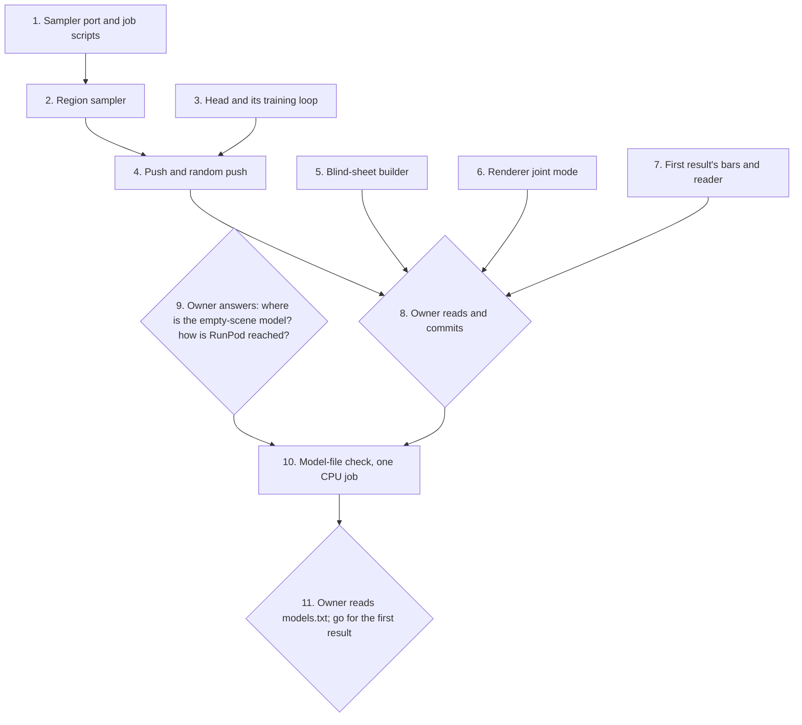

# 🔧 Paper 1 setup: the code every stage needs, written with no GPU

**What this plan does, in one line.** Write and commit the sampler port, the region sampler, the head and its training loop, the
push, the blind-sheet builder, the renderer's joint mode and the first result's bars, and find the three frozen models on the
cluster, so [the first-result plan](02-first-result.md) can start with nothing left to write.

## Recommended prompt (after this plan completes)

```
/sync-plan-tree @plans/paper-1-clevr-touching/plans/01-setup.md: <one line on what was committed and where the empty-scene model is>
```

## Position in the plan tree

| Step | Plan | What it does |
|------|------|-------------|
| Before | [the Paper 1 front page](../README.md) | Says what runs first and why |
| **Current** | **Paper 1 setup (this plan)** | **Writes and commits the code; checks the model files; no GPU** |
| Next | [the first-result plan](02-first-result.md) | Runs the smallest test that can show the method works |
| After | [the full plan](03-full-plan.md) | Confirm and for the paper, after a yes |

## Table of contents

- [Words this uses](#words-this-uses)
- [Quick context: where you are](#quick-context-where-you-are)
- [Considerations](#considerations)
- [Environment Facts This Plan Depends On](#environment-facts-this-plan-depends-on)
- [The claim](#the-claim)
- [Why this plan exists](#why-this-plan-exists)
- [What happens (visual)](#what-happens-visual)
- [Description: what to build / do / learn](#description-what-to-build--do--learn)
- [Purpose and goal](#purpose-and-goal)
- [Tasks](#tasks), steps for Claude
- [Instructions](#instructions), steps for the owner
- [What has to pass before this runs](#what-has-to-pass-before-this-runs)
- [Outputs / Figures / Deliverables](#outputs--figures--deliverables)
- [Orchestration](#orchestration-keeping-catalogs-and-plan-files-in-sync)
- [References](#references)
- [Next step](#next-step)
- [Error Matrix](#error-matrix)

## Words this uses

Navigation: 📋 [TOC](#table-of-contents) | [Next](#quick-context-where-you-are) ➡️

**The red expert, the blue expert and the empty-scene model** are three frozen EDM2 image generators at 64 by 64 pixels: two
trained apart on 1 to 3 objects of one colour, one on the empty CLEVR floor. **The colour-expert run** is the earlier experiment
that trained them on a rented RunPod machine and left its sampler in `m10_pod/m10_compose.py`.

**The region sampler** lets each expert draw only inside its own object's outline and the empty-scene model draw the rest. **The
head** is a small trained network that reads the frozen experts' features and gives one score, the logit. **The push** adds w
times the logit's gradient on sampler steps 15 to 22 of 32 (σ 2.90 to 0.28); steps 10 to 22 are tried as a second setting at
tuning. **A blind sheet** shows pictures at 4 times size under neutral names,
with the key that says which method drew each one kept apart. Each is defined in full in
[the full plan's models section](03-full-plan.md#the-models), which this plan implements without changing.

## Quick context: where you are

Navigation: ⬅️ [Words this uses](#words-this-uses) | 📋 [TOC](#table-of-contents) | [Next](#considerations) ➡️

**The system.** New code in `2-classifier-guidance/scripts/paper1/`, plus a joint mode in
`2-classifier-guidance/scripts/method_search/clevr_render.py`.

**The design.** Port, do not rewrite: the sampler, paste and the mean empty scene move out of `m10_compose.py` with their
behaviour unchanged; the new pieces follow [the full plan's models section](03-full-plan.md#the-models) setting by setting.

**This plan's job.** Leave the first result nothing to write. Every check that needs a GPU or a model file runs in the first
result, not here.

**What blocks it.** Two open questions for the owner, under [instruction 9](#9-answer-the-two-open-questions).

## Considerations

Navigation: ⬅️ [Quick context](#quick-context-where-you-are) | 📋 [TOC](#table-of-contents) | [Next](#environment-facts-this-plan-depends-on) ➡️

**Cost.** No GPU. One CPU job on the cluster of about 0.05 node-hours (task 10), after the owner's yes. Writing the code is
session time.

**What runs here.** Nothing loads a model or touches a GPU. The laptop's `python3` has no torch, so each code task is checked by
`python3 -m py_compile` (a syntax check that executes nothing) and by the owner reading the diff. The behavioural checks (the
port sheet, the region identity, the w = 0 identity) are the first result's tasks 2, 3 and 10.

**Commits.** The owner commits each piece after reading it ([instruction 8](#8-read-the-code-and-commit-it)).
`scripts/cluster.sh run` refuses to run with uncommitted tracked changes, so nothing reaches the cluster before that.

**Known issues.** See the [Error Matrix](#error-matrix).

## Environment Facts This Plan Depends On

Navigation: ⬅️ [Considerations](#considerations) | 📋 [TOC](#table-of-contents) | [Next](#the-claim) ➡️

<details>
<summary>The facts the code must respect, and the two that are missing</summary>

| Fact | Where it is recorded |
|---|---|
| Every job script uses `/home-mscluster/mmolefe/miniforge3/envs/co3/bin/python`, a disk guard on the `/datasets` folder it writes to, and a GPU-visibility guard (`scripts/review_bench_co3.sbatch`, lines 26 to 31) | [the environment overview](../../../environment/overview.md#compute--runtime), [the execution protocol](../../../environment/hpc/execution-protocol.md) |
| The `bigbatch` exclude list, passed whole on the `sbatch` line | [the node table](../../../environment/hpc/nodes.md#partitions) |
| Pictures and checkpoints go to `/datasets/mmolefe/poe_repair_min/` only | [the storage page](../../../environment/storage.md) |
| `scripts/cluster.sh pull <path>` reads the cluster checkout, so each job copies its small outputs to `outputs/paper1/<run-name>/` | the repository `CLAUDE.md`, "Two checkouts, one launch path" |
| The colour experts' snapshots and `pod.sha256` | [CLEVR rendering and EDM2](../../../environment/clevr-and-edm2.md#the-colour-experts-model-files) |
| `m10_compose.py` hard-codes RunPod paths under `/workspace/m10` | the full plan's [Error Matrix](03-full-plan.md#error-matrix) |
| The empty-scene model is `/datasets/mmolefe/poe_repair_min/loop-6/m7/full/models/empty/network-snapshot-0002000-0.100.pkl`, the M7 run's final snapshot, with its sha256 recorded | [CLEVR rendering and EDM2](../../../environment/clevr-and-edm2.md#the-colour-experts-model-files) |
| **Missing:** any page on RunPod or containers; the environment folder has none | [the environment index](../../../environment/00-INDEX.md) |

</details>

## The claim

Navigation: ⬅️ [Environment facts](#environment-facts-this-plan-depends-on) | 📋 [TOC](#table-of-contents) | [Next](#why-this-plan-exists) ➡️

**Every script the first result runs exists, follows the full plan's settings, passes a syntax check, and is committed; and the
three model files are found on the cluster with both experts' hashes matching.**

**Why this matters right now.** A first result that stops halfway to write code spends GPU queue time waiting.

## Why this plan exists

Navigation: ⬅️ [The claim](#the-claim) | 📋 [TOC](#table-of-contents) | [Next](#what-happens-visual) ➡️

**The gap.** None of `2-classifier-guidance/scripts/paper1/` exists, and the colour-expert run's sampler only runs on the RunPod
machine.

**The approach.** Write the code against the full plan's settings, commit it on the owner's yes, and find the model files with one
CPU job.

**Key points.**

1. Porting `m10_compose.py` rather than rewriting it keeps the sampler that produced the plain sum's 0 of 288, so the first
   result's port sheet can compare against pictures already on record.
2. Splitting code from runs keeps every GPU hour inside a plan with a written question.

## What happens (visual)

Navigation: ⬅️ [Why this plan exists](#why-this-plan-exists) | 📋 [TOC](#table-of-contents) | [Next](#description-what-to-build--do--learn) ➡️



## Description: what to build / do / learn

Navigation: ⬅️ [What happens](#what-happens-visual) | 📋 [TOC](#table-of-contents) | [Next](#purpose-and-goal) ➡️

| File | What it holds | Full-plan step it serves |
|---|---|---|
| `2-classifier-guidance/scripts/paper1/paper1_sample.py` | the Heun sampler, paste, apart, the mean empty scene, the plain sum, the region sampler, the push, the random push | 6, 7, 8, 26 to 31, 34 |
| `paper1_render.sbatch`, `paper1_gpu.sbatch`, `paper1_train.sbatch` | the CPU, GPU and training job scripts, each copying its small outputs to `outputs/paper1/<run-name>/` | every cluster step |
| `paper1_disc.py` | the head on the frozen experts' features, its training loop, and its held-out check | 23, 25 |
| `paper1_sheets.py` | the blind-sheet builder and the settling of two reviewers' calls with a third | 9, 62, 64 |
| `paper1_first_bars.py` | the first result's constants and the reader that turns settled calls into its answer | the first result's tasks 1 and 16 |
| `paper1_model_check.py` | lists the three model files, their sizes and their hash matches | 5 |
| joint mode in `clevr_render.py` | red and blue placed together, touching allowed, per-object masks at 64 pixels | 10, 12 |

The renderer's parts mode and the scorer's distractor list (full-plan step 10) are written at the confirm stage, since nothing
before it uses them.

## Purpose and goal

Navigation: ⬅️ [Description](#description-what-to-build--do--learn) | 📋 [TOC](#table-of-contents) | [Next](#tasks) ➡️

**Purpose.** Let the first result run straight through, so its GPU hours buy an answer and not debugging.

**Goals.**

1. Seven pieces of code written, syntax-checked and committed.
2. The three model files found, both experts' hashes matched, and the empty-scene model's path recorded in the environment folder.
3. The two open questions answered.

## Tasks

Navigation: ⬅️ [Purpose and goal](#purpose-and-goal) | 📋 [TOC](#table-of-contents) | [Next](#instructions) ➡️

**For Claude to execute.** Code tasks 1 to 7 write files on the laptop and run nothing but a syntax check. Task 10 is the only
cluster job, and it waits for the owner's yes.

### 0. Check this plan before working from it

- [x] **0.1** Paste: `/verify-plan @plans/paper-1-clevr-touching/plans/01-setup.md`. Done when the report is clean or its proposals
  are applied.
- [x] **0.2** Paste: `/xref-pillar @plans/paper-1-clevr-touching/plans/01-setup.md`. Done when its proposed links are applied or
  there are none.

▶ **Next: [task 1](#1-port-the-sampler-and-write-the-job-scripts)**, and the owner can answer
[instruction 9](#9-answer-the-two-open-questions) at any time.

### 1. Port the sampler and write the job scripts

- [x] Move the Heun sampler, `paste`, `apart`, `mean_empty` and the snapshot paths from
  `2-classifier-guidance/scripts/method_search/m10_pod/m10_compose.py` into `2-classifier-guidance/scripts/paper1/paper1_sample.py`,
  with paths, counts and seeds taken from arguments. Write `paper1_render.sbatch`, `paper1_gpu.sbatch` and `paper1_train.sbatch` from
  `m7_render.sbatch`, `m7_train.sbatch` and the guard block of `scripts/review_bench_co3.sbatch`, each ending with the copy of small
  outputs to `outputs/paper1/<run-name>/`.
  - Output: the four files. Cost: none.
  - **Done when:** `python3 -m py_compile 2-classifier-guidance/scripts/paper1/paper1_sample.py` exits without error, no
    `/workspace` path is left in the file (`grep -n /workspace` prints nothing), and the three job scripts carry the `co3`
    absolute path and both guards. This is the code half of [full-plan step 6](03-full-plan.md#6-make-the-earlier-sampler-run-on-the-cluster);
    its 24-picture check runs in the first result's task 2.

### 2. Add the region sampler

- [x] Add to `paper1_sample.py` the region sampler of [the models](03-full-plan.md#the-models): each lone sample's object mask
  (pixels more than 0.1 from the mean empty scene), dilated by 1 pixel, and D = D_empty + M_red ⊙ (D_red − D_empty) + M_blue ⊙
  (D_blue − D_empty) at every step from the same starting noise; and an `--identity` flag that sets both masks to all ones.
  - Output: the mode. Cost: none.
  - **Done when:** the file compiles and the owner has read the formula against the full plan's. The identity itself is checked
    in the first result's task 3.

### 3. Write the head and its training loop

- [x] Write `paper1_disc.py`: the head on the frozen red and blue experts' decoder features at the 16 by 16 and 8 by 8 levels, with
  the width, joining, conditioning, pooling and output of [the main discriminator](03-full-plan.md#the-models); the feature-block
  choice on tuning seeds as the same section describes, with a logistic probe on the raw noisy pixels trained beside the probe
  on each candidate block; the training loop with the noise, positives, negatives, loss, optimiser, batch and update count of
  the settings table there, plus [the first result's three training safeguards](02-first-result.md#what-the-heads-training-adds):
  whole-pixel shifts of up to 4 in each direction applied to positives and negatives alike (edges repeated; no mirror, colour
  change or cutout), bounded logits, and negatives reweighted in each batch to the positives' touching share; an alignment loss
  (1 minus the cosine between w · σ² · ∇ₓ logit and the real scene minus the region sampler's clean guess, built from the
  renderer's per-object masks, on a quarter of each batch of positives, weight 1), off by default; every 250 updates, the
  overfitting gauge (mean sign of the logit on the positives), the mean logit on positives and on negatives, and the balanced
  accuracy of the positives against 256 held-out negatives, logged to `overfit.json` and W&B; a printed weight count; the loss
  logged to W&B project `prime_lab/poe-repair-animals-compose`; seconds per update over the first 200 with a projected cost. Add
  a `check` subcommand for the held-out balanced accuracy in the four σ bands beside training accuracy, overall and on
  touching-only and apart-only pairs; the direction check (on the 64 training scenes, 8 noise draws each per band, the median
  cosine between the push and the real scene minus the region sampler's clean guess, beside the cosine against another scene's
  target, and the same on the held-out scenes, written to `direction.json`); and the depth-order preference (on touching tuning
  seeds' lone samples, the share where the head scores the lower-on-top paste above the upper-on-top paste, per band, written to
  `depth_preference.json`). Gradients are taken in float32.
  - Output: the file. Cost: none.
  - **Done when:** the file compiles, every setting in the full plan's table appears as a default argument with that value, the
    three safeguards are arguments on by default, and the alignment loss is an argument off by default.

### 4. Add the push and the random push

- [x] Add to `paper1_sample.py` a `push` mode: D' = D + w · σ² · ∇ₓ logit on the sampler steps a `--window` argument names, default
  15 to 22 (σ 2.90 to 0.28), with 10 to 22 accepted for tuning; the head loaded from a checkpoint path, its gradient taken in
  float32; at w = 0 it must run the region sampler's exact arithmetic. Add `--random-push`: at each pushed step, Gaussian noise
  from the seed's own generator multiplied pixel by pixel by the size of the head's push at that step on that seed, then scaled
  to that push's length. Print, per run: the median and largest grey-level change from the region sampler's picture, inside the
  overlap band (where both dilated masks hold, plus 1 pixel either side) and outside it; per σ band, the push length, the
  share of its squared length inside the overlap band over that band's share of the area, and the cosine between the change the
  code applies and the gradient (it must be +1); the share of gradient entries that are zero or not finite; for a random push,
  the largest length mismatch and its share inside the band beside the real push's. Add to the `region` mode's check run a
  `band.json`: per seed, the median distance in grey levels between each overlap-band pixel and the nearer of the two lone
  objects' own colours. Add `--lower-on-top` to `paste`: the lone object lower in the frame laid over the other.
  - Output: the modes. Cost: none.
  - **Done when:** the file compiles, the window is one argument whose default is 15 to 22, and the old constants
    `PUSH_STEPS = range(10, 15)` and `PUSH_B` from `m10_compose.py` are not carried over. The w = 0 identity is checked in the
    first result's task 10.

### 5. Write the blind-sheet builder

- [x] Write `paper1_sheets.py`: from a list of (row, seed, count, picture path), copy each picture at 4 times size by nearest
  neighbour under a shuffled neutral name, write `key.json` outside the sheet folder, write reviewer CSV templates with columns red
  count, blue count, blended band and occlusion correct, and print the rubric version at the top of an index page. Any number of
  rows goes on one sheet: the first result's tuning sheet holds seven settings and its blind sheet six rows on the touching
  seeds, the lower-on-top paste among them. Add a `settle` subcommand: field by field, the two reviewers' call where they agree
  and the third reviewer's where they do not. Add a `count` subcommand: from calls and the key, the count right per row or
  setting and the count right per field (red count, blue count, blended band, occlusion), which the first result's task 13 reads
  to choose w and the window.
  - Output: the file. Cost: none.
  - **Done when:** the file compiles, and the owner agrees no output name or folder can carry a row name.

### 6. Add the joint mode to the renderer

- [x] Add to `2-classifier-guidance/scripts/method_search/clevr_render.py` a joint mode as [the data and the splits](03-full-plan.md#the-data-and-the-splits)
  describes: red objects placed by the generator's distance and margin rules among themselves, blue the same, a red and a blue
  object at any gap of 0 or more but never passing through each other, every object at least 200 visible pixels at 320 by 240;
  and per-object masks written at 64 pixels.
  - Output: the mode. Cost: none.
  - **Done when:** the file compiles and the existing modes are unchanged in the diff. Its smoke render is the first result's task 5.

### 7. Write the first result's bars and its reader

- [x] Write `2-classifier-guidance/scripts/paper1/paper1_first_bars.py` with every constant of
  [the first result's bars](02-first-result.md#the-bars) at its value, `FIRST_DIRECTION_COS_MIN` and `FIRST_W_ANCHOR_GREY`
  among them, and a reader that takes the settled calls and the sheet's key, counts right per row on the touching, apart and
  real-scene seeds, computes the gain and the one-sided exact binomial p on the disagreeing seeds, prints yes, no or
  inconclusive by the rule in [the first result's verdict file](../review/02-first-result.md), and prints the lower-on-top
  paste's count right beside ours, deciding nothing. Add a `depth-order` subcommand for the first result's task 7: from the
  held-out scene files' 3D positions, the share of touching red and blue pairs whose nearer object is the lower one in the
  frame, per count, written to `depth_order.json`; and a `direction-gate` subcommand that reads `direction.json` and prints
  whether the training-scene cosine meets `FIRST_DIRECTION_COS_MIN` in at least one of the two lowest σ bands.
  - Output: the file. Cost: none.
  - **Done when:** the file compiles, and its constants match the plan's table line for line.

▶ **Next: [instruction 8](#8-read-the-code-and-commit-it)** (the owner reads and commits).

### 10. Check the model files

◀ **Needs: [instruction 8](#8-read-the-code-and-commit-it)** (code committed) and
[instruction 9](#9-answer-the-two-open-questions) (where to look).

- [ ] Write `paper1_model_check.py` and run it as `paper1-model-check`, a CPU job of a few minutes submitted with
  `scripts/cluster.sh run "sbatch ..."` and `paper1_render.sbatch`: list the red and blue snapshots in
  `/datasets/mmolefe/poe_repair_min/loop-6/m10/full/models/r-full/` and `b-full/` and any `training-state-*.pt`, compare each
  sha256 with `pod.sha256`, and compare the empty-scene model's sha256 at `/datasets/mmolefe/poe_repair_min/loop-6/m7/full/models/empty/network-snapshot-0002000-0.100.pkl` with the one the environment page records.
  - Output: `outputs/paper1/paper1-model-check/models.txt` with each file's path, size and hash match. Cost: about 0.05 CPU
    node-hours.
  - **Done when:** three snapshots are found and all three hashes match the recorded ones in
    [CLEVR rendering and EDM2](../../../environment/clevr-and-edm2.md#the-colour-experts-model-files). This is [full-plan step 5](03-full-plan.md#5-check-the-model-files).

▶ **Next: [instruction 11](#11-read-the-model-check-and-say-go)**.

### Close out. Record what this plan taught

- [ ] Paste `/ingest-error-pattern --from-run-log @plans/paper-1-clevr-touching/plans/01-setup.md` if task 10 failed.
- [ ] Paste `/sync-plan-tree @plans/paper-1-clevr-touching/plans/01-setup.md: <one line on what was committed>`.

## Instructions

Navigation: ⬅️ [Tasks](#tasks) | 📋 [TOC](#table-of-contents) | [Next](#what-has-to-pass-before-this-runs) ➡️

**For the owner to follow.** These steps share the numbering above.

### 8. Read the code and commit it

◀ **Needs: [tasks 1 to 7](#7-write-the-first-results-bars-and-its-reader)** done.

8.1 In VS Code, open the Source Control panel and read each new file under `2-classifier-guidance/scripts/paper1/` and the diff of
    `clevr_render.py`.
8.2 For each file, check the settings against [the full plan's models section](03-full-plan.md#the-models) and
    [the first result's bars](02-first-result.md#the-bars).
   - ✅ they match: commit them in one commit, for example `git commit -m "Paper 1: code for the first result"`.
   - ❌ say what differs; Claude fixes it and you read it again.

▶ **Next: [task 10](#10-check-the-model-files)** once instruction 9 is also answered.

### 9. Answer the two open questions

◀ **Needs:** nothing; answer at any time.

9.1 ✅ **Where is the empty-scene model on the cluster?** At `/datasets/mmolefe/poe_repair_min/loop-6/m7/full/models/empty/network-snapshot-0002000-0.100.pkl`, the M7 run's final 0.100 snapshot, recorded with its
    sha256 in [CLEVR rendering and EDM2](../../../environment/clevr-and-edm2.md#the-colour-experts-model-files).
9.2 ✅ **How is the RunPod pod reached?** Not needed: all three models are on `/datasets`, so Paper 1 never reads from the pod.
   - Say go for task 10.

▶ **Next: [task 10](#10-check-the-model-files)**.

### 11. Read the model check and say go

◀ **Needs: [task 10](#10-check-the-model-files)** done.

11.1 Pull it: `scripts/cluster.sh pull outputs/paper1/paper1-model-check`, then open `models.txt`.
11.2 Check three snapshots are listed and both experts read "match".
   - ✅ go for [the first-result plan](02-first-result.md).
   - ❌ a hash mismatch or a missing file: the first result waits until the files are fixed.

## What has to pass before this runs

Navigation: ⬅️ [Instructions](#instructions) | 📋 [TOC](#table-of-contents) | [Next](#outputs--figures--deliverables) ➡️

> The first result starts only when every script it runs is committed and its three models are found, so nothing it spends is
> spent waiting on code or files.

**Pass.** Tasks 1 to 7 compile and are committed (instruction 8); both open questions are answered (instruction 9); three
snapshots are found with both hashes matching and the empty-scene path recorded (task 10).

**Stop.** A hash mismatch; the empty-scene model nowhere the owner can reach.

**When you get results,** go to [the first-result plan](02-first-result.md).

## Outputs / Figures / Deliverables

Navigation: ⬅️ [What has to pass](#what-has-to-pass-before-this-runs) | 📋 [TOC](#table-of-contents) | [Next](#orchestration-keeping-catalogs-and-plan-files-in-sync) ➡️

**Code modules**, as listed under [the description](#description-what-to-build--do--learn); `models.txt`; the empty-scene model's
path in the environment folder. No figures.

## Orchestration: keeping catalogs and plan files in sync

Navigation: ⬅️ [Outputs](#outputs--figures--deliverables) | 📋 [TOC](#table-of-contents) | [Next](#references) ➡️

| Step | Command | Triggered by |
|------|---------|--------------|
| Check the plan | `/verify-plan @plans/paper-1-clevr-touching/plans/01-setup.md` | task 0.1 |
| Cross-reference | `/xref-pillar @plans/paper-1-clevr-touching/plans/01-setup.md` | task 0.2 |
| Capture failures | `/ingest-error-pattern --from-run-log @plans/paper-1-clevr-touching/plans/01-setup.md` | the close out |
| Bring the tree current | `/sync-plan-tree @plans/paper-1-clevr-touching/plans/01-setup.md` | the close out |

## References

Navigation: ⬅️ [Orchestration](#orchestration-keeping-catalogs-and-plan-files-in-sync) | 📋 [TOC](#table-of-contents) | [Next](#next-step) ➡️

**Code read from.** `2-classifier-guidance/scripts/method_search/m10_pod/m10_compose.py` (the sampler, paste, apart, the mean empty
scene), `clevr_render.py`, `m7_render.sbatch`, `m7_train.sbatch`, `scripts/review_bench_co3.sbatch` (the guard block), and
`2-classifier-guidance/scripts/leakage/z11_gradient_checker.py` (a head on frozen features, for its feature hooks).

## Next step

Navigation: ⬅️ [References](#references) | 📋 [TOC](#table-of-contents)

[The first-result plan](02-first-result.md), from its task 0.

## Error Matrix

Navigation: ⬅️ [Next step](#next-step) | 📋 [TOC](#table-of-contents)

<details>
<summary>Known failures in this setting and their fixes</summary>

| Symptom | Cause | Fix |
|---|---|---|
| The sampler fails on a missing `/workspace/m10` | `m10_compose.py` hard-codes the RunPod paths | paths from arguments in `paper1_sample.py` |
| `scripts/cluster.sh run` refuses to start | uncommitted tracked changes | commit first (instruction 8) |
| `import torch` fails on the laptop | the laptop has no torch | syntax checks only here; behaviour is checked on the cluster in the first result |

</details>
