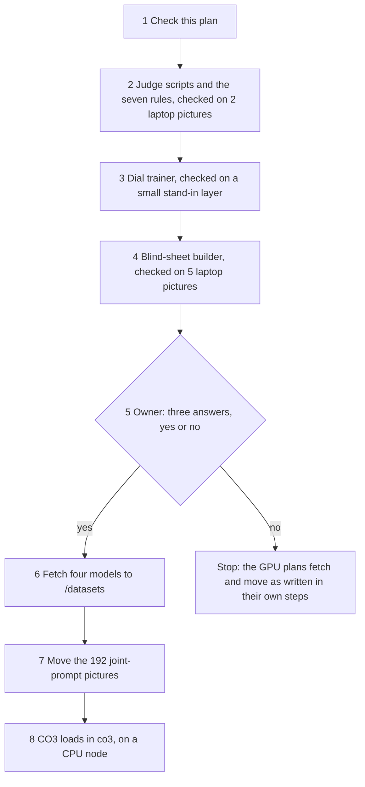

# 🔧 Paper 2's setup: the scripts, the weights and the pictures, with no GPU

**Read first:** [the Paper 2 front page](../README.md). This plan prepares what [the species judge](02-species-judge.md) and
[the identity dial's first result](03-identity-dial-first-result.md) run on, so that their GPU hours go on the work
itself.

**What this asks.** Write the code both plans need and check it on the laptop with no GPU; then, only with the owner's yes,
put the model weights and the 192 joint-prompt pictures on `/datasets` and check CO3 loads in the `co3` environment.

## Recommended prompt (after this plan completes)

```
/sync-plan-tree @plans/paper-2-dials/plans/01-setup.md: <which tasks are done, and the owner's three answers>
```

## Position in the plan tree

| Step | Plan | What it does |
|------|------|-------------|
| Before | [the route to two papers](../../route-two-papers.md) | Orders the work across both papers |
| **Current** | **Paper 2's setup (this plan)** | **The judge scripts, the dial trainer and the blind-sheet builder, checked with no GPU; the weights and pictures on the owner's yes** |
| Next | [the species judge](02-species-judge.md) | Runs the judges written here against blind calls |
| Then | [the identity dial's first result](03-identity-dial-first-result.md) | Trains the dial with the trainer written here |

## Table of contents

- [Words this uses](#words-this-uses)
- [Quick context: where you are](#quick-context-where-you-are)
- [Considerations](#considerations)
- [Environment Facts This Plan Depends On](#environment-facts-this-plan-depends-on)
- [The claim](#the-claim)
- [Why this plan exists](#why-this-plan-exists)
- [What happens (visual)](#what-happens-visual)
- [Description: what to build / do / learn](#description-what-to-build--do--learn)
- [Purpose and goal](#purpose-and-goal)
- [Tasks](#tasks) (for Claude to execute)
- [Instructions](#instructions) (for you to do by hand)
- [What has to pass before this runs](#what-has-to-pass-before-this-runs)
- [Outputs / Figures / Deliverables](#outputs--figures--deliverables)
- [Orchestration](#orchestration-keeping-catalogs-and-plan-files-in-sync)
- [References](#references)
- [What is not decided](#what-is-not-decided)
- [Next step](#next-step)
- [Error Matrix](#error-matrix)

## Words this uses

**A judge** is a program that looks at a picture and the two asked species and names the picture's kind (two clear,
borrowed part, hybrid, two of one kind, wrong species, extra subject, or other), by finding each animal's box and asking
what each cropped animal is. The four candidates and their settings are in [the species judge's judges table](02-species-judge.md#the-judges).
**The seven rules** turn the calls on each animal into one kind for the picture; they are written out with worked examples
in [what happens](02-species-judge.md#what-happens-visual).

**The identity dial** is a rank-4 low-rank adapter (LoRA) on SDXL's attention layers with a strength knob, trained so each
animal comes out its asked species. **The one-step trainer** is the project's reward fine-tune: it samples without
gradient to a chosen step, takes one step with the graph kept, decodes the predicted clean picture and scores it. Here the
score is the judge's two-clear score, so the dial learns from the judge's gradient.

**A blind sheet** is a set of pages, one picture per page at full size (1024 by 1024 pixels), under a neutral name, shuffled,
with only the two asked species printed, so a reviewer cannot tell which method drew it.

## Quick context: where you are

Navigation: ⬅️ [Previous](#words-this-uses) | 📋 [TOC](#table-of-contents) | [Next](#considerations) ➡️

**Where this sits.** Paper 2's first result is the identity dial alone on CO3. It needs a species judge to train against
([the species judge](02-species-judge.md)) and then a small training and test
([the identity dial's first result](03-identity-dial-first-result.md)). Both are GPU work. This plan is the part of both
that needs no GPU, done first so the GPU steps start on tested code.

**Two halves.** Tasks 1 to 4 run on the laptop and need nothing from anyone. Tasks 6 to 8 touch the cluster's storage
and wait for the owner's yes and three answers, given in [instruction 5](#5-answer-the-three-questions-and-say-yes-or-no).

**What this plan does not do.** It draws no picture and trains nothing. The species judge plan's steps stay as written;
where this plan has already produced a step's output, that step finds it in place and checks it.

## Considerations

Navigation: ⬅️ [Previous](#quick-context-where-you-are) | 📋 [TOC](#table-of-contents) | [Next](#environment-facts-this-plan-depends-on) ➡️

**Cost.** No GPU-hours. About 0.2 CPU node-hours on the cluster for the weights fetch and the CO3 load check, and laptop
time for the rest.

**Disk.** About 26 GB onto `/datasets` only: about 17 GB for Qwen3-VL-8B-Instruct (the species judge plan's figure), and
estimates of about 7 GB for SDXL base 1.0's fp16 files, 1.2 GB for DINOv2 large and 0.7 GB for GroundingDINO tiny. SDXL may
already sit in the 12.9 GB cache, since CO3 runs read it. Task 6 prints the real sizes.

**Three open questions block the cluster half.** They come from the species judge plan and are listed in
[instruction 5](#5-answer-the-three-questions-and-say-yes-or-no).

## Environment Facts This Plan Depends On

Navigation: ⬅️ [Previous](#considerations) | 📋 [TOC](#table-of-contents) | [Next](#the-claim) ➡️

<details>
<summary>Every cluster and storage fact the tasks rely on, with where it is recorded</summary>

| Fact | Where it is recorded |
|---|---|
| Every job script uses `/home-mscluster/mmolefe/miniforge3/envs/co3/bin/python` and a disk guard on the `/datasets` folder it writes to | [the environment overview](../../../environment/overview.md#compute--runtime) |
| Every job script sets `HF_HOME=/datasets/mmolefe/.cache/huggingface`; the default cache sits on `/home-mscluster`, which once hit 100% and killed a run | [the storage page](../../../environment/storage.md) |
| Earlier job scripts export `HF_HUB_OFFLINE=1`, so a model is fetched into `HF_HOME` before any job that reads it | `2-classifier-guidance/scripts/method_search/m1_paper2.sbatch` |
| Hugging Face model pulls have worked anonymously | [the environment overview](../../../environment/overview.md#auth) |
| `scripts/cluster.sh pull <path>` copies from the cluster to the laptop and has no mode that copies the other way | the repository `CLAUDE.md`, "Two checkouts, one launch path" |
| The body counter loads `IDEA-Research/grounding-dino-tiny` | `poe_repair/experiments/compose_scorer_validation/validate_detection.py`, line 109 |
| How to copy files from the laptop to `/datasets` | not recorded; instruction 5 asks the owner |
| Whether `co3` has a `transformers` version that loads Qwen3-VL-8B | not recorded; the species judge's step 0.14 checks it |
| How a separate environment, a container, or a rented GPU (RunPod) would be set up for this project | not recorded: `environment/` has no page on RunPod or containers (only a passing mention of a RunPod pod in the CLEVR page, and a note that Docker on the laptop lacks the NVIDIA container toolkit) |

</details>

## The claim

Navigation: ⬅️ [Previous](#environment-facts-this-plan-depends-on) | 📋 [TOC](#table-of-contents) | [Next](#why-this-plan-exists) ➡️

**Every script the species judge and the first result run is written and passes a check on the laptop before any GPU job
uses it, and every weight and picture those jobs read is on `/datasets` before they start.**

## Why this plan exists

Navigation: ⬅️ [Previous](#the-claim) | 📋 [TOC](#table-of-contents) | [Next](#what-happens-visual) ➡️

**The gap.** The species judge plan writes its four judges inside the GPU step that first runs them (0.15), and fetches
weights inside another (0.14). A bug found there costs a queue wait on the cluster and the single `biggpu` slot's time.

**The approach.** Write each script with a stand-in for the model it calls, so its logic (the crop, the seven rules, the
adapter at strength 0, the sheet's neutral names) is checked on the laptop. The real models meet the code only in the GPU
steps, which then test one thing: the model.

## What happens (visual)

Navigation: ⬅️ [Previous](#why-this-plan-exists) | 📋 [TOC](#table-of-contents) | [Next](#description-what-to-build--do--learn) ➡️



## Description: what to build / do / learn

Navigation: ⬅️ [Previous](#what-happens-visual) | 📋 [TOC](#table-of-contents) | [Next](#purpose-and-goal) ➡️

| Script | In `2-classifier-guidance/scripts/paper2/` | Used by | Checked here by |
|---|---|---|---|
| The seven rules | `paper2_kinds.py`: one function from each animal's call (A, B, mixed, other) and flag to the picture's kind; `paper2_bars.py` in step 0.2 imports it | every judge, every reviewer sheet's scoring | the five worked examples in the species judge plan return the kinds written there |
| CLIP on crops | `paper2_judge_clip.py` | step 0.18 | a dry run with a stand-in scorer on 2 pictures |
| ImageNet classifier on crops | `paper2_judge_imagenet.py` | step 0.19 | the same |
| Detect-and-Compare on crops | `paper2_judge_dac.py` | step 0.19b | the same |
| Vision-language model on crops | `paper2_judge_vlm.py` | step 0.20 | the same |
| The identity dial's trainer | `paper2_identity_dial.py`: a rank-4 adapter on SDXL's attention layers with a strength knob, the one-step trainer from `poe_repair/experiments/reward_finetune/train.py` with its reward swapped for the gradient judge's two-clear score, the closeness term, and a random dial of matched weight norm | the first result's steps 3 to 6, and the full ladder's step 3.3 | strength 0 reproduces a stand-in layer exactly; two training steps run on CPU with a stand-in reward |
| The blind-sheet builder | `paper2_sheets.py` | step 0.5 and the first result's step 6 | 5 laptop pictures built into pages, spot-checked |

Every judge takes the same inputs (a list of pictures, the two asked species per picture, the body counter's boxes) and
writes the same `calls.json` (each animal's call and flag, each picture's kind and two-clear score), so the scoring step
reads all four alike. The settings each judge chooses on its choosing pairs (m, p, t, b) are command-line arguments with the
grids from [the judges table](02-species-judge.md#the-judges) as their allowed values.

## Purpose and goal

Navigation: ⬅️ [Previous](#description-what-to-build--do--learn) | 📋 [TOC](#table-of-contents) | [Next](#tasks) ➡️

**Purpose.** The first GPU hour of Paper 2 tests a model, never a script.

**Goals.**

1. Six scripts and the seven-rules function, each passing its laptop check.
2. The owner's three answers recorded.
3. On a yes: four models under `HF_HOME` on `/datasets`, the 192 joint-prompt pictures on `/datasets`, and CO3 loading in
   `co3`.

## Tasks

Navigation: ⬅️ [Previous](#purpose-and-goal) | 📋 [TOC](#table-of-contents) | [Next](#instructions) ➡️

**For Claude to execute.** Tasks 1 to 4 on the laptop, any time. Tasks 6 to 8 only after the owner's yes in
instruction 5, through `scripts/cluster.sh run "sbatch ..."` as CPU jobs.

### 1. Check this plan

- [x] **1.1** Paste: `/verify-plan @plans/paper-2-dials/plans/01-setup.md`. Done when the report is clean or its
  proposals are applied.
- [x] **1.2** Paste: `/xref-pillar @plans/paper-2-dials/plans/01-setup.md`. Done when its proposed links are applied or
  there are none.

### 2. Write the judge scripts and the seven rules

- [x] Write `paper2_kinds.py` with the seven rules in the order the species judge plan gives them, and the four judges.
  Each judge crops every body from the full-size picture with a 10% margin and every other body's box painted out in the
  picture's mean colour (as `3-understanding-compositionality/scripts/species_judge.py` does at lines 72 to 82), calls
  each crop, and applies the seven rules. Each takes `--dry-run`, which swaps the model for a stand-in returning fixed
  scores.
  - Output: the five files, and `tests/test_paper2_kinds.py` with the five worked examples. Cost: laptop.
  - Passes when: the test returns borrowed part, two of one kind, extra subject, extra subject and wrong species for the
    five worked examples in order; and each judge's `--dry-run` on 2 pictures from `outputs/loop-6/m14/blind/pictures/`
    writes a `calls.json` with a kind for each picture and the painted-out crops saved beside it.

### 3. Write the identity dial's trainer

- [x] Write `paper2_identity_dial.py`: the adapter (rank 4, SDXL's attention layers, a strength scale), the random dial
  (same shapes, weights drawn at random and scaled to a given norm), and the training loop reusing the one-step trainer,
  with the gradient judge's two-clear score as the reward and the closeness term from
  [how a dial is trained](04-full-ladder.md#how-a-dial-is-trained). Settings (steps, checkpoint steps, the noise window,
  the closeness weight) are arguments, not constants. Five requirements go beyond the reused trainer:
  1. **The rollout is CO3's.** The steps sampled without gradient, and the one step that keeps the graph, run CO3 from
     the joint prompt with its correction on steps 0 to 5, using CO3's row from
     `2-classifier-guidance/scripts/method_search/paper2_rows.py`. The reused trainer rolls out the plain product
     (`poe_eps` in `poe_repair/experiments/reward_finetune/train.py`, lines 269 to 308), which the dial is never used on.
  2. **The closeness term is read outside the dial's purpose.** Each training step adds one small batch of
     single-animal and unlike-pair prompts at a random step, and the term is the dial's noise prediction there against
     the frozen model's. The frozen predictions come from an untouched U-Net in another process, computed once for a
     fixed set of those prompts, starting noises and steps. The weight is an argument, chosen in the first result's smoke
     from the drift logged at smoke step 50, since a new adapter's drift is zero at step 1.
  3. **The dial is on only from the training window's start.** An argument names the first step the dial acts at;
     before it the U-Net runs without the dial, in the training rollout, in every picture drawn with the dial, and for
     the random dial alike.
  4. **The smoke fails on a silent term.** At the first step after the dial has moved (step 2 of any run), a reward
     term, the closeness term, or the gradient norm of the adapter that is exactly 0 stops the run with the term's name;
     at step 1 a new dial's closeness term is 0 by construction.
  5. **Pairs come from an argument, and the reward is logged per pair.** The training pairs are read from a file with a
     weight per pair, so look-alike pairs can be drawn at least half the time, and each pair's reward is logged on its
     own to W&B.
  - Output: the script and `tests/test_paper2_identity_dial.py`. Cost: laptop.
  - Passes when: on a small stand-in attention layer, strength 0 gives the frozen output bit for bit; strength 1 changes
    it; the random dial's norm equals the asked norm to 4 digits; the dial leaves the output unchanged before its first
    step and changes it after; a stand-in reward that returns 0 stops the dry run with that term's name; and `--dry-run`
    takes 2 training steps on CPU with a stand-in reward, two stand-in pairs and their weights, logs the reward per pair,
    and writes a checkpoint.

### 4. Write the blind-sheet builder

- [x] Write `paper2_sheets.py`: from a list of pictures and their two asked species, shuffle by a given seed, copy each
  under a neutral name, build one page per picture at full size with the two species printed above, and write `key.json`
  linking neutral names to source paths.
  - Output: the script. Cost: laptop.
  - Passes when: run on 5 pictures from `outputs/loop-6/m14/blind/pictures/`, the pages show the pictures at 1024 by 1024,
    and a search of the pages for the source folder, the row, the seed and the original file name finds nothing.

▶ **Next: [instruction 5](#5-answer-the-three-questions-and-say-yes-or-no)**.

### 6. Fetch the four models to /datasets

◀ **Needs: [instruction 5](#5-answer-the-three-questions-and-say-yes-or-no)** answered yes.

- [ ] Write `paper2_fetch_weights.sbatch` (a CPU job with the disk guard on `/datasets` and
  `HF_HOME=/datasets/mmolefe/.cache/huggingface`) and run it: fetch `stabilityai/stable-diffusion-xl-base-1.0` (its fp16 safetensors only),
  `facebook/dinov2-large`, `Qwen/Qwen3-VL-8B-Instruct` and `IDEA-Research/grounding-dino-tiny`, printing for each whether
  it was already cached and its size. The species judge's step 0.14 fetches CLIP ViT-L/14 and the ImageNet classifier.
  - Output: `outputs/paper2/paper2-fetch-weights/sizes.txt`. Cost: about 0.1 CPU node-hours.
  - Passes when: all four load their config offline (`HF_HUB_OFFLINE=1`), and `/home-mscluster` usage grew by no more
    than 1 GB.

### 7. Move the 192 joint-prompt pictures

◀ **Needs: [instruction 5](#5-answer-the-three-questions-and-say-yes-or-no)** answered with a route.

- [ ] Copy `outputs/loop-6/m14/blind/pictures/` (193 files: 192 pictures and one more) from the laptop to
  `/datasets/mmolefe/poe_repair_min/paper2/paper2-upload-joint/` by the route the owner names, and record the route in
  `environment/storage.md`.
  - Output: the folder on `/datasets` and a count. Cost: none.
  - Passes when: 192 pictures open there at 1024 by 1024. This is the species judge's step 0.3, done here; step 0.3 then
    counts the folder and moves on.

### 8. Check CO3 loads in co3

- [ ] Run a CPU job that imports CO3's row from `2-classifier-guidance/scripts/method_search/paper2_rows.py` in `co3` and
  builds its pipeline from the fetched SDXL weights on the CPU, offline, without drawing a picture.
  - Output: `outputs/paper2/paper2-co3-load/load.txt` with the package versions and the seconds to load. Cost: about 0.1
    CPU node-hours.
  - Passes when: the pipeline builds with no download attempted. Drawing a picture waits for the first result's step 2,
    which needs a GPU.

### Close out

- [ ] Paste: `/sync-plan-tree @plans/paper-2-dials/plans/01-setup.md: <tasks done, and the three answers>`.

## Instructions

Navigation: ⬅️ [Previous](#tasks) | 📋 [TOC](#table-of-contents) | [Next](#what-has-to-pass-before-this-runs) ➡️

**For you to do by hand.**

### 5. Answer the three questions and say yes or no

◀ **Needs: [task 4](#4-write-the-blind-sheet-builder)** done.

5.1 **Who calls the pictures.** The species judge plan runs with three fresh Claude sessions as reviewers 1 to 3. Is there
a person who can replace reviewer 1? If not, write "Claude sessions". The answer carries to the first result and the full
ladder.

5.2 **How 192 pictures reach `/datasets` from the laptop.** `scripts/cluster.sh` only pulls. Name a route (for example
`rsync` through mscluster84 in the push direction, or `scp` to the cluster checkout and a move there), or decline, in which
case the species judge's box rows supply the same kinds on the same pairs.

5.3 **A separate environment for Qwen3-VL.** If `co3` cannot load Qwen3-VL-8B (the species judge's step 0.14 checks), may a
separate mamba environment be built for the vision-language judge? The environment folder has no page on RunPod or
containers, so a container or a rented GPU would first need its own page there.

5.4 **Yes or no to tasks 6 to 8.** They write about 26 GB to `/datasets` and run two short CPU jobs.

Write the four answers into this plan's [What is not decided](#what-is-not-decided), each as a settled line.

▶ **Next: [task 6](#6-fetch-the-four-models-to-datasets)**.

## What has to pass before this runs

Navigation: ⬅️ [Previous](#instructions) | 📋 [TOC](#table-of-contents) | [Next](#outputs--figures--deliverables) ➡️

**Pass.** Nothing before tasks 1 to 4. Tasks 6 to 8 need the owner's yes, and task 7 a route.

**Stop.** A fetch that writes to `/home-mscluster`; a model that needs a licence accepted in a browser (a step for the
owner, recorded in `environment/overview.md` under Auth).

## Outputs / Figures / Deliverables

Navigation: ⬅️ [Previous](#what-has-to-pass-before-this-runs) | 📋 [TOC](#table-of-contents) | [Next](#orchestration-keeping-catalogs-and-plan-files-in-sync) ➡️

#### Pending: to be generated from prompts

None; this scope has no illustrated map.

#### Generated during execution

| Item | Lane | Description | Generated by | Status | Details |
|------|------|-------------|--------------|--------|---------|
| Dry-run crops | none | the painted-out crops of 2 pictures, one per judge, beside each judge's call | task 2 | ⏳ | shows the crop step before any model sees it |
| Sample blind page | none | one page from task 4's 5-picture run | task 4 | ⏳ | the page a reviewer sees |

## Orchestration: keeping catalogs and plan files in sync

Navigation: ⬅️ [Previous](#outputs--figures--deliverables) | 📋 [TOC](#table-of-contents) | [Next](#references) ➡️

| Step | Command | Triggered by |
|------|---------|--------------|
| Check the plan | `/verify-plan @plans/paper-2-dials/plans/01-setup.md` | task 1.1 |
| Cross-reference | `/xref-pillar @plans/paper-2-dials/plans/01-setup.md` | task 1.2 |
| Bring the tree current | `/sync-plan-tree @plans/paper-2-dials/plans/01-setup.md` | the close out |

## References

Navigation: ⬅️ [Previous](#orchestration-keeping-catalogs-and-plan-files-in-sync) | 📋 [TOC](#table-of-contents) | [Next](#what-is-not-decided) ➡️

**Code.** `3-understanding-compositionality/scripts/species_judge.py` (the old judge and its paint-out),
`poe_repair/experiments/compose_scorer_validation/detection_scorer.py` (`count_instances`, the body counter),
`poe_repair/experiments/reward_finetune/train.py` (the one-step trainer), and
`2-classifier-guidance/scripts/method_search/paper2_rows.py` (CO3's row).

**Plans.** [The species judge](02-species-judge.md) for the judges, the seven rules and the open questions;
[the identity dial's first result](03-identity-dial-first-result.md) and [the full ladder](04-full-ladder.md) for the
dial.

## What is not decided

Navigation: ⬅️ [Previous](#references) | 📋 [TOC](#table-of-contents) | [Next](#next-step) ➡️

1. **Whether a person can be reviewer 1** (instruction 5.1).
2. **How files reach `/datasets` from the laptop** (instruction 5.2).
3. **Whether the vision-language judge may have its own environment** (instruction 5.3), and how one would be built,
   since the environment folder has no page on RunPod or containers.
4. **Whether tasks 6 to 8 run here** or inside the species judge plan's own steps (instruction 5.4).

## Next step

Navigation: ⬅️ [Previous](#what-is-not-decided) | 📋 [TOC](#table-of-contents)

[The species judge](02-species-judge.md), starting at its step 0.1.

## Error Matrix

Navigation: ⬅️ [Previous](#next-step) | 📋 [TOC](#table-of-contents)

<details>
<summary>3 known failures in this setting and their fixes</summary>

| Symptom | Cause | Fix |
|---|---|---|
| `/home-mscluster` fills while a model downloads | the Hugging Face cache defaults to the home folder | `HF_HOME=/datasets/mmolefe/.cache/huggingface` in the job script |
| A later job fails with "cannot find the requested files in the local cache" | `HF_HUB_OFFLINE=1` and the model was never fetched | task 6 before any job that reads the model |
| A CPU job dies with "No such file or directory" on a `/datasets` folder that exists | stale `/datasets` on `mscluster79` and `mscluster87` | the node table's exclude list on the `sbatch` line |

</details>
