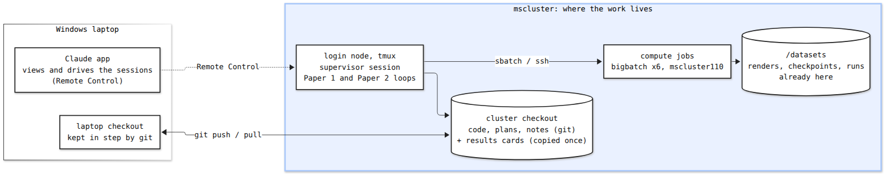

# 🧭 Runbook: keeping the Claude sessions running on the cluster

Navigation: 📋 [Index](../00-INDEX.md)

The supervisor and the paper loops run as Claude Code sessions in tmux on a `batch` node, so they keep working while the
laptop sleeps or WSL disconnects. A host job holds the node for a day, submits its own successor two hours before its
limit, and hands the sessions over through a lock file in the home folder (every node sees it; some nodes cannot see `/datasets` inside a job). Each session is resumed by name on the new node,
because its history lives in `~/.claude` on the shared home filesystem. The Claude app on Windows reaches each session
through Remote Control.

## Table of contents

- [1. What runs where](#1-what-runs-where)
- [2. The one-time setup](#2-the-one-time-setup)
- [3. Start, or restart after an outage](#3-start-or-restart-after-an-outage)
- [4. Look at the sessions](#4-look-at-the-sessions)
- [5. Add or retire a session](#5-add-or-retire-a-session)
- [6. Keep the laptop and the cluster in step](#6-keep-the-laptop-and-the-cluster-in-step)

## 1. What runs where

Navigation: 📋 [TOC](#table-of-contents) | [Next](#2-the-one-time-setup) ➡️

<a href="../../artifacts/notes/progress/setup/sketches/move-to-cluster.png"></a>

| Piece | Where |
|---|---|
| Host job `claude-host` | `batch` partition, 1-day limit; verified 2026-11-27 (job 97053 on mscluster164) that a `batch` job starts while all six `bigbatch` slots and the `biggpu` job are held, so it does not count against those caps |
| Scripts | `scripts/claude-host/`: `host.sbatch`, `up.sh`, `sessions.txt`, `prompts/` |
| Host state | `/home-mscluster/mmolefe/claude-host/`: `lock` (job id whose sessions are live), `takeover`, `started/<name>` (sessions that have run once), `logs/host-<job>.log` |
| Session history | `~/.claude/projects/` on the cluster's home filesystem, shared by every node |
| GPU work | still `sbatch` on `bigbatch` and the owner's `biggpu` job, per [the launch recipe](launching-and-harvesting-a-run.md) |

The login node is not used: the owner's rule is that Claude does not run there.

## 2. The one-time setup

Navigation: ⬅️ [What runs where](#1-what-runs-where) | 📋 [TOC](#table-of-contents) | [Next](#3-start-or-restart-after-an-outage) ➡️

These are the owner's steps; the sessions never handle credentials or their own permission settings.

1. **Log Claude in on the cluster.** From the laptop: `ssh mscluster`, then `srun -p batch -t 00:30:00 --pty bash`, then
   `/home-mscluster/mmolefe/.local/bin/claude` and sign in. You should see the prompt box; `/exit` leaves. The sign-in is
   stored under the cluster's home folder, so every later node finds it.
2. **Set the sessions' permission rules** in the cluster's `~/.claude/settings.json` (or put extra flags in
   `/home-mscluster/mmolefe/claude-host/host.env` as `CLAUDE_ARGS="..."`). A session in tmux stops and waits at any permission
   prompt nobody answers, so the rules decide how unattended it can be.
3. **Bring `~/.claude` and the learning tree to the cluster** as git clones (`git clone <your .claude repo> ~/.claude`,
   and the same for `~/goal-setting/learning`), then point any hook or setting that names `/home/molef/` at
   `/home-mscluster/mmolefe/`.

## 3. Start, or restart after an outage

Navigation: ⬅️ [One-time setup](#2-the-one-time-setup) | 📋 [TOC](#table-of-contents) | [Next](#4-look-at-the-sessions) ➡️

From the laptop repo root:

```bash
scripts/claude-host/up.sh
```

It copies the scripts and prompts to `/home-mscluster/mmolefe/claude-host/` and submits `host.sbatch`, unless a host job is
already queued or running. **Worked:** it prints `Submitted batch job <id>`, and `scripts/claude-host/up.sh status` shows
the job `RUNNING` with the lock holding its id. **Failed:** `cluster not answering` (the login node is down: wait and run
again), or the status shows no job (it ended during an outage: run `up.sh` again; the sessions resume by name).

## 4. Look at the sessions

Navigation: ⬅️ [Start](#3-start-or-restart-after-an-outage) | 📋 [TOC](#table-of-contents) | [Next](#5-add-or-retire-a-session) ➡️

- **From the Claude app:** each session appears under its name (`supervisor`, `paper1`, `paper2`) through Remote Control.
- **In the terminal:** `scripts/claude-host/up.sh status` names the node; then `ssh mscluster`, `ssh <node>`,
  `tmux -L claude-host attach`. `Ctrl-b n` moves between sessions, `Ctrl-b d` leaves them running.
- **The handover:** the host log shows `USR1: submitting the next host job` about 22 hours in, then on the new job
  `waiting for host <old> to hand over`, on the old one `takeover asked ... stopping sessions` and `lock released`, and
  on the new one `lock taken` and `started <name>` for each session.

## 5. Add or retire a session

Navigation: ⬅️ [Look](#4-look-at-the-sessions) | 📋 [TOC](#table-of-contents) | [Next](#6-keep-the-laptop-and-the-cluster-in-step) ➡️

Uncomment or add a `name|prompt.txt` line in `scripts/claude-host/sessions.txt`, put the prompt in
`scripts/claude-host/prompts/`, and run `up.sh`. The new session starts at the next host start; the prompt is used only
the first time, after which the session is resumed by name.

## 6. Keep the laptop and the cluster in step

Navigation: ⬅️ [Add or retire](#5-add-or-retire-a-session) | 📋 [TOC](#table-of-contents)

Code, plans and notes travel by git. When the cluster cannot reach GitHub, send the commits as a bundle through
`/datasets`:

```bash
git bundle create /tmp/sync.bundle <cluster commit>..HEAD
scp /tmp/sync.bundle mscluster:/datasets/mmolefe/poe_repair_min/sync.bundle
ssh mscluster "cd /home-mscluster/mmolefe/Playground/PhD/concept-composition && git fetch /datasets/mmolefe/poe_repair_min/sync.bundle HEAD && git merge --ff-only FETCH_HEAD"
```

The merge refuses if the cluster checkout has uncommitted edits to a file the commits change; look at the edit with
`git diff <file>`, keep it with `git stash push -m "<why>" <file>`, then merge again.
