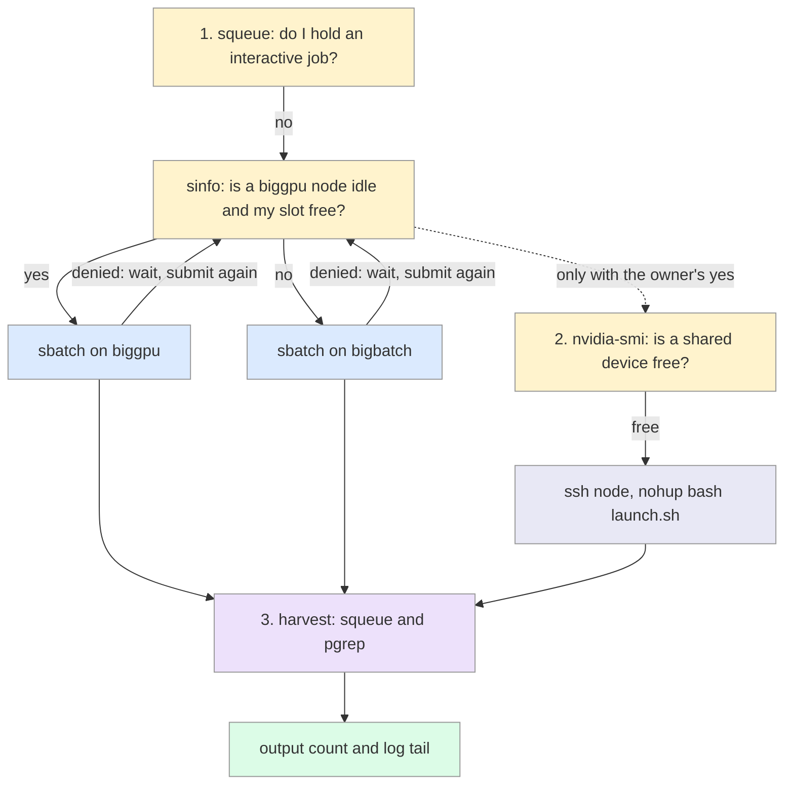

# 🧭 Runbook: launching and harvesting a run on the cluster

Navigation: 📋 [Index](../00-INDEX.md)

Contents: [1. Decide where a run goes](#1-decide-where-a-run-goes) ·
[2. Launch on a shared device](#2-launch-on-a-shared-device) ·
[3. Harvest what is running](#3-harvest-what-is-running)

The full reasoning behind each step, the mandatory safety rules for the shared-device path, and
the disk-guard and `co3`-path checks a job must pass before it starts are in the
[launch protocol](../../environment/hpc/execution-protocol.md). This theme holds only the commands;
that file holds the why.

## Table of contents

- [1. Decide where a run goes](#1-decide-where-a-run-goes)
- [2. Launch on a shared device](#2-launch-on-a-shared-device)
- [3. Harvest what is running](#3-harvest-what-is-running)
- [🖼️ In pictures, code and further reading](#in-pictures-code-and-further-reading)
- [Cross-references](#cross-references)

## 1. Decide where a run goes

Navigation: 📋 [TOC](#table-of-contents) | [Next](#2-launch-on-a-shared-device) ➡️

`unverified`, written 2026-11-22 from `environment/hpc/execution-protocol.md`, not run this
sitting

GPU work goes through `sbatch`, inside the administrator's caps of one `biggpu` job and six
`bigbatch` jobs per user. In order, stop at the first match.

⚠️ The `sbatch` line starts a real job on the cluster, so check the partition and time limit in its header first.

```bash
scripts/cluster.sh sh "squeue -u mmolefe"   # your own interactive job on biggpu? run inside it
scripts/cluster.sh sh "sinfo -p biggpu"     # idle biggpu node and your one biggpu job slot free? use biggpu, else bigbatch
scripts/cluster.sh run "sbatch scripts/<job>.sbatch"   # commit first; its header names the partition
```

✅ Expected: `squeue` lists your own jobs, `sinfo` shows node states, and `sbatch` prints
`Submitted batch job <id>`.

❌ **`sbatch` is denied**: an administrator cap was reached. Wait and submit again. An SSH launch
instead needs the owner's yes, filed with `python3 scripts/progress_board.py ask`.

## 2. Launch on a shared device

Navigation: ⬅️ [Previous](#1-decide-where-a-run-goes) | 📋 [TOC](#table-of-contents) | [Next](#3-harvest-what-is-running) ➡️

`unverified`, transcribed 2026-08-24, not run this sitting

⚠️ Needs the owner's yes through `python3 scripts/progress_board.py ask` before it runs, and so do
the `nohup` commands recorded in other recipes. It starts a real process outside Slurm on a node
another user may be sharing. Read the safety rules in
`execution-protocol.md` first (never start on a device carrying a foreign process, re-check the
device inside the launch script itself, keep VRAM within the free device only, record node/device/PID
in the log header). A free device reads roughly 0MiB used and 0% utilisation.

```bash
ssh <node> nvidia-smi --query-gpu=index,memory.used,utilization.gpu --format=csv
ssh <node> 'GPU=<free index> nohup bash /abs/path/to/launch.sh > /abs/path/to/logs/<name>.log 2>&1 &'
sleep 5; ssh <node> 'pgrep -af "train"; tail -20 /abs/path/to/logs/<name>.log'
```

**Every path must be absolute.** A non-interactive SSH command starts in `$HOME`, not the repo,
and `cd <repo> &&` is not reliable (`known-failures.md`, entry `poe-launch-001`, three identical
silent failures on 2026-08-19). The launch script does `cd "$REPO"` internally so the caller
needs no working directory.

✅ Expected: the `pgrep` line shows the new process; the log tail shows the block of checks that
runs before anything else passing (disk guard, `co3` path check, `nvidia-smi` guard) followed by
real training/generation output.

❌ **`pgrep` shows nothing**: the launch failed before backgrounding; read the full log, not just
the tail, for the guard that aborted it before the run started.

## 3. Harvest what is running

Navigation: ⬅️ [Previous](#2-launch-on-a-shared-device) | 📋 [TOC](#table-of-contents) | [Next](#in-pictures-code-and-further-reading) ➡️

`unverified`, transcribed 2026-08-24, not run this sitting

Two execution modes, and Slurm only sees one of them:

```bash
scripts/cluster.sh sh "squeue -u mmolefe"   # normal sbatch jobs
scripts/cluster.sh sh "ssh <node> \"pgrep -af 'sweep|train'\""   # runs launched with nohup; invisible to squeue
```

**Why both.** New runs go through `sbatch`, and Slurm sees them. A run already started with `nohup`
outside Slurm, or one the owner approved that way, is invisible to it, so a harvest that only
checks `squeue` will report "nothing running" while a real run is still going on another node.

✅ Expected: the output count against what the plan expected, and the tail of the log, per
`CLAUDE.md`'s "Harvest reads three execution modes, not one."

No ❌ branch beyond an unreachable node, which is an SSH/network problem, not a harvest problem.

<!-- related:start (drain) -->
<a id="in-pictures-code-and-further-reading"></a>

## 🖼️ In pictures, code and further reading

Navigation: ⬅️ [Previous](#3-harvest-what-is-running) | 📋 [TOC](#table-of-contents) | [Next](#cross-references) ➡️

A launch on this cluster is an `sbatch` submission and a two-mode harvest, with an SSH route that needs the owner's yes. The pictures below are a flowchart of that order and the guard block one real launcher runs before it starts anything.

### How it fits together



*Key: yellow is a check before anything starts, blue a queue, grey a process you started, purple the read of what is running, green what you keep.* Read it top to bottom: the first two yellow boxes and the blue boxes are section 1, the third yellow box and the grey box are section 2, the purple and green boxes are section 3. Section 1 stops at the first match, so a held interactive job is used directly. The chart draws the path where that answer is no, and the dashed edge opens only with the owner's yes.

### The code behind it

The guard block of `1-lora-correction/scripts/mechanism_study/run_corrector_curve.sh` (lines 37 to 45) is what "re-check the device inside the launch script itself" means in section 2:

```bash
USED_MIB=$(nvidia-smi --query-gpu=memory.used --format=csv,noheader,nounits -i "$GPU" | tr -dc '0-9')
if [ "${USED_MIB:-9999}" -gt 1024 ]; then
  echo "guard: device $GPU has ${USED_MIB}MiB in use (>1GiB), refusing to start on a foreign process" >&2
  exit 4
fi
UTIL=$(nvidia-smi --query-gpu=utilization.gpu --format=csv,noheader -i "$GPU")
case "$UTIL" in *N/A*|*reset*) echo "guard: device $GPU reports utilization '$UTIL' (faulted, poe-launch-002), refusing" >&2; exit 6 ;; esac
export CUDA_VISIBLE_DEVICES="$GPU"
"$PY" -c 'import torch, sys; sys.exit(0 if torch.cuda.is_available() else 7)' || { echo "guard: torch.cuda.is_available() is False on device $GPU, refusing (poe-launch-002)" >&2; exit 7; }
```

- Line 37 reads memory in use in MiB; line 38 refuses above 1024, which is the "foreign process" rule.
- Lines 42 and 43 refuse a faulted card, whose utilisation reads `[N/A]` or contains `reset`; this is `poe-launch-002`.
- Line 45 refuses a card that lists in `nvidia-smi` but cannot run torch, the third way a device can look free and not be.

**Two scripts, two thresholds.** `scripts/launch_sdlora.sh` accepts a device with under 100 MiB in use, or under 4096 MiB in use at 0% utilisation, because one device carries an idle 2.9 GB residency from another user (its own comment). `run_corrector_curve.sh` refuses anything above 1024 MiB. The page's section 1 describes a free device as roughly 0 MiB used; the two scripts differ from each other and from that description, and this block changes none of them.

### What comes out

No recorded output of these three commands is on this page, and each section is marked `unverified`. Two recipes that did run on a shared device record what came back: the corrector recipe's [step 5](running-the-langevin-corrector.md#5-render-the-eight-seed-sheets-the-adapter-tail-and-the-clean-tail) lists its output files and row counts, and the probing recipe's [step 3](probing-a-pooled-lora-checkpoint.md#3-resume-a-pooled-training-from-a-checkpoint-on-a-free-device---ran-2026-09-01) quotes a real log.

### Go deeper

| What | Link |
|---|---|
| Launch protocol, with the reasons and the safety rules | [execution protocol](../../environment/hpc/execution-protocol.md) |
| Which node has which card and which python | [the cluster nodes](../../environment/hpc/nodes.md) |
| How long a step, a save and an eval take | [throughput](../../environment/hpc/throughput.md) |
| The relative-path launch failure | [poe-launch-001](../../environment/known-failures.md#entry-id-poe-launch-001) |
| A recipe that uses the guards on a seven-stage launcher | [running the Langevin corrector](running-the-langevin-corrector.md) |
| A recipe that resumes and trains on a free device | [probing a pooled LoRA checkpoint](probing-a-pooled-lora-checkpoint.md) |
| Reading the log a launch writes | [reading a training run](../looking-at-what-a-run-produced/reading-a-training-run.md) |

### Still open

- No screenshot or pasted output of `squeue`, `sinfo` or the `nvidia-smi` query exists for this page; all three sections are `unverified`.
- No picture shows a launch. The only path under an `artifacts/` folder with "launch" in its name is a walk folder in `1-lora-correction/artifacts/drips/answering-the-reviewers/`, and it holds two markdown files.
<!-- related:end -->

## Cross-references

Navigation: ⬅️ [Previous](#in-pictures-code-and-further-reading) | 📋 [TOC](#table-of-contents)

- The mention of **SSH launch**, whose relative paths resolve in `$HOME` and kill the run before `nohup` starts, in [the failure catalog entry poe-launch-001](../../environment/known-failures.md#entry-id-poe-launch-001).
- The mention of **one-job-per-user rule** in [the PRZE-10 compute plan](../../1-lora-correction/report/paper-review/prze-10-compute.md), whose third outcome starts long jobs with `nohup` and checks them with `pgrep`, a route that needs the owner's yes.
- The mention of **launch on a shared device** in [the environment index, under Before I...](../../environment/00-INDEX.md#before-i).

<!-- built-to: PAGE_LOOK_FORMAT v1 -->
