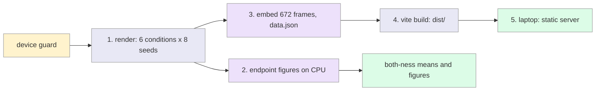
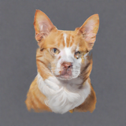

<a id="reproducing-where-each-condition-lands"></a>

# 🧭 Runbook: reproducing where each condition lands

Navigation: 📋 [Index](../00-INDEX.md)

Contents: [Before any of these](#before-any-of-these) |
[1. Render the references and the per-step frames on a shared device](#1-render-the-references-and-the-per-step-frames-on-a-shared-device) |
[2. Make the endpoint figures and their sidecar](#2-make-the-endpoint-figures-and-their-sidecar) |
[3. Embed the frames and export the page's data](#3-embed-the-frames-and-export-the-pages-data) |
[4. Build the page from Diffusion Explorer's UI and open it](#4-build-the-page-from-diffusion-explorers-ui-and-open-it) |
[5. Open the built page on a laptop with no cluster tunnel](#5-open-the-built-page-on-a-laptop-with-no-cluster-tunnel) |
[If something looks wrong](#if-something-looks-wrong) |
[Where this came from](#where-this-came-from)

The whole chain behind [the finding on where each condition lands](../../1-lora-correction/report/when-does-the-outcome-lock-in/where-does-each-condition-land.md):
render the joint prompt, each concept alone, plain product-of-experts and the corrected run on
the same seeds, embed the results, draw the two figures, and build the animated page. The renders
need a GPU on the cluster; everything after them runs on the session node's CPU; the page builds
with the Node that is already on the cluster. Which card takes which python build is a fact owned
by [nodes](../../environment/hpc/nodes.md); how to pick a free device, once the owner has said yes, is
[launching a run § 2](launching-and-harvesting-a-run.md#2-launch-on-a-shared-device).

**What "the port" is, said once.** SDXL is not ported into Diffusion Explorer. That tool's models
are two-number toys trained in the browser, so nothing of ours runs inside it. What is ported is
the other way round: the tool's UI source (`packages/ui/src`) is vendored into
`1-lora-correction/artifacts/scenes/where-each-condition-lands/vendor/ui/` and its time slider and legend components
drive a page fed by our own precomputed frames. The comparison itself (joint versus A versus B
versus PoE versus PoE plus correction) is a set of Python samplings on the cluster, recipes 1 to 3.

## Table of contents

- [Before any of these](#before-any-of-these)
- [1. Render the references and the per-step frames on a shared device](#1-render-the-references-and-the-per-step-frames-on-a-shared-device)
- [2. Make the endpoint figures and their sidecar](#2-make-the-endpoint-figures-and-their-sidecar)
- [3. Embed the frames and export the page's data](#3-embed-the-frames-and-export-the-pages-data)
- [4. Build the page from Diffusion Explorer's UI and open it](#4-build-the-page-from-diffusion-explorers-ui-and-open-it)
- [5. Open the built page on a laptop with no cluster tunnel](#5-open-the-built-page-on-a-laptop-with-no-cluster-tunnel)
- [If something looks wrong](#if-something-looks-wrong)
- [Where this came from](#where-this-came-from)
- [🖼️ In pictures, code and further reading](#in-pictures-code-and-further-reading)

## Before any of these

Navigation: 📋 [TOC](#table-of-contents) | [Next](#1-render-the-references-and-the-per-step-frames-on-a-shared-device) ➡️

- [ ] 🖥️ **The owner has said yes to this SSH launch.** New GPU work goes through `sbatch`. A recipe below that starts a process with `nohup` records how a past run was launched, and running it again needs the owner's yes through `python3 scripts/progress_board.py ask`.
- [ ] 🖥️ **The repo is on the branch that has the scripts**
  ```bash
  ls /home-mscluster/mmolefe/Playground/PhD/concept-composition/1-lora-correction/scripts/showcase/where_each_condition_lands_*
  ```
  ✅ **Five files**: `_render.py`, `_trajectories.py`, `_plot.py`, `_frames_embed.py`, `_shared_device.sh` (plus `_dynamics.py`, which draws the both-ness-over-steps figure).
  ❌ Fewer: you are on an older branch; the scripts landed on `overhaul/tree-2026-08-10` on 2026-09-05.

- [ ] 🖥️ **The rank-32 checkpoint and the training cache exist**
  ```bash
  ls /datasets/mmolefe/poe_repair_min/outputs/showcase/phase1_r32_100k/checkpoints/lora_step_030050.pt \
     /datasets/mmolefe/poe_repair_min/artifacts/caches/training_cache/heldout/a_cat__x__a_dog/seed_9/residuals/step_000.pt
  ```
  ✅ **Both paths print.** The checkpoint is the correction; the cache's `step_000.pt` is the pinned initial noise every condition starts from.
  ❌ **`No such file`**: the checkpoint or the cache moved; the finding's "Where this came from" table names what they are.

## 1. Render the references and the per-step frames on a shared device

Navigation: ⬅️ [Previous](#before-any-of-these) | 📋 [TOC](#table-of-contents) | [Next](#2-make-the-endpoint-figures-and-their-sidecar) ➡️

⚠️ Starts a GPU job outside Slurm, so it needs the owner's yes. Do [Before any of these](#before-any-of-these) first.

`ran 2026-09-05` (references on mscluster110 device 0, frames on mscluster109 device 1)


**When you need this**

You want the 48 samplings (six conditions by eight held-out seeds of cat × dog) with their
per-step decoded estimates, or only the three single-prompt references as final images.

**Fill in**

| What | Example | Where to get it |
|---|---|---|
| node | `mscluster109` | a `biggpu` node with a free device, per [launching a run § 2](launching-and-harvesting-a-run.md#2-launch-on-a-shared-device) |
| device | `1` | the free index from `nvidia-smi` on that node; the script refuses a device with more than 1 GiB in use or a faulted one |
| stage | `frames` | `render` writes only the three references' final images; `frames` writes every condition at 14 saved steps |

With the owner's yes, launch over SSH, absolute paths only, then check it is alive and on the GPU:

```bash
ssh mscluster109 'GPU=1 STAGE=frames nohup bash /home-mscluster/mmolefe/Playground/PhD/concept-composition/1-lora-correction/scripts/showcase/where_each_condition_lands_shared_device.sh > /datasets/mmolefe/poe_repair_min/outputs/showcase/logs/where_each_condition_lands_frames.log 2>&1 &'
sleep 90
ssh mscluster109 'pgrep -af where_each_condition | grep -v pgrep; nvidia-smi --query-gpu=index,memory.used,utilization.gpu --format=csv,noheader'
tail -4 /datasets/mmolefe/poe_repair_min/outputs/showcase/logs/where_each_condition_lands_frames.log
```

✅ **Two processes, the device shows memory and utilisation, and runs land at about 16 seconds
each (36 for the corrected ones).** Real output, 2026-09-05, mscluster109:
```
1846708 bash /home-mscluster/mmolefe/Playground/PhD/concept-composition/scr
1846722 /home-mscluster/mmolefe/miniforge3/envs/co3/bin/python scripts
1, 15712 MiB, 100 %
[solo_b] seed=9 14 frames (16.0s)
[joint] seed=9 14 frames (15.9s)
```
The whole `frames` stage is 48 runs, about 20 minutes. It ends with `[done]` in the log and
`frames_manifest.json` under
`/datasets/mmolefe/poe_repair_min/outputs/showcase/where_each_condition_lands/frames/`. A
run whose `step_050.png` already exists is skipped, so a relaunch finishes what died.

❌ **`torch.OutOfMemoryError` in the log**: a co-tenant holds most of the card. SDXL at 1024 px
needs more than about 8 GB free. Pick another device; do not lower the resolution, every other
render in the finding is 1024 px.

❌ **`guard: device N reports utilization '[N/A]' (faulted)` or `torch.cuda.is_available() is
False`**: the card is in the fault state of
[poe-launch-002](../../environment/known-failures.md); pick another node. Before the guard existed
this ran on the CPU at 15 minutes per run with nothing in the log saying why.

❌ **`CUDA error` on mscluster110 to 112 within the first minute**: the script picked `co3`
instead of `co3_bw` for a Blackwell card; the `case "$(hostname -s)"` block at the top of the
launch script is where the mapping lives.

❌ **Reference frames differ from the earlier reference renders by more than a few grey levels**:
the references were rendered after the adapter was attached. The frames script renders the three
references first and attaches the adapter only for the `poe`, `lora_1.0` and `lora_1.2` runs,
because the windowed sampler leaves the adapter enabled when it returns. Move the bad reference
folders aside and relaunch with `--conditions solo_a,solo_b,joint`.

**Variations**

- Only the references' final images, for the endpoint figures: `STAGE=render`, about 10 seconds
  a render, output under `.../where_each_condition_lands/{solo_a,solo_b,joint}/seed_<n>.png`.
- A subset: append `--seeds 9,10 --conditions joint,poe` to the SSH line; the launch script
  passes its arguments through.

<details>
<summary><b>What the six conditions are, and what is held fixed</b></summary>

**The runs**

Cat alone, dog alone, and "a cat and a dog" are plain classifier-free-guidance samplings.
Plain PoE is the windowed LoRA sampler at λ 0, which is the same arithmetic as the product of
experts. The two corrected runs are the same sampler with the rank-32 step-30050 adapter's
residual added at λ 1.0 and λ 1.2 on every step. All six start from the seed's cached
step-0 latent, run 50 DDIM steps at guidance 7.5, and decode at 1024 px, so only the prompt and
the correction differ between any two runs of one seed.

**The frames**

At steps 0, 2, 5, 8, 10, 15, 20, 25, 30, 35, 40, 45 and 49 the script takes the sampler's own
latent and guided noise prediction, forms the Tweedie mean (the model's current guess at the
finished image), decodes it, and saves it at 256 px. The final image is saved as step 50.
</details>

## 2. Make the endpoint figures and their sidecar

Navigation: ⬅️ [Previous](#1-render-the-references-and-the-per-step-frames-on-a-shared-device) | 📋 [TOC](#table-of-contents) | [Next](#3-embed-the-frames-and-export-the-pages-data) ➡️

`ran 2026-09-05` on mscluster85, CPU


**When you need this**

The three references' final images exist (recipe 1, `STAGE=render`) and the rank-32 renders
exist under `outputs/showcase/figure_r32_030050/renders/full/`, and you want the two endpoint
plots, the contact sheet and the sidecar.

```bash
cd /home-mscluster/mmolefe/Playground/PhD/concept-composition
XFORMERS_DISABLED=1 CUDA_VISIBLE_DEVICES="" /home-mscluster/mmolefe/miniforge3/envs/co3/bin/python 1-lora-correction/scripts/showcase/where_each_condition_lands_plot.py
```

✅ **The both-ness means print and three files land.** Real output, 2026-09-05:
```
both-ness by condition (mean over seeds): {'solo_a': -0.0, 'solo_b': 0.0, 'joint': 0.523, 'poe': 0.205, 'lora_1.0': 0.411, 'lora_1.2': 0.42}
wrote /home-mscluster/mmolefe/Playground/PhD/concept-composition/1-lora-correction/artifacts/results/what-the-correction-is/when-it-acts/where-does-each-condition-land/cat-x-dog-in-dino-space.png/.json
```
Beside them: `cat-x-dog-in-dino-space-cloud-axes.png` and `cat-x-dog-in-dino-space-dino-feats.npy`.
About two minutes, most of it DINOv2 on the CPU.

❌ **`NotImplementedError` from `xformers ... fmha`**: `XFORMERS_DISABLED=1` was dropped. The
DINOv2 hub code routes attention through xformers, which has no CPU kernel.

❌ **`missing render: .../solo_a/seed_13.png`**: recipe 1's `render` stage has not covered
that seed.

## 3. Embed the frames and export the page's data

Navigation: ⬅️ [Previous](#2-make-the-endpoint-figures-and-their-sidecar) | 📋 [TOC](#table-of-contents) | [Next](#4-build-the-page-from-diffusion-explorers-ui-and-open-it) ➡️

`ran 2026-09-05` on mscluster85, CPU


**When you need this**

Recipe 1's `frames` stage has finished and you want the page's `data.json` and thumbnails, plus
the frames' embeddings beside the finding's other numbers.

```bash
cd /home-mscluster/mmolefe/Playground/PhD/concept-composition
XFORMERS_DISABLED=1 CUDA_VISIBLE_DEVICES="" /home-mscluster/mmolefe/miniforge3/envs/co3/bin/python 1-lora-correction/scripts/showcase/where_each_condition_lands_frames_embed.py
```

✅ **672 frames embedded, the step-50 both-ness means match recipe 2's to within 0.01, and the
scene's `public/` fills.** Real output, 2026-09-05:
```
embedded 672 frames
both-ness at step 50 (mean over seeds): {'solo_a': -0.0, 'solo_b': -0.0, 'joint': 0.53, 'poe': 0.215, 'lora_1.0': 0.4161, 'lora_1.2': 0.4138}
wrote .../artifacts/scenes/where-each-condition-lands/public/data.json and 672 thumbnails
```
About five minutes. The axes are refit on this run's own step-50 references, so the numbers are
not byte-identical to recipe 2's.

❌ **The corrected runs' both-ness at step 50 lands near the PoE value (0.27 rather than 0.41)**:
the references carry the adapter; see the last ❌ branch of recipe 1.

❌ **`missing run joint seed 9: 0 frames on disk`**: a run's folder is absent; relaunch recipe 1,
which skips finished runs.

## 4. Build the page from Diffusion Explorer's UI and open it

Navigation: ⬅️ [Previous](#3-embed-the-frames-and-export-the-pages-data) | 📋 [TOC](#table-of-contents) | [Next](#5-open-the-built-page-on-a-laptop-with-no-cluster-tunnel) ➡️

⚠️ Overwrites the vendored UI under `vendor/ui` and rewrites `dist/`, so list both folders with `ls` first and confirm nothing there is unsaved.

`ran 2026-09-05` on mscluster85


**When you need this**

`public/data.json` and `public/frames/` exist (recipe 3) and you want the animated page, or
you changed `src/App.svelte`.

The vendored UI is already in the repo. Refresh it only when upstream has something you want:

```bash
cd /tmp && git clone -q --depth 1 https://github.com/helblazer811/Diffusion-Explorer.git
cp -r Diffusion-Explorer/diffusion-explorer/packages/ui/src /home-mscluster/mmolefe/Playground/PhD/concept-composition/1-lora-correction/artifacts/scenes/where-each-condition-lands/vendor/ui
```

Build:

```bash
cd /home-mscluster/mmolefe/Playground/PhD/concept-composition/1-lora-correction/artifacts/scenes/where-each-condition-lands
npm install
npx vite build
```

✅ **`✓ built`, with `dist/` about 26 MB.** Real output, 2026-09-05:
```
dist/index.html                   0.41 kB │ gzip:   0.27 kB
dist/assets/index-cGwOTlfR.css    7.51 kB │ gzip:   2.24 kB
dist/assets/index-BnbD86gT.js   347.59 kB │ gzip: 119.64 kB
✓ built in 7.91s
```

Then open it through the scene server and tunnel already documented:
[serve the scenes folder](../looking-at-what-a-run-produced/showing-a-scene-in-the-local-browser.md#1-serve-the-scenes-folder-from-a-tmux-session),
[forward the port](../looking-at-what-a-run-produced/showing-a-scene-in-the-local-browser.md#2-forward-the-port-and-open-it-on-the-laptop),
and browse to

```
http://localhost:8800/where-each-condition-lands/dist/index.html
```

❌ **Blank page and a console error about `data.json`**: recipe 3 has not run, or `dist/` was
built before it did; `public/` is copied into `dist/` at build time, so rebuild.

❌ **Slider present but the points do not move**: the page fetched a `data.json` whose `steps`
list is a single entry; recipe 1 was run with `STAGE=render` (final images only) rather than
`frames`.

**Variations**

- Live editing of the page: `npm run dev` binds `127.0.0.1:5174`; forward that port the same way
  and open `http://localhost:5174/`.
- Screenshots without a browser on the laptop: `npm install --no-save playwright && npx playwright install chromium`
  inside the scene folder puts a headless Chromium in `~/.cache/ms-playwright`; the three
  screenshots in the results folder were taken that way against the dev server.

<details>
<summary><b>What the page borrows, and what it does not</b></summary>

**Borrowed**

The `TimeSlider`, `Slider` and `FigureLegend` Svelte components, used unchanged in their
"legacy" mode (value in, callback out; no Player object). The design: precomputed frames, one
slider driving every panel, a plane the points move in, the classifier-free-guidance page's idea
of drawing several predictions on one moving sample.

**Not borrowed**

Any model, any training, any TensorFlow.js. The tool's `@diffusion-explorer/ui` package also
depends on a private `@helblazer811/tempus` animation package that is not on the public npm
registry; the page imports the three components by file path so that dependency is never
resolved.
</details>

## 5. Open the built page on a laptop with no cluster tunnel

Navigation: ⬅️ [Previous](#4-build-the-page-from-diffusion-explorers-ui-and-open-it) | 📋 [TOC](#table-of-contents) | [Next](#if-something-looks-wrong) ➡️

`unverified`, written 2026-09-05 from the build's `base: './'` setting, not run


**When you need this**

You want the page on your own machine, for a talk or a supervisor meeting off the cluster.

On the laptop:

```bash
rsync -av mmolefe@mscluster85.ms.wits.ac.za:/home-mscluster/mmolefe/Playground/PhD/concept-composition/1-lora-correction/artifacts/scenes/where-each-condition-lands/dist/ ~/where-each-condition-lands/
cd ~/where-each-condition-lands && python3 -m http.server 8800
```

Then browse to `http://localhost:8800/`.

✅ **Expected**: the same page as recipe 4. The build uses relative asset paths, so any static
server at the folder root works.

❌ **Opening `index.html` by double-click shows a blank page**: `file://` pages cannot fetch
`data.json`; the local server above is the fix.

## If something looks wrong

Navigation: ⬅️ [5. Open the built page on a laptop](#5-open-the-built-page-on-a-laptop-with-no-cluster-tunnel) | 📋 [TOC](#table-of-contents) | [Next](#where-this-came-from) ➡️

**The numbers do not match the finding.** The finding's both-ness means are in its rung 1 and
rung 4 with their files; recipe 2 and recipe 3 print the same fields. A difference above 0.02 on
any condition means a render changed. Compare a fresh PoE render against
`outputs/showcase/figure_r32_030050/renders/full/seed_9_lambda_0.0.png`: the same settings agree
to a mean pixel difference of about 2 on the 0 to 255 scale, anything above 10 is a different
sampling.

**A `pkill -f` from the session node killed the session shell (exit 144).** The pattern matched
the calling command line. Kill by PID from `pgrep -f "[w]here_each"` instead.

## Where this came from

Navigation: ⬅️ [If something looks wrong](#if-something-looks-wrong) | 📋 [TOC](#table-of-contents) | [Next](#in-pictures-code-and-further-reading) ➡️

Captured from the session of 2026-09-05 that produced the finding, with every ✅ block pasted from
that session's real output and every ❌ branch a failure hit that day: the co-tenant OOM on
mscluster85, the `co3` build on a Blackwell card, the CPU fallback on mscluster111, the
adapter-contaminated references, and the xformers CPU error. Recipe 5 is the one part not run,
and is marked so. The finding that consumes these outputs is
[where does each condition land](../../1-lora-correction/report/when-does-the-outcome-lock-in/where-does-each-condition-land.md); the plan that
owns the run is
[where each condition lands](../../1-lora-correction/plans/05-when-does-the-outcome-lock-in/plans/figures/06-where-each-condition-lands.md).

<!-- related:start (drain) -->
<a id="in-pictures-code-and-further-reading"></a>

## 🖼️ In pictures, code and further reading

Navigation: ⬅️ [Previous](#where-this-came-from) | 📋 [TOC](#table-of-contents)

The finding this recipe chain feeds compares six runs from one starting noise. The pictures below are the 160 px thumbnails recipe 3 makes from one seed's final frames, and the code above them is the function that decodes the running estimate at each saved step.

### How it fits together



*Key: yellow is the device check, grey is a build or render, purple is a measurement on the CPU, green is what you open.* Only recipe 1 needs a GPU.

### The code behind it

`dump_frames`, with the constants and save helper above it, in `1-lora-correction/scripts/showcase/where_each_condition_lands_trajectories.py` (lines 61 to 91) is what recipe 1's `frames` stage runs for each condition:

```python
FRAME_STEPS = (0, 2, 5, 8, 10, 15, 20, 25, 30, 35, 40, 45, 49)
THUMB = 256
CONDITIONS = ("solo_a", "solo_b", "joint", "poe", "lora_1.0", "lora_1.2")


def _save(img01: torch.Tensor, path: Path) -> None:
    arr = (img01[0].clamp(0, 1).permute(1, 2, 0).float().cpu().numpy() * 255).round().astype("uint8")
    Image.fromarray(arr).resize((THUMB, THUMB), Image.LANCZOS).save(path)


def dump_frames(out: "SamplerOutputs", ctx, cond_dir: Path) -> list[dict]:
    """Decode x̂0 at FRAME_STEPS from the tracker, plus the final image."""
    cond_dir.mkdir(parents=True, exist_ok=True)
    tr = out.tracker
    frames = []
    for k in FRAME_STEPS:
        z = tr.trajectories[k].to(device=ctx.device, dtype=ctx.dtype)
        eps = tr.velocities[k].to(device=ctx.device, dtype=ctx.dtype)
        t = int(tr.timesteps[k].item())
        ab = ctx.scheduler.alphas_cumprod[t].to(device=ctx.device, dtype=ctx.dtype)
        x0 = tweedie_mean(z, ab, eps)
        img = decode_latents(ctx.models, x0)
        p = cond_dir / f"step_{k:03d}.png"
        _save(img, p)
        frames.append({"step": k, "timestep": t, "png": str(p)})
        del z, eps, x0, img
    p = cond_dir / "step_050.png"
    _save(out.image, p)
    frames.append({"step": 50, "timestep": 0, "png": str(p)})
    torch.cuda.empty_cache()
    return frames
```

- Line 61 is the 13 saved steps; with the final image on line 87 to 89 that is the 14 frames per run the recipe counts.
- Lines 77 to 81 take the sampler's own latent and guided prediction at step `k` and form the Tweedie mean, the model's current guess at the finished image.
- Line 82 decodes it and line 84 saves it at 256 px (`THUMB`, line 62); the scene's own thumbnails are 160 px.

### What comes out

| <a href="../../1-lora-correction/artifacts/scenes/where-each-condition-lands/public/frames/joint/seed_9/step_050.png"></a> | <a href="../../1-lora-correction/artifacts/scenes/where-each-condition-lands/public/frames/poe/seed_9/step_050.png"></a> | <a href="../../1-lora-correction/artifacts/scenes/where-each-condition-lands/public/frames/lora_1.2/seed_9/step_050.png"></a> |
|---|---|---|
| joint prompt | plain PoE | PoE plus correction, λ 1.2 |

Seed 9, the final image of three of the six conditions, read from the scene's frame folder `verified` (opened; the six conditions at step 10 and step 50 were also read side by side). The joint prompt gives a cat beside a dog, plain PoE gives one animal with a cat's ears and a dog's face, and the corrected run at λ 1.2 gives a cat beside a dog again. The finding's both-ness means (joint 0.523, plain PoE 0.205, λ 1.2 0.42) are printed by recipe 2 and quoted on the page `stated` (page); the pictures here do not measure them. The other three conditions (cat alone, dog alone, λ 1.0) are in the same folders.

### Go deeper

| What | Link |
|---|---|
| The animated page, its card and how to build it | [where each condition lands, scene card](../../1-lora-correction/artifacts/scenes/where-each-condition-lands/README.md) |
| The finding these outputs feed | [where does each condition land](../../1-lora-correction/report/when-does-the-outcome-lock-in/where-does-each-condition-land.md) |
| The plan that owns the run | [where each condition lands, plan](../../1-lora-correction/plans/05-when-does-the-outcome-lock-in/plans/figures/06-where-each-condition-lands.md) |
| Serving the scene and forwarding the port | [showing a scene in the local browser](../looking-at-what-a-run-produced/showing-a-scene-in-the-local-browser.md) |
| Nodes and python builds | [the cluster nodes](../../environment/hpc/nodes.md) |
| The adapter-left-on failure | [known failures](../../environment/known-failures.md) |

### Still open

- The endpoint figures and the dino-space plots recipe 2 writes, under `1-lora-correction/artifacts/results/what-the-correction-is/when-it-acts/where-does-each-condition-land/`, are not on this checkout: that folder does not exist, and `RENAMES.md` has no entry for it. The finding links pictures in it too.
- No published link for the scene is recorded in any card this block read.
- No screenshot of the built page exists on disk. The finding embeds two from the missing folder, while recipe 4 and the finding's link to its figure explainer say there are three.
- Recipe 5 is `unverified`; no picture shows it.
<!-- related:end -->

<!-- built-to: PAGE_LOOK_FORMAT v1 -->
