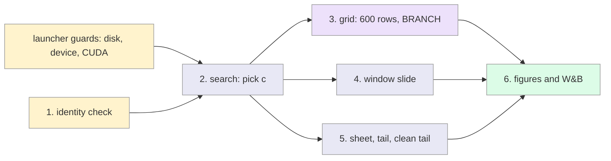

<a id="running-the-langevin-corrector"></a>

# 🧭 Runbook: running the Langevin corrector

Navigation: 📋 [Index](../00-INDEX.md)

Contents: [Before any of these](#before-any-of-these) |
[1. Prove the corrector is off when it is switched off](#1-prove-the-corrector-is-off-when-it-is-switched-off) |
[2. Fix the step size before reading any curve](#2-fix-the-step-size-before-reading-any-curve) |
[3. Run the corrector-count grid and print its verdict](#3-run-the-corrector-count-grid-and-print-its-verdict) |
[4. Slide a corrector window across the run](#4-slide-a-corrector-window-across-the-run) |
[5. Render the eight-seed sheets, the adapter tail and the clean tail](#5-render-the-eight-seed-sheets-the-adapter-tail-and-the-clean-tail) |
[6. Draw the figures and log the set to W&B](#6-draw-the-figures-and-log-the-set-to-wb) |
[If something looks wrong](#if-something-looks-wrong) |
[Where this came from](#where-this-came-from)

Every recipe behind the three corrector findings:
[does a Langevin corrector remove part of the correction](../../1-lora-correction/report/is-the-gap-the-samplers-or-the-models/does-a-langevin-corrector-remove-part-of-the-correction.md),
[does a corrector alone produce two animals](../../1-lora-correction/report/is-the-gap-the-samplers-or-the-models/does-a-corrector-alone-produce-two-animals.md),
and [can a corrector or a clean tail sharpen the adapter's renders](../../1-lora-correction/report/is-the-gap-the-samplers-or-the-models/can-a-corrector-or-a-clean-tail-sharpen-the-adapters-renders.md).

One launcher drives all of them, `1-lora-correction/scripts/mechanism_study/run_corrector_curve.sh`, picked by a
`STAGE` variable. It carries its own disk guard, its own device guard and a CUDA probe, so a
faulted card or a device another user just took is refused rather than run on. Which card takes
which python build is owned by [nodes](../../environment/hpc/nodes.md); how to pick a free device,
once the owner has said yes, is [launching a run § 2](launching-and-harvesting-a-run.md#2-launch-on-a-shared-device).

**What the corrector is, said once.** At each of the 50 noise levels it takes `k` small steps
along the product-of-experts score with a little fresh noise each time, then takes the ordinary
reverse step from wherever that lands. The step size is `c` times the scheduler's beta at that
level. With `k = 0` it is plain product-of-experts, byte for byte. Everything else here is a
measurement or a render taken on the path it produces.

🔤 **The name:** Langevin. Langevin was a physicist describing a pollen grain in water: a steady
push plus random kicks from the water molecules. Here the push is the product-of-experts score and
the kick is the fresh noise in each of the `k` steps. Background: [Langevin dynamics, where to learn it](../../../../Obsidian/Mathematics/Statistics/Markov%20Chain%20Monte%20Carlo/Langevin%20Dynamics.md#where-to-learn-this).

## Table of contents

- [Before any of these](#before-any-of-these)
- [1. Prove the corrector is off when it is switched off](#1-prove-the-corrector-is-off-when-it-is-switched-off)
- [2. Fix the step size before reading any curve](#2-fix-the-step-size-before-reading-any-curve)
- [3. Run the corrector-count grid and print its verdict](#3-run-the-corrector-count-grid-and-print-its-verdict)
- [4. Slide a corrector window across the run](#4-slide-a-corrector-window-across-the-run)
- [5. Render the eight-seed sheets, the adapter tail and the clean tail](#5-render-the-eight-seed-sheets-the-adapter-tail-and-the-clean-tail)
- [6. Draw the figures and log the set to W&B](#6-draw-the-figures-and-log-the-set-to-wb)
- [If something looks wrong](#if-something-looks-wrong)
- [Where this came from](#where-this-came-from)
- [🖼️ In pictures, code and further reading](#in-pictures-code-and-further-reading)
- [Cross-references](#cross-references)

## Before any of these

Navigation: 📋 [TOC](#table-of-contents) | [Next](#1-prove-the-corrector-is-off-when-it-is-switched-off) ➡️

- [ ] 🖥️ **The owner has said yes to this SSH launch.** New GPU work goes through `sbatch`. A recipe below that starts a process with `nohup` records how a past run was launched, and running it again needs the owner's yes through `python3 scripts/progress_board.py ask`.
- [ ] 🖥️ **The composer and its two drivers are on this branch**
  ```bash
  ls /home-mscluster/mmolefe/Playground/PhD/concept-composition/poe_repair/methods/_poe_langevin.py \
     /home-mscluster/mmolefe/Playground/PhD/concept-composition/poe_repair/composers/poe_langevin.py \
     /home-mscluster/mmolefe/Playground/PhD/concept-composition/1-lora-correction/scripts/corrector_residual_curve.py \
     /home-mscluster/mmolefe/Playground/PhD/concept-composition/1-lora-correction/scripts/corrector_window_sweep.py
  ```
  ✅ **Four paths print.** They landed on `overhaul/tree-2026-08-10` on 2026-09-05.
  ❌ **`No such file`**: you are on an older branch.

- [ ] 🖥️ **The cache and the rank-32 checkpoint exist** (the checkpoint only for recipe 5)
  ```bash
  ls /datasets/mmolefe/poe_repair_min/artifacts/caches/training_cache/heldout/a_cat__x__a_dog/seed_9/residuals/step_000.pt \
     /datasets/mmolefe/poe_repair_min/outputs/showcase/phase1_r32_100k/checkpoints/lora_step_030050.pt
  ```
  ✅ **Both print.** `step_000.pt` holds the pinned initial noise every condition starts from.

- [ ] 🖥️ **The output root is set in any shell that runs these by hand**
  ```bash
  export POE_REPAIR_OUTPUT_ROOT=/datasets/mmolefe/poe_repair_min/outputs
  ```
  The launcher sets it itself; a bare `python scripts/...` call does not.

## 1. Prove the corrector is off when it is switched off

Navigation: ⬅️ [Previous](#before-any-of-these) | 📋 [TOC](#table-of-contents) | [Next](#2-fix-the-step-size-before-reading-any-curve) ➡️

`ran 2026-09-05` (in-session on mscluster85 device 0, about 25 seconds per render)


**When you need this**

Before believing any measurement taken on the corrector's path, and after any edit to the
composer or the sampler.

```bash
PY=/home-mscluster/mmolefe/miniforge3/envs/co3/bin/python
cd /home-mscluster/mmolefe/Playground/PhD/concept-composition
export POE_REPAIR_OUTPUT_ROOT=/datasets/mmolefe/poe_repair_min/outputs
$PY 1-lora-correction/scripts/corrector_residual_curve.py --check-identity --pair a_cat__x__a_dog --seed 9
$PY 1-lora-correction/scripts/corrector_residual_curve.py --check-identity --window off --k 200 --pair a_cat__x__a_dog --seed 9
```

✅ **Both print** `corrector off is byte-identical to plain PoE`, and the first also prints
`against run_cfg_poe (the three-branch reference sampler): byte-identical`.
❌ **`IDENTITY FAILED: max |diff| = ...`**: the composer changes something it should not, and
nothing measured on its path may be believed. Two checks exist because the first cannot see a
corrector that ignores its own window: at zero steps there is nothing to ignore.

## 2. Fix the step size before reading any curve

Navigation: ⬅️ [Previous](#1-prove-the-corrector-is-off-when-it-is-switched-off) | 📋 [TOC](#table-of-contents) | [Next](#3-run-the-corrector-count-grid-and-print-its-verdict) ➡️

⚠️ Starts a GPU job outside Slurm, so it needs the owner's yes. Do [Before any of these](#before-any-of-these) first.

`ran 2026-09-05` (mscluster108 device 1, about 9 to 19 minutes per value)


**When you need this**

Once, before the grid, and again if the model or the scheduler changes. At the wrong step size
the chain either never moves or wrecks the sample, and both imitate a scientific answer.

```bash
ssh mscluster108 'STAGE=search GPU=1 nohup bash /home-mscluster/mmolefe/Playground/PhD/concept-composition/1-lora-correction/scripts/mechanism_study/run_corrector_curve.sh > /datasets/mmolefe/poe_repair_min/outputs/interaction_term/corrector/logs/step_size_search.log 2>&1 &'
```

Widen the range in place when the pick lands at an edge, appending rows to the same file:

```bash
ssh mscluster108 'STAGE=search GPU=1 EXTRA="--search-c 3.0,10.0,30.0,100.0,300.0" nohup bash /home-mscluster/mmolefe/Playground/PhD/concept-composition/1-lora-correction/scripts/mechanism_study/run_corrector_curve.sh > /datasets/mmolefe/poe_repair_min/outputs/interaction_term/corrector/logs/step_size_search_wider.log 2>&1 &'
```

Read the table, and then read the pictures:

```bash
PY=/home-mscluster/mmolefe/miniforge3/envs/co3/bin/python
$PY -c "import json;d=json.load(open('/datasets/mmolefe/poe_repair_min/outputs/interaction_term/corrector/step_size_search.json'));print('picked',d['picked_c'],'at edge',d['picked_c_at_edge_of_range']);[print(r['c'],round(r['median_chain_disp_rel'],3),round(r['max_latent_norm_rel'],3),r['verdict']) for r in d['rows']]"
ls /datasets/mmolefe/poe_repair_min/outputs/interaction_term/corrector/pairs/a_cat__x__a_dog/seed_9/
```

✅ **A picked value that is not at either end of the range**, and its render is a photograph.
⚠️ The picked value's render is texture noise. This happened, and it is the trap the numeric
guards do not catch: an unadjusted Langevin step contracts toward the score's mean whatever its
size until the step passes 2, so the latent-norm bound cannot trip while the sample is destroyed.
Look at the image before trusting the pick. The working value on SDXL at 50 steps is `c = 3`,
the largest whose composing-pair curve does not rise in recipe 3.

🔤 **Unadjusted** means no accept-or-reject check after each step, so a finite step keeps a small
error. Toy with invented numbers: a standard bell, step h = 0.5. Each step multiplies the position
by 1 − h = 0.5, so a point at 4 moves to 2, and the kicks (variance 2h = 1) settle the spread at
2 / (2 − h) = 1.33 instead of the true 1 (200,000 simulated chains gave 1.34). Past h = 2 the
factor |1 − h| exceeds 1 and the step overshoots instead of contracting.
❌ Every value stalls or diverges: the corrector cannot be run stably here, which is a finding
rather than a bug.

## 3. Run the corrector-count grid and print its verdict

Navigation: ⬅️ [Previous](#2-fix-the-step-size-before-reading-any-curve) | 📋 [TOC](#table-of-contents) | [Next](#4-slide-a-corrector-window-across-the-run) ➡️

⚠️ Starts a GPU job outside Slurm, so it needs the owner's yes. Do [Before any of these](#before-any-of-these) first.

`ran 2026-09-05 and 06` (mscluster110 device 0 for one step size, mscluster108 and mscluster85 for the others)


**When you need this**

To measure how much of the correction survives once the chain has settled: six corrector counts
by two pairs by 50 steps, 600 rows, no images and no detector.

**Fill in**

| What | Example | Where to get it |
|---|---|---|
| node and device | `mscluster110`, `0` | a free device, per [launching a run § 2](launching-and-harvesting-a-run.md#2-launch-on-a-shared-device) |
| step size | `--c 3` | recipe 2's pick, checked against its render |
| pair | `--pairs a_cat__x__a_dog` | one pair per process keeps a whole pair on one device, which the fp16 spread makes necessary |

```bash
ssh mscluster110 'STAGE=grid GPU=0 EXTRA="--pairs a_cat__x__a_dog --c 3" nohup bash /home-mscluster/mmolefe/Playground/PhD/concept-composition/1-lora-correction/scripts/mechanism_study/run_corrector_curve.sh > /datasets/mmolefe/poe_repair_min/outputs/interaction_term/corrector/logs/grid_cat_dog.log 2>&1 &'
```

It is resumable: cells are keyed by pair, seed, step size and count, and an existing cell is
skipped. Harvest and judge:

```bash
PY=/home-mscluster/mmolefe/miniforge3/envs/co3/bin/python
cd /home-mscluster/mmolefe/Playground/PhD/concept-composition
$PY 1-lora-correction/scripts/corrector_residual_curve.py --verdict --c 3
$PY 1-lora-correction/scripts/corrector_residual_curve.py --plot --c 3 --fig-name how-much-of-the-correction-a-corrector-removes-c3
```

✅ **`rows: 600 of 600 expected`** and one of `BRANCH: support`, `null` or `inconclusive`, with
the numbers it was judged against.
⚠️ **`BRANCH: inconclusive`** naming the instability bar: the two largest counts disagree by more
than 5%. On one seed this is expected, because the read-out's own scatter is larger than the bar;
the fix is seeds, not a looser bar.
❌ **Fewer than 600 rows**: a count crashed and the loop swallowed it. Rerun the same command; it
fills only what is missing.

**Timing on the cards this ran on.** Use this to pick a card before launching: a count of 200 costs about 16 to 73 minutes per pair depending on the card.

| Card | One corrector count of 200, per pair | Whole grid for one pair |
|---|---|---|
| RTX PRO 6000 (Blackwell) | about 16 minutes | roughly one hour |
| RTX 3090 | about 34 minutes | roughly four hours |
| Quadro RTX 8000 | about 73 minutes | roughly four hours |

## 4. Slide a corrector window across the run

Navigation: ⬅️ [Previous](#3-run-the-corrector-count-grid-and-print-its-verdict) | 📋 [TOC](#table-of-contents) | [Next](#5-render-the-eight-seed-sheets-the-adapter-tail-and-the-clean-tail) ➡️

⚠️ Starts a GPU job outside Slurm, so it needs the owner's yes. Do [Before any of these](#before-any-of-these) first.

`ran 2026-09-05 and 06` (mscluster108 device 1, about 1.6 hours)


**When you need this**

To ask whether the corrector changes the outcome in the window where composition is decided, in a
layout matched to the injected-correction figure.

```bash
ssh mscluster108 'STAGE=window GPU=1 EXTRA="--c 3 --k 20" nohup bash /home-mscluster/mmolefe/Playground/PhD/concept-composition/1-lora-correction/scripts/mechanism_study/run_corrector_curve.sh > /datasets/mmolefe/poe_repair_min/outputs/interaction_term/corrector/logs/window.log 2>&1 &'
```

✅ **`per column composed of 4:`** with ten entries, and `window_curves_mcmc.json` holding 40
scored cells.
❌ **`no picked c in the step-size search`**: recipe 2 has not run, or its file is elsewhere.

Each window render is about 2 minutes on that card and the all-50 column about 7.6.

## 5. Render the eight-seed sheets, the adapter tail and the clean tail

Navigation: ⬅️ [Previous](#4-slide-a-corrector-window-across-the-run) | 📋 [TOC](#table-of-contents) | [Next](#6-draw-the-figures-and-log-the-set-to-wb) ➡️

⚠️ Starts a GPU job outside Slurm, so it needs the owner's yes. Do [Before any of these](#before-any-of-these) first.

`ran 2026-09-06` (sheets on mscluster108 device 1, both tails on mscluster85 device 0)


**When you need this**

The read-out every parallel session reports on: eight held-out seeds, both pairs, the joint prompt
and plain product-of-experts beside whatever this session tests.

```bash
L=/home-mscluster/mmolefe/Playground/PhD/concept-composition/1-lora-correction/scripts/mechanism_study/run_corrector_curve.sh
O=/datasets/mmolefe/poe_repair_min/outputs/interaction_term/corrector/logs
ssh mscluster108 "STAGE=sheet GPU=1 EXTRA='--c 3 --k 20' nohup bash $L > $O/sheet.log 2>&1 &"
ssh mscluster85  "STAGE=tail  GPU=0 EXTRA='--c 3'        nohup bash $L > $O/tail.log 2>&1 &"
ssh mscluster85  "STAGE=clean GPU=0 EXTRA='--c 3'        nohup bash $L > $O/clean_tail.log 2>&1 &"
```

⚠️ **Run `tail` and `clean` in their own process, never beside `sheet` or `window`.** Both attach
the adapter, and the windowed adapter sampler leaves it enabled when it returns, so a reference
rendered afterwards in the same process silently carries the correction. This cost one re-render
on 2026-09-05 and is catalogued in [known failures](../../environment/known-failures.md).

✅ **`sheet_scores.json` holds 16 rows, `tail_fidelity.json` 48, `clean_tail.json` 96**, and the
two tail stages print `BRANCH:` with the numbers behind it.
❌ **`NameError`** in the scoring pass: a threshold was renamed and its old name survives in the
verdict function. The renders are on disk and the stage re-scores without re-rendering.

**Timing.** Use this to budget a stage before launching it.

| Render | Card | Time |
|---|---|---|
| a sheet cell (two references plus one corrector render) | Quadro | 8.3 minutes |
| a tail render at 0 corrector steps | 3090 | 42 seconds |
| a tail render at 5 corrector steps | 3090 | 105 seconds |
| a tail render at 20 corrector steps | 3090 | 293 seconds |
| the clean tail's 96 renders | 3090 | about 2.4 hours |

## 6. Draw the figures and log the set to W&B

Navigation: ⬅️ [Previous](#5-render-the-eight-seed-sheets-the-adapter-tail-and-the-clean-tail) | 📋 [TOC](#table-of-contents) | [Next](#if-something-looks-wrong) ➡️

`ran 2026-09-06` (session node, CPU for the drawing, about 4 minutes)


```bash
PY=/home-mscluster/mmolefe/miniforge3/envs/co3/bin/python
cd /home-mscluster/mmolefe/Playground/PhD/concept-composition
export POE_REPAIR_OUTPUT_ROOT=/datasets/mmolefe/poe_repair_min/outputs
$PY 1-lora-correction/scripts/corrector_window_sweep.py --figures --wandb --c 3
```

✅ **Seven paths print** (the window strip into `writing/iclr/figures/when-the-correction-arrives/mcmc/`
and six sheets into `1-lora-correction/artifacts/results/is-it-the-sampler-or-the-model/is-the-gap-the-samplers-or-the-models/`), then
`wandb run: prime_lab/poe-repair-animals-compose/<id>`, also written to
`corrector/wandb_run_id.txt`.

The scoring needs a GPU for the detector and the embedder; drawing alone does not. Run it on the
node that holds the renders, because the session node's view of `/datasets` can lag a launch
node's writes by minutes.

## If something looks wrong

Navigation: ⬅️ [6. Draw the figures](#6-draw-the-figures-and-log-the-set-to-wb) | 📋 [TOC](#table-of-contents) | [Next](#where-this-came-from) ➡️

**The launcher exits immediately with `guard:` on the first line.** It refused the device, and the
message says which check: more than 1 GiB in use (another user took it between your check and the
launch, which happened twice on 2026-09-05), a utilisation reading of `[N/A]` or
`[GPU requires reset]` (the card is faulted), or a failed CUDA probe. Pick another device; none of
these is worth waiting out.

**The run produces files at about forty times the expected wall time.** The process is on the CPU.
A Blackwell card can list in `nvidia-smi` and still fail `torch.cuda.is_available()`, which is
[poe-launch-002](../../environment/known-failures.md). The launcher probes for this, so a run that
gets past the probe and is still slow is a different problem.

**The same cell reads a different number on a different card.** Expected, and it is why a pair's
whole count sweep stays on one device: fp16 arithmetic over 50 steps spreads the uncorrected cell
by 15% across the three card types here.

**`pkill -f` kills your own shell.** The pattern matches the ssh command line that carries it. Match
a pattern that cannot appear in the caller, as
[cluster shell pitfalls](../../environment/known-failures.md) records.

## Where this came from

Navigation: ⬅️ [If something looks wrong](#if-something-looks-wrong) | 📋 [TOC](#table-of-contents) | [Next](#in-pictures-code-and-further-reading) ➡️

Every recipe was run on 2026-09-05 and 2026-09-06 while executing steps 25 to 27 of
[the sampler-against-model scope](../../1-lora-correction/plans/06-is-the-gap-the-samplers-or-the-models/MASTER_PLAN.md),
and the commands here are the ones that ran, with the node and device each was launched on. The
verdicts they produced are the three corrector findings linked at the top; the constants every
branch is judged against sit in `1-lora-correction/scripts/corrector_residual_curve.py` and
`1-lora-correction/scripts/corrector_window_sweep.py`.

<!-- related:start (drain) -->
<a id="in-pictures-code-and-further-reading"></a>

## 🖼️ In pictures, code and further reading

Navigation: ⬅️ [Previous](#where-this-came-from) | 📋 [TOC](#table-of-contents) | [Next](#cross-references) ➡️

The corrector recipes produce residual curves, one step-size strip, a window strip and the eight-seed sheets. The pictures below show each next to the loop that makes them.

### How it fits together



*Key: yellow is a check, grey a render run, purple a verdict, green the figures.* One launcher, `run_corrector_curve.sh`, runs recipes 2 to 5 by its `STAGE` variable.

### The code behind it

The chain in recipes 2 to 4 and the `sheet` stage of recipe 5 is `run_poe_langevin` in `poe_repair/methods/_poe_langevin.py`. Recipe 5's `tail` and `clean` stages call `run_lora_langevin_windowed_poe` in the same file. Lines 179 to 191 of `run_poe_langevin` are the `k` steps taken at one noise level:

```python
        if n_inner > 0:
            x32 = x_start32.clone()
            noise_std = math.sqrt(2.0 * delta)
            for j in range(n_inner):
                x16 = x32.to(dtype)
                eps_p = poe_forward(x16, timestep)
                if measure_residual and j in probes:
                    probe_rows[str(j)] = residual_row(eps_p, x16, timestep)
                score = -eps_p.float() / sigma_t
                z = torch.randn(x32.shape, generator=gen, device=device, dtype=torch.float32)
                x32 = x32 + delta * score + noise_std * z
                max_norm_ratio = max(max_norm_ratio, _norm(x32) / max(start_norm, 1e-12))
            latents = x32.to(dtype)
```

- Line 179 and 166: nothing runs when the corrector is off or outside its window, which is why `k = 0` is plain PoE byte for byte.
- Line 181 sets the size of the fresh noise, `sqrt(2 * delta)`, which line 188 draws. `delta` is `c` times the scheduler's beta (line 167), the step size recipe 2 picks.
- Line 187 turns the PoE prediction into a score; line 189 is the whole Langevin step.
- Line 191 hands the settled latent to the ordinary reverse step.

### What comes out

| <a href="../../1-lora-correction/artifacts/results/is-it-the-sampler-or-the-model/is-the-gap-the-samplers-or-the-models/corrector-residual-curves-c3.png"></a> | <a href="../../1-lora-correction/artifacts/results/is-it-the-sampler-or-the-model/is-the-gap-the-samplers-or-the-models/corrector-cat-dog-across-step-sizes.png"></a> | <a href="../../1-lora-correction/artifacts/results/is-it-the-sampler-or-the-model/is-the-gap-the-samplers-or-the-models/corrector-cat-dog-eight-seed-sheet.png"></a> |
|---|---|---|
| residual curves at step size 3 | one render per step size | eight-seed sheet |

**Residual curves.** The correction's size relative to the PoE prediction, `||eps_J - eps_PoE|| / ||eps_PoE||`, against the denoising step, for seed 9 at c = 3.0, one curve per corrector count (0, 1, 5, 20, 100, 200), cat × dog left and butterfly × meadow right, the two norms below. The figure's own title prints the branch "inconclusive" `verified`. On the left the 100 and 200 curves fall to about 0.1 by step 30 and stay near it until the last steps, while the lower counts sit higher through steps 30 to 45 `verified` (read by eye); the card's file is the c = 3 copy `stated` (card).

**Step sizes.** Cat × dog seed 9 at 20 corrector steps: photographs at 0.035, 0.1 and 0.3, a different scene at 3 and a painted dog at 10, texture noise at 30 and above `verified` (opened, matches the card). The tile for 1.0 reads "no image" and the card does not mention it.

**Eight seeds.** Joint prompt 8 of 8, plain PoE 0 of 8, corrector 0 of 8 by the figure's own title `verified`. By eye four corrector tiles (seeds 13, 14, 15, 16) are cartoons or line drawings `verified`; the card says five of eight. The two sources disagree on that count and this block changes neither.

### Further illustrations

**Evidence**

| <a href="../../1-lora-correction/artifacts/results/is-it-the-sampler-or-the-model/is-the-gap-the-samplers-or-the-models/corrector-window-slides-cat-dog.png"></a> | <a href="../../1-lora-correction/artifacts/results/is-it-the-sampler-or-the-model/is-the-gap-the-samplers-or-the-models/corrector-cat-dog-across-k-c0p3.png"></a> | <a href="../../1-lora-correction/artifacts/results/is-it-the-sampler-or-the-model/is-the-gap-the-samplers-or-the-models/corrector-on-adapter-tail-cat-dog-eight-seed-sheet.png"></a> |
|---|---|---|
| window slides | across counts at 0.3 | corrector on the adapter tail |

**Window slides.** Rows seeds 9 to 12, nine ten-step windows and all 50 steps; every tile reads "blended · 1 inst" and no frame is green `verified`, as the card says. Across counts. At c = 0.3 each tile is one animal, labelled with its ratio (0.180 at k = 0 to 0.115 at k = 200) `verified`; the look changes from a pale cut-out at k = 0 to a saturated dog at k = 200. The card says "photograph to drawing"; the k = 0 tile is not a photograph, so the card's wording and the picture differ. The card also says each tile carries its latent norm, and these tiles print only the ratio. Adapter tail. The figure's title prints 7, 8, 7 of 8 composed for k = 0, 5, 20 and the branch "null" `verified`; seed 14's adapter tiles carry a child among the animals, and seed 11 reads 1 instance at k = 0 and 3 at k = 20.

### Go deeper

| What | Link |
|---|---|
| Card for these pictures | [is the gap the sampler's or the model's](../../1-lora-correction/artifacts/results/is-it-the-sampler-or-the-model/is-the-gap-the-samplers-or-the-models/README.md) |
| Every corrector picture read in plain words | [the corrector figure explainer](../../1-lora-correction/artifacts/results/is-it-the-sampler-or-the-model/is-the-gap-the-samplers-or-the-models/figure-explainer-the-langevin-corrector.md) |
| Findings | [removes part of the correction](../../1-lora-correction/report/is-the-gap-the-samplers-or-the-models/does-a-langevin-corrector-remove-part-of-the-correction.md), [alone produces two animals](../../1-lora-correction/report/is-the-gap-the-samplers-or-the-models/does-a-corrector-alone-produce-two-animals.md) |
| Plan scope | [sampler against model](../../1-lora-correction/plans/06-is-the-gap-the-samplers-or-the-models/MASTER_PLAN.md) |
| Environment | [execution protocol](../../environment/hpc/execution-protocol.md), [known failures](../../environment/known-failures.md) |

### Still open

- Not placed: the two clean-tail eight-seed sheets, the butterfly × meadow counterparts, the second residual-curve file (c = 30), the `clean-tail-k-sweep` sheets and the butterfly across-counts strip; none was opened in this pass.
- No picture shows recipe 1's identity check; its evidence is the printed line in the recipe.
<!-- related:end -->

## Cross-references

Navigation: ⬅️ [Previous](#in-pictures-code-and-further-reading) | 📋 [TOC](#table-of-contents)

- The mention of **a Langevin corrector** run at every noise level in [the whole corrector design](../../1-lora-correction/plans/06-is-the-gap-the-samplers-or-the-models/source/the-whole-corrector-design.md#what-this-asks-in-one-line).

<!-- built-to: PAGE_LOOK_FORMAT v1 -->
