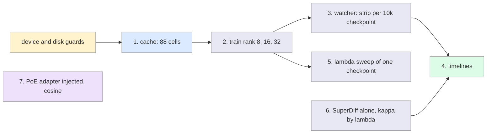

# 🧭 Runbook: training and watching a SuperDiff adapter

Navigation: 📋 [Index](../00-INDEX.md)

Everything that runs SuperDiff on this cluster: building its trajectory cache, training an
adapter against its residual, rendering a strip from every checkpoint while the training runs,
sweeping λ on one checkpoint, rendering SuperDiff's own κ × λ sheets, and injecting a
PoE-trained adapter into it. Picking a node and the general launch rules are in
[launching and harvesting a run](launching-and-harvesting-a-run.md); this file holds only what
is specific to SuperDiff. The system facts every recipe leans on (which python on which node,
where `/datasets` is, the disk guard) are owned by [the environment index](../../environment/00-INDEX.md).

<details>
<summary><b>How the SuperDiff pieces fit, in three minutes</b></summary>

**The composer**

`poe_repair/composers/superdiff.py` reimplements the `superdiff/superdiff-sdxl-v1-0` pipeline
as one of this repo's composers. It is a hand-written stochastic integrator over 200 steps with
no scheduler object, so there is no DDIM or step-count knob beyond `num_inference_steps`. On
every step it runs the UNet on prompt a, prompt b and an empty prompt, blends them with a weight
`kappa` (its own per-step estimate, or a value you force), and can also run a fourth pass on the
joint prompt to form the residual `r_t^SD = ε_J − ε_M`. It can add back a fraction `lam` of that
residual, or inject an attached LoRA as `ε(off) + λ · (ε(on) − ε(off))`. Every render writes a
`.json` sidecar beside its `.png` with the per-step norms.

**The cache and the trainer**

`1-lora-correction/scripts/build_superdiff_cache.py` renders the pool once at κ 0.5 and saves, per cell and per
step, the UNet input and the three raw predictions plus the joint one, under the same key names
the PoE cache uses, so the pooled trainer reads it unchanged. The only new trainer code is the
`--compose superdiff --kappa 0.5` switch, which composes the three branches with SuperDiff's blend
inside the training step.

**The watcher**

The trainer's own inline sampler renders with the PoE sampler, which is the wrong composition
rule for these adapters, so it is off. `sdlora_sample_watcher.py` runs on a separate device,
polls the checkpoint folders, and renders every 10k checkpoint through SuperDiff itself into a
strip, logged to a companion W&B run per rank.

</details>

🔤 **The name:** rank. A LoRA adapter stores its change to a weight matrix as two thin matrices, and
the rank is how thin: the width of the strip they share. Toy with invented sizes: a 64 by 64 weight
holds 4,096 numbers; rank 8 learns 8 × (64 + 64) = 1,024, and rank 32 learns 4,096, as many as the
whole matrix. Background: [LoRA, where to learn it](../../../../Obsidian/Artificial%20Intelligence/Large%20Language%20Models/LoRA.md#where-to-learn-this).

## Table of contents

The recipes are numbered so the index and the findings can point at them. The numbers are
addresses, not an order to follow: start at whichever one answers your question.

- [Words this file uses](#words-this-file-uses)
- [Before any of these](#before-any-of-these)
- [The reference block](#the-reference-block)
- [1. Build the SuperDiff trajectory cache](#1-build-the-superdiff-trajectory-cache---ran-2026-09-03)
- [2. Launch one training](#2-launch-one-training---ran-2026-09-03)
- [3. Render a strip from every checkpoint while it trains](#3-render-a-strip-from-every-checkpoint-while-it-trains---ran-2026-09-03)
- [4. Assemble the timelines](#4-assemble-the-timelines---ran-2026-09-05)
- [5. Sweep λ on one checkpoint](#5-sweep-λ-on-one-checkpoint---ran-2026-09-03)
- [6. Render SuperDiff's own kappa by lambda sheets](#6-render-superdiffs-own-kappa-by-lambda-sheets---ran-2026-09-03)
- [7. Inject a PoE-trained adapter into SuperDiff and measure its direction](#7-inject-a-poe-trained-adapter-into-superdiff-and-measure-its-direction---ran-2026-09-03)
- [8. Stop a run cleanly](#8-stop-a-run-cleanly---ran-2026-09-04)
- [If something looks wrong](#if-something-looks-wrong)
- [Where this came from](#where-this-came-from)
- [🖼️ In pictures, code and further reading](#in-pictures-code-and-further-reading)

## Words this file uses

Navigation: 📋 [TOC](#table-of-contents) | [Next](#before-any-of-these) ➡️

- **`SD`**: the SuperDiff output root, `/datasets/mmolefe/poe_repair_min/outputs/interaction_term/corrector/superdiff`. Every recipe below sets it first.
- **κ (`kappa`)**: SuperDiff's blending weight between the two prompts' predictions, per step. 0.5 is what every run here forces.
- **λ**: how much of a correction is added on every step. For the raw residual it is `lam`; for an attached adapter it is `lambda_value`.
- **the residual `r_t^SD`**: the joint prompt's prediction minus SuperDiff's blended one at the same state, what SuperDiff is missing on that step.
- **a strip**: one image per checkpoint and pair, rows seeds 9 to 12, columns mono target, SuperDiff alone, adapter at λ 1.
- **`co3` and `co3_bw`**: the two conda pythons. `co3` for the RTX 8000 and A6000 nodes, `co3_bw` for the Blackwell nodes 110 to 112, where `co3` has no CUDA kernels.

## Before any of these

Navigation: ⬅️ [Words this file uses](#words-this-file-uses) | 📋 [TOC](#table-of-contents) | [Next](#the-reference-block) ➡️

- [ ] 🖥️ **The owner has said yes to this SSH launch.** New GPU work goes through `sbatch`. A recipe below that starts a process with `nohup` records how a past run was launched, and running it again needs the owner's yes through `python3 scripts/progress_board.py ask`.
- [ ] 🖥️ **The target device is free**
  ```bash
  ssh <node> "nvidia-smi --query-gpu=index,memory.used,utilization.gpu --format=csv,noheader; pgrep -af 'train_poole[d]|superdif[f]' | cut -c1-80"
  ```
  ✅ **A row reading under 100 MiB, or under 4 GB at 0 %, and no process line of yours**: free. mscluster109 device 0 carries a permanent idle 2.9 GB residency from another user and is safe to share.
  ❌ Memory in the tens of GB or utilisation above 0: someone is on it. Pick another device; the launch script refuses this one anyway.
- [ ] 🖥️ **`/datasets` has room**
  ```bash
  df -h /datasets | tail -1
  ```
  ✅ **Under 90 % used.** The cache is 11 GB and each training folder grows to about 1.5 GB of checkpoints.
  ❌ Over 90 %: every launch script here exits with `ERROR: /datasets over 90%`; clear the parity or preview renders first.
- [ ] 🖥️ **The right python for the node**
  ```bash
  ssh <node> "/home-mscluster/mmolefe/miniforge3/envs/co3/bin/python -c 'import torch; print(torch.cuda.get_device_name(0)); torch.zeros(1).cuda()'"
  ```
  ✅ **Prints the card name and returns.** Use `co3`.
  ❌ **`no kernel image is available` on an RTX PRO 6000 Blackwell**: pass `PY=/home-mscluster/mmolefe/miniforge3/envs/co3_bw/bin/python` to every command below.

## The reference block

Navigation: ⬅️ [Before any of these](#before-any-of-these) | 📋 [TOC](#table-of-contents) | [Next](#1-build-the-superdiff-trajectory-cache---ran-2026-09-03) ➡️

| What is listed | What it is | Watch out |
|---|---|---|
| `1-lora-correction/scripts/superdiff/` in the repo | Every script below, the canonical copies | The copies under `$SD/scripts/` are what actually ran on the nodes; the repo ones are identical as of 2026-09-05. Run from `$SD/scripts/` on a node, because a script in the session's `/tmp` scratchpad is invisible on every other node |
| `$SD/cache/train/<pair>/seed_<n>/` | The trajectory cache: `meta.json` plus 200 `residuals/step_XXX.pt` per cell, 88 cells | Key names are the PoE cache's (`x_t`, `eps_a_raw`, `eps_b_raw`, `eps_j_raw`, `eps_uncond`) on purpose |
| `$SD/sdlora_r{8,16,32}_100k/` | One training each: `checkpoints/lora_step_*.pt` every 5k steps, `history.json`, `samples/superdiff/` strips | Final checkpoints are named `lora_step_1000xx.pt`, not `100000` exactly |
| `$SD/lambda_sweep/`, `$SD/transfer/`, `$SD/transfer_sdlora/`, `$SD/preview_sdlora/`, `$SD/samples_sdlora/` | Renders: SuperDiff alone across κ and λ; PoE adapters inside SuperDiff; SuperDiff adapters inside SuperDiff (final set, never run); λ sweeps of single checkpoints; the watcher's tiles | Every render is cached by path, so a re-run skips finished cells |
| W&B `prime_lab/poe-repair-animals-compose` | Training runs `t5b00h56` (rank 8), `5oz1bsa1` (rank 16), `ue205g6e` (rank 32); companion image runs `sdlora_r{8,16,32}_samples` | The training runs carry loss curves only. Images live on the companion runs against `ckpt_step` |
| `scripts/launch_sdlora.sh <rank> <cuda index>` | The training launcher: guards, then `train_pooled` with the SuperDiff flags | Honours `PY=`, `RESUME_FROM=`, `RESUME_WANDB_ID=` |

## 1. Build the SuperDiff trajectory cache   `ran 2026-09-03`

Navigation: ⬅️ [The reference block](#the-reference-block) | 📋 [TOC](#table-of-contents) | [Next](#2-launch-one-training---ran-2026-09-03) ➡️

⚠️ Starts a GPU job outside Slurm, so it needs the owner's yes. Do [Before any of these](#before-any-of-these) first.

Renders the pooled-adapter pool (11 training pairs × 8 seeds, from `phase1_r8_450k`'s pool files)
through SuperDiff at κ 0.5 and saves every step. About 77 s per cell on an A6000; two shards on
two devices finish in about 70 minutes.

The script this recorded command runs lives at `$REPO/1-lora-correction/scripts/build_superdiff_cache.py`.

```bash
SD=/datasets/mmolefe/poe_repair_min/outputs/interaction_term/corrector/superdiff
REPO=/home-mscluster/mmolefe/Playground/PhD/concept-composition
PY=/home-mscluster/mmolefe/miniforge3/envs/co3/bin/python
ssh mscluster109 "CUDA_VISIBLE_DEVICES=0 nohup $PY $REPO/scripts/build_superdiff_cache.py --shard 0 --nshards 2 > $SD/cache_shard0.log 2>&1 < /dev/null &"
ssh mscluster109 "CUDA_VISIBLE_DEVICES=1 nohup $PY $REPO/scripts/build_superdiff_cache.py --shard 1 --nshards 2 > $SD/cache_shard1.log 2>&1 < /dev/null &"
# when both logs end: count cells and check one against the composer's own norms
find $SD/cache/train -name meta.json | wc -l
ssh mscluster109 "CUDA_VISIBLE_DEVICES=0 $PY $SD/scripts/check_cache_cell.py"
```

Current path: `1-lora-correction/scripts/build_superdiff_cache.py` in both checkouts. The commands above stay as they were recorded.

✅ **88 `meta.json` files, and the check prints four step norms that match the live render to
about 1e-5** (5.358 vs 5.359 at step 0, 14.546 vs 14.546 at step 50, and so on). The cache is what
the composer computed.

❌ **Fewer than 88 after both logs end**: a shard died; the tail of its log names the cell.
Relaunch the same shard, every finished cell is skipped.

## 2. Launch one training   `ran 2026-09-03`

Navigation: ⬅️ [1. Build the SuperDiff trajectory cache](#1-build-the-superdiff-trajectory-cache---ran-2026-09-03) | 📋 [TOC](#table-of-contents) | [Next](#3-render-a-strip-from-every-checkpoint-while-it-trains---ran-2026-09-03) ➡️

⚠️ Starts a 24 to 34 hour process on a shared node outside Slurm, so it needs the owner's yes. Do the checks under Before any of these
first; the script re-checks the device itself and refuses one that is busy.

```bash
REPO=/home-mscluster/mmolefe/Playground/PhD/concept-composition
SD=/datasets/mmolefe/poe_repair_min/outputs/interaction_term/corrector/superdiff
ssh mscluster109 "nohup bash $REPO/scripts/launch_sdlora.sh 8 0 > $SD/sdlora_r8_100k.log 2>&1 < /dev/null & echo pid \$!"
# on a Blackwell node (110 to 112) the python must be co3_bw:
ssh mscluster112 "PY=/home-mscluster/mmolefe/miniforge3/envs/co3_bw/bin/python nohup bash $REPO/scripts/launch_sdlora.sh 32 0 > $SD/sdlora_r32_100k.log 2>&1 < /dev/null & echo pid \$!"
sleep 90; tail -n 5 $SD/sdlora_r8_100k.log
```

Rank and alpha are the first argument; the script fixes everything else: the SuperDiff cache,
`--compose superdiff --kappa 0.5`, the commit window 20 to 100 (SuperDiff steps, since its run is
200 steps long where PoE's is 50), the stall deadline of 20k steps, 2000 epochs of 50 steps at
batch 1 and learning rate 1e-4, checkpoints every 100 epochs, inline sampling off, W&B online.

✅ **The log opens with `disk: ... used`, `node=... device=... pid=... run_id=sdlora_r8_100k
rank=8 cache_cells=88`, then a W&B run URL, then epoch lines like
`epoch=20/2000 step=1000 loss(early/commit/late)=0.0009/0.0082/0.0069 ep_t=42.1s`.** About 42 s
per epoch on an A6000, 24 s on the Blackwell, 64 s on an RTX 8000.

❌ **`ERROR: device 0 has NNNN MiB in use at NN% utilisation, refusing to share`**: pick another
device. **`ERROR: SuperDiff cache has N of 88 cells`**: recipe 1 first. **The run dies at step
5000 with a commit-loss message**: the halving deadline fired; it is set to 20k for this cache
and should not, so read the log's loss lines before touching it.

To continue a stopped run in place with the same W&B curve:

```bash
ssh mscluster106 "RESUME_FROM=$SD/sdlora_r32_100k/checkpoints/lora_step_005000.pt RESUME_WANDB_ID=ue205g6e nohup bash $REPO/scripts/launch_sdlora.sh 32 1 > $SD/sdlora_r32_100k.log 2>&1 < /dev/null & echo pid \$!"
```

## 3. Render a strip from every checkpoint while it trains   `ran 2026-09-03`

Navigation: ⬅️ [2. Launch one training](#2-launch-one-training---ran-2026-09-03) | 📋 [TOC](#table-of-contents) | [Next](#4-assemble-the-timelines---ran-2026-09-05) ➡️

⚠️ Starts a GPU job outside Slurm, so it needs the owner's yes. Do [Before any of these](#before-any-of-these) first.

Runs on its own device, needs no change to the trainings, and exits once every rank's final
checkpoint is rendered. Each checkpoint at a multiple of 10k steps costs 4 renders per pair
(about 3 minutes per pair on the Blackwell); the mono and SuperDiff-alone columns are plan 05's
cached tiles.

```bash
SD=/datasets/mmolefe/poe_repair_min/outputs/interaction_term/corrector/superdiff
ssh mscluster112 "CUDA_VISIBLE_DEVICES=0 nohup /home-mscluster/mmolefe/miniforge3/envs/co3_bw/bin/python $SD/scripts/sdlora_sample_watcher.py > $SD/sample_watcher.log 2>&1 < /dev/null & echo pid \$!"
# RANKS=8,16 and EVERY=20000 in the environment narrow it
grep -E "^rank|Traceback" $SD/sample_watcher.log | tail
```

✅ **Lines like `rank 8 step 10000: [PosixPath('.../sdlora_r8_100k/samples/superdiff/step_010000_cat_dog.png'), ...] in 6.1 min`**,
and the strip appears on W&B under `sdlora_r8_samples` with `ckpt_step` 10000. A
`step_010000_done.json` beside the strip marks it finished, so a relaunch never re-renders.

❌ **`UsageError: Run (sdlora_r8_samples) is finished`**: an older copy of the script that held
one W&B run open per process; the current one opens and closes a run per log call. ❌ **The log
stops without `ALL FINALS RENDERED`**: the watcher was killed; relaunch, cached tiles make the
catch-up instant.

## 4. Assemble the timelines   `ran 2026-09-05`

Navigation: ⬅️ [3. Render a strip from every checkpoint while it trains](#3-render-a-strip-from-every-checkpoint-while-it-trains---ran-2026-09-03) | 📋 [TOC](#table-of-contents) | [Next](#5-sweep-λ-on-one-checkpoint---ran-2026-09-03) ➡️

One sheet per rank and pair from the watcher's tiles: rows mono target, SuperDiff alone, then
each checkpoint; columns seeds 9 to 12. Run it on the node that rendered the tiles, since the
session node's view of `/datasets` can lag by minutes.

```bash
SD=/datasets/mmolefe/poe_repair_min/outputs/interaction_term/corrector/superdiff
ssh mscluster112 "/home-mscluster/mmolefe/miniforge3/envs/co3_bw/bin/python $SD/scripts/assemble_timeline.py"
ls $SD/timelines/
```

✅ **Six files, `cat_dog_r8_timeline.png` through `butterfly_meadow_r32_timeline.png`, and the
script prints `rows N` per file** (2 reference rows plus one per checkpoint). A red box in a
sheet is a tile the watcher has not rendered yet.

## 5. Sweep λ on one checkpoint   `ran 2026-09-03`

Navigation: ⬅️ [4. Assemble the timelines](#4-assemble-the-timelines---ran-2026-09-05) | 📋 [TOC](#table-of-contents) | [Next](#6-render-superdiffs-own-kappa-by-lambda-sheets---ran-2026-09-03) ➡️

⚠️ Starts a GPU job outside Slurm, so it needs the owner's yes. Do [Before any of these](#before-any-of-these) first.

Sixteen renders (seeds 9 to 12 × λ 0.25, 0.5, 0.75, 1) of one checkpoint on cat × dog, then a
sheet with plan 05's λ 0 column on the left. About 12 minutes on the Blackwell.

```bash
SD=/datasets/mmolefe/poe_repair_min/outputs/interaction_term/corrector/superdiff
PY=/home-mscluster/mmolefe/miniforge3/envs/co3_bw/bin/python
CK=$SD/sdlora_r16_100k/checkpoints/lora_step_030000.pt
ssh mscluster112 "CUDA_VISIBLE_DEVICES=0 nohup $PY $SD/scripts/preview_sdlora.py --rank 16 --checkpoint $CK --tag sdr16s30k > $SD/preview_sdr16s30k.log 2>&1 < /dev/null &"
# when the log ends with PREVIEW DONE:
ssh mscluster112 "$PY $SD/scripts/assemble_preview_sheet.py sdr16s30k 16 30000"
```

✅ **`.../preview_sdlora/cat_dog_grid_200_steps_kappa_050_sdlora_r16_step30k_preview.png tiles 20 missing 0`.**
The tag must be unique per checkpoint: it names the render folder, and a reused tag returns the
old cached tiles.

## 6. Render SuperDiff's own kappa by lambda sheets   `ran 2026-09-03`

Navigation: ⬅️ [5. Sweep λ on one checkpoint](#5-sweep-λ-on-one-checkpoint---ran-2026-09-03) | 📋 [TOC](#table-of-contents) | [Next](#7-inject-a-poe-trained-adapter-into-superdiff-and-measure-its-direction---ran-2026-09-03) ➡️

⚠️ Starts a GPU job outside Slurm, so it needs the owner's yes. Do [Before any of these](#before-any-of-these) first.

SuperDiff alone at 200 steps, seeds 9 to 12, λ 0 to 1 of its own residual added back, one sheet
per κ setting: cat × dog at κ 0, 0.25, 0.5, 0.75, 1 and its own unclamped κ, butterfly × meadow
at κ 0.5. 140 renders at 107 to 136 s each, about 5 hours on one A6000.

The two scripts this recorded command runs live under `$REPO/1-lora-correction/scripts/superdiff/`.

```bash
SD=/datasets/mmolefe/poe_repair_min/outputs/interaction_term/corrector/superdiff
REPO=/home-mscluster/mmolefe/Playground/PhD/concept-composition
PY=/home-mscluster/mmolefe/miniforge3/envs/co3/bin/python
ssh mscluster85 "CUDA_VISIBLE_DEVICES=0 nohup $PY $REPO/scripts/superdiff/run_lambda_sweep_200.py > $SD/lambda_sweep.log 2>&1 < /dev/null &"
# when the log ends: sheets into the paper's figure folder, with their .json sidecars
$PY $REPO/scripts/superdiff/assemble_lambda_sheets.py
ls $REPO/writing/iclr/figures/how-much-is-added/across-composition-rules/*_grid_200_steps_kappa_*.png
```

Current path: both scripts are now under `1-lora-correction/scripts/superdiff/` in both checkouts. The commands above stay as they were recorded.

✅ **Seven sheets, `cat_dog_grid_200_steps_kappa_{balanced,000,025,050,075,100}.png` and
`butterfly_meadow_grid_200_steps_kappa_050.png`, each with a `.json` naming every tile's source.**

❌ **A sheet with red `missing` boxes**: the sweep is still running or a cell failed; the box
names the tile, and the sweep resumes on relaunch.

## 7. Inject a PoE-trained adapter into SuperDiff and measure its direction   `ran 2026-09-03`

Navigation: ⬅️ [6. Render SuperDiff's own kappa by lambda sheets](#6-render-superdiffs-own-kappa-by-lambda-sheets---ran-2026-09-03) | 📋 [TOC](#table-of-contents) | [Next](#8-stop-a-run-cleanly---ran-2026-09-04) ➡️

⚠️ Starts a GPU job outside Slurm, so it needs the owner's yes. Do [Before any of these](#before-any-of-these) first.

Three steps: prove the attached adapter is inert at λ 0 and active at λ 1, render the 96-cell
set (rank 8, 16, 32 × two pairs × seeds 9 to 12 × λ 0.25 to 1), then measure on one cell the
per-step cosine between the adapter's correction and SuperDiff's missing residual.

```bash
SD=/datasets/mmolefe/poe_repair_min/outputs/interaction_term/corrector/superdiff
PY=/home-mscluster/mmolefe/miniforge3/envs/co3/bin/python
ssh mscluster109 "CUDA_VISIBLE_DEVICES=1 $PY $SD/scripts/test_transfer_inert.py 2>&1 | tail -n 8"
ssh mscluster109 "CUDA_VISIBLE_DEVICES=1 nohup $PY $SD/scripts/run_transfer_set.py > $SD/transfer.log 2>&1 < /dev/null &"
ssh mscluster109 "CUDA_VISIBLE_DEVICES=0 $PY $SD/scripts/cosine_cell.py 2>&1 | tail -n 6"
# sheets, on the render node (assemble_transfer_remote.py) or the session node once NFS has caught up
$PY $SD/scripts/assemble_transfer_remote.py
```

✅ **The inertness test prints the same sha256 for the λ 0 render and the no-adapter render, and
non-zero ‖Δ̂‖ on every step at λ 1. The transfer log advances one `[n/96]` line per ~121 s. The
cosine cell prints medians per step bucket** (0.10, 0.34, 0.18, 0.06 for the rank-8 adapter on
cat × dog seed 9) and writes them to
`$SD/transfer_diag/cosine/pairs/a_cat__x__a_dog/seed_9/.../*.json`, field `delta_hat_cos_r_t`.

❌ **`Adapter with name lora already exists`**: attaching a second rank on the same UNet needs
`unet.delete_adapters('lora')` first; every script here does it, an older copy did not.
❌ **`rank N: zero matched modules`**: the checkpoint's module names do not match SuperDiff's
UNet; the script refuses rather than render the baseline under a new name.

## 8. Stop a run cleanly   `ran 2026-09-04`

Navigation: ⬅️ [7. Inject a PoE-trained adapter into SuperDiff and measure its direction](#7-inject-a-poe-trained-adapter-into-superdiff-and-measure-its-direction---ran-2026-09-03) | 📋 [TOC](#table-of-contents) | [Next](#if-something-looks-wrong) ➡️

⚠️ Kills a training run, so confirm the target before running the stop command.

Kill by pid, never by pattern. The pid is in the log header (`pid=...`) or from `pgrep` with the
bracket trick, which stops the pattern from matching the shell you are typing it into.
These commands are recorded from a cluster session. From the laptop, wrap each in `scripts/cluster.sh sh "..."`.

```bash
ssh mscluster109 "pgrep -af 'train_poole[d]' | cut -c1-60"
ssh mscluster109 "kill 1831235 1831236; sleep 5; pgrep -af 'train_poole[d]' | wc -l; nvidia-smi --query-gpu=index,memory.used --format=csv,noheader"
```

✅ **`0` processes and the device's memory back to its idle level.** The last checkpoint on disk
is the last multiple of 5k steps; the W&B run shows as crashed, which is what a kill looks like
there, so add a note to the run saying it was stopped and why.

❌ **`exit 255` and the ssh command dies before the kill**: `pkill -f <pattern>` matched the
remote shell's own command line, which contained the pattern, and killed it. Use the pid.

## If something looks wrong

Navigation: ⬅️ [8. Stop a run cleanly](#8-stop-a-run-cleanly---ran-2026-09-04) | 📋 [TOC](#table-of-contents) | [Next](#where-this-came-from) ➡️

- **A file another node just wrote is not there.** The session node's NFS view of `/datasets`
  lags the writing node by minutes. Count or assemble on the node that wrote, over `ssh`.
- **A script in `/tmp` is not found on a node.** `/tmp` is node-local. Scripts that run remotely
  live under `$SD/scripts/` (or the repo).
- **`nvidia-smi` shows 100 % utilisation on a device with 2 MiB used.** The utilisation sample
  is stale for about a minute after a kill; memory under 100 MiB means nothing is running.
- **Two runs OOM on one device.** A SuperDiff render takes about 16 GB and a training about
  25 GB; on a 48 GB A6000 run one of each at most, on the 96 GB Blackwell a training and the
  watcher fit together.
- **A 5-step render comes out as static.** The integrator is numerically unstable at very low
  step counts; 50 steps is the lowest that renders cleanly. Not a bug.
- **A 200-step render of cat × dog is one animal.** That is SuperDiff's real behaviour at its
  defaults, the subject of the finding this file serves.

## Where this came from

Navigation: ⬅️ [If something looks wrong](#if-something-looks-wrong) | 📋 [TOC](#table-of-contents) | [Next](#in-pictures-code-and-further-reading) ➡️

| What | How it was established | When |
|---|---|---|
| Every command in recipes 1 to 8 | Run as written in the chat that built plans 05, 07 and 08 of scope 06, with the ✅ blocks quoting their real output; recorded in those plans' review files | 2026-09-03 to 2026-09-05 |
| The per-epoch times and per-render times | Read off the logs of those runs | 2026-09-03 |
| `co3` has no CUDA kernels on the Blackwell nodes | The first rank-32 launch failed with `no kernel image is available` on mscluster112 and ran under `co3_bw` | 2026-09-03 |
| `pkill -f` kills the remote shell | Two ssh commands died with exit 255 before their relaunch line ran | 2026-09-03 |
| One W&B run per process | The first watcher died with `UsageError: Run (sdlora_r8_samples) is finished` on its second rank | 2026-09-03 |

<!-- related:start (drain) -->
<a id="in-pictures-code-and-further-reading"></a>

## 🖼️ In pictures, code and further reading

Navigation: ⬅️ [Previous](#where-this-came-from) | 📋 [TOC](#table-of-contents)

SuperDiff here is a composer, a cache, a trainer and a watcher. The pictures below show the watcher's output, the training loss and the sweeps, next to the lines that add the residual.

### How it fits together



*Key: yellow is a guard, blue the cache, grey a run, purple a measurement, green a sheet.* Recipes 6 and 7 do not depend on 2 to 5.

### The code behind it

`poe_repair/composers/superdiff.py` lines 344 to 359 form SuperDiff's blended prediction and the residual that recipe 6 adds back with `lam`. Recipes 5 and 7 add an attached adapter's correction instead, on line 378:

```python
            eps_m = noise_pred_uncond + guidance_scale * (
                (noise_pred_2 - noise_pred_uncond)
                + kappa[:, None, None, None] * (noise_pred_1 - noise_pred_2)
            )
            eps_m_norms.append(eps_m.detach().float().norm().item())

            if form_r_t:
                # Single CFG branch on the literal joint prompt, this project's own eps_J
                # (poe_repair/composers/_helpers.py's get_joint_embeds), evaluated at this
                # step's actual latent so r_t^SD sits on the trajectory this render visits.
                eps_j = noise_pred_uncond + guidance_scale * (noise_pred_joint - noise_pred_uncond)
                r_t_sd = eps_j - eps_m
                r_t_sd_norms.append(r_t_sd.detach().float().norm().item())
                # The generalised amount axis from step 29, applied to this rule: add back a
                # fraction lam of the residual. lam=0 is SuperDiff alone, lam=1 is eps_J exactly.
                eps_used = eps_m + lam * r_t_sd if lam != 0.0 else eps_m
```

- Lines 344 to 347 are `eps_M`: SuperDiff's blend of the two prompts' predictions with weight `kappa`.
- Line 354 is `eps_J`, the single joint-prompt prediction; line 355 is the residual `r_t^SD = eps_J - eps_M` that the glossary at the top of the page defines.
- Line 359 adds back a fraction `lam`: `lam = 0` is SuperDiff alone, `lam = 1` is `eps_J` exactly.

### What comes out

| <a href="../../1-lora-correction/artifacts/results/is-it-the-sampler-or-the-model/is-the-gap-the-samplers-or-the-models/superdiff-lora-rank16-cat-dog-checkpoint-timeline.png"></a> | <a href="../../1-lora-correction/artifacts/results/is-it-the-sampler-or-the-model/is-the-gap-the-samplers-or-the-models/superdiff-lora-loss-curves.png"></a> | <a href="../../1-lora-correction/artifacts/results/is-it-the-sampler-or-the-model/is-the-gap-the-samplers-or-the-models/superdiff-lora-separation-by-checkpoint.png"></a> |
|---|---|---|
| rank 16 timeline, cat and dog | loss curves, three ranks | separation by checkpoint |

**Timeline.** Rank 16, cat × dog, seeds 9 to 12; rows are the mono target, SuperDiff alone at κ 0.5 and the adapter at λ 1 at every 10k checkpoint from 10k to 60k `verified`. Two animals show at 10k on all four seeds and the later rows are more smeared, as the card says `verified`. Loss. Total loss and three step buckets (0 to 19, 20 to 99, 100 to 199) for the three ranks, log y, W&B runs `t5b00h56`, `5oz1bsa1`, `ue205g6e` by the figure's title `verified`. The x axis ends near 61,000 optimizer steps, while recipe 2 sets 2000 epochs of 50 steps (100,000); the page's recipe 8 says a run was stopped by hand, and neither the card nor the picture says whether these runs were stopped `stated`. Separation. Seeds of four that show two bodies (cat × dog, left panel) or a clear butterfly (butterfly × meadow, right panel), by checkpoint. On cat × dog, rank 32 goes 4 at 10k then 0 at 20k and 30k; rank 16 is 4 at 10k to 30k, 3 at 40k, 0 from 50k; rank 8 stays at 3 or 4 `verified`. On butterfly × meadow, rank 8 reads 2, 2, 4, 0, 0, 1 from 10k to 60k, rank 16 reads 1 at 10k then 0, and rank 32 reads 0 `verified`. Eye reads recorded in plan 08, not detector scores `stated` (card).

### Further illustrations

**Evidence**

| <a href="../../1-lora-correction/artifacts/results/is-it-the-sampler-or-the-model/is-the-gap-the-samplers-or-the-models/superdiff-alone-cat-dog-kappa-050-lambda-sheet.png"></a> | <a href="../../1-lora-correction/artifacts/results/is-it-the-sampler-or-the-model/is-the-gap-the-samplers-or-the-models/poe-adapter-in-superdiff-cosine-profile.png"></a> | picture held back |
|---|---|---|
| lambda sheet, SuperDiff alone | cosine and norm profile | SuperDiff baseline, eight cells |

**Lambda sheet.** SuperDiff alone at 200 steps, rows seeds 9 to 12, λ 0 to 1 of its own residual added back: one fused animal at λ 0 on every seed, a cat and a dog by λ 0.5 to 0.75 `verified`; the card says "between λ 0.25 and 0.75" `stated` (card). Cosine profile. Cat × dog seed 9, the rank-8 PoE adapter's correction against SuperDiff's missing residual: medians about 0.1, 0.34, 0.18 and 0.06 across the four step buckets `verified`, matching recipe 7's printed numbers. The card says the two norms are "same size throughout". The sidecar's median norms over the four step buckets are 10.7, 20.2, 27.1 and 47.2 for the adapter and 8.6, 15.6, 17.1 and 15.3 for the residual `stated` (`superdiff-report-figures.json`), and in the right panel the adapter norm climbs away from the residual after about step 130 `verified`. Picture and card differ and this block changes neither. Baseline. The card says SuperDiff at its own settings "composes at 50, one animal or a blurred butterfly at 200" and "the clamp changes nothing". In the picture the 50-step cat × dog tiles are one large stylised cat head, the 50-step meadow tiles are graphic meadows with no clear butterfly, the 200-step meadow tiles show wildflowers with no visible butterfly, and the 200-step cat × dog tiles are one animal each `verified`. The two 200-step meadow tiles look alike, while the two 200-step cat × dog tiles are different animals, one orange and white and one tricolour on a cushion `verified`. The "composes at 50", "blurred butterfly" and "clamp changes nothing" statements are not visible in the picture; card and picture differ on all three.

### Go deeper

| What | Link |
|---|---|
| Card for these pictures | [is the gap the sampler's or the model's](../../1-lora-correction/artifacts/results/is-it-the-sampler-or-the-model/is-the-gap-the-samplers-or-the-models/README.md) |
| Findings | [SuperDiff at its own defaults](../../1-lora-correction/report/is-the-gap-the-samplers-or-the-models/does-superdiff-compose-at-its-own-defaults.md), [the PoE-trained correction inside SuperDiff](../../1-lora-correction/report/is-the-gap-the-samplers-or-the-models/does-the-poe-trained-correction-carry-into-superdiff.md), [an adapter trained on SuperDiff's residual](../../1-lora-correction/report/is-the-gap-the-samplers-or-the-models/does-an-adapter-trained-on-superdiffs-own-residual-compose.md) |
| Launch rules for a shared device | [launching and harvesting a run](launching-and-harvesting-a-run.md) |
| Resume and training recipes for the PoE adapter | [probing a pooled LoRA checkpoint](probing-a-pooled-lora-checkpoint.md) |
| Nodes and python builds | [the cluster nodes](../../environment/hpc/nodes.md) |

### Still open

- Not placed: the other five timelines, the rank 16 λ-sweep sheets, the butterfly × meadow sheets and the rank-8 PoE-adapter sheets; none was opened in this pass.
- The page's commands call `$REPO/scripts/build_superdiff_cache.py` and `$REPO/scripts/superdiff/...`; on this checkout the cache script is under `1-lora-correction/scripts/` and the SuperDiff scripts are under `1-lora-correction/scripts/superdiff/`. `scripts/launch_sdlora.sh` is at the repo root as the page says. This block changes none of them.
- No recorded run of recipe 8 has a picture.
<!-- related:end -->

<!-- built-to: PAGE_LOOK_FORMAT v1 -->
