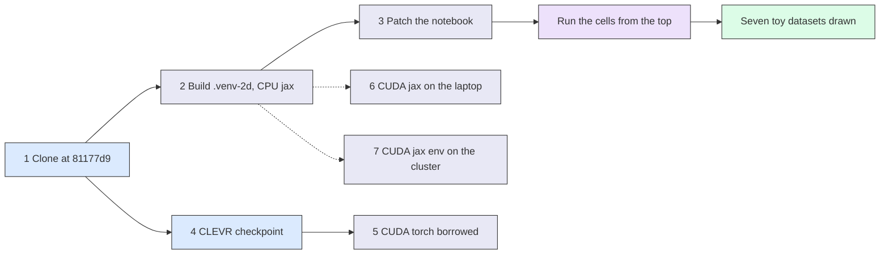

# 🧭 Runbook: setting up the Reduce, Reuse, Recycle code on the laptop

How to get the authors' code for Du et al. 2023 (arXiv 2302.11552) from an empty folder to running:
the 2D notebook on the CPU (or the GPU), and the CLEVR sampling script on the GPU. What is true
about this code and why each step exists is in
[the reduce-reuse-recycle code facts](../environment/reduce-reuse-recycle-code.md); this file only
holds the commands.

## Table of contents

The recipes are numbered so the index can point at them. Follow 1 to 3 for the notebook, 4 and 5
for CLEVR.

- [Before any of these](#before-any-of-these)
- [1. Clone at the commit the walk uses](#1-clone-at-the-commit-the-walk-uses---ran-2026-10-13)
- [2. Build the 2D notebook's environment](#2-build-the-2d-notebooks-environment---ran-2026-10-13)
- [3. Make the notebook run on current jax](#3-make-the-notebook-run-on-current-jax---ran-2026-10-13)
- [4. Get the CLEVR checkpoint](#4-get-the-clevr-checkpoint---ran-2026-10-13)
- [5. Give the CLEVR script a CUDA torch](#5-give-the-clevr-script-a-cuda-torch---ran-2026-10-13)
- [6. Run the notebook on the GPU instead](#6-run-the-notebook-on-the-gpu-instead---unverified)
- [7. Build the 2D notebook's environment on the cluster](#7-build-the-2d-notebooks-environment-on-the-cluster---ran-2026-10-13)
- [Where this came from](#where-this-came-from)
- [🖼️ In pictures, code and further reading](#in-pictures-code-and-further-reading)

## Before any of these

Navigation: 📋 [TOC](#table-of-contents) | [Next](#1-clone-at-the-commit-the-walk-uses---ran-2026-10-13) ➡️

- [ ] 🖥️ **uv is installed**
  ```bash
  uv --version
  ```
  ✅ **a version number**
  ❌ **`command not found`**: `curl -LsSf https://astral.sh/uv/install.sh | sh`, then open a new terminal

## 1. Clone at the commit the walk uses   `ran 2026-10-13`

Navigation: ⬅️ [Before any of these](#before-any-of-these) | 📋 [TOC](#table-of-contents) | [Next](#2-build-the-2d-notebooks-environment---ran-2026-10-13) ➡️

```bash
cd ~/PhD
git clone https://github.com/yilundu/reduce_reuse_recycle reduce-reuse-recycle
cd reduce-reuse-recycle
git checkout -b walk 81177d9
```

✅ **`git log -1 --oneline` prints `81177d9 Update README.md`** and `git ls-files | wc -l` prints 40.

## 2. Build the 2D notebook's environment   `ran 2026-10-13`

Navigation: ⬅️ [1. Clone](#1-clone-at-the-commit-the-walk-uses---ran-2026-10-13) | 📋 [TOC](#table-of-contents) | [Next](#3-make-the-notebook-run-on-current-jax---ran-2026-10-13) ➡️

```bash
cd ~/PhD/replications/reduce-reuse-recycle
uv venv .venv-2d --python 3.12
UV_HTTP_TIMEOUT=600 uv pip install --python .venv-2d/bin/python \
    jax dm-haiku optax distrax chex matplotlib ipykernel
.venv-2d/bin/python -c "import jax, haiku, optax, distrax, chex; print(jax.__version__, jax.devices())"
```

✅ **`0.11.2 [CpuDevice(id=0)]`**, after a warning that a CUDA-enabled jaxlib is not installed.
The download is about 200 MB; on a slow line it takes most of an hour.
❌ **the install sits for minutes with no output**: it is downloading, not stuck. Check with
`du -sm ~/.cache/uv/.tmp*`, which grows while files arrive.

## 3. Make the notebook run on current jax   `ran 2026-10-13`

Navigation: ⬅️ [2. The 2D environment](#2-build-the-2d-notebooks-environment---ran-2026-10-13) | 📋 [TOC](#table-of-contents) | [Next](#4-get-the-clevr-checkpoint---ran-2026-10-13) ➡️

⚠️ Rewrites `simple_distributions.ipynb` in place and is not safe to run twice, so check first that the notebook is unmodified:

```bash
git -C ~/PhD/replications/reduce-reuse-recycle status --short -- notebooks/simple_distributions.ipynb
```

✅ **No output** means the notebook is untouched and the script below is safe to run.

```bash
python3 ~/PhD/concept-composition/scripts/fix_reduce_reuse_recycle_notebook.py \
    ~/PhD/replications/reduce-reuse-recycle/notebooks/simple_distributions.ipynb
```

✅ **`47 cells; fixes applied`**. It drops the `!pip` cell and the unused TensorFlow and pandas
imports, renames `jnp.clip(..., a_min=)` to `min=`, and adds a compatibility cell after the
imports. Run it once only, on a fresh clone.

Then in VS Code: open `notebooks/simple_distributions.ipynb`, click **Select Kernel** (top right),
Python Environments, and pick `.venv-2d`. Run the cells from the top. Each training cell
prints a loss every 100 steps and a `TEST <step> logpx <value>` line every 1,000.

❌ **`TypeError: clip() got an unexpected keyword argument 'a_min'`** or **`[Chex] Assertion
assert_type failed`** or **`module 'jax' has no attribute 'tree_leaves'`**: the script was not
run, or the compatibility cell was not run in this kernel.

## 4. Get the CLEVR checkpoint   `ran 2026-10-13`

Navigation: ⬅️ [3. Notebook fixes](#3-make-the-notebook-run-on-current-jax---ran-2026-10-13) | 📋 [TOC](#table-of-contents) | [Next](#5-give-the-clevr-script-a-cuda-torch---ran-2026-10-13) ➡️

Google Drive answers a file this size with a virus-scan page, so the download has to pass that
page's confirmation.

```bash
cd ~/PhD/replications/reduce-reuse-recycle
curl -sSL "https://drive.google.com/uc?export=download&id=19ay4bLVCQho8_aXtODWbDCpu6L2l58YB" -o /tmp/gd.html
UUID=$(grep -oP 'name="uuid" value="\K[^"]+' /tmp/gd.html)
curl -sSL -C - --retry 5 -o ebm-49x1874.pt \
  "https://drive.usercontent.google.com/download?id=19ay4bLVCQho8_aXtODWbDCpu6L2l58YB&export=download&confirm=t&uuid=$UUID"
ls -l ebm-49x1874.pt
```

✅ **500,704,677 bytes**, and `file ebm-49x1874.pt` says `Zip archive data`.
❌ a file of a few KB: that is the HTML page, so `UUID` came back empty. Open the link in a
browser instead and save the file into the clone.

## 5. Give the CLEVR script a CUDA torch   `ran 2026-10-13`

Navigation: ⬅️ [4. The checkpoint](#4-get-the-clevr-checkpoint---ran-2026-10-13) | 📋 [TOC](#table-of-contents) | [Next](#6-run-the-notebook-on-the-gpu-instead---unverified) ➡️

This borrows the CUDA torch already installed for `my-eye-my-brain`, read-only, and adds only
matplotlib inside the clone.

```bash
cd ~/PhD/replications/reduce-reuse-recycle
uv pip install --target .clevr-extras matplotlib
PYTHONPATH=$PWD/.clevr-extras ~/playground/deep-learning/my-eye-my-brain/.venv/bin/python \
  -c "import torch, matplotlib; print(torch.__version__, torch.cuda.is_available())"
```

✅ **`2.14.1+cu130 True`**.
❌ **`No such file or directory`** for the borrowed interpreter: that playground venv is gone.
Build a CUDA torch in the clone instead (about 2.5 GB):
`uv venv .venv-clevr --python 3.12 && uv pip install --python .venv-clevr/bin/python torch numpy matplotlib tqdm --index-url https://download.pytorch.org/whl/cu130 --extra-index-url https://pypi.org/simple --index-strategy unsafe-best-match` (`unverified`).

`inf_sample.py` itself still fails as released; see the U-Net fact in
[the reduce-reuse-recycle code facts](../environment/reduce-reuse-recycle-code.md#the-clevr-script).

## 6. Run the notebook on the GPU instead   `unverified`

Navigation: ⬅️ [5. CLEVR torch](#5-give-the-clevr-script-a-cuda-torch---ran-2026-10-13) | 📋 [TOC](#table-of-contents) | [Next](#7-build-the-2d-notebooks-environment-on-the-cluster---ran-2026-10-13) ➡️

```bash
cd ~/PhD/replications/reduce-reuse-recycle
UV_HTTP_TIMEOUT=600 uv pip install --python .venv-2d/bin/python "jax[cuda13]==0.11.2"
.venv-2d/bin/python -c "import jax; print(jax.devices())"
```

✅ **a `CudaDevice`** in the list. The download is about 2.3 GB of CUDA libraries. Then restart
the notebook's kernel and rerun from the top.

## 7. Build the 2D notebook's environment on the cluster   `ran 2026-10-13`

Navigation: ⬅️ [6. GPU notebook](#6-run-the-notebook-on-the-gpu-instead---unverified) | 📋 [TOC](#table-of-contents) | [Next](#where-this-came-from) ➡️

On a GPU node (the walk used `mscluster88`), with the clone from recipe 1 at
`~/PhD/replications/reduce-reuse-recycle`. Check the card first, because `bigbatch` cards fault between checks:

```bash
nvidia-smi -L
```

✅ **one `GPU 0:` line.** ❌ **`Unable to determine the device handle`**: the card is faulted;
move to another node from [the node table](../environment/hpc/nodes.md).

```bash
R=/datasets/mmolefe/reduce-reuse-recycle
mkdir -p $R/uv-cache $R/venvs
export UV_CACHE_DIR=$R/uv-cache
~/.local/bin/uv venv --python 3.12 $R/venvs/rrr-jax
~/.local/bin/uv pip install --python $R/venvs/rrr-jax/bin/python "jax[cuda12]==0.11.2" dm-haiku optax distrax chex matplotlib ipykernel
ln -sfn $R/venvs/rrr-jax ~/PhD/replications/reduce-reuse-recycle/.venv
~/PhD/replications/reduce-reuse-recycle/.venv/bin/python -c "import jax; print(jax.devices())"
```

✅ **`[CudaDevice(id=0)]`.** The install takes about 5 minutes. ❌ **`[CpuDevice(id=0)]`**: the
CUDA plugin did not install or the node has no visible card; rerun `nvidia-smi -L`.

In VS Code, open the notebook, click the kernel name at the top right, choose **Select Another
Kernel → Python Environments → .venv (Python 3.12.10)**. If `.venv` is not listed, choose **Enter
interpreter path** and paste `/home-mscluster/mmolefe/PhD/reduce-reuse-recycle/.venv/bin/python`.

## Where this came from

Navigation: ⬅️ [7. Cluster environment](#7-build-the-2d-notebooks-environment-on-the-cluster---ran-2026-10-13) | 📋 [TOC](#table-of-contents) | [Next](#in-pictures-code-and-further-reading) ➡️

**The drip-repo walk of 2026-10-13**, whose working file is
`/home/molef/PhD/replications/reduce-reuse-recycle/artifacts/drips/reduce-reuse-recycle/REPO_WALK.md`. Every recipe marked `ran` was run that day
on the laptop, except recipe 7, run on `mscluster88` from the walk file
`/home/molef/PhD/replications/reduce-reuse-recycle/artifacts/drips/reduce-reuse-recycle-mscluster112/REPO_WALK.md`.

<!-- related:start (drain) -->
<a id="in-pictures-code-and-further-reading"></a>

## 🖼️ In pictures, code and further reading

Navigation: ⬅️ [Previous](#where-this-came-from) | 📋 [TOC](#table-of-contents)

Seven recipes build two setups, a notebook environment (1 to 3, 6, 7) and a CLEVR script environment (4, 5). The pictures below are what the notebook draws once recipe 3 has run.

### How it fits together



*Key: blue loads something, grey does work, purple is the run, green is what comes out. Dashed arrows are the two GPU variants of recipe 2.*

Recipes 1 to 3 lead to the notebook; recipes 4 and 5 are a separate branch that needs only the clone.

### The code behind it

Recipe 3 runs one script and describes what it does in a sentence. Excerpt from `scripts/fix_reduce_reuse_recycle_notebook.py` (lines 8 to 25):

```python
p = sys.argv[1]; nb = json.load(open(p)); cells = nb["cells"]
src = lambda c: "".join(c["source"])
# 1. drop the !pip cell
cells[:] = [c for c in cells if not src(c).lstrip().startswith("!pip install")]
for c in cells:
    lines = c["source"]
    # 2. drop the unused tensorflow and pandas imports
    lines = [l for l in lines if not ("import tensorflow" in l or "import pandas" in l)]
    # 3. jax 0.11 renamed jnp.clip's a_min= to min=
    c["source"] = [l.replace("a_min=", "min=") for l in lines]
# 4. compatibility cell after the imports
i = next(k for k, c in enumerate(cells) if src(c).lstrip().startswith("import math"))
cells.insert(i + 1, {"cell_type": "code", "execution_count": None, "metadata": {}, "outputs": [], "source": [
    "import chex\n",
    "chex.assert_type = lambda *args, **kwargs: None  # dtype checks predate JAX's 32-bit defaults\n",
    "jax.tree_leaves = jax.tree_util.tree_leaves      # removed from jax; lives on in jax.tree_util\n",
    "jax.tree_map = jax.tree_util.tree_map"]})
open(p, "w").write(json.dumps(nb, indent=2, ensure_ascii=False) + "\n")
```

- The `cells[:] =` line drops the `!pip` cell; the loop then drops the TensorFlow and pandas imports and renames `a_min=` to `min=`.
- The inserted cell goes right after the `import math` cell and holds four lines: `import chex` and the patches for `assert_type`, `tree_leaves` and `tree_map`. The recipe's `assert_type` and `tree_leaves` failures point at this cell, and its `TypeError` on `a_min` points at the rename in the loop.
- The file is rewritten in place, so a second run on the same notebook would insert a second compatibility cell, which is why the recipe says to run it once.

### What goes in

The clone of the authors' repository at `81177d9` holds `notebooks/simple_distributions.ipynb`, the notebook the script patches (47 cells after the patch, per recipe 3's recorded output).

### What comes out

<a href="../../replications/reduce-reuse-recycle/artifacts/drips/reduce-reuse-recycle/figures/the-seven-toy-datasets.png"></a>

Seven scatter panels from the patched notebook run on the laptop CPU, titled `toy_gmm`, `toy_gauss`, `toy_box`, `bar`, `bar_horizontal`, `toy_gmm_left` and `right_bar` `verified` (counted and read on the picture). The walk file records the same seven datasets drawn by cells 14 to 20 on 2026-10-13 `stated` (the laptop walk's run map, row 3b). Axes run about minus 1.2 to 1.2, and each panel is a cloud of points drawn from one dataset sampler `verified`.

### Further illustrations

**Output file**

<a href="../../replications/reduce-reuse-recycle/artifacts/drips/reduce-reuse-recycle-mscluster112/figures/datasets-1000-samples-each.png"></a>

Ten panels, 1000 samples from each dataset sampler in `simple_distributions.ipynb`, axes minus 1.1 to 1.1 `verified` (the picture's own title and a count of ten panels). Beyond the seven above it adds `toy_box(0.3)`, `toy_gmm_right()` and `left_bar()`. Its `toy_gmm(std=.03)` draws tighter clusters than the first picture's `toy_gmm`, and its `toy_box(0.7)` spans a smaller square than the first picture's `toy_box`, which fills minus 1 to 1 `verified`. It is filed with the cluster walk, whose run map marks the 2D notebook sections open with the note "definitions and datasets run by the user" `stated`, so which machine drew it is not stated.

### Go deeper

| What | Link |
|---|---|
| The facts behind these recipes | [the reduce-reuse-recycle code facts](../environment/reduce-reuse-recycle-code.md) |
| The node table recipe 7 points at | [the node table](../environment/hpc/nodes.md) |
| The laptop walk, run map and recorded outputs | [the laptop walk file](../../replications/reduce-reuse-recycle/artifacts/drips/reduce-reuse-recycle/REPO_WALK.md) |
| The cluster walk, run map | [the cluster walk file](../../replications/reduce-reuse-recycle/artifacts/drips/reduce-reuse-recycle-mscluster112/REPO_WALK.md) |

### Still open

- No picture shows the CLEVR script's output: the laptop walk marks `inf_sample.py` rows 6 and 7 as open, and the page says it still fails as released.
- No picture shows recipe 6's `CudaDevice` list or recipe 7's GPU kernel selection.
- Rows 3c to 3e of the laptop walk's run map (product, mixture, negation scatters) are open, and its figures folder holds no such scatter.
<!-- related:end -->

<!-- built-to: PAGE_LOOK_FORMAT v1 -->
