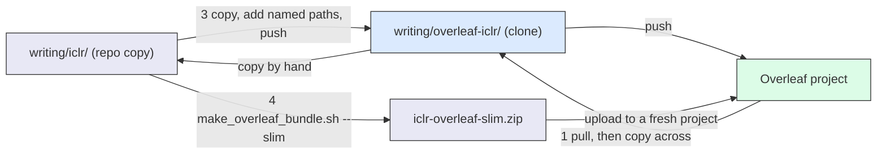

# 🧭 Runbook: syncing the paper with Overleaf

The paper exists in three places and they do not update each other. This file is how you move
edits between them by hand: pulling what you typed in the Overleaf editor down into the repo,
sending a repo-side edit back up, and rebuilding the upload zip when the git route is not the
one you want. It does not cover writing the paper (that is `/drip-write` and
[the draft map](../writing/iclr/DRAFT_MAP.md)) or building the PDF locally, which needs the
Tectonic facts in [the paper environment file](../environment/paper.md), since no system LaTeX
exists on this cluster.

## Words this file uses

Navigation: 📋 [TOC](#table-of-contents) | [Next](#before-any-of-these) ➡️

- **The repo copy**: `writing/iclr/`, the folder this repository tracks and commits. Everything
  else in the project links into it: figures, the draft map, the spine.
- **The Overleaf clone**: `writing/overleaf-iclr/`, a second, separate git repository whose
  `origin` is Overleaf itself. The outer repository does not track it.
- **The bundle**: `writing/iclr-overleaf-slim.zip`, a snapshot of the repo copy made for uploading
  into a fresh Overleaf project. The route that predates the clone.

## Table of contents

The recipes are numbered so the index can point at them. The numbers are addresses, not an order
to follow.

- [Words this file uses](#words-this-file-uses)
- [Before any of these](#before-any-of-these)
- [Where the paper lives](#where-the-paper-lives)
- [1. Pull your Overleaf edits into the repo](#1-pull-your-overleaf-edits-into-the-repo---ran-2026-09-21)
- [2. Read what came down before you commit it](#2-read-what-came-down-before-you-commit-it---ran-2026-09-21)
- [3. ⚠️ Send a repo-side edit back up to Overleaf](#3-send-a-repo-side-edit-back-up-to-overleaf)
- [4. Rebuild the upload zip instead](#4-rebuild-the-upload-zip-instead---unverified)
- [If something looks wrong](#if-something-looks-wrong)
- [Where this came from](#where-this-came-from)
- [Cross-references](#cross-references)
- [🖼️ In pictures, code and further reading](#in-pictures-code-and-further-reading)

## Before any of these

Navigation: ⬅️ [Words this file uses](#words-this-file-uses) | 📋 [TOC](#table-of-contents) | [Next](#where-the-paper-lives) ➡️

- [ ] 🖥️ **The Overleaf clone is there and points at the right project.**
  ```bash
  git -C writing/overleaf-iclr remote -v
  ```
  ✅ **`origin  https://git@git.overleaf.com/6a86dc92ca15fe47d75b86f6`** for fetch and push. That
  hash is the Overleaf project id, the same one in the editor's URL.
  ❌ **`not a git repository`**: the clone is gone. Recreate it with
  `git clone https://git@git.overleaf.com/6a86dc92ca15fe47d75b86f6 writing/overleaf-iclr`, which
  asks for the Overleaf git token as the password.

- [ ] 🖥️ **Your Overleaf token is stored, so no pull prompts for a password.**
  ```bash
  git -C writing/overleaf-iclr config --get credential.helper && grep -c overleaf ~/.git-credentials
  ```
  ✅ **`store`** then **`1`**. The token sits in `~/.git-credentials`, mode 600.
  ❌ **`0`**: the next pull will prompt. The password is an Overleaf git token from Account
  Settings, not your account password.

## Where the paper lives

Navigation: ⬅️ [Before any of these](#before-any-of-these) | 📋 [TOC](#table-of-contents) | [Next](#1-pull-your-overleaf-edits-into-the-repo---ran-2026-09-21) ➡️

| Place | What is in it | Who writes it | Watch out |
|---|---|---|---|
| `writing/iclr/` | the tracked copy: tex, bib, every figure, the writing notes | this repo, and you through Claude | a pull into the clone does not reach it; §1 copies across |
| `writing/overleaf-iclr/` | tex, bib, the style files, only the figures the tex includes | Overleaf, when you type in the editor | its working tree is dirty in a deleting direction; see §3 |
| `writing/iclr-overleaf-slim.zip` | a snapshot for uploading a new project | `1-lora-correction/scripts/make_overleaf_bundle.sh --slim` | stale the moment either side moves |

The clone holds a subset on purpose: it has no `DRAFT_MAP.md`, no `SPINE.md`, no reference PDFs,
and only the figures the manuscript actually includes.

## 1. Pull your Overleaf edits into the repo   `ran 2026-09-21`

Navigation: ⬅️ [Where the paper lives](#where-the-paper-lives) | 📋 [TOC](#table-of-contents) | [Next](#2-read-what-came-down-before-you-commit-it---ran-2026-09-21) ➡️

**When you need this**

You wrote in the Overleaf editor and want that text in the repo, where the figures and the draft
map live.

```bash
cd /home-mscluster/mmolefe/Playground/PhD/concept-composition
git -C writing/overleaf-iclr pull
```

✅ **A fast-forward naming the files Overleaf changed:**

```
From https://git.overleaf.com/6a86dc92ca15fe47d75b86f6
   d512a90..e793c5e  main       -> origin/main
Updating d512a90..e793c5e
Fast-forward
 iclr2027_conference.tex | 42 ++++++++++++++++++++++++++----------------
 1 file changed, 26 insertions(+), 16 deletions(-)
```

Overleaf writes every editor session as one commit called `Update on Overleaf.`, so the count of
commits tells you how many sittings came down, never how many edits.

A fast-forward means the clone had nothing Overleaf lacked, so git only slides the clone's label
forward along Overleaf's commits and makes no merge commit. Toy with invented numbers: the clone
sits at commit 3, Overleaf is at commit 5, and the pull moves the clone from 3 to 5 and brings 2 commits.

✅ **`Already up to date.`** means nothing has been typed in the editor since your last pull.

Then copy what came down into the repo copy, file by file, only for the files the pull actually
touched:

⚠️ Overwrites the repo copy of the tex, so run `git status --short writing/iclr/` first and confirm it is clean.

```bash
cp writing/overleaf-iclr/iclr2027_conference.tex writing/iclr/iclr2027_conference.tex
git status --short writing/iclr/
```

✅ **` M writing/iclr/iclr2027_conference.tex`**, ready for you to read the diff (§2) and commit.

**Check the repo copy was clean before you overwrote it.** Run `git status --short
writing/iclr/iclr2027_conference.tex` first: an empty answer means nobody edited it here since the
last commit, so the copy loses nothing. If it comes back ` M`, both sides moved and you have a
real merge on your hands, so diff them and resolve by hand instead of copying.

**Variations**

- Just look, do not merge: `git -C writing/overleaf-iclr fetch && git -C writing/overleaf-iclr log --oneline HEAD..origin/main`
- Refuse anything but a clean fast-forward: `git -C writing/overleaf-iclr merge --ff-only origin/main` after that fetch

## 2. Read what came down before you commit it   `ran 2026-09-21`

Navigation: ⬅️ [1. Pull your Overleaf edits into the repo](#1-pull-your-overleaf-edits-into-the-repo---ran-2026-09-21) | 📋 [TOC](#table-of-contents) | [Next](#3-send-a-repo-side-edit-back-up-to-overleaf) ➡️

**When you need this**

The pull landed and you want to know what you actually changed in the editor, because an Overleaf
commit message never says.

```bash
git -C writing/overleaf-iclr show --stat HEAD
git -C writing/overleaf-iclr show HEAD -- iclr2027_conference.tex
```

✅ **The diff, one hunk per place you typed.** Overleaf commits whole editor sessions, so expect
unrelated edits in one commit: on 2026-09-21 a single commit carried a new title, a rewritten
abstract with the old one commented out beneath it, a `wrapfig` float move, three `\looseness=-1`
lines and two paragraph moves.

**Variations**

- How far apart the two copies are right now: `diff -u writing/iclr/iclr2027_conference.tex writing/overleaf-iclr/iclr2027_conference.tex`
- Which hunks differ, without the prose: append `| grep '^@@'` to that

<a id="3-send-a-repo-side-edit-back-up-to-overleaf"></a>

## 3. ⚠️ Send a repo-side edit back up to Overleaf   `unverified`

Navigation: ⬅️ [2. Read what came down before you commit it](#2-read-what-came-down-before-you-commit-it---ran-2026-09-21) | 📋 [TOC](#table-of-contents) | [Next](#4-rebuild-the-upload-zip-instead---unverified) ➡️

**When you need this**

A figure or a paragraph changed in the repo and you want it visible in the Overleaf editor.

⚠️ **The clone's working tree deletes files if you commit it wholesale.** As of 2026-09-21 it has
`DRAFT_MAP.md`, `OVERLEAF.md`, `README.md`, `SPINE.md`, `figures.md`, three abstract PDFs and
eleven figures deleted locally while they still exist on Overleaf. A `git add -A` here removes
all of them from the project.

Read the damage before you write anything:

```bash
git -C writing/overleaf-iclr status --short
```

Then stage only the paths you mean to send, never `-A` and never `.`:

```bash
cp writing/iclr/iclr2027_conference.tex writing/overleaf-iclr/iclr2027_conference.tex
cp writing/iclr/figures/<the figure the tex includes> writing/overleaf-iclr/figures/<same path>
git -C writing/overleaf-iclr add iclr2027_conference.tex figures/<same path>
git -C writing/overleaf-iclr commit -m "<what changed, in the repo's voice>"
git -C writing/overleaf-iclr push
```

✅ **The push reports `main -> main`**, and refreshing the Overleaf editor shows the new text.

❌ **`! [rejected] main -> main (fetch first)`**: someone typed in the editor since your last
pull. Run §1 first, then push. Never force-push; that erases the editor's history.

**Every figure the tex names has to exist in the clone**, or Overleaf fails the compile with a
missing-file error that appears nowhere locally. `grep includegraphics writing/overleaf-iclr/iclr2027_conference.tex`
lists what it needs.

## 4. Rebuild the upload zip instead   `unverified`

Navigation: ⬅️ [3. ⚠️ Send a repo-side edit back up to Overleaf](#3-send-a-repo-side-edit-back-up-to-overleaf) | 📋 [TOC](#table-of-contents) | [Next](#if-something-looks-wrong) ➡️

⚠️ Overwrites the existing upload zip.

**When you need this**

You are starting a fresh Overleaf project, or the clone has drifted so far that replacing the
project is cheaper than reconciling it.

```bash
1-lora-correction/scripts/make_overleaf_bundle.sh --slim
```

✅ **`writing/iclr-overleaf-slim.zip`, and a printed list of the figures it kept.** The slim flag
reads the `\includegraphics` calls out of the tex and packs only those figures, because the full
bundle carries every working draft under `figures/` and has grown past what Overleaf accepts on
upload.

The project settings the bundle expects (main file, compiler, the commented-out bibliography
lines) are in [the Overleaf handoff note](../writing/iclr/OVERLEAF.md).

## If something looks wrong

Navigation: ⬅️ [4. Rebuild the upload zip instead](#4-rebuild-the-upload-zip-instead---unverified) | 📋 [TOC](#table-of-contents) | [Next](#where-this-came-from) ➡️

**A pull asks for a username and password.** The stored token has expired or was never written.
Generate a git token in Overleaf's Account Settings, then pull again and paste it as the
password with `git` as the username; the `store` helper keeps it.

**The pull is not a fast-forward.** Something was committed in the clone as well as in the
editor. `git -C writing/overleaf-iclr log --oneline origin/main..HEAD` shows what is local; decide
per commit rather than merging blind.

**The repo copy and the clone disagree on a file you did not touch.** They are separate
repositories with no automatic mirroring, so this is the normal state after either side moves.
§1 for down, §3 for up.

**Overleaf compiles fine but the repo's build fails, or the reverse.** The two use different
engines. Overleaf's is pdfLaTeX or XeLaTeX per the project setting; here it is Tectonic, per
[the paper environment file](../environment/paper.md).

## Where this came from

Navigation: ⬅️ [If something looks wrong](#if-something-looks-wrong) | 📋 [TOC](#table-of-contents) | [Next](#cross-references) ➡️

| What | How it was established | When |
|---|---|---|
| The clone's remote and project id | `git -C writing/overleaf-iclr remote -v` | 2026-09-21 |
| §1 and §2, with their real output | Pulled commit `e793c5e` down and copied the tex into the repo copy | 2026-09-21 |
| The deleting-direction warning in §3 | `git status --short` in the clone: 18 deletions and 9 untracked files | 2026-09-21 |
| Overleaf names every editor session `Update on Overleaf.` | The clone's own log | 2026-09-21 |
| §3's push and §4's bundle | Transcribed, not run this sitting: §3 from the clone's remote, §4 from the handoff note | 2026-09-21 |

## Cross-references

Navigation: ⬅️ [Previous](#where-this-came-from) | 📋 [TOC](#table-of-contents) | [Next](#in-pictures-code-and-further-reading) ➡️

- The mention of **Overleaf clone**, one of the two older local copies that must not be edited, in [the PRZE-5 page on revising the paper](../1-lora-correction/report/paper-review/prze-5-paper-revised.md), first outcome.

<!-- related:start (drain) -->
<a id="in-pictures-code-and-further-reading"></a>

## 🖼️ In pictures, code and further reading

Navigation: ⬅️ [Previous](#cross-references) | 📋 [TOC](#table-of-contents)

This page has no screenshots or run graphs; what it manages is text and commands. The block adds the script behind recipe 4 and the other route into Overleaf that the project has recorded.

### How it fits together



*Key: grey boxes are the tracked repo copy and the git-ignored zip built from it, blue is the separate git clone (also git-ignored), green is Overleaf itself.*

Every arrow is a hand step; nothing updates another place on its own.

### The code behind it

Recipe 4 runs a shell script and describes what `--slim` does. Excerpt from `1-lora-correction/scripts/make_overleaf_bundle.sh` (lines 52 to 67):

```bash
# --slim keeps only the figure files the manuscript actually includes. Everything
# else under figures/ is there for sections that have not been written yet, and it
# is what pushes the full bundle past what Overleaf will accept on upload.
if [[ "$slim" == "1" ]]; then
  used="$(grep -oE '\\includegraphics(\[[^]]*\])?\{[^}]+\}' "$paper_dir"/*.tex \
          | sed -E 's/.*\{([^}]+)\}/\1/' | sort -u)"
  find "$stage/figures" -type f -print0 | while IFS= read -r -d '' f; do
    base="${f#$stage/figures/}"
    if ! grep -qxF "$base" <<< "$used"; then
      rm -f "$f"
    fi
  done
  find "$stage/figures" -type d -empty -delete
  echo "slim bundle keeps:" >&2
  echo "$used" | sed 's/^/  /' >&2
fi
```

- `used` is every file name inside an `\includegraphics{...}` call in the `.tex` files; the loop removes every staged figure not in that list, then removes empty folders.
- The script prints the kept list to standard error, which is the "printed list of the figures it kept" the recipe expects.
- Lines 37 to 50 (not shown) stage `README.md`, `OVERLEAF.md`, `figures.md`, `SPINE.md` and `DRAFT_MAP.md` into the zip, so the zip holds `SPINE.md` and `DRAFT_MAP.md`, which the sentence under the table above says the clone lacks.

### Further illustrations

**Notes**

A second route is recorded in the project: putting a revision into a supervisor's existing Overleaf project by hand in the browser, with no git. Its step list says the revision is one new `.tex` at the project root plus 26 files in a new `revision/` folder, and that its 71 MB `overleaf-bundle.zip` is above Overleaf's 50 MB limit for one upload, so the files themselves go up, the 26 in one drag `stated` (the step list; not run in this drain). It has no pictures to place; see [the step list](../artifacts/drips/present-revision-to-supervisor/overleaf-steps.md).

### Go deeper

| What | Link |
|---|---|
| The bundle script | [the Overleaf bundle script](../1-lora-correction/scripts/make_overleaf_bundle.sh) |
| The Overleaf project settings the bundle expects | [the Overleaf handoff note](../writing/iclr/OVERLEAF.md) |
| Building the PDF locally | [the paper environment file](../environment/paper.md) |
| Writing the paper | [the draft map](../writing/iclr/DRAFT_MAP.md) |
| Uploading a revision to a supervisor's project | [the step list](../artifacts/drips/present-revision-to-supervisor/overleaf-steps.md) |

### Still open

- No screenshot of the Overleaf editor, its git token screen or a pull result is filed.
- The page's table records recipe 3's push and recipe 4's bundle as transcribed and not run that sitting, and no recorded run of either is filed.
<!-- related:end -->

<!-- built-to: PAGE_LOOK_FORMAT v1 -->
