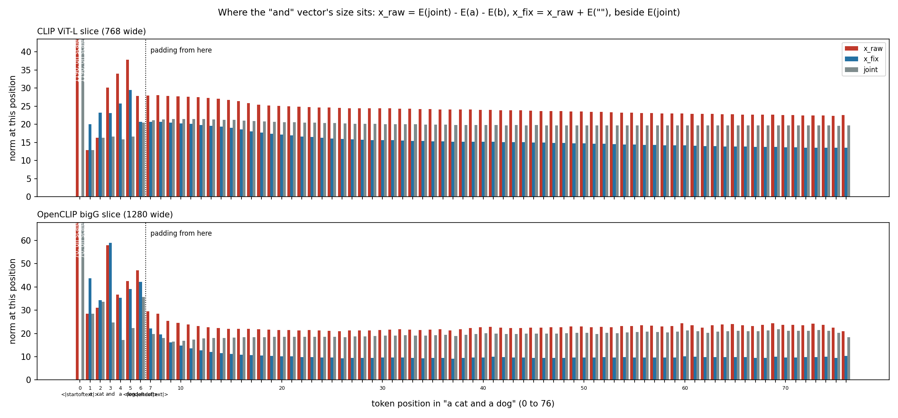
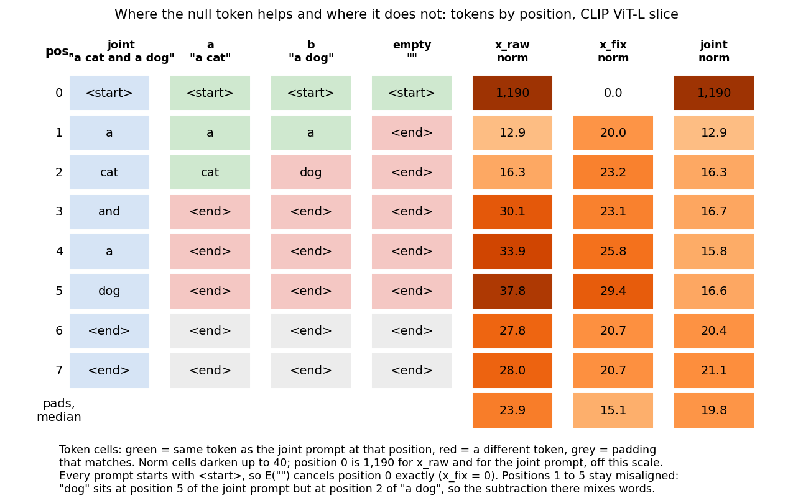
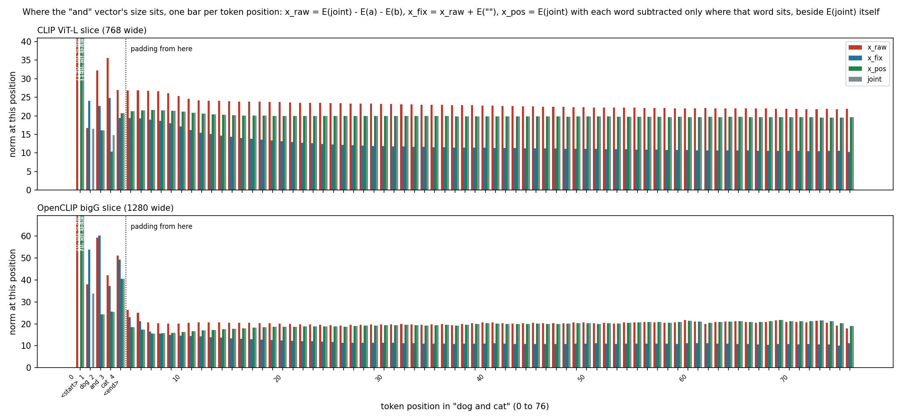
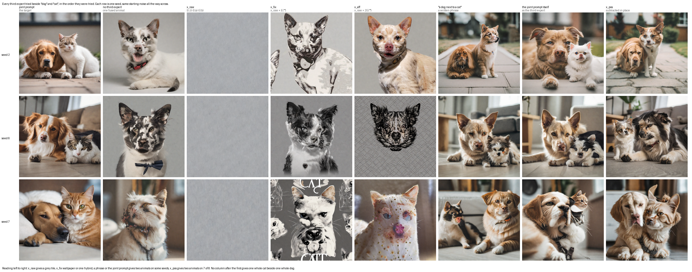
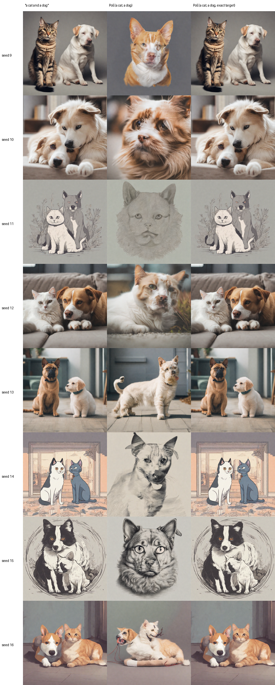

# What a missing "and" does to PoE: the sheets, in order

Product of experts (PoE) draws "a cat" and "a dog" from two separate prompts and gets one
cat-dog hybrid. The joint prompt "a cat and a dog" draws a clear cat and a clear dog on 7 of 8
held-out seeds. The question: can a third expert, added beside the two animals, supply what "and"
adds? Every sheet below tries one way of building that third expert.

**How to read a sheet.** One row per seed, every column from the same starting noise. The last
column is the third-expert version, and the column before it is plain PoE to compare against.
"Held-out" means cat × dog seeds 9 to 16, which no training ever saw.

**Share removed** is how much of the gap between the joint image's prediction and plain PoE's the
third expert closes: 1 means all of it, 0 means none. Stop rule written before training: under 10%
at every one of four checked steps means stop and report.

## 1. Inference only, nothing trained: PoE(dog, cat, x)

The third expert x is built by arithmetic or by a phrase and added at sampling time. Folder:
[1-inference-only](1-inference-only).

| Sheet | What x is | Result |
|---|---|---|
| [the arithmetic vector x](1-inference-only/1-arithmetic-vector-x.png) | x = E("dog and cat") − E("dog") − E("cat"), built so the start token cancels | 1 clear pair of 7 seeds (seed 3); pass mark was 4. The two other versions of the arithmetic got 0 each and are in the full sheet under `artifacts/results/` |
| [real phrases](1-inference-only/3-real-phrases-as-the-third-expert.png) | seven phrases, including "dog and cat" itself | best phrase: 0 clear pairs, 4 to 5 seeds of two hybrids |
| [x at rising weight](1-inference-only/4-x-at-rising-weight.png) | x scaled from 0.1 to 1 | nothing helps; high weights turn seeds into wallpaper |
| [latent steering](1-inference-only/5-latent-steering.png) | nudge the starting noise so the two experts attend to different pixels | 0 of 7 at every step size |
| [x subtracted in place](1-inference-only/8-x-pos-subtracted-in-place.png) | x_pos = the joint prompt's own sequence with each animal's word subtracted only at the position holding that word; the start token, "and", the end token and all 72 pads left as the joint prompt has them | **0 clear pairs of 7**; but two separate animals on 6 of the 7 judgeable seeds and no wallpaper on any, the best count in the table |

**Why x_raw fails, the token matrix.** Each bar is one text token position of "a cat and a dog"
(top panel one text encoder, bottom panel the other). Red is x_raw, blue is x_fix, grey is the joint
prompt. Position 0, the start-of-text token, is off the chart at a norm of 1190 against about 15
for a word, and it is the same in every prompt, so x_raw is mostly that token negated. Adding the
empty prompt E("") cancels it, which is the null-token fix, but x_fix's word positions then sit
above a real prompt's and its padding sits below. The vector no prompt would produce is what SDXL is
handed.

The same comparison as a token matrix, with each prompt's token at each position beside the norms:

**What subtracting in place does instead.** x_pos keeps the joint prompt's numbers everywhere except
the two positions holding the animals' words, so position 0, the end token and all 72 pads match the
joint prompt exactly rather than at 0.57. The green bars sit on the grey ones:

**The whole series in one picture**, every third expert in the order tried, three seeds down, the same
starting noise along each row. Left to right: a grey tile, then wallpaper or one hybrid, then two
animals on some seeds, then two animals on seven of eight. No column after the first gives one whole
cat beside one whole dog. At this size the picture shows the trajectory; identity was called from the
full-resolution tiles, not from here.

**What the series adds up to on two separate axes.** Plurality, meaning two animals rather than one
fused one, is recoverable from a fixed text-space condition and improves steadily across the series.
Identity, meaning each animal being one whole species, never moves.

| Third expert | Tiles with two separate animals, of 8 | Tiles that went to wallpaper, texture or grey | Clear pairs, of 7 |
|---|---|---|---|
| none, plain PoE | 0 | 0 | 0 |
| x_raw | 0 | 8 | 0 |
| x_fix | 1 | 3 | 1 |
| best phrase naming both animals | 5 | 0 | 0 |
| x_pos | 7 | 0 | 0 |

**Reference:** [where the joint prompt succeeds](1-inference-only/0-reference-where-the-joint-prompt-succeeds.png)
(7 of 8 seeds), so the pass marks use only those seeds.

**The written-up version of this section**, with the pass mark, the premise test and the per-seed
pixel distances, is [the finding "can a text-space third expert restore composition"](../report/can-a-text-space-third-expert-restore-composition.md).

## 2. Training: fit the third expert instead of building it

One new token `<and>` has a trainable embedding row in each of SDXL's two text encoders, started from
the word "and". Nothing else is trained. It is fitted on 182 cached examples over 48 pairs (no cat ×
dog, no held-out seed) to output the vector that makes the three-expert product equal the guided
joint. Folder: [2-training](2-training).

| Type of training | What is different | Held-out share removed at steps 0, 10, 25, 40 | Sheets |
|---|---|---|---|
| bare token, 8,000 and 32,000 updates | the third prompt is `<and>` alone | 8,000: −0.070, +0.013, −0.005, −0.008; 32,000: −0.028, +0.009, −0.044, −0.007 | [bare-token](2-training/bare-token) |
| token in the sentence, 8,000 updates | third prompt is "a cat `<and>` a dog" | −0.146, +0.004, −0.062, −0.009 | [token-in-sentence](2-training/token-in-sentence) |
| pair-written rows, 8,000 updates | a small network writes the token's rows from the two animals' prompts | −0.094, +0.019, +0.007, −0.002 | [pair-written-rows](2-training/pair-written-rows) |
| token plus LoRA, 8,000 updates | adds a rank-8 LoRA on the denoiser's cross-attention keys and values, active only for the third expert | −0.024, +0.006, +0.032, −0.025 | [token-plus-lora](2-training/token-plus-lora) |

Each folder holds the held-out cat × dog sheet at 300 and the final update, nine pair sheets
(eight training pairs and the held-out elephant × penguin) at the final update, and for the bare
token three over-time strips (300 to 8,000 updates).

**Read.** All four stop on the 10% rule, and quadrupling the bare token's updates changed nothing.
It also fails on its own training pairs (lion × meerkat, typewriter × cactus), so this is a fit
failure and not a transfer failure. Fused objects stay fused: a typewriter with cacti growing out
of it, an elephant-penguin creature, a cat-dog hybrid.

## 3. Sampler check: is it a bug?

Put the exact target into the third slot at every step and the render should be the joint image.
Mean absolute pixel difference from the joint, 0 to 255: plain PoE 34.69, exact target 2.23. The
sampler and the target formula are right, so only the fit fails.

## What it adds up to

1. **The missing piece is not a fixed vector in text space.** Arithmetic and real phrases fail, and
   the norm matrix shows why for the arithmetic.
2. **A learned token cannot fit it either.** The target contains "undo both animals", which a
   concept token cannot express, and it differs by pair and by image state.
3. **The route still open is a learned correction inside the denoiser**, the repo's existing LoRA,
   which has to be conditioned on the pair. Whether it reaches an unseen pair is the open question,
   and a modifier family such as host factor with disease is the medical version of that test.

## What these claims rest on

The held-out calls are my reads by eye from sheets at reduced size, with one held-out pair, so a
count needs a second reader's full-size calls. The share numbers come from the run logs and the pixel
differences from `oracle.log`, both on the cluster under
`/datasets/mmolefe/poe_repair_min/outputs/learned_and_token/`. The fuller inference-only write-up is
[the earlier talking points](../artifacts/notes/supervisor-meetings/2026-10-29-talking-points.md).
